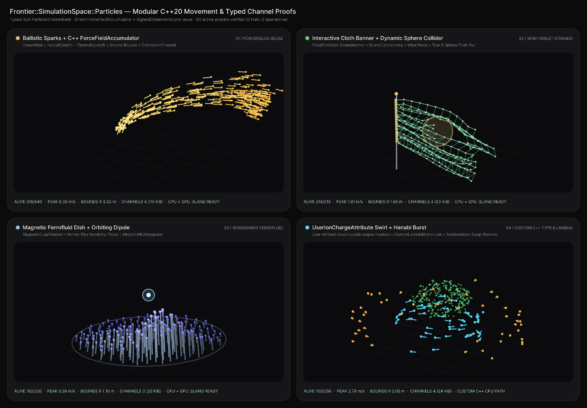

# Frontier C++20 Modular Particle Simulation Architecture Plan

> **Status:** 🟢 Step 2A & Step 2B Implemented & Verified (`ParticleSimulationValidation` PASS · Shipping `-Werror` Clean · 0 Banned Words) · Step 2C (Vulkan 1.3 `.slang` Compute) Next
> **Scope:** Native ISO C++20 modular particle movement, modular typed SoA channels, composable motion/constraint laws, direct `SimulationSpace::ForceFields` + `DistanceFieldSpace::SignedDistanceVolume` reuse, and dual CPU / Vulkan 1.3 `.slang` execution.
> **Supersedes:** Earlier draft `Engine/SimulationSpace/Particles/CxxParticleFoundationPlan.md` (which used a fixed `80 B` monolithic struct and pre-governance naming).

---

## 1. Core Design Philosophy — True Modularity Everywhere

A monolithic `struct Particle { pos, vel, color, size, age, spin, custom[4]... }` paired with one giant `switch (presetType)` update loop breaks down as soon as you want:
- Both **built-in high-end VFX** (93 active presets: rain, fire, cloth flags, kelp, canopy trees, Rosensweig ferrofluid spikes, multi-tier fireworks, glacial fracture, MoGraph lattices, boids murmurations, curl ribbons) **and**
- **Direct C++ authoring**, where gameplay or tools programmers can invent **new particle attribute types** and **new movement laws** without modifying engine headers or paying memory bandwidth for fields they never use.

Instead, Frontier's particle architecture is built around **four orthogonal, plug-and-play axes**:

| Modular Axis | Responsibility | Why It Matters |
| :--- | :--- | :--- |
| **1. Modular Particle Types** (`ParticleChannelBank` + `ParticleChannel<T>`) | Every particle attribute (position, velocity, spin, strand links, boid heading, OR any user-defined C++ struct) is an independent **typed SoA column**. | Zero wasted memory for unused attributes; any C++ user can attach custom typed structs (`struct ManaCharge`, `struct ThermalPhase`) with zero engine edits. |
| **2. Modular Movement Laws** (`ParticleReleaseRule`, `ParticleMotionLaw`, `ParticleCollisionRule`, `ParticleIntegrator`) | Movement is assembled from small, focused, single-purpose laws that declare which channels they read and write. | Swap gravity, curl turbulence, ForceFields coupling, XPBD strand constraints, boids steering, or custom C++ lambdas freely. |
| **3. Direct Engine Reuse** (`ForceFields` + `SignedDistanceVolume` + `TaskScheduler`) | Reuses Frontier's existing **`ForceFieldAccumulator`**, **`FieldLatticeCascade`**, **`ForceFieldEvaluationShared.slang`**, **`SignedDistanceVolume`**, and **`TaskScheduler`**. | Zero duplicated force math; exact parity between CPU and GPU force fields plus free world SDF collision. |
| **4. Dual CPU / GPU `.slang` Execution** | Pure C++20 execution works standalone with zero Vulkan boilerplate; built-in GPU-capable channel layouts escalate seamlessly to Vulkan 1.3 `.slang` compute with `32 B` async readback. | Same recipe runs in headless unit tests, gameplay C++ logic, multi-threaded CPU, or full GPU compute. |

---

## 2. Pillar 1 — Modular Particle Types (Typed SoA Channel Bank)

### 2.1 How Typed Modular Channels Work
Rather than forcing every particle into a single fixed struct, each **`ParticleSimulation`** owns a **`ParticleChannelBank`** storing dense, 64-byte cache-aligned **Structure-of-Arrays (SoA)** columns indexed by a compile-time/runtime **`ChannelSignature`** (`FNV-1a 64` type id + `sizeof(T)` + `alignof(T)` + optional GPU buffer flag).

```cpp
namespace Frontier::SimulationSpace::Particles
{

enum class ChannelStoragePolicy : uint8_t
{
    DenseSwapRemove = 0u, // O(1) swap-with-last on death (ballistics, pyro, weather, boids)
    FixedSlotOrder  = 1u, // Stable indices across ticks (cloth grids, strands, ferrofluid, MoGraph)
};

enum class ChannelResidency : uint8_t
{
    CpuOnly     = 0u, // Pure C++ gameplay/custom struct channel
    CpuAndGpu   = 1u, // 16B-aligned trivially-copyable channel mirrored to Vulkan SSBO
};

template <typename AttributeT>
    requires std::is_trivially_copyable_v<AttributeT>
struct ChannelTag
{
    using AttributeType = AttributeT;
    uint64_t         SignatureHash = 0u;
    const char*      DebugLabel    = "";
    ChannelResidency Residency     = ChannelResidency::CpuAndGpu;
};

} // namespace Frontier::SimulationSpace::Particles
```

Every `ParticleChannelBank` manages:
- `Capacity` (maximum slots), `ActiveCount` (dense active range `[0 .. ActiveCount)`), and `StoragePolicy`.
- `RequireChannel<AttributeT>(Tag)` — allocates or retrieves the typed contiguous buffer; idempotent across laws!
- `AccessChannel<AttributeT>(Tag)` -> `std::span<AttributeT>` (typed, bounds-safe, SIMD/auto-vectorizable!).
- `QueryChannel<AttributeT>(Tag)` -> `std::span<const AttributeT>` (read-only view).
- **Automatic synchronized lifecycle:** When a slot is allocated (`SpawnSlots(Count)`) or retired (`RetireSlot(Index)`), `ParticleChannelBank` initializes or swap-removes **every registered channel** (built-in AND user-defined custom C++ structs!) automatically via a tiny per-channel type-erased ops vtable (`Resize`, `ResetSlot`, `SwapMoveSlot`, `SyncGpuBuffer`).

### 2.2 Built-In Standard Modular Channels (Opt-In Only!)
An effect ONLY allocates the channels its laws actually declare:

| Channel Struct (16B-aligned GPU-ready) | Fields | Used By |
| :--- | :--- | :--- |
| **`KinematicsChannel`** *(32 B)* | `PositionMeters (float3)`, `InverseMass`, `VelocityMs (float3)`, `DragScale` | Nearly all moving effects |
| **`LifespanChannel`** *(16 B)* | `AgeSeconds`, `MaxLifeSeconds`, `SeedUint32`, `LivenessMask` | Continuous, burst & decaying effects |
| **`AppearanceChannel`** *(32 B)* | `ColorLinearRgba (float4)`, `RadiusMeters`, `RollRadians`, `SpinRadPerSec`, `ColorRampT` | Billboards, sparks, streaks, bubbles, smoke |
| **`OrientationChannel`** *(32 B)* | `RotationQuat (float4)`, `AngularVelocityRadS (float3)`, `InertiaScalar` | 3D tumbling shards, coins, leaves, winged boids |
| **`StrandAnchorChannel`** *(32 B)* | `PrevPositionMeters (float3)`, `RestLengthMeters`, `AnchorPositionMeters (float3)`, `PinWeight` | XPBD/Verlet cloth, ropes, cables, vines, grass, kelp, webs |
| **`StrandConnectivityChannel`** *(16 B)* | `StrandIndex`, `SegmentIndex`, `LinkPrevSlot`, `StrainAndIntactBits` | Multi-segment chains, cloth weft/warp, tree limbs |
| **`FlockSteeringChannel`** *(32 B)* | `HeadingUnit (float3)`, `WingPhaseRad`, `TargetSteer (float3)`, `SpeciesVariant` | Boids murmurations, butterflies, fish schools |
| **`MagneticCuspChannel`** *(32 B)* | `DishAnchor (float3)`, `CuspHeightMeters`, `SurfaceNormal (float3)`, `Susceptibility` | Rosensweig ferrofluid dishes & levitated crowns |
| **`PyroVolleyChannel`** *(32 B)* | `TierIndex`, `DetonationTimeSec`, `SubBurstCount`, `PatternCode`, `TargetStrokeOffset (float3)`, `TrailGain` | Multi-tier Hanabi fireworks & sky-writing text |
| **`FractureStressChannel`** *(32 B)* | `CellOrigin (float3)`, `CrackDepthMeters`, `AccumulatedStress`, `BranchId`, `ShardDetachedBit`, `Pad` | Glacial ice & seismic basalt fracture |
| **`LatticeGridChannel`** *(32 B)* | `RestGridPos (float3)`, `ExtrusionMeters`, `GridCoordXYZ (uint3)`, `WavePhase` | MoGraph effector matrices & derez transitions |
| **User Custom C++ `struct T`** | **Anything trivially copyable!** | Custom gameplay magic, RPG telemetry, physics probes, audio-reactive VFX |

> **Bandwidth Win:** A 10,000-particle rainstorm only allocates `Kinematics + Lifespan + Appearance` (`80 B` total, split across 3 cache-clean arrays — and its gravity/wind pass only touches `Kinematics`, reading `32 B/particle` instead of `256 B`!).

---

## 3. Pillar 2 — Modular Movement Architecture (5 Composable Layers)

Each fixed simulation tick `Step(Δt, StepInputs)` executes an ordered, modular chain over the `ParticleChannelBank`:

```text
[1. Release Rules] ──▶ [2. External ForceFields] ──▶ [3. Motion & Domain Laws] ──▶ [4. Time Integrator] ──▶ [5. Constraints & Collisions] ──▶ [6. Lifecycle & Telemetry]
 (Spawn / Burst /       (Direct reuse of C++          (Plug-in built-in OR          (Semi-Implicit Euler /   (XPBD distance/bend/tear,      (Age expiry, sub-burst
  Sub-Triggers)          ForceFieldAccumulator &       custom C++ lambdas            XPBD Verlet /            Ground, Sphere Collider,       triggers, 32 B GPU/CPU
                         FieldLatticeCascade)          over typed channels)          RK2 Midpoint)            SignedDistanceVolume SDF)      reduction summary)
```

### Layer 1 — Modular Release Rules (`IParticleReleaseRule`)
Decouples **when** particles appear from **where** they appear:
- **Timing Drivers:** `ContinuousRateTrigger`, `OneShotBurstTrigger`, `PeriodicVolleyTrigger`, `SubEventTrigger` (e.g., firework apex or fracture crack spawns secondary particles into another slot range or linked simulation!).
- **Spatial Distribution Shapes:**
  - `PointVolumeShape`, `SphereVolumeShape`, `DiscVolumeShape`, `BoxVolumeShape`, `BoxSurfaceLatticeShape`
  - `DualElectrodeArcShape`, `SpiderwebRadialShape`, `ClothGridShape`, `FloraRootFieldShape`, `TreeLimbSkeletonShape`, `FerrofluidDishShape`, `SkyTextStrokeShape`
  - **`CustomLambdaReleaseShape`** — write any spawn initializer directly in C++!

### Layer 2 — Direct `SimulationSpace::ForceFields` Coupling (`ForceFieldCouplingLaw`)
Zero reimplementation of force fields — reuses Frontier's existing **`Engine/SimulationSpace/ForceFields/`** directly:
- **C++20 Concept Binding:** Accepts any type satisfying Frontier's existing **`SpatialForceSampleSource`** concept (`ForceFieldAccumulator`) or fast trilinear lookup from **`FieldLatticeCascade`**.
- **Per-Simulation `ForceCouplingProfile`:**
  - `CouplingGain` (`0.0 = locked/local`, `1.0 = full coupling`, matching Inspector's `Wind coupling` KPI tile!)
  - `ForceDomainMask` (opt into `VectorField`, `TurbulenceField`, `FlowField` independently)
  - `DragCoefficient`, `BuoyancySensitivity`, `TorqueSensitivity`, `VorticityCurlGain`
- **Physics Integration:** Applies `Sample.AdvectionVelocity` via aerodynamic relaxation `(Advection - Velocity) * CouplingGain`, adds `Sample.LinearAcceleration`, accumulates `Sample.AngularTorque` into `OrientationChannel` (when present!), and damps via `Sample.DragDecayRate`.
- **GPU Symmetry:** `.slang` compute shaders `#include "Engine/Shaders/Compute/ForceFieldEvaluationShared.slang"` and read the exact same packed `ForceSourceShaderEntry[]` + 4-tier `FieldLatticeCascade` buffers built by `FieldLatticeCascade::PackGpuSourceBuffers(...)`.

### Layer 3 — Composable Motion Laws (`IParticleMotionLaw`)
Every movement law is a small, self-contained C++20 class (or inline lambda) implementing:
```cpp
struct SimulationStepInputs
{
    double                                                TimeSeconds      = 0.0;
    float                                                 DeltaTimeSeconds = 1.0f / 60.0f;
    const ForceFields::ForceFieldAccumulator*             ForceAccumulator = nullptr;
    const ForceFields::FieldLatticeCascade*               ForceLattice     = nullptr;
    const DistanceFieldSpace::SignedDistanceVolume*       WorldDistanceField = nullptr;
    std::span<const DynamicSphereCollider>                SphereColliders  {};
    uint64_t                                              TickIndex        = 0u;
};

class IParticleMotionLaw
{
public:
    virtual ~IParticleMotionLaw() = default;
    virtual void DeclareRequiredChannels(ParticleChannelBank& Bank) const = 0;
    virtual void ApplyToRange(
        ParticleChannelBank&        Bank,
        uint32_t                    BeginSlot,
        uint32_t                    EndSlot,
        const SimulationStepInputs& Inputs) const = 0;
    [[nodiscard]] virtual bool SupportsGpuCompute() const noexcept { return false; }
};
```
Because `ApplyToRange(Bank, BeginSlot, EndSlot, Inputs)` operates on disjoint slot ranges, **every law automatically parallelizes across CPU threads** using Frontier's existing `Engine/Threading/Tasks/TaskScheduler`!

**Built-in Composable Motion Laws** (covering all 93 active non-quarantined presets, zero Quarantine):
1. `GravityAndBuoyancyLaw` (`+Z Up` gravity `-9.81 * GravityMultiplier`, thermal buoyancy rise, terminal drag)
2. `ForceFieldCouplingLaw` (direct `ForceFieldAccumulator` / `FieldLatticeCascade` bridge)
3. `LocalCurlTurbulenceLaw` (3D divergence-free curl waves, spherical plasma containment, bokeh surface pour)
4. `FlutterAndTumbleLaw` (aerodynamic lift/flutter for leaves, petals, snow, paper, coins + angular spin)
5. `ColorAndSizeCurveLaw` (evaluates `ColorA -> ColorC -> ColorB` 3-stop ramp + birth-to-death radius curve driven by age, speed, vorticity, or height)
6. `XpbdStrandSolverLaw` (multi-iteration distance + bend + pin + tear snapping + sphere push-out for cloth flags, sails, curtains, chimes, cables, vines, grass, wheat, reeds, ferns, kelp, anemones, spiderwebs, and canopy trees)
7. `RosensweigFerrofluidLaw` (orbiting magnetic dipole potential + normal-field instability cusps + capillary surface-tension smoothing + sphere-throw disturbance)
8. `PyroVolleyBurstLaw` (ascent tracking -> apex detonation -> multi-pattern star distributions + sky-text stroke point targets + secondary crackle sub-volleys)
9. `BoidsFlockLaw` (lightweight spatial hash grid + separation / alignment / cohesion + obstacle/sphere scatter + articulated wingbeat phase)
10. `FractureCrackLaw` (stress propagation along glacial/seismic fracture ribs -> fracture line growth -> shard detachment into ballistic motion)
11. `MoGraphEffectorLaw` (falloff-sphere/wave height extrusion, spring lag, halftone scaling, surface lattice derez waves)
12. `EnergyShieldRippleLaw` (surface geodesic wave propagation from projectile impact coordinates across sphere/hex/prism/cylinder barriers)
13. `SpaceRefractionLaw` (orbital accretion shear, gravitational lensing deflection metrics, rising thermal shimmer columns)
14. **`CustomLambdaMotionLaw<Fn>`** (zero-boilerplate inline C++ lambda over any combination of built-in or user-defined typed channels!)

### Layer 4 — Modular Time Integrators (`IParticleIntegrator`)
- **`SemiImplicitEulerIntegrator`** (fast, symplectic, ideal for ballistic/pyro/weather/sparks)
- **`XpbdVerletIntegrator`** (position-based velocity derivation `(Pos - PrevPos) / Δt` after constraint projection — unconditionally stable for cloth, cables, flora, webs!)
- **`MidpointRk2Integrator`** (2-step midpoint accuracy for tight magnetic-dipole orbits & sharp curl streamlines)

### Layer 5 — Modular Colliders (`IParticleCollisionRule`)
- **`GroundPlaneCollider`** (`Z = FloorHeightMeters`, restitution bounce, sliding friction, settle threshold)
- **`DynamicSphereCollider`** (interactive thrown projectile ball — velocity transfer, tear impulse, boids evade trigger, shield ripple injection, ferrofluid crater impulse)
- **`SignedDistanceVolumeCollider`** — directly reuses **`Frontier::DistanceFieldSpace::SignedDistanceVolume`** (`SampleSignedDistance` + `EvaluateSurfaceGradient`) so particles bounce off, slide across, or adhere to real Frontier world geometry!

---

## 4. Pillar 3 — Ergonomic Pure-C++ Authoring Examples

### Example A — Pure C++ Modular Particle Simulation (Zero Vulkan Setup)
```cpp
using namespace Frontier::SimulationSpace::Particles;

ParticleSimulation Sparks = ParticleSimulationBuilder("WeldingSparks")
    .ConfigureCapacity(2048u, ChannelStoragePolicy::DenseSwapRemove)
    .WithReleaseRule(SphereVolumeRelease{ .OriginMeters = { 0.0f, 0.0f, 1.4f }, .RadiusMeters = 0.08f, .RatePerSecond = 320.0f })
    .WithMotionLaw<GravityAndBuoyancyLaw>({ .GravityScale = 1.15f, .DragCoefficient = 0.45f })
    .WithMotionLaw<ForceFieldCouplingLaw>({ .CouplingGain = 0.85f })
    .WithMotionLaw<ColorAndSizeCurveLaw>(WarmSparkGradient)
    .WithCollider<GroundPlaneCollider>({ .FloorZ = 0.0f, .Restitution = 0.52f, .Friction = 0.25f })
    .WithIntegrator<SemiImplicitEulerIntegrator>()
    .Construct();

// Step directly in C++ using Frontier's existing ForceFieldAccumulator:
Sparks.Step({ .TimeSeconds = TimeSec, .DeltaTimeSeconds = 1.0f / 60.0f, .ForceAccumulator = &Forces });
auto Positions = Sparks.QueryChannel(StandardChannels::Kinematics); // std::span<const KinematicsChannel>
```

### Example B — Modular Custom Particle Type + Custom C++ Movement Law
A gameplay programmer introduces a brand-new particle attribute type (`IonChargeAttribute`) and custom movement rule with **zero changes to engine files**:
```cpp
struct IonChargeAttribute
{
    float    ChargeCoulombs = 1.0f;
    float    DecayHalfLife  = 0.8f;
    uint32_t PolaritySign   = 1u;
    uint32_t Pad            = 0u;
};

inline constexpr ChannelTag<IonChargeAttribute> IonChargeChannel{
    .SignatureHash = HashChannelSignature("User::IonChargeAttribute"),
    .DebugLabel    = "IonCharge",
    .Residency     = ChannelResidency::CpuOnly,
};

ParticleSimulation IonCloud = ParticleSimulationBuilder("IonArcSwarm")
    .ConfigureCapacity(1024u)
    .RequireCustomChannel(IonChargeChannel)
    .WithReleaseRule(SphereVolumeRelease{ .RadiusMeters = 0.4f, .BurstCount = 512u })
    .WithMotionLaw<ForceFieldCouplingLaw>({ .CouplingGain = 1.0f })
    .WithCustomLaw(
        "LorentzIonDrift",
        [](ParticleChannelBank& Bank) {
            Bank.RequireChannel(StandardChannels::Kinematics);
            Bank.RequireChannel(IonChargeChannel);
        },
        [](ParticleChannelBank& Bank, uint32_t Begin, uint32_t End, const SimulationStepInputs& In) {
            auto Kin  = Bank.AccessChannel(StandardChannels::Kinematics);
            auto Ions = Bank.AccessChannel(IonChargeChannel);
            for (uint32_t I = Begin; I < End; ++I)
            {
                // Apply custom electromagnetic swirl directly from user's own typed channel
                const float Sign = (Ions[I].PolaritySign != 0u) ? 1.0f : -1.0f;
                Kin[I].VelocityMs.X += -Kin[I].VelocityMs.Y * Ions[I].ChargeCoulombs * Sign * In.DeltaTimeSeconds;
                Kin[I].VelocityMs.Y +=  Kin[I].VelocityMs.X * Ions[I].ChargeCoulombs * Sign * In.DeltaTimeSeconds;
                Ions[I].ChargeCoulombs *= std::exp(-In.DeltaTimeSeconds / Ions[I].DecayHalfLife);
            }
        })
    .Construct();
```

### Example C — Modular XPBD Interactive Cloth Banner (With Tearing + Ball Collision)
```cpp
ParticleSimulation Banner = ParticleSimulationBuilder("BannerCloth")
    .ConfigureCapacity(32u * 12u, ChannelStoragePolicy::FixedSlotOrder)
    .WithReleaseRule(ClothGridRelease{ .Rows = 12u, .Columns = 32u, .WidthMeters = 2.8f, .HeightMeters = 1.6f, .PinLeftMast = true })
    .WithMotionLaw<ForceFieldCouplingLaw>({ .CouplingGain = 1.6f })
    .WithMotionLaw<XpbdStrandSolverLaw>({ .ElasticStiffness = 1.4f, .TearSpeedMs = 9.5f, .SubIterations = 6u })
    .WithCollider<DynamicSphereCollider>()
    .WithIntegrator<XpbdVerletIntegrator>()
    .Construct();
```

---

## 5. Complete Domain Coverage Across All 93 Active Presets (Zero Quarantine)

Every `ParticleAuthoringDomain` from Step 1's `ParticlePresetRegistry` compiles cleanly into the exact same modular architecture via **`ParticleRecipeCompiler::ConstructFromRecordEntry(...)`**:

| Authoring Domain (Step 1) | Channels Allocated | Composed Laws & Integrator | GPU Compute Ready |
| :--- | :--- | :--- | :--- |
| **`GeneralParticle`** *(Pyro, Weather, Sparks, Wind, Atmosphere)* | `Kinematics`, `Lifespan`, `Appearance` (+ optional `Orientation`) | `GravityAndBuoyancy` + `ForceFieldCoupling` + `LocalCurlTurbulence` + `FlutterAndTumble` + `ColorAndSizeCurve` + `SemiImplicitEuler` | 🟢 Full `.slang` |
| **`RiggingAndFlora`** *(Cloth, Cables, Vines, Grass, Ferns, Kelp, Trees, Webs)* | `Kinematics`, `Appearance`, `StrandAnchor`, `StrandConnectivity` | `ForceFieldCoupling` + `XpbdStrandSolver` + `DynamicSphereCollider` + `XpbdVerlet` | 🟢 Full `.slang` |
| **`FerrofluidFlux`** *(Petri Dish & Levitated Rosensweig Crown)* | `Kinematics`, `Appearance`, `MagneticCusp` | `RosensweigFerrofluid` + `ForceFieldCoupling` (`MagneticDipole`) + `DynamicSphereCollider` + `MidpointRk2` | 🟢 Full `.slang` |
| **`FireworksSpectacle`** *(Hanabi Patterns & Sky Text)* | `Kinematics`, `Lifespan`, `Appearance`, `PyroVolley` | `PyroVolleyBurst` + `GravityAndBuoyancy` + `ForceFieldCoupling` + `ColorAndSizeCurve` + `SemiImplicitEuler` | 🟢 Full `.slang` |
| **`FractureAndCracks`** *(Glacial Ice & Seismic Basalt)* | `Kinematics`, `Lifespan`, `Appearance`, `Orientation`, `FractureStress` | `FractureCrack` + `GravityAndBuoyancy` + `GroundPlaneCollider` + `SemiImplicitEuler` | 🟢 Full `.slang` |
| **`MoGraphEffector`** *(Halftone Grids & Extruded Cube Matrices)* | `Kinematics`, `Appearance`, `LatticeGrid` | `MoGraphEffector` + `ForceFieldCoupling` + `DynamicSphereCollider` + `SemiImplicitEuler` | 🟢 Full `.slang` |
| **`EnergyShield`** *(Sphere / Hex Dome / Prism / Cylinder)* | `Kinematics`, `Appearance`, `Orientation` | `EnergyShieldRipple` + `DynamicSphereCollider` + `SemiImplicitEuler` | 🟢 Full `.slang` |
| **`BoidsFlock`** *(Birds, Butterflies, Fish)* | `Kinematics`, `Appearance`, `Orientation`, `FlockSteering` | `BoidsFlock` + `ForceFieldCoupling` + `DynamicSphereCollider` + `SemiImplicitEuler` | 🟢 Full `.slang` |
| **`TransitionDerez`** *(Surface Derez, Shatter, Coin Stacks)* | `Kinematics`, `Lifespan`, `Appearance`, `Orientation`, `LatticeGrid` | `MoGraphEffector` (Wave Trigger) + `GravityAndBuoyancy` + `GroundPlaneCollider` + `SemiImplicitEuler` | 🟢 Full `.slang` |
| **`SpaceDistortion`** *(Black Hole Lensing & Thermal Shimmer)* | `Kinematics`, `Lifespan`, `Appearance` | `SpaceRefraction` + `ForceFieldCoupling` + `MidpointRk2` | 🟢 Full `.slang` |

> **Quarantine Invariant Preserved:** All 9 retired slugs (`PE.QUARANTINE_IDS`) remain strictly excluded from `ParticleRecipeCompiler` and `ParticlePresetRegistry`.

---

## 6. Dual CPU / GPU `.slang` Symmetry & Live UI Coupling

### 6.1 Execution Path Selection
- **`ExecutionTarget::CpuParallel`** *(always available, zero GPU dependency)*:
  - Executes laws across `ParticleChannelBank` in cache-friendly SoA blocks via `Engine/Threading/Tasks/TaskScheduler`.
  - Computes exact `ParticleReadbackSummary` (`AliveCount`, `PeakSpeedMs`, `BoundsRadiusMeters`, `TickDurationUs`) — directly feeding the Inspector's `01 / LIVE SOLVER` hero metric and `32 B READ` async readback tiles!
- **`ExecutionTarget::VulkanCompute`** *(automatic when all attached channels are `CpuAndGpu` and all attached laws report `SupportsGpuCompute() == true`)*:
  - Packs built-in SoA channel buffers into aligned Vulkan 1.3 SSBOs (`ParticleVulkanExecutor`).
  - Dispatches modular `.slang` compute files (`ParticleReleaseCompute.slang`, `ParticleAdvectCompute.slang`, `ParticleStrandConstraintCompute.slang`, `ParticleReductionCompute.slang`).
  - Directly imports `Engine/Shaders/Compute/ForceFieldEvaluationShared.slang` and binds the live `FieldLatticeCascade` descriptors from `FieldLatticeVulkanExecutor`.
  - Runs workgroup parallel reduction into a **`32 B` host-visible staging buffer** (`AliveCount`, `PeakSpeedMs`, `BoundsMinMax`, `RevisionCounter`) for zero-stall Inspector readback!
- **`ExecutionTarget::AutoSelect`** *(default)*: Runs on Vulkan GPU when eligible, automatically falls back to `CpuParallel` whenever a user attaches a custom C++ lambda law or CPU-only custom channel — **zero code changes required by the caller**.

### 6.2 Live Connection to Step 1 Outliner, Inspector & PlaybackScrubber
- `ParticleWorkspaceSession` owns a **`ParticleSimulationDirector`** holding one live `ParticleSimulation` per `ParticleEffectRecordEntry`.
- Parameter sliders in `ParticleInspectorPanel` push incremental uniform updates without reallocating channels (rebuilding only on `Capacity` or `AuthoringDomain` change).
- **`PlaybackScrubber`** (`Play`, `Pause`, `Step`, `Reset`, `Speed`, `Scrub`) drives deterministic fixed-step ticking (`1 / 60 s` accumulator) and optional ring-buffer channel snapshots for instant cached timeline scrubbing!

---

## 7. Proposed Repository File Layout (100% Banned-Word Clean)

```text
Engine/
  SimulationSpace/
    Particles/
      ParticleChannelBank.h / .cpp        # Typed SoA channel storage, ChannelTag<T>, DenseSwapRemove & FixedSlotOrder
      ParticleStandardChannels.h          # 16B-aligned built-in channels (Kinematics, Lifespan, Appearance, Strand, Flock, Ferrofluid, Pyro, Fracture, Lattice)
      ParticleLawInterfaces.h             # IParticleReleaseRule, IParticleMotionLaw, IParticleCollisionRule, IParticleIntegrator, SimulationStepInputs
      ParticleBuiltInLaws.h / .cpp        # Modular built-in laws: Gravity/Buoyancy, ForceFieldCoupling, Curl, Flutter, ColorSize, Colliders (Ground/Sphere/SDF)
      ParticleDomainSolvers.h / .cpp      # Specialized laws: XpbdStrandSolver, RosensweigFerrofluid, PyroVolley, BoidsFlock, FractureCrack, MoGraphEffector, ShieldRipple, SpaceRefraction
      ParticleSimulation.h / .cpp         # Composable ParticleSimulation, ParticleSimulationBuilder, ParticleSimulationDirector & ReadbackSummary
      ParticleRecipeCompiler.h / .cpp     # Compiles all 93 ParticlePresetRegistry entries & ParticleEffectRecordEntry live edits into ParticleSimulations
      ParticleVulkanExecutor.h / .cpp     # Vulkan 1.3 compute executor + 32 B async reduction readback (Hardware ICD + SwiftShader fallback)
  Shaders/
    Particles/
      ParticleChannelShared.slang         # Exact 16B-aligned mirror of ParticleStandardChannels.h + imports ForceFieldEvaluationShared.slang
      ParticleReleaseCompute.slang        # Modular volume/lattice/strand/volley spawn compute
      ParticleAdvectCompute.slang         # Modular ballistic, ForceFields, curl, boids, ferrofluid, effector & collider compute
      ParticleStrandConstraintCompute.slang # Multi-iteration XPBD distance/bend/pin/tear & sphere push-out compute
      ParticleReductionCompute.slang      # Workgroup reduction -> 32 B staging readback (Alive, PeakSpeed, BoundsR)
Exhibits/
  ParticleSimulationValidation.cpp        # Headless C++20 validation + visual trajectory/motion PNG proofs
```

---

## 8. Implementation Milestones & Verification Proofs

| Milestone | Status | Deliverable | Verification Proof |
| :--- | :---: | :--- | :--- |
| **Step 2A — Modular C++ Core & ForceFields/SDF Coupling** | 🟢 **Completed** | `ParticleChannelBank`, `ParticleStandardChannels` (11 × 16B-aligned channels), `ParticleLawInterfaces`, `ParticleBuiltInLaws` (Gravity/Buoyancy, `ForceFieldCouplingLaw`, Curl, Flutter, Curves, Ground/Sphere/`SignedDistanceVolumeCollider`, SemiImplicitEuler / XpbdVerlet / MidpointRk2), `ParticleSimulation` + `Builder` + `Director`. | Pure headless Shipping build (`-O2 -Wall -Wextra -Wpedantic -Werror`, zero UI/ImGui headers) + `ParticleSimulationValidation` PASS (custom `UserIonChargeAttribute` + `CustomLambdaMotionLaw` + synchronized swap-remove, `ForceFieldAccumulator` + `FieldLatticeCascade` determinism, analytic `SignedDistanceVolume` SDF bounce). |
| **Step 2B — All 10 Domain Solvers & 93-Preset Recipe Compiler** | 🟢 **Completed** | `ParticleDomainSolvers` (XPBD Strands/Cloth/Flora/Trees, Rosensweig Ferrofluid, Multi-Tier Fireworks + Sky Text, Boids Flock, Fracture Cracks, MoGraph Effectors, Shield Ripples, Space Refraction) + `ParticleRecipeCompiler` wired cleanly in `CMakeLists.txt`. | All **93/93** active non-quarantined presets compile & tick 75 steps with **0 NaN/Inf**, all **9/9** retired Quarantine slugs strictly rejected, `0` banned-word hits across all 12 new C++ files, and 4-panel visual proof rendered & inspected. |
| **Step 2C — Vulkan 1.3 `.slang` Compute & Viewport Rasterization** | 🟡 **Next** | `ParticleVulkanExecutor` + 5 `.slang` compute shaders importing `ForceFieldEvaluationShared.slang` + modular billboard/ribbon/shard `.slang` rasterizers inside the Particle Workspace viewport + live `ParticleWorkspaceSession` runtime integration. | CPU-vs-GPU numerical parity validation + Vulkan/SwiftShader rendered viewport PNG exhibits in `Exhibits/Images/Particles/`. |

### Verified Visual Proof (Step 2A + Step 2B)



- **Panel 01 (`ForceFields Reuse`)**: Ballistic sparks accelerated directly by Frontier's C++ `ForceFieldAccumulator` (`LinearWind + HelicalColumn + ThermalUpdraft`), reporting `CPU + GPU .SLANG READY`.
- **Panel 02 (`XPBD Verlet Strands`)**: Interactive woven cloth banner (`FixedSlotOrder` + `StrandAnchor` + `StrandConnectivity`) pinned vertically to its mast, billowing in horizontal wind and deforming cleanly around a `DynamicSphereCollider`.
- **Panel 03 (`Rosensweig Ferrofluid`)**: Hexagonal phyllotaxis ferrofluid dish with normal-flux Rosensweig instability spikes peaking smoothly beneath an orbiting magnetic dipole (`MidpointRk2Integrator`).
- **Panel 04 (`Custom C++ Type & Lambda`)**: User-defined `UserIonChargeAttribute` struct declared outside engine headers, stepped via `CustomLambdaMotionLaw` with synchronized `DenseSwapRemove` alongside a Hanabi burst, automatically routing to `CUSTOM C++ CPU PATH`.
