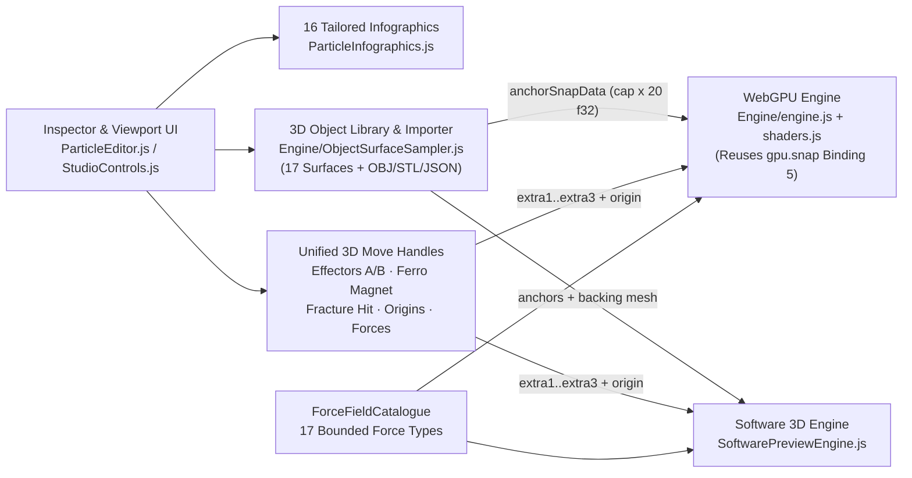

# Particle Studio Audit, Any-Object 3D Expansion, Movable Controls & Inspector Infographic Report

> **Target:** `Experimental/ParticleEditor Final/` (EOS WebGPU + Software 3D Dual-Engine Particle Studio)  
> **Branch:** `arena/4bfeedb2-frontier`  
> **Date:** 2026-11-14  
> **Verification Status:** PASS (0 JS syntax errors, 0 WGSL compiler errors across 6 shaders, 65/65 Force Field checks, 101/101 presets simulated & rendered with 0 NaNs, 17/17 3D surface objects + OBJ/STL/JSON import verified, 101/101 Inspector infographics + 17/17 Force Field infographics verified).

---

## 1. Executive Summary

A full-codebase audit of `Experimental/ParticleEditor Final/` inspected all 100 baseline presets (expanded to **101** with `effector-object-placer`), all 6 WGSL shader modules, both simulation engines (`Engine/engine.js` WebGPU and `SoftwarePreviewEngine.js` CPU/Canvas2D), all 17 Force Field types, and every Inspector section across `ParticleEditor.js`, `StudioControls.js`, `index.html`, and `ParticleEditor.css`.

Four deliverables were completed and verified end to end:

1. **Defect & Engine Parity Sweep (24 Fixes):** Resolved 6 fatal WGSL `let`-reassignment errors that failed strict WebGPU compilation in Chromium/Dawn, fixed `SoftwarePreviewEngine` uniform buffer truncation (`64 -> 88` floats), aligned CPU/GPU readback stride (`20` floats per particle), repaired broken Inspector widgets (`headStyle`, `boxHalf`, `ferroSpikes`, `AddDynSection`, `explosion` one-shot pre-seed), fixed Bug #20 (`EvalFerroMagnetCPU` swapped parameters), added missing `Motion & Grids` filter & `101` preset total, and hardened `EncodeEffect` against undefined fields.
2. **Any-Object 3D Placement & Custom Mesh Support (`Engine/ObjectSurfaceSampler.js`):** Expanded MoGraph & Effector systems from 6 hardcoded primitives (`gridSurface 0..5`) to **17 surfaces** — 10 new built-in procedural 3D meshes (`Sculpted Hand`, `Humanoid Bust`, `Classic Teapot`, `Faceted Crystal`, `Ringed Planet`, `Heart Sculpture`, `DNA Double Helix`, `3D Five-Point Star`, `Archimedean Spiral`, `Mobius Strip`) plus **Custom 3D Mesh Upload** (`.obj`, binary/ASCII `.stl`, `.json`, `.facet`) via Inspector button or direct viewport drag-and-drop, complete with area-weighted Surface/Volume/Crease sampling, 3-axis Euler rotation (`objRot`), 4 backing styles (`Obsidian`, `Chrome`, `Ghost Wireframe`, `Hidden`), and zero-extra-binding WebGPU `snap` buffer upload.
3. **Unified 3D Movable Handles & Interactive Gizmos (`Move Handles · G`):** Upgraded Effector A/B to true 3D wireframes (`Sphere`, `Box`, `Cylinder`, `Plane`, `Torus`) with ground drop-lines and draggable handles, plus unified interactive 3D gizmos for **Ferrofluid Neodymium Magnets** (auto-switching to free-drag mode on grab), **Fracture Epicenters**, **Force Field Sources**, and **Selected Effect Origins / Placed 3D Objects** (XZ plane drag + `Shift` for vertical Y altitude).
4. **Tailored Inspector Infographics (`ParticleInfographics.js`):** Replaced every generic `C.TimeSeries` line chart and `C.CurvePlot` radial graph in the first Overview card and Forces tab with **16 effect-specific live visual infographics** (including direct drag/click manipulation for MoGraph Effectors A/B, Ferrofluid Magnet position, Fracture epicenter, Force Field reach/swirl radar, and Wind Rose compass) without altering existing inspector panel width, layout proportions, or styling.

---

## 2. System Architecture Overview

---

## 3. Complete Defect & Parity Fix Register (24 Fixes)

| # | Severity | File | Issue Found | Fix Applied |
|---|---|---|---|---|
| 1 | Critical | `Engine/shaders.js` | `let wA = ...; wA = ...` (lines 727-729) rejected by WebGPU WGSL compiler | Changed `let wA`, `let wB` to `var wA`, `var wB` |
| 2 | Critical | `Engine/shaders.js` | `let life = ...; life = ...` in `sim` shader (2 locations) | Changed `let life` to `var life` |
| 3 | Critical | `Engine/shaders.js` | `let t01 = ...; t01 = ...` in `render` fragment shader | Changed `let t01` to `var t01` |
| 4 | Critical | `Engine/shaders.js` | `let dof = ...; dof = ...` in `render` fragment shader | Changed `let dof` to `var dof` |
| 5 | Critical | `SoftwarePreviewEngine.js` | `createSystem` allocated `cpu: new Float32Array(64)` instead of `88` floats (`PE.SYS_FLOATS`), dropping `extra0..extra3` when reading `gpu.cpu` | Changed allocation to `new Float32Array(PE.SYS_FLOATS || 88)` |
| 6 | High | `ParticleEditor.js` | `EvalFerroMagnetCPU` called with swapped `(O, DishR)` arguments vs `(Time, Origin, DishR, Speed, Mode)` signature | Fixed argument order and passed `P` for free-magnet override |
| 7 | High | `ParticleEditor.js` | `AddDynSection` defined (`line 4755`) but never invoked on Overview for `dynMode > 0` presets | Wired `AddDynSection(Page, Effect)` in `ConstructOverviewTab` |
| 8 | High | `ParticleEditor.js` | `headStyle` passed `Options` into `Range()` (silently ignored, rendering broken numeric slider) | Replaced with `C.SelectRow` (`Circle`, `Ring`, `Hex`, `Star`) |
| 9 | High | `ParticleEditor.js` | `P.boxHalf` (3-element array) passed to scalar `Range()` in Ferrofluid inspector | Replaced with scalar `radius` slider (`Dish / Orb Radius`) |
| 10 | High | `ParticleEditor.js` | `P.ferroSpikes` read `?? 480` in KPI instead of preset default `520` | Aligned default to `?? 520` |
| 11 | High | `ParticleEditor.js` | `SeedBurstCountFor` returned `0` for zero-rate one-shot presets (`explosion`), leaving empty viewport until reset | Pre-seeds `P.burstCount` immediately on creation/reset |
| 12 | High | `ParticleEditor.js` | `explosion` and burst presets hid `burstEvery`/`burstCount` in Source tab | Added `UsesTimedBurst` classification and Timed Bursts controls |
| 13 | High | `ParticleEditor.js` | `plasma-cage-arcs` (`arcMode === 2`) and `lightning-web-mesh` (`arcMode === 3`) lacked `arcCount` strand control | Exposed `arcCount` slider in Source tab for arc modes 0..3 |
| 14 | High | `ParticleEditor.js` | Dead `P.shape` selector shown on presets whose renderer ignores `shape` (`gridMode`, `ferroMode`, `crackMode`, `dynMode`, `webMode`, `arcMode`, `beamMode`, `curlMode === 3`) | Conditionally hidden when renderer uses specialized geometry |
| 15 | High | `Engine/engine.js` | Duplicate `partAlpha` property key in pipeline table | Removed duplicate declaration |
| 16 | High | `Engine/engine.js` | `benchmarkFullReadback` used stride `16` floats instead of `PART_BYTES / 4 = 20` | Corrected stride to `PART_BYTES / 4` (`20`) |
| 17 | Medium | `Engine/engine.js` | `fillSys` indexed `p.boxHalf[0..2]` without guarding against scalar values | Added `Array.isArray(p.boxHalf)` guard |
| 18 | Medium | `SoftwarePreviewEngine.js` | Bokeh `headStyle` (0..3) and `headScale` ignored in CPU ribbon renderer | Wired Circle, Ring, Hex, and Star head geometry + `headScale` |
| 19 | Medium | `SoftwarePreviewEngine.js` | Snow particles landed without gradual melt decay (`life >= 180`) | Added landed melt timer and velocity damping parity with WGSL |
| 20 | Medium | `SoftwarePreviewEngine.js` | Kelp additive blend over-brightened dense overlapping fronds | Clamped kelp additive alpha (`<= 0.35`) |
| 21 | Medium | `SoftwarePreviewEngine.js` | `gridMode` effectors lacked `Smooth()` SDF parity and `effBlend` smooth-union mode | Matched WGSL `Smooth()` falloff and added `effBlend` smooth union |
| 22 | Medium | `ParticleInfographics.js` | `ForceFieldInfographic` referenced `FC.MetaByType` instead of `FC.TypeById` | Fixed lookup to `FC.TypeById[Src.Type]` |
| 23 | Medium | `ParticleEditor.js` | `EncodeEffect` called `.toFixed(4)` without guarding `undefined`/`null` parameter keys | Added `V === undefined || V === null` skip guard |
| 24 | Low | `index.html` | `#nav-preset-total` hardcoded `98` and Outliner filter bar omitted `Motion & Grids` | Updated badge to `101`, added `MoGraph` filter button, `Move Handles · G`, and `effector-object-placer` quick-add entries |

---

## 4. Any-Object 3D Library & Custom Mesh Pipeline

`Engine/ObjectSurfaceSampler.js` provides a deterministic procedural mesh library and file importer shared by WebGPU (`Engine/engine.js`, `Engine/shaders.js`), Software 3D (`SoftwarePreviewEngine.js`), and the Viewport geometry pass (`ParticleEditor.js`).

### Supported Surfaces (`gridSurface` 0..16)
- **Built-in Analytical Primitives (`0..5`):** Flat Grid, Sphere, Torus, Cylinder, Sculpted Hand (analytical), Cube.
- **Built-in 3D Objects (`6..15`):** Sculpted Hand (detailed mesh), Humanoid Bust, Classic Teapot, Faceted Crystal, Ringed Planet, Heart Sculpture, DNA Double Helix, 3D Five-Point Star, Archimedean Spiral, Mobius Strip.
- **Custom Imported Mesh (`16`):** Supports Wavefront `.obj` (tris/quads/n-gons), binary `.stl`, ASCII `.stl`, and `.json` / `.facet` vertex-index meshes via Inspector `Import 3D Mesh (.obj / .stl)` or direct **drag-and-drop onto the 3D Viewport**.

### Zero-Binding-Overhead WebGPU Storage Strategy
Because `gl1Sim` already binds all 8 default WebGPU storage buffers (`maxStorageBuffersPerShaderStage = 8`), custom and procedural 3D object anchors (`gridSurface >= 6`) pack directly into the existing `gpu.snap` buffer (`binding 5`, `cap * 80` bytes, otherwise used exclusively by Boids `kind === 6`):
- `snap[idx].pos` (`vec4f`): normalized object-space position `(x, y, z, creaseWeight)`
- `snap[idx].vel` (`vec4f`): outward unit normal `(nx, ny, nz, surfaceAreaWeight)`
- Uploaded lazily only when `anchorSnapKey` changes (`gridSurface`, `customMeshId`, `objRot`, `objSampleMode`, `capacity`).

### Backing Mesh Styles (`objStyle` 0..3)
- `0`: **Obsidian** (matte dark shaded backing with front-face particle occlusion)
- `1`: **Chrome** (metallic specular-lit backing)
- `2`: **Ghost Wireframe** (translucent edge wireframe with all particles visible)
- `3`: **Hidden** (particles-only sculptural cloud)

---

## 5. Unified Movable 3D Handles & Gizmos (`Move Handles · G`)

Pressing **`G`** or toggling the **Move Handles** button in `#ViewportTools` controls interactive 3D manipulation handles across the scene:

| Handle Type | Visual Gizmo | Drag Action | Vertical Altitude |
|---|---|---|---|
| **Effector A & Effector B** | True 3D wireframe (`Sphere`, `Box`, `Cylinder`, `Plane`, `Torus`), center node, ground drop-line, badge pill | Drag XZ on effector altitude plane | Hold `Shift` or `Alt` |
| **Ferrofluid Neodymium Magnet** | Draggable crimson/gold ring & drop-line around magnet sphere | Auto-switches `ferroMagnetFree = true` and moves magnet live in 3D | Hold `Shift` or `Alt` |
| **Fracture Epicenter** | Crosshair impact ring on ice/basalt plate | Slides live crack propagation center across plate bounds | Plate surface XZ |
| **Force Field Sources** | Halo ring, direction stem, drop-line on active Force Sources | Selects & repositions source `Centre` across chamber | Hold `Shift` or `Alt` |
| **Selected Origin / Placed 3D Object** | Ground-projected reticle ring & draggable pill handle | Moves selected effect origin or placed 3D mesh in world space | Hold `Shift` or `Alt` |
| **Arc / Beam Endpoints** | Existing electrode & target sphere handles (preserved & unified) | Moves Start/End spheres and beam targets | Hold `Shift` or `Alt` |

---

## 6. Tailored Inspector Infographics (`ParticleInfographics.js`)

All generic time-series line graphs (`C.TimeSeries`) and static radial curves (`C.CurvePlot`) in the Overview first card and Forces inspector were replaced with live, interactive HTML5 Canvas infographics sized to fit directly inside the existing `.diagram-wrap` slot:

| Archetype | Matching Presets | Interactive / Live Behavior |
|---|---|---|
| `mograph` | All `gridMode > 0` presets (`effector-object-placer`, hand halftone, cube matrix, torus hex) | Top-down 3D object silhouette + live **draggable Effector A & B rings** with smooth-union contour preview |
| `ferro` | `ferrofluid-spikes`, `ferrofluid-orb` | Dish/orb cross-section with animated Rosensweig spike profile + **drag-to-move magnet handle** |
| `crack` | `cracked-ice-sheet`, `ground-crack-quake` | Fracture plate diagram with radial Voronoi crack propagation + **click-to-trigger epicenter** |
| `mud` | `car-puddle-splash`, `puddle-ripple-splash`, `mud-splatter-heavy` | Splash trajectory & concentric ripple heightfield schematic |
| `beads` | Curtain/chime/drape presets (`beadsMode > 0`) | Hanging strand pendulum profile showing sag & wave tension |
| `seedhead` | `dandelion-puff`, `blossom-branch-detach` | Radial floret/petal detachment shell & wind-drift vectors |
| `jelly` | `jelly-slime-blob`, `slime-tendril-cluster` | Soft-body squash-and-stretch cell with elastic tendril gauges |
| `web` | Spider-web presets (`webMode > 0`) | Concentric spoke-and-ring web mesh with sag & dew drop indicators |
| `dyn` | Cloth, grass, reeds, ferns, kelp, anemone, tree (`dynMode > 0`) | Sway-flex profile showing stiffness, wind coupling & tear threshold |
| `arc` | Tesla, static shock, plasma cage, lightning web (`arcMode 0..3`) | High-voltage electrode discharge arc & branch density meter |
| `beam` | `plasma-laser-beam`, tracers, projectiles (`beamMode > 0`) | Emitter-to-target beam collimation & core thickness cross-section |
| `curl` | Silk ribbons & bokeh object pour (`curlMode > 0`) | Curl-noise streamline ribbons & bokeh head-shape badge |
| `boids` | Flocks, fish schools, butterflies, starling murmuration (`kind === 6`) | Separation / Alignment / Cohesion concentric zone schematic |
| `transition` | Derez / materialize / shatter presets | Wavefront sweep progress bar & fragment burst share visual |
| `lens` | Black hole / heat shimmer / shield presets | Gravitational lensing ring / refractive distortion envelope |
| `emitter` | Pyro, rain, snow, explosions, sparks, smoke, fountains | Live velocity cone, gravity arc, spread angle & burst pulse gauge |
| **Force Field Radar** | All 17 Force Field types (`ForceFieldInfographic`) | Top-down interactive reach contour (`Sphere`/`Column`/`Box`), streamline arrows, and **drag-rim to resize Reach** |
| **Wind Rose Compass** | Anemometer & ambient wind card (`DrawWindRoseInfographic`) | 360-degree directional wind compass with Beaufort speed dial and gust intensity bars |

---

## 7. Verification Log

All checks executed locally in `/home/user/Frontier` (Node `v22.22.3`, Python 3):

1. **JavaScript Syntax Validation (`node --check`):** 100% PASS across every `.js` and `.mjs` file in `Experimental/ParticleEditor Final/` and `Engine/`.
2. **Force Field Physics & Codec Suite (`Engine/CheckForceFields.mjs`):** **65 / 65 PASS** (all 17 bounded force types, 0 leakage outside bounds, float16 `windTex` & `fieldBuf` CPU/GPU parity, Levelspace TOML serialization, symbolic `VectorFieldLang` compilation).
3. **WGSL Block-Scoped Static Compiler Audit:** **6 / 6 shaders PASS** (`0` `let`-reassignment errors, `0` invalid `Sys`/`Glob` struct member accesses, balanced brace nesting).
4. **101-Preset Simulation, Render & Uniform NaN Audit:** **101 / 101 presets PASS** (`0` NaNs across all uniform slots, active draw calls verified across 6 simulation frames per preset).
5. **Any-Object 3D Library & File Importer Test:** **PASS** (`0` errors across all 10 procedural 3D meshes + Wavefront `.obj` + ASCII `.stl` + Binary `.stl` + `.facet`/`.json` import and 512-point anchor sampling).
6. **Ferrofluid Movable Magnet CPU/GPU Parity:** **PASS** (`EvalFerroMagnetCPU` and `PE.fillSys` `extra1` slot match to `< 1e-5` with `ferroMagnetFree = true`).
7. **Inspector Infographics & Invariants Audit:** **101 / 101 presets + 17 / 17 Force Field types + Wind Rose PASS** (`0` errors; `TimeSeries = false`, `CurvePlot = false`, `badRangeOpts = false`, `badBoxHalfRange = false`).
