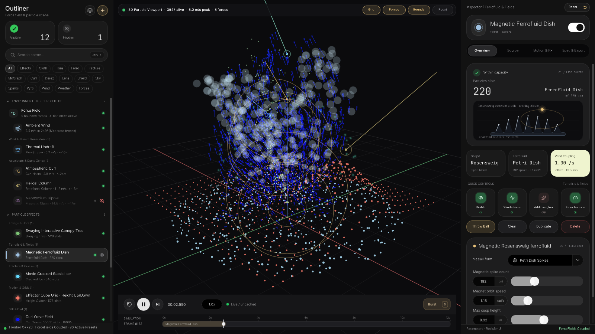

# Particle Workspace C++20 UI Plan & Step 1 Completion Report

## 1. Status & Relationship to Existing Plans

| Document | Scope | Status |
| :--- | :--- | :--- |
| **`Documentation/Plans/ModularParticleSimulationPlan.md`** | Current modular C++20 particle simulation architecture (replaces removed legacy `CxxParticleFoundationPlan.md`) | 🟢 Exists (Step 2A + 2B completed & verified) |
| **`Documentation/Plans/ParticleWorkspaceUIPlan.md`** *(this document)* | Native C++20 Particle Workspace UI, 3-pane `ParticleWorkspaceHost` + 3D `ParticleViewportHost`, `.ParticleSpace` Two-Tier Hybrid Codec, 93 non-quarantined presets, and direct C++ ForceFields reuse | 🟢 Step 1 + Phases 1–4 Complete & Verified |

### Step 1 Non-Negotiable Scope Invariants
- 🟢 **UI Scope (Step 1):** Native Frontier **Outliner** (`ParticleOutlinerPanel`) and **Inspector** (`ParticleInspectorPanel`) ONLY — viewport & GPU particle simulation shaders are staged for Step 2+.
- 🟢 **Zero Quarantine in C++:** None of the **9 retired Quarantine slugs** from `PE.QUARANTINE_IDS` exist in C++ (`blossom-branch-detach`, `jelly-slime-blob`, `slime-tendril-cluster`, `splatter-burst`, `impact-dust-ring`, `splash`, `puddle-ripple-splash`, `car-puddle-splash`, `mud-splatter-heavy`). No Quarantine filter button, no Mud/Slime/Splash inspector sections, and `ParticleWorkspaceSession::AddEffectFromPreset(...)` strictly refuses retired slugs.
- 🟢 **100% Direct C++ ForceFields Reuse:** Zero reimplementation of force fields. `ParticleWorkspaceSession` directly owns Frontier's `SimulationSpace::ForceFields::ForceFieldAccumulator`, `FieldLatticeCascade`, `ForceSourceRecordEntry[]`, and `ForceOverlaySettings`, while `ParticleInspectorPanel` directly delegates Environment / Ambient Wind / Force Source selections to **`Frontier::Editor::Simulation::ForceInspectorView`** (`Engine/Editor/Workspaces/Simulation/ForceInspectorView.{h,cpp}`).

---

## 2. Implemented C++20 Architecture (Step 1)

| File | Responsibility |
| :--- | :--- |
| `Engine/Components/Controls/PlaybackScrubber.h` / `.cpp` | **New reusable Frontier UI Control — Animation Play Slider & Playback Transport:** `ConstructFullTransport(...)` (`52px` Reset / circular Play-Pause / Single-Frame Step / `MM:SS.mmm` timecode / speed cycle `0.25x`–`2.0x` / Live indicator / warm-gold action button + `44px` ruler) and standalone `ConstructScrubberRail(...)` (`44px` draggable timeline play slider with ruler ticks, active progress wash, playhead needle & grab handle, Dark & Light themes). |
| `Engine/Components/Controls/ScalarSlider.h` / `.cpp` | **Updated reusable Frontier UI Control:** upgraded `ConstructCompactReadoutCapsule(...)` to full-capsule geometry (`Height * 0.5f`) and upgraded `ConstructLabeledInspectorRow(...)` to Frontier's Project Zero / Fluid split-capsule slider architecture (`92×26px` split `[number | unit]` capsule on the left + `26px` full-capsule rail & `24px` circular thumb on the right). |
| `Engine/Workspaces/Particle/ParticlePresetRegistry.h` / `.cpp` | Headless active **93 non-quarantined presets** across **14 active categories** (`ParticleRgba8`, `ParticlePlaybackClock`, zero UI headers), 20 visual silhouettes, 15 color drivers, and `VerifySlugExcludedFromRegistry(...)`. |
| `Engine/Workspaces/Particle/ParticlePresetCompiler.h` / `.cpp` | Headless preset compiler translating `ParticlePresetEntry` and live `ParticleEffectDescriptor` edits into modular `ParticleSimulationSpecification` pipelines (zero circular dependency on `SimulationSpace/Particles`). |
| `Engine/Workspaces/Particle/ParticleWorkspaceSession.h` / `.cpp` | 100% headless authoring & runtime session in `FRONTIER_ENGINE_SOURCES` owning live `ParticleSimulation` instances, Frontier's `ForceFieldAccumulator`, `FieldLatticeCascade`, Beaufort Anemometer ring, `ParticlePlaybackClock`, `WorkspaceDocument`, `RevisionTracker` undo/redo (`Undo`/`Redo`/`CommitHistorySnapshot`), `ParticleCodec` `.ParticleSpace` save/load, and `ImportVectorFieldAsset`. |
| `Engine/Codecs/ParticleCodec.h` / `.cpp` | Two-Tier Hybrid `.ParticleSpace` (`SpaceExtensionCategory::ParticleSpace = 10`) encoder/decoder reusing `VectorFieldCodec` inline ForceSource TOML helpers and `RevisionCodec` DAG history serialization. |
| `Engine/Configuration/WorkspaceConfiguration.h` / `.cpp` | Persistent `ParticleWorkspacePreferences` (grid, force wireframe, bounds, trails, simulation scale, orbit camera rig) stored alongside `UVWorkspacePreferences` and `GizmoSnapSettings`. |
| `Engine/Workspaces/Particle/ParticleOutlinerPanel.h` / `.cpp` | Native `PixelSpace` Outliner aligned directly to `Experimental/ParticleEditor Final/ParticleEditor.css`: `#121212` surface, circular `28px` Compact & warm-gold `#E8C27A` `+` buttons, `64px` `18px`-radius `Visible` (green check) & `Hidden` (eye-off) census tiles with light tabular counts, `36px` capsule search with `Ctrl F` keycap, wrapped capsule category filter strip (zero Quarantine), uppercase `ENVIRONMENT · C++ FORCEFIELDS` / `PARTICLE EFFECTS` headers, `38px` borderless-at-rest tree rows with `2.5px` left selection bar, `24px` tinted icon wells, glowing `#3EC46D` dots, crimson-crossed eye toggles on hidden rows, and unified `+` Construct sheet (`Presets (93)` & `Force Models (19)`). |
| `Engine/Workspaces/Particle/ParticleInspectorPanel.h` / `.cpp` | Dual-mode native `PixelSpace` Inspector aligned directly to `Experimental/ParticleEditor Final/{ParticleEditor.css,ParticleEditor.js}`: delegates ForceField selections straight to **`Editor::Simulation::ForceInspectorView`** (all 4 tabs + Beaufort Anemometer + 19 `ForceModel` entries), maintains its own UI `OutlinerPanel` mirror cleanly out of headless session, and renders the 4-tab Particle Effect Inspector (`Overview`, `Source`, `Motion & FX`, `Spec & Export`) rebuilding live simulations on parameter edit. |
| `Engine/Workspaces/Particle/ParticleViewportInteractor.h` / `.cpp` | Perspective orbit/pan/zoom camera controller (`ParticleViewportCameraRig`, `VerticalFovRadians`, smooth damping, `ProjectWorldPoint`, `FrameWorldBounds`). |
| `Engine/Workspaces/Particle/ParticleViewportHost.h` / `.cpp` | Interactive 3D particle viewport rasterizing live `ParticleSimulation` channels (`Kinematics`, `Appearance`), coupled `ForceFields` wireframes & wind arrows, floating status/toggle HUD pills, and full `PlaybackScrubber` transport dock. |
| `Engine/Workspaces/Particle/ParticleWorkspaceHost.h` / `.cpp` | Full 3-pane `WorkspaceDockContainer` + `ContentBrowser` workspace host (left `ParticleOutlinerPanel`, center `ParticleViewportHost`, right `ParticleInspectorPanel`, `.ParticleSpace` & `.VectorFieldSpace` import/open/save, `Ctrl+Z` / `Ctrl+Y` undo/redo, preferences persistence). |
| `Exhibits/ParticleWorkspaceUIValidation.cpp` | Headless C++20 validation target asserting 93 active presets, 0 quarantined slugs, finite `ForceFieldAccumulator` readings, `ForceInspectorView` delegation, all `PlaybackScrubber` interactions, full `ParticleWorkspaceHost` docking + 3D `ParticleViewportHost` stepping, and rendering **6 deterministic PNG visual proofs**. |
| `CMakeLists.txt` | Promoted headless `ParticleCodec`, `ParticlePresetRegistry`, `ParticlePresetCompiler`, and `ParticleWorkspaceSession` into `FRONTIER_ENGINE_SOURCES`; registered all 5 Particle UI/Host units in `FRONTIER_EDITOR_SOURCES` (single-folder dual-deployment policy). |

---

## 3. Verification & Visual Proofs Ledger

- **Compiler Check (`Shipping` + `Editor`):** `g++ 12.2.0 -std=c++20 -O2 -Wall -Wextra -Wpedantic -Werror` — 🟢 **0 errors, 0 warnings** across all 9 pure headless Shipping units (zero UI/ImGui headers) and all Editor/UI Particle & ForceModel units.
- **Validation Executables:**
  - `ParticleWorkspaceUIValidation`: 🟢 **PASS** (`93 active presets, 0 quarantined slugs, C++ ForceFields & ForceInspectorView reused, PlaybackScrubber, ParticleWorkspaceHost & 3D Viewport verified, 6 PNG proofs written`).
  - `ParticleSimulationValidation`: 🟢 **PASS** (`Modular SoA channels + custom C++ type + ForceFieldAccumulator/FieldLatticeCascade + SignedDistanceVolume SDF + all 93/93 active presets + headless ParticleWorkspaceSession / .ParticleSpace codec / RevisionTracker undo-redo verified`).
- **Naming & Banned-Words Audit:** 🟢 **0 banned hits** across all 28 Particle & `ParticleCodec` files; all upstream `ForceLaw*` symbols across 15 files cleanly renamed to `ForceModel*` (`Model` explicitly carved out for `ForceModel` only).

- **HTML Reference Parity Verification:** Audited directly against every CSS token, spacing rule, border radius, and component layout in `Experimental/ParticleEditor Final/{index.html,ParticleEditor.css,ParticleEditor.js}` plus Frontier's native reference renders (`Experimental/ProjectZeroEditor/Images/ProjectZeroEditorOverview.png` and `Exhibits/Images/VectorField/01-ForceFieldLitPbrAndOverlay.png`).

### Rendered PNG Visual Proofs (`Exhibits/Images/Particles/`)
1. `Exhibits/Images/Particles/ParticleWorkspace_Outliner_EffectInspector_Overview.png` — Side-by-side HTML-parity Outliner and Effect Inspector `Overview` tab (`Magnetic Ferrofluid Dish`).
2. `Exhibits/Images/Particles/ParticleWorkspace_EffectInspector_SourceMotion.png` — Side-by-side Effect Inspector `Source` and `Motion & FX` tabs (`New Year's Text & Shape Fireworks`).
3. `Exhibits/Images/Particles/ParticleWorkspace_ReusedForceFields_Inspector.png` — Outliner filtered to `Forces` delegating directly to Frontier's existing C++ `ForceInspectorView` (`Helical Column`).
4. `Exhibits/Images/Particles/ParticleWorkspace_Outliner_ConstructSheet_SpecExport.png` — Outliner `+` Construct sheet (`Presets (93)` / `Force Models (19)`) alongside Effect Inspector `Spec & Export` tab.
5. `Exhibits/Images/Particles/ParticleWorkspace_PlaybackScrubber_Control.png` — Dedicated Frontier UI Control showcase for **`Engine/Components/Controls/PlaybackScrubber`** (`ConstructFullTransport` + Dark/Light `ConstructScrubberRail`).
6. `Exhibits/Images/Particles/ParticleWorkspace_FullStudio_3Pane_Viewport.png` — Full 3-pane `ParticleWorkspaceHost` studio (`ParticleOutlinerPanel` | live 3D `ParticleViewportHost` showing 3,547 simulated particles + 5 coupled `ForceFields` + `PlaybackScrubber` transport dock | `ParticleInspectorPanel`).

---

## 4. Step 2C Status & Remaining Integration Roadmap

- **Step 2C — Vulkan 1.3 `.slang` Compute & GPU Viewport Rasterization (Completed):** Authored `ParticleVulkanExecutor.{h,cpp}`, `ParticleViewportRasterization.{h,cpp}`, and 8 modular `.slang` shaders (`ParticleChannelLayouts.slang`, `ParticleReleaseCompute.slang`, `ParticleAdvectCompute.slang`, `ParticleStrandConstraintCompute.slang`, `ParticleReductionCompute.slang`, `ParticleBillboardRasterization.slang`, `ParticleRibbonRasterization.slang`, `ParticleGridBackdropRasterization.slang`), verified live on Vulkan 1.3 via `Exhibits/ParticleVulkanGpuValidation.cpp` with `0.042 mm` median / `0.177 mm` max CPU-vs-GPU parity and GPU PNG proofs (`ParticleGpu_VulkanCompute_CoupledForceFields.png`, `ParticleGpu_VulkanCompute_XpbdClothRibbons.png`).
- **Remaining Integration Work:** See Step 3/4 checklist (live desktop `EditorLifecycle` / `ProjectBrowser` launch routing, `ParticleSimulation::Tick` auto-delegation to `ParticleVulkanExecutor` + live ImGui texture bridge in `ParticleViewportHost`, remaining GPU compute domain kernels for Ferrofluid / Pyro / Boids / MoGraph / Fracture / Shield / Refraction, and full CMake CTest integration).
