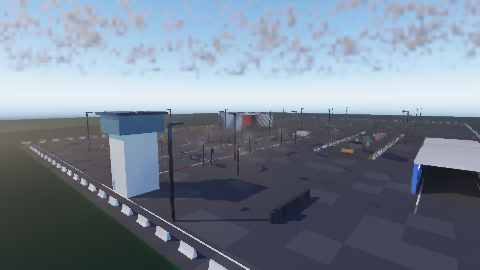
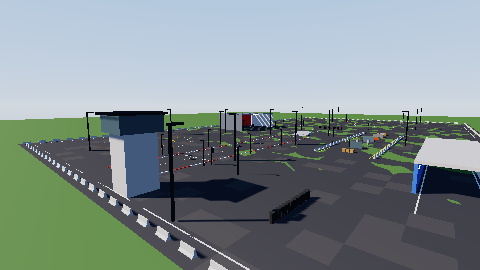
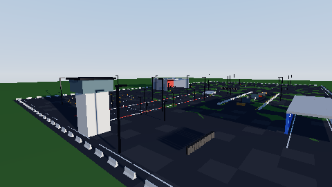
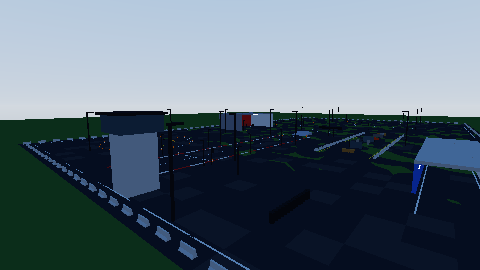

# Analytic illumination — the editor's fast closed-form renderer

`Frontier/Engine/Rendering/AnalyticIllumination/` draws the scene the global illumination loaded with closed-form
lighting only. It renders one shadowed sun, Lambert and Blinn-Phong surfaces, a sky/ground hemisphere fill and a
gradient sky with the sun disc, all driven by the level's Sun record. There are no distance fields, cards, path tracing
or temporal reuse, so a refresh is a shadow-map raster plus one shaded raster into the viewport's presented image. It is
the "Fast Blinn" preview of `Documentation/Plans/Ongoing/VirtualizedGeometry.md` §7, renamed under the naming skill.

This exhibit holds one claim: in the editor's own scene viewport, the analytic illumination builds on the global
illumination's scene and stays lit by the level's sun. It refreshes about two orders of magnitude faster on the same
device, and it hands the presented image back to the global illumination.

## Pieces

| Piece | Role |
|---|---|
| `AnalyticIlluminationSequence` | bring-up on the GI's vertex, occupant and material regions; per refresh, the 76-float profile (camera, sun box, sky) and one submission |
| `SolarDepthRasterization` | depth-only orthographic raster along the sun: 2048² `d32`, a 180 m box placed ahead of the camera, texel-snapped, slope bias |
| `SurfaceShadingRasterization` | sky triangle (zenith/horizon/ground gradient, sun disc), then the surfaces with reversed-Z depth; ACES fit into the sRGB image |
| `Shaders/AnalyticIllumination/*.slang` | 5 entries; `MaterialProfile` by family with the occupant's `MaterialOverride`, as the GI reads them |

Sun irradiance is 4 × (illuminance / 98 klx) × the black-body colour of the Sun's temperature, faded below the horizon.
Exposure compensation is the viewport's. The renderer is selected by the levelspace key `analytic_illumination`
(`RenderPipelineConfiguration::AnalyticIllumination`), Editor/Development only; there is no control yet (owner's scope).

## Run

```sh
cmake --build <build> --target AnalyticIlluminationCapture
<build>/AnalyticIlluminationCapture <build>/ShaderArchives/GlobalIllumination <build>/ShaderArchives/Environment \
    EngineContent/EnvironmentArchives/ProvingGround EngineContent/EnvironmentArchives/CelestialMaps <out> low 480 270 4
```

It needs a Vulkan device. In this sandbox it ran on SwiftShader through `FRONTIER_VULKAN_DRIVER` and
`VK_ICD_FILENAMES`, both pointing at `ExternalPackages/VulkanCompute/SwiftShader`.
`Results/AnalyticIlluminationCapture.txt` and `Images/` were produced on 2026-11-02 (2-CPU Linux sandbox, GCC 12.2
Release).

## Results

| Setting | Refresh (mean of 4) | Check |
|---|---|---|
| Global illumination (reference) | 9.534 s | — |
| Analytic, first refresh (builds its programs and shadow map) | 0.122 s | ✅ builds on the GI's scene |
| Analytic, settled | **0.065 s (146× faster)** | ✅ 129 distinct colours; ✅ sky blue over red at the top |
| Analytic, sun at 9° from 262° | 0.058 s | ✅ mean change 0.112 against the 38° sun |
| Analytic, sun disabled | 0.061 s | ✅ the fill alone lights the lower half at 0.110, against 0.343 with the sun |
| Global illumination again | 9.471 s | ✅ resumes |

Mean absolute difference against the GI image: 0.085. The analytic sky has no clouds or scattering. Its grass is more
saturated because there is no bounce light or aerial perspective, and the curve is a plain ACES fit rather than the
global illumination's display chain.

| Global illumination | Analytic illumination |
|---|---|
|  |  |
| **Analytic, sun at 9°** | **Analytic, no sun** |
|  |  |

## Limitations

- SwiftShader timings measure a CPU emulation. The ratio, not the absolute time, is the meaningful number. On a real GPU
  both renderers are far faster.
- One shadow map covers 180 m around the view, so shadows beyond it are absent. There are no cascades, by design.
- Glass draws as an opaque Blinn-Phong surface; transmission and refraction remain the global illumination's.
- Virtualized geometry does not take over here: the analytic raster draws the full-detail facet sets.
