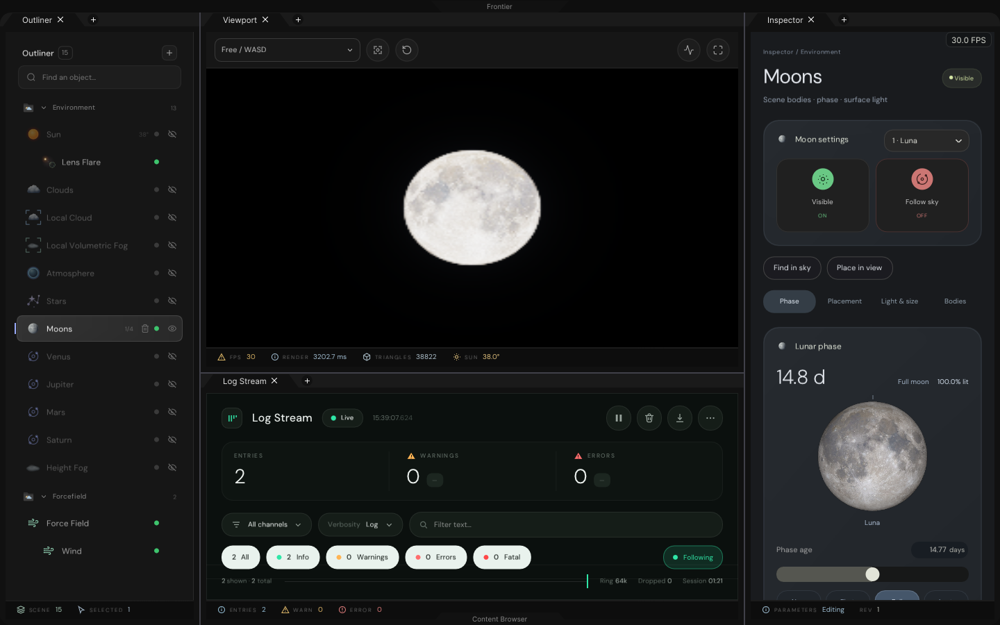
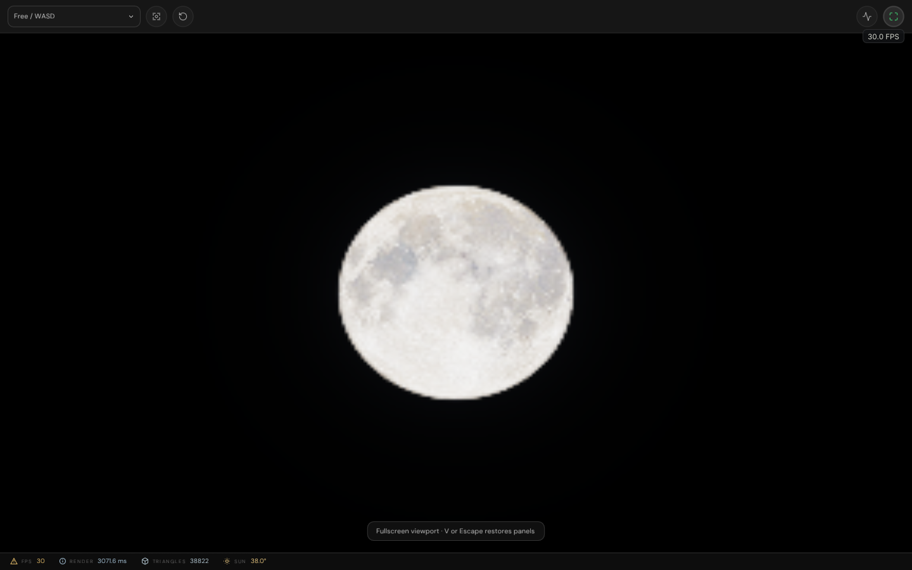

# Celestial controls and workspace cleanup

Production C++/Vulkan changes for live celestial editing, distinct planet instruments, selected-target cameras and
panel-local workspace chrome. No generated mockup is used as validation evidence.

## Native editor evidence





## Changes

| Area       | Behaviour                                                                                  |
|------------|--------------------------------------------------------------------------------------------|
| Moons      | All four slots reach the native atlas; phase, orientation, size, visibility and glow update |
| Moonlight  | Primary slot controls night lighting through phase, elevation, brightness and light power   |
| Discovery  | Find in sky frames a body; Place in view disables following and places it above the horizon |
| Venus      | Cloud-veil disc and interactive limb-depth profile                                           |
| Jupiter    | Latitudinal belts/zones and an interactive contrast wave                                     |
| Mars       | Drag-to-rotate globe and a procedural relief-contrast instrument                             |
| Saturn     | Oblique ring preview and an interactive ring-radius/inclination diagram                      |
| Stars      | Native limiting magnitude, point size, halo, rotation and scintillation settings connected  |
| Cameras    | Dropdown: Orbit selected, Chase selected, Free/WASD, six axis views and Space navigation      |
| Fullscreen | V fills the application client area with the viewport; Escape/V restores the docked panels  |
| Panels     | Outliner, viewport, Inspector and Log Stream each reserve their own footer space              |
| Removal    | Scene notch/title, live badge, particle launch, respawn/reassemble and distance-slice path removed |

### Planet designs

Each surface page uses different instruments and geometry, rather than a recoloured Sun/Moon card. Controls feed the
same authoring-to-renderer conversion used by the native viewport. The isolated surface previews run the production
CPU celestial evaluator under fixed light; they are not claims of pixel identity with the GPU camera image.

- [Venus](Results/Workspace/Venus-Inspector.png): veil and atmospheric limb.
- [Jupiter](Results/Workspace/Jupiter-Inspector.png): bands, longitude and contrast.
- [Mars](Results/Workspace/Mars-Inspector.png): globe orientation, surface contrast and thin atmosphere.
- [Saturn](Results/Workspace/Saturn-Inspector.png): ring geometry, opacity and inclination.

Placement, appearance and ring/atmosphere parameters persist in the level. Sun and planet ephemeris following remain
available. Manual position edits switch off following instead of being immediately overwritten by the solver.

### Camera semantics

| Mode | Input / interpretation |
|------|------------------------|
| Free | Existing Unreal-style RMB + WASD/EQ flight; mouse-wheel speed; Shift boost |
| Orbit selected | Middle/left drag rotates around a finite selected target; Shift-middle pans; Ctrl-middle dollies |
| Chase selected | Retains offset while a selected target moves; tracks celestial direction for sky targets |
| Axis views | Top/Bottom/Front/Back/Left/Right; fixed-axis **perspective**, not orthographic |
| Space | Wide-range free flight starting at 150 km; returning to Free restores the earlier scene position |
| F | Frame the selected volume, field region or celestial direction |
| Home button | Restore the default scene camera |

Celestial bodies remain sky-direction objects, not a newly implemented orbital mechanics simulation. The finite-target
orbit test uses an actual target position; sky bodies provide directional focus and tracking. High-altitude ray origins
and hit distances use float32 visibility storage rather than overflowing half-float coordinates.

### Scene cleanup

The default file keeps **20 records**, with **15 rendered scene entries** shown in Outliner. Required renderer
configuration
records remain persisted. The Render settings inspector is available from Control Centre → Quick Controls instead.

Simulation Origin, the unused physics/scientific specimens, Fluid Plume, Fracture, Particles, and unconnected default
lightning/aerial-authoring records are removed from this level. Reusable engine classes remain intact. Their existing
regressions use `Exhibits/EverestInterface/Content/Simulation.levelspace`, not dummy entries in the delivered scene.

The distance-slice presentation shader function, UI controls, shortcuts, presentation-only descriptor dependency and
request plumbing are removed. Its retired uniform slot is explicitly reserved to preserve the remaining encoding.

## Verification

| Program | Checks |
|---------|--------|
| `CelestialRenderValidation` | Native pixel changes for four Moons, planet controls and stellar settings |
| `CelestialWorkspaceValidation` | Real editor captures, cameras, fullscreen, scene cleanup, previews and persistence |
| `EnvironmentInspectorValidation` | Numerical, codec, input and lifecycle checks; full planet captures |
| `EverestInterfaceValidation` | Existing editor behaviour against the retained simulation exhibit fixture |
| `EverestShippingValidation` | Editor-free simulation and serialization against the same explicit fixture |
| `Results/WindowsPackage.json` | Source revision, package size and hashes; unrun Windows checks |
| `Results/Verification.txt` | Final executed commands, results and limitations |

Images are genuine production ImGui draw output with a native Vulkan scene readback. The scene is intentionally rendered
at **288 × 180** for these SwiftShader integration checks and enlarged inside a 1440 × 900 UI. The UI clock is fixed for
repeatable captures; its FPS badge/footer is not a measured hardware-performance result. Raw GPU images are 320 × 240.

## Reproduction

Prerequisites are the repository's pinned UI/font tools and `Automation/PrepareVulkanCompute.py`. The host uses Linux
x86-64, GCC 12, Debug and SwiftShader. Windows delivery is a separate Release x64 build with Zig 0.13.0.

```bash
_ClaudeScratch/venv/bin/cmake --build _ClaudeScratch/build/UI \
  --target CelestialRenderValidation CelestialWorkspaceValidation EnvironmentInspectorValidation \
  EverestInterfaceValidation EverestShippingValidation -j 3
export VK_ICD_FILENAMES="$PWD/ExternalPackages/VulkanCompute/SwiftShader/vk_swiftshader_icd.json"
export LD_LIBRARY_PATH="$PWD/ExternalPackages/VulkanCompute/SwiftShader${LD_LIBRARY_PATH:+:$LD_LIBRARY_PATH}"
_ClaudeScratch/build/UI/CelestialRenderValidation . _ClaudeScratch/build/UI/ShaderArchives/Environment \
  Exhibits/CelestialWorkspace/Results/Gpu
_ClaudeScratch/build/UI/CelestialWorkspaceValidation EngineContent Projects/Everest \
  _ClaudeScratch/build/UI/ShaderArchives Exhibits/CelestialWorkspace/Results/Workspace
_ClaudeScratch/build/UI/EnvironmentInspectorValidation EngineContent Projects/Everest \
  Exhibits/CelestialWorkspace/Results/Inspectors Exhibits/EnvironmentInspectors/Results/ReferenceExpectations.tsv
_ClaudeScratch/venv/bin/ctest --test-dir _ClaudeScratch/build/UI \
  -R '^Everest(Interface|Shipping)Validation$' --output-on-failure
```

After shader changes, use `Automation/StoreShaderArchives.py` for both Environment and GlobalIllumination. This keeps
Windows packages built without a shader compiler consistent with the new native layout and removed debug shader code.

**Not claimed:** Windows interactive execution, hardware-GPU performance, signed or antivirus-scanned binaries,
orthographic projection, new scene geometry for removed demonstrations, or physical solar-system dynamics.
