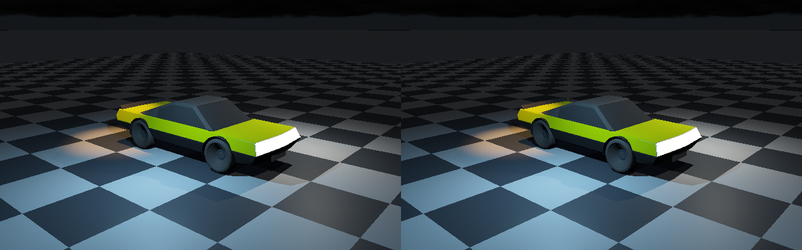

# Native analytic light clustering

Both recovered clustering prototypes select **analytic lights**. Neither proves a separate native mesh-emitter
clustering implementation. Keep emissive appearance/transport and analytic lights; clustering is selection,
not an emission model. This phase adds conservative native selection and actual spot/LM-63 profile evaluation.



**Left: exhaustive evaluation of 36 analytic lights. Right: exhaustive evaluation of clustered candidates.**
Both are newly rendered native C++ CPU 640×400 readbacks of the same 25,068-facet ControlVehicle. The display
pixels are identical. The fixture contains a directional Sun, point light, spot, synthetic LM-63 profile and
32 distant finite-range lights. The authored vehicle emission remains present. This is not a GPU capture.

## Audit of the recovered prototypes

| Path | Actual mechanism | Correctness boundary |
|---|---|---|
| A, VehicleProvingGrounds | Analytic point/beam profiles; 16 light indices per cell | Drops assignments above 16; outside-grid shader queries clamp to edge cells |
| B, IlluminationHost | Analytic point/beam profiles; 32-bit cell mask | Retains all 32 supported lights; outside-grid queries use all lights; global limit 32 |
| Native recovered renderer | Directional/point RIS from a global power PDF | Had no native spot, LM-63 importer or clustered candidate selection |

The saved CPU binning reproduction drops **16,384 assignments** in A for 32 overlapping lights. B retains its
32 supported lights. Both prototype shader comments identify hand-tuned angular curves, not measured IES data.
An `iesParam` name does not establish LM-63 support. The prototypes remain untouched as pinned references.
Their 8 and 3 lighting tests pass, but those tests do not establish native/Vulkan execution or unbounded capacity.
`ClusteredLightsSubmission` in `IlluminationUnits` is a resource declaration, not an executed clustering shader.

## What changed

- `LightInfluenceSpace`: sphere/cell overlap with roundoff padding. Zero reach and directional lights are global.
  Whole-list overflow and outside-grid queries return **all global IDs**, never a silently truncated list.
  Invalid builds leave the old grid intact. Explicit budgets: 32,768 lights, 1,048,576 cells and 16,777,216
  light/cell tests; exceeding a budget throws. These are bounded reference limits, not arbitrary scalability.
- Native RIS uses the cell's power-PDF mass to normalize its fresh proposals. Reservoirs retain global IDs for
  temporal/spatial reevaluation. The default legacy route stays unchanged; enable `ClusteredLights` explicitly.
- Spot support has an oriented smooth inner/outer cone. Finite reach multiplies inverse-square intensity by
  `(1 - (distance/reach)^4)^2` inside reach and zero outside. Reach zero means unbounded support.
- `CandelaDistribution` imports Type-C LM-63 1995/2002/2019, `TILT=NONE`, unity ballast factors, ordered angles
  and nonnegative candela tables. It supports axial, quadrant, half-plane and full-circle symmetry with bilinear
  angular interpolation. Other photometric types, tilt tables, inconsistent seams and malformed files reject.
  Input is capped at 8 MiB, 4,096 angles per axis and 1,048,576 candela values.
- `EvaluateCandela` returns tabulated candela including the file multiplier. Renderer profiles are **relative
  to the table peak**; `ReferenceLight::Radiance` supplies peak RGB intensity. This is not automatic photometric
  lumen-to-radiometric calibration. The committed `.ies` is explicitly synthetic, not manufacturer measurement.
  Polar angle zero follows `Direction`; horizontal zero follows orthogonalized `Up`, increasing toward
  `Up cross Direction`. Attaching a profile to a spot additionally applies that spot's cone.
- `ExhaustiveLights` bypasses reservoir sampling/reuse for a direct-light sum using the same BRDF and visibility.
  It provides a reference for clustered evaluation, not a replacement ReSTIR implementation.

## Retain both emission and analytic lighting

| Facility | Keep? | Purpose |
|---|---|---|
| Emissive materials and existing geometry transport | Yes | Visible emission and emitting geometry in reflected/indirect paths |
| Clustered point/spot/profile sources | Yes | Controlled illumination and scalable analytic candidate selection |
| Separate mesh-emitter clustering | Not required for these facilities | Useful later for sampling many emitting triangles/area lights |

A scalar emissive material does not become an IES luminaire merely by clustering it. An analytic proxy and
emitting mesh may describe one fixture, but must not independently add the same direct-light contribution twice.
`Active=false` disables the analytic proxy without removing mesh emission; the test exercises this. **A general
paired-emitter energy-accounting system is not implemented by this phase.**

## Executed checks

| Check | Result |
|---|---|
| Independent receiver-to-sphere oracle | 10,000 probes; 11,899 affecting-light memberships retained |
| Dense lists, outside-grid and invalid rebuilds | 97 lights retained by exhaustive fallback; transactional rejection passes |
| Native exact small-scene reference | 2,278 global versus 98 local list visits; RGB channel agreement within 1e-10 |
| Fresh clustered RIS, 1,024 seeds | Mean RGB sum 8.93014; exhaustive 8.95031; standard error 0.0274606 |
| IES interpolation, symmetry, rotation, rejection and limits | Passed; three headers, CRLF and comma-separated input exercised |
| Emissive surface with inactive analytic proxies | Emission preserved |
| Temporal/spatial reuse | Four static frames finite; **not** motion or unbiased-reuse proof |
| Native ControlVehicle | Zero changed display pixels; identical quantized HDR hash 7823226369187254349 |
| Vehicle candidate-list visits | 8,107,704 → 2,682,703, **66.91% fewer**; 56,643 exhaustive fallback queries |
| Native CTest | 4/4 passed; includes existing renderer, triangle visibility and distance checks |
| Recovered core suites | 188/188 checks passed |
| AddressSanitizer + UndefinedBehaviorSanitizer | Focused native light validation passed |
| Prior vehicle/distance renders | All six rerendered; three disabled controls still match preceding captures |

List visits are a workload count, not timing. They include reference proposal-list traversal, not GPU memory or
shader instruction counts. No GPU speedup is claimed. Native exact images do not certify the ReSTIR reuse
estimator; fresh RIS has a statistical check, whereas moving/reused histories still need separate validation.

## Reproduce and evidence

```bash
bash Exhibits/ClusteredLighting/Run.sh
SANITIZE=1 bash Exhibits/ClusteredLighting/Run.sh  # adds GCC/Clang sanitizers
bash Exhibits/VehicleReference/Run.sh           # six legacy vehicle/distance controls
```

Requires CMake 3.20+, a C++17 compiler, Node and Python; PNG conversion has no extra Python dependencies.
The shared CMake target `LightValidation` is registered alongside the vehicle checks. The supplied shell script
is exercised on Linux; no new Windows runtime proof is claimed. Logs, source/product hashes and CPU identity are
in this directory. Device here: Intel Xeon CPU, GCC 12.2.0; **no Vulkan or physical GPU execution**.

This completes the defined native analytic-selection proof, not the full renderer. The next integration remains
shared Slang/Vulkan execution with RTX ray queries and triangle-BVH fallback, followed by moving-history/filtering
and Windows/device acceptance. Environment/Moon appearance requirements remain in `Documentation/EnvironmentTodo.md`.
