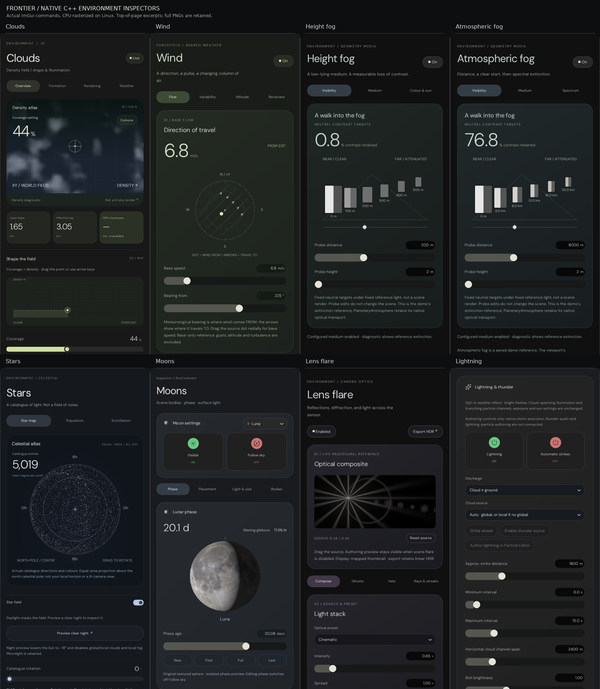

# Native environment inspector validation

Native C++ implementations of the remaining VehicleHMI environment controls, using production ImGui controls,
configuration codecs and registered celestial content. This exhibit does not substitute a browser UI for the editor.



## Coverage

| Inspector       | Native controls                                                            |
|-----------------|----------------------------------------------------------------------------|
| Clouds          | Overview, Formation, Rendering, Weather; density projections and layer stack |
| Local cloud     | Puff/Bank/Wisp, camera placement, XYZ fields, bounds, medium, budget, weather |
| Wind            | Flow, Variability, Altitude, Receivers; bearing, gust, shear and routing     |
| Height fog      | Visibility, Medium, Colour & sun; contrast probe, terraces and tint        |
| Atmospheric fog | Separate `AerialFog` record; Visibility, Medium, Spectrum                   |
| Local fog       | Shape-dependent volume controls, medium, lighting and wind                 |
| Lightning       | Discharge/source, intervals, distance, channel span and illumination       |
| Stars           | Catalogue, magnitude census, scintillation and clear-night action          |
| Moons           | Four slots; Phase, Placement, Light & size, Bodies and planets              |
| Lens flare      | Compose, Ghosts, Halo, Rays & streaks; asynchronous preview and PFM export |

Sun and Atmosphere remain in the regression capture set. The default Everest level now has **29 records**;
Atmospheric Fog is independently selectable rather than an extra mode of the Height Fog inspector.

## Evidence and limits

| Evidence                           | What it establishes                                                     |
|------------------------------------|-------------------------------------------------------------------------|
| `Results/Native/Validation.tsv`     | Numerical, persistence, input, image lifecycle and native capture checks |
| `Results/ReferenceExpectations.tsv` | 114 cases evaluated by the pinned demo's actual JS equations             |
| `Results/Native/*.png`              | Production C++ inspector draw commands, CPU-rasterized with real textures |
| `Results/Reference/*.png`           | Original demo builders and CSS, rendered by Chromium without the scene   |
| `Results/Compare-*.png`             | Side-by-side source/native captures for visual review                    |
| `Results/CaptureManifest.json`      | Dimensions and SHA-256 of retained images                                |
| `Results/Workspace/*.png`           | Full production Everest workspace captures (headless scene viewport)     |
| `Results/SourceManifest.json`       | Exact hashes of changed production sources and registered content        |
| `Results/Verification.txt`          | Final build/test/package outcomes                                       |

- The native test covers keyboard and pointer sliders, disabled input, Cloud mix revisions, the Wind compass,
  Fog probes that do not dirty the scene, clear-night cross-record edits, Moon phase/follow coupling,
  Lightning interval ordering, camera-dependent placement, async preview destruction and texture retirement.
- All serialized fields in the seven configuration families, plus the aerial record, undergo TOML round trips
  and disk reloads. Non-finite float input is rejected; legacy Moon settings migrate into the four-slot schema.
- SLAT decoding is bounded and rejects malformed input. All six existing 2K lunar maps are decoded; their bytes
  match the pinned demo. No random stars or painted replacement Moon maps are used.
- PFM checks cover RGB Float32, little-endian encoding, bottom-up rows, HDR retention, refusal to overwrite an
  existing file, invalid dimensions and non-finite radiance. Export uses a native path-entry modal.
- **These are not Vulkan screenshots or Windows interaction tests.** Linux validation uses a null window platform
  and the exhibit's CPU rasterization of actual ImGui commands. No Windows session or hardware GPU was available.
- Native scene defaults are preserved, so several readings differ from the demo defaults in comparison images.
  Fonts and browser/C++ rasterization also differ. The captures are review evidence, **not a pixel-identical parity
  certification**; exhaustive wide-column/responsive and interactive visual sign-off remains outstanding.

## Renderer boundary

The scene renderer was not extended. Existing native effects remain intact. Unsupported controls are disabled with
explanations or explicitly described as saved authoring/reference settings; no strikes, sample counters or GPU timings
are fabricated.

| Area        | Important boundary                                                     |
|-------------|------------------------------------------------------------------------|
| Clouds      | Formation/noise diagnostics are references; native sampling remains fixed |
| Local media | Bounded local cloud/fog rendering is not connected                      |
| Wind        | Receiver settings are saved; native global cloud drift remains legacy X |
| Aerial fog  | Reference coefficients are separate from native Atmosphere transport    |
| Lightning   | No native strike executor, thunder playback or lightning-particle authoring |
| Stars       | Inspector uses the demo SLAT catalogue; sky retains `Hipparcos8.csv`      |
| Moon        | Four authoring slots; viewport still renders its two legacy bodies       |
| Flare       | Preview/export use demo equations; custom layers are not native sky optics |

## Provenance and reproduction

| Property             | Configuration                                                        |
|----------------------|----------------------------------------------------------------------|
| Working branch       | `arena/8b705b7d-frontier`                                              |
| Imported history     | `streamlinkinbox/Frontier`, `arena/88b72faa-frontier`, tip `a1771e9b`  |
| Source reference     | `SultanAladin/Frontier`, `6afb6f00b5f25c45f7cda92c7da65b64845768f3`    |
| Reference directory  | `Experimental/VehicleHmiPrototype/`                                 |
| Tested source        | Imported tip plus this working tree; package records uncommitted edits |
| Host                 | Linux x86-64, GCC 12, Debug, CMake 4.4.4, Ninja 1.13.2                |
| Windows cross-build  | Zig 0.13.0 / Clang 18.1.6, x86_64-windows-gnu, Release                 |
| Browser comparison   | Node 22; playwright-core 1.56.1; @sparticuz/chromium 141.0.0           |

Restore the repository's pinned UI dependencies and font archives using `Automation/PrepareUI.py` and
`Automation/PrepareFonts.py`. The host build disables GLFW X11/Wayland because these captures do not open OS windows.

```bash
_ClaudeScratch/venv/bin/cmake -S . -B _ClaudeScratch/build/UI -G Ninja \
  -DFRONTIER_HOST_VERIFICATION=ON -DCMAKE_BUILD_TYPE=Debug \
  -DGLFW_BUILD_X11=OFF -DGLFW_BUILD_WAYLAND=OFF \
  -DPython3_EXECUTABLE="$PWD/_ClaudeScratch/venv/bin/python" \
  -DCMAKE_MAKE_PROGRAM="$PWD/_ClaudeScratch/venv/bin/ninja"
_ClaudeScratch/venv/bin/cmake --build _ClaudeScratch/build/UI \
  --target EnvironmentInspectorValidation EverestInterfaceValidation EverestShippingValidation -j 3
_ClaudeScratch/build/UI/EnvironmentInspectorValidation EngineContent Projects/Everest \
  Exhibits/EnvironmentInspectors/Results/Native Exhibits/EnvironmentInspectors/Results/ReferenceExpectations.tsv
_ClaudeScratch/venv/bin/ctest --test-dir _ClaudeScratch/build/UI \
  -R '^Everest(Interface|Shipping)Validation$' --output-on-failure
```

The retained JS fixtures can be regenerated independently after extracting the pinned reference into scratch:

```bash
git fetch --no-tags https://github.com/SultanAladin/Frontier.git \
  6afb6f00b5f25c45f7cda92c7da65b64845768f3
mkdir -p _ClaudeScratch/tmp/VehicleHmiReference
git archive 6afb6f00b5f25c45f7cda92c7da65b64845768f3 \
  Experimental/VehicleHmiPrototype/Source Experimental/VehicleHmiPrototype/Style \
  | tar -xf - -C _ClaudeScratch/tmp/VehicleHmiReference
node Exhibits/EnvironmentInspectors/Code/ReferenceExpectations.mjs \
  _ClaudeScratch/tmp/VehicleHmiReference/Experimental/VehicleHmiPrototype \
  Exhibits/EnvironmentInspectors/Results/ReferenceExpectations.tsv
```

`CaptureReference.mjs` takes the extracted reference directory, a `node_modules` directory containing the two pinned
browser packages, the output directory and `EngineContent`. On minimal Linux hosts, its bundled `al2023.tar.br`
libraries must be extracted and their `lib` directory added to `LD_LIBRARY_PATH`. The script serves only local test
content and closes its HTTP listener after capture. No browser dependency is linked into Frontier.

`AssembleEvidence.py` requires Pillow and DejaVu Sans. It labels and crops real captures;
it does not draw replacement UI.

```bash
_ClaudeScratch/venv/bin/python Exhibits/EnvironmentInspectors/Code/AssembleEvidence.py \
  Exhibits/EnvironmentInspectors/Results \
  --workspace _ClaudeScratch/build/UI/everest-interface-exhibits
```

For Windows, use the existing `Automation/WindowsToolchain.cmake`. With a Python virtual environment, propagate
`Python3_EXECUTABLE` into CMake's compiler probes using `-DCMAKE_TRY_COMPILE_PLATFORM_VARIABLES=Python3_EXECUTABLE`.
Build `Frontier`, then run `Automation/PackageEditorPreviewWindows.py --omit-material-archives`.
The delivered ZIP is unsigned and not antivirus-scanned; consult its `Package.json` for exact content and limitations.
