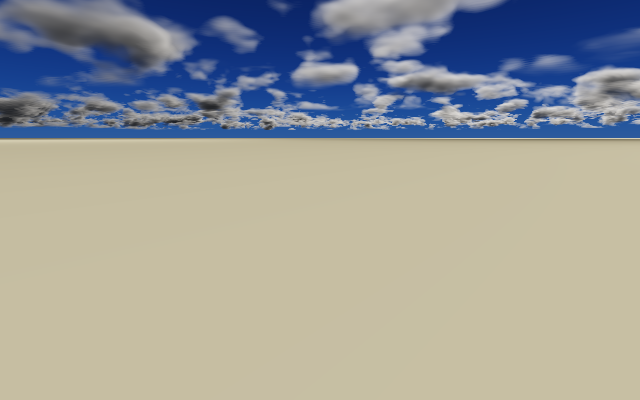

# Environment records and Sun/sky/cloud/fog scene

First native slice of the deferred [editor scene inspection plan](../../Documentation/Plans/Ongoing/EditorSceneInspection.md),
against the pinned VehicleHMI HTML at `6afb6f0`. Analytic lights are deliberately not included.

## What exists

| Area | Implementation |
|---|---|
| Editor descriptions | `Frontier/Engine/Scene/RecordEditorDescription.h` — editor-profile-only. Each record's constructor builds its own description (pinned HTML stable id, group, glyph, colour) and registers it through `RecordEntry::RegisterEditorDescription`; the SceneDirectory stores it beside the record. Shipping contains none of it. |
| Records | `Frontier/Engine/Scene/EnvironmentRecords.*` — `SunRecord`, `AtmosphereRecord`, `CloudRecord`, `FogRecord`, `WindRecord`, each binding inspector fields directly to live Engine settings (`SunPlacement`, `AtmosphereParameters`, `CloudParameters`, `FogParameters`). Bounds are the pinned HTML ranges (`CloudRanges`, sun presets at `6afb6f0`). |
| Outliner model | `SceneDirectoryPanel` now projects HTML group sections in `GroupOrder` (Render, Environment, Forcefield, Objects, Vehicle, Effects, Destruction, Level), Enabled/Disabled tile counts, row group/colour/stable-id, search, and a per-selection inspector model whose fields edit the scene. |
| Inspector host | `Frontier/Engine/Interface/SceneInspectorPanel.cpp` draws that model with the pinned CSS metrics (44 px crumb bar, 20/16 px padding, 19 px header, enabled pill, card sliders with number fields). Registered as the Inspector panel in `FrontierMain` beside the existing Outliner and Log Stream; the environment records are owned by the workspace session. |
| Scene render | This exhibit renders one frame from the records' own Engine models: atmosphere sky, finite Sun disc, marched cloud slab with ground cloud shadow, sun-lit ground, height fog. No point/spot/area lights. |

## Evidence



`EnvironmentSceneValidation` (editor profile) passes 13/13 in release and ASan/UBSan here: five records,
Environment ×4 then Forcefield ×1 groups, 4 enabled / 1 disabled tiles, Sun and Cloud inspector
construction, live field edit, search, and rendered-frame changes for cloud, fog and Sun elevation
(hashes in `Results/EnvironmentScene.txt`). The SceneDirectory exhibit still passes in Development
(45), Editor (45) and Shipping (17) profiles, and the LogStream exhibit passes 2/2 with the editor
host changes. The SDK interface path of `FrontierMain.cpp` syntax-compiles against the restored
pinned ImGui/GLFW/toml++ dependencies.

## Boundaries

- The retained frame is a host CPU render from the Engine environment models, **not** the editor
  viewport: the viewport still shows its placeholder until the Vulkan presentation contract lands
  (plan step 6). No ImGui window has run in this sandbox (no X11/Vulkan display), so pixel-level
  UI parity with the HTML is transcribed and compile-checked, not screenshot-verified.
- Sky colour is a transmittance-tinted approximation, not the full GPU atmosphere/volume pipeline;
  cloud appearance limits from the LightCompute checkpoints (flat slab, approximate ambient) apply.
- Vehicle, Jolt, gizmos and ReSTIR/reflection inspector controls remain deferred per the plan.

## Reproduce

```sh
bash Exhibits/EnvironmentScene/Run.sh
SANITIZE=1 bash Exhibits/EnvironmentScene/Run.sh
```

## Visual proofs

Small, fast CPU renders (seconds, not minutes): `Images/EnvironmentScene.png` (day frame),
`Images/EnvironmentStrip.png` (2×2 clear / no-clouds / fog / night from the same validated run) and
`Images/EnvironmentDrift.gif` (16 frames, 256×160, 30 s of wind-advected clouds). Regenerate with
`EnvironmentSceneValidation out.ppm --strip --animate` plus any PPM→PNG/GIF converter. These are
exhibit renders proving the record→render path, not captures of the editor viewport.
