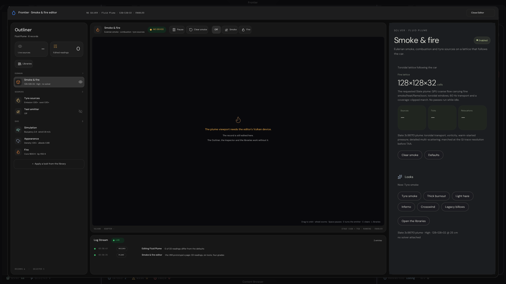
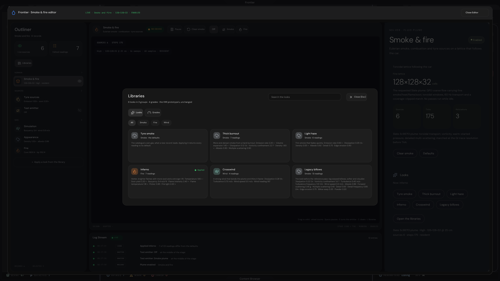
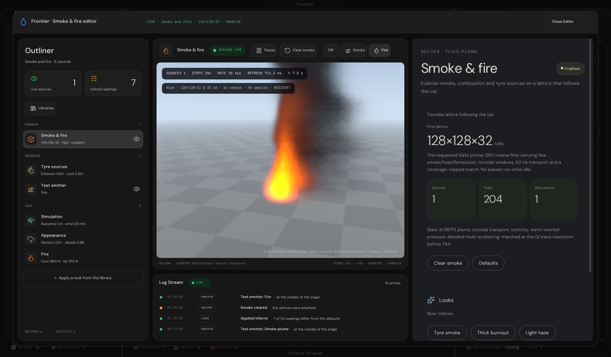
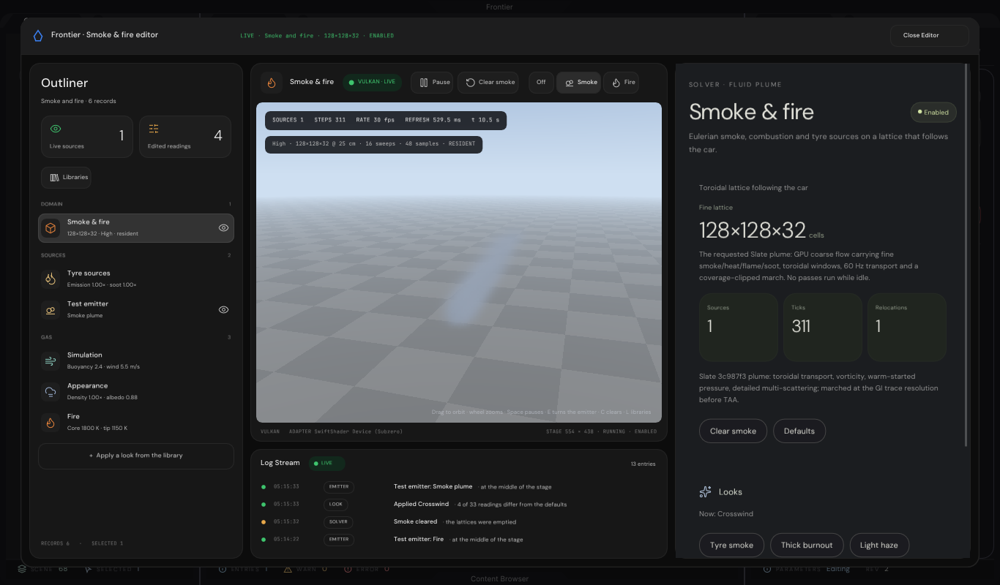

# Smoke & fire editor (C++): evidence

The fluid, gas and plume editor of the HTML prototype (the **Smoke & fire** page of `Experimental/VehicleHmiPrototype`, `BuildGas` in
`Source/InspectorPages.js`, with its looks) as a window of the C++ Frontier editor, laid out as the Particle editor's is: an **Outliner** on the left,
the **viewport** and the **Log Stream** in the middle, an **Inspector** on the right, and the **Libraries** as a sheet over the window. It edits the 33
readings of the plume that `Exhibits/PlumeSimulation` ports, on a **FluidPlume** record of the level, and its stage draws that plume.

It opens from a **Solver · Fluid Plume** record (`FluidPlume` in a levelspace): the record's page in the workspace's Inspector has a **Plume Editor** button
(the way the Particle editor's record has its own), and *Close Editor* returns to the scene. The editor is guarded by `FRONTIER_EDITOR`.

An earlier version of this editor was one modal of six cards with no Outliner, no Inspector and no libraries. It was rejected and is replaced by this
window; none of its layout is left.

## The window

| Part | Holds |
|---|---|
| **Outliner** (292 px) | The plume as records: **Domain** (the plume itself; its eye enables or disables it), **Sources** (Tyre sources, and the Test emitter, whose eye starts and stops the smoke), **Gas** (Simulation, Appearance, Fire). The counters *Live sources* and *Edited readings* (how many of the 33 differ from the defaults), the **Libraries** pill and a footer with the record count |
| **Viewport** | The stage with the plume. The bar: *Pause*, *Clear smoke* and the test emitter *Off · Smoke · Fire*. The HUD: sources, steps, rate, refresh time and clock, and the grade with its lattice. A drag over the stage orbits the camera, the wheel zooms. Space pauses, E turns the emitter, C clears the smoke, L shows the libraries |
| **Log Stream** | One line for every action: `PLUME` (the device), `LOOK` (a look applied, with how many readings differ from the defaults), `EMITTER`, `SOLVER` (smoke cleared), `RECORD` |
| **Inspector** (404 px) | The page of the selected row. **Domain**: the lattice, the counters the plume reports, *Clear smoke*, *Defaults*, the looks and a way to the libraries. **Sources**, **Simulation**, **Appearance** and **Fire**: the sliders of that part, with the decay canvas on Simulation and the blackbody strip on Fire. **Test emitter**: Off, Smoke plume, Fire |
| **Libraries** | A sheet over the window. *Looks*: the six looks of the prototype (Tyre smoke, Thick burnout, Light haze, Inferno, Crosswind, Legacy billows) in three groups (Smoke, Fire, Wind), with a search box, group chips, three-column cards and *Applied* on the look the gas holds. *Grades*: Low, Medium, High and Ultra with their cells, cell size, pressure sweeps and march samples (read only; *In use* marks the plume's). Escape or a click outside closes it |

26 of the catalogue's 33 readings have a slider, as in the prototype. The other seven (Expansion, Momentum, Tread ejection, Erosion, Warp, Powder, Flame
flicker) are set by the looks only.

At the three window sizes that were tried (1920 × 1080, 1366 × 800 and 1156 × 720) the Outliner and the Inspector keep their widths and the stage takes what
is left. Where the stage is narrow the bar gives up its words and keeps its icons, and a line that is longer than its column ends in an ellipsis.





## The plume in the stage

The editor draws no smoke itself. Each refresh it hands a host's presenter a `PlumeViewportRequest` (the record's gas by pointer, enabled, the test
emitter, the seconds, whether to clear, the stage's size, the camera) and shows the `PlumeViewportImage` it gets back. A host registers the presenter with
`InspectorRuntime::RegisterPlumeViewportPresenter`; without one the stage says why it is empty (`The plume viewport needs the editor's Vulkan device.`)
and the editor still edits.

The presenter is `Frontier/Extensions/Plume/PlumeExtension` (the editor application's, as `ParticleExtension` is the Particle editor's):

- **The device and the plume.** On the first refresh it brings up a Vulkan device (its own, or the host's borrowed) and builds the plume of the grade
  the level's Render settings record names: Low `64 × 64 × 20`, Medium `96 × 96 × 24`, High `128 × 128 × 32`; High where the level has no such record.
  A new tier builds a new plume. `SmokeSequence` (the sources, the step clock) and `PlumeSimulationSequence` (the lattices, the march) are the ports
  that `Exhibits/PlumeSimulation` checks bit for bit against the prototype.
- **The sources.** A parked stand-in car (nothing slides, nothing burns, so the tyres emit nothing) and the test emitter 3 m ahead of it, at the middle
  of the stage: smoke (radius 0.35 m, 26 smoke and 1.2 heat a second, 0.35 m/s up) or fire (radius 0.45 m, 12 flame and 39 heat a second, 1.2 m/s up).
  They are the numbers of `ResolveTestPlume` in the prototype's `IlluminationHost.js`. Its emission also names a hub, a strength, an expansion, a
  second plume and a combustion power; the plume's sources read none of them (`SmokeSequence.js`), so none is carried.
- **A step and a march.** One transport step when the schedule asks for one (at most one a refresh, from 1/60 s accumulated, of at most 1/30 s), then the
  march from the editor's camera, an orbit about the emitter. The march's resolution is the stage's divided by `max(2, ceil(sqrt(pixels / 250,000)))`.
- **The picture.** The march's radiance is composited on the CPU over a flat backdrop (a sky that pales toward the horizon and a two-metre checker for the
  ground), encoded as sRGB and written to an RGBA8 image the interface samples in `GENERAL` layout, as the Particle editor's. A plume that is not
  resident records no march: the stage shows the backdrop alone.
- **Stand-ins.** There is no scene behind the stage, so the programs bind `Frontier/Engine/Rendering/PlumeSimulation/PlumeStandIns` (a distance field of
  zero cascades, a surface with no depth, a shadow with no cascade, a one-texel sky). They are `PlumeSimulationCapture`'s stand-ins, moved into the engine.

## Captures

Every capture is the window drawn by Dear ImGui on the CPU raster of `Exhibits/ControlCentre/Code/CpuRasterization.h`.

**With the plume's own picture** (`FluidPlumeEditorCapture`, SwiftShader, High, 1366 × 800 unless noted; each is 96 refreshes, 3.2 s of the stage's clock,
after the emitter or the look changed and the smoke was cleared):

| Image | Shows |
|---|---|
| `SmokeAndFireEditor-Live-empty.png` | The empty stage: emitter off, nothing in the lattices. The backdrop alone, the plume not resident |
| `SmokeAndFireEditor-Live-smoke.png` | The Tyre smoke look with the smoke emitter: a pale blue puff above the ground, drifting in the look's 0.8 m/s wind. The HUD reads 1 source and 98 steps in all (95 in the 96 refreshes that the claim counts) |
| `SmokeAndFireEditor-Live-inferno.png` | The Inferno look, applied from the libraries, with the fire emitter: a white and yellow flame, orange at its edge, under a column of dark soot that leans away. The HUD reads 204 steps; the Outliner counts 7 edited readings and the Log Stream says `Applied Inferno · 7 of 33 readings differ from the defaults` |
| `SmokeAndFireEditor-Live-orbit.png` | The fire seen after a drag of (−120, −20) px over the stage: the camera has turned 0.72 rad and the flame leans the other way |
| `SmokeAndFireEditor-Live-crosswind.png` | The Crosswind look (wind 5.5 m/s) with the smoke emitter: the smoke is carried off in a thin, pale streak. 311 steps |
| `SmokeAndFireEditor-Live-1080p.png` | The Crosswind plume again, in a 1920 × 1080 window: the stage and the picture are 1108 × 718 and the plume has carried on (319 steps) |





**With a stand-in picture** (`FluidPlumeEditorValidation`; its presenter returns a flat gradient, not a plume, and a readout from the C++ plume's CPU half):

| Image | Shows |
|---|---|
| `SmokeAndFireEditor-Opening.png` | A new record, no presenter registered: the stage's message, every reading at its default |
| `SmokeAndFireEditor-Libraries-looks.png` | The Looks tab: search, chips, six cards in three columns, the applied look marked |
| `SmokeAndFireEditor-Libraries-grades.png` | The Grades tab: four read-only cards, High *In use* |
| `SmokeAndFireEditor-Live-standin.png` | A 1920 × 1080 window with a presenter registered, Inferno applied and the fire emitter on: the Fire page (the blackbody strip, Ignition, six sliders) beside a stage that holds the stand-in's blue gradient and grid (not a plume) and the readout of 6 sources and 175 steps |
| `SmokeAndFireEditor-Narrow-medium.png` | A 1366 × 800 window at the Medium grade |
| `SmokeAndFireEditor-Smallest.png` | A 1156 × 720 window |
| `Workspace-FluidPlume-selected.png` | The Everest workspace with the record selected: its page in the Inspector, with the Plume Editor button |
| `FluidPlumeInspector-Panel.png` | The record's compact page |

## Results

| Check | Program | Result |
|---|---|---|
| The record, the libraries, every card driven by input, the window in the workspace | `FluidPlumeEditorValidation` (`Code/RunFluidPlumeEditorValidation.sh`) | 🟢 577 assertions, 0 failures (`Results/Validation.tsv`), 35 to 41 s |
| The plume in the stage | `FluidPlumeEditorCapture` (`Code/RunFluidPlumeEditorCapture.sh`) | 🟢 13 claims, 0 failed (`Results/LivePlume.tsv`), 4 min on SwiftShader at High |
| The plume's programs, re-run after their stand-ins moved into the engine | `RunPlumeParity.sh` and `PlumeSimulationValidation` | 🟢 9 of 9 captures bit for bit, 0 claims failed; 706 assertions, 0 failures |

### `FluidPlumeEditorValidation`

It runs on a real Dear ImGui context and asserts:

- **The record.** A new record is enabled with the test emitter off and holds the catalogue's defaults, all 33 readings. The file format names every one of
  them as a snake_case key. A save and reload returns all 33 bit for bit. A reading outside its range is held to the range; a NaN, an infinity and a string keep the
  reading they would replace; a file without `enabled` leaves the record enabled. The legacy block of `Exhibits/EverestInterface/Content/Simulation.levelspace` moves one reading (`vorticity`).
- **The libraries.** Each of the six looks sets exactly the prototype's gas (0, 7, 6, 7, 4 and 13 of the 33 readings differ from the defaults for Tyre
  smoke, Thick burnout, Light haze, Inferno, Crosswind and Legacy billows) and the groups hold what they should; the sheet's search for `wind` finds two cards.
- **Every control.** Each of the 26 sliders is driven by the keyboard: Right moves one step to the decimal the figure shows, Left returns to the default
  exactly, Shift+Right moves ten steps, End reaches the maximum and Home the minimum; only its own reading moves and the record's revision advances. The
  looks, *Defaults*, *Clear smoke*, the test emitter and the way to the libraries each change exactly what they name.
- **The window in the workspace.** Opened from a `FluidPlume` record the way the Inspector's button opens it and driven with the pointer and the keyboard:
  the Outliner's rows and eyes, the page each row shows (a slider that is on another page moves nothing), the sheet (tabs, chips, search, a look applied,
  Escape, a click outside), the bar and the orbit (yaw −0.006 rad and pitch +0.006 rad a pixel, about a tenth of the distance a notch of the wheel, clamped), and
  what the editor asks of a presenter (the gas by pointer, the emitter, the camera, the clear, the stage's pixels). At 1920 × 1080 the Outliner is
  292 px and the Inspector 404 px; at 1366 × 800 and 1156 × 720 the Inspector lies inside the window, the stage keeps its place between the two columns,
  the bar's controls lie inside the stage's column and the Outliner's last row is inside the window or its list scrolls to it.
- **The instruments**, looked for in what the window submits as ordered vertex-colour runs: the decay canvas on Simulation and the blackbody strip on Fire.
- **The host's part.** With a presenter registered the window opens with the smoke emitter on (so edits can be judged as they are made) and says so in the Log
  Stream; closing it puts the emitter back as it was. The presenter is asked on every refresh for the stage's pixels, with the record's own gas, the emitter
  and the camera; it is given no seconds while the stage is paused; *Clear smoke* reaches it exactly once, and nothing is left queued for a host to take
  twice. Without a presenter *Clear smoke* is a request that a host takes once (`FluidPlumeEditor::TakeRequests`). With the window closed, a verb that edits
  the record is refused.

### `FluidPlumeEditorCapture`: expected against observed

Each capture is checked against what it should show; the plume's pixels are counted against the empty stage's (a pixel counts when a colour channel differs
by more than 8 of 255). `Results/LivePlume.tsv` holds the rows, the adapter and the refresh times.

| Capture | Expected | Observed |
|---|---|---|
| Empty stage | the plume is not resident (no march recorded) | not resident, 0 sources |
| Tyre smoke, smoke emitter, 96 refreshes | resident; one step in a refresh nine times in ten at least; over 0.5 % of the stage changed | resident, 95 steps, 3.70 % |
| Inferno, fire emitter, 96 refreshes | resident; over 0.5 % changed; pixels redder than any pixel of the empty stage | resident, 25.94 %, 25,414 px redder than blue (the empty stage: 0) |
| Orbit, a drag of (−120, −20) px | yaw +0.72 rad, pitch −0.12 rad, distance unchanged, over 5 % of the stage redrawn | +0.720 rad, −0.120 rad, 11.0 m, 73.4 % |
| Crosswind, smoke emitter, 96 refreshes | resident; over 0.5 % changed; over 0.5 % unlike the Tyre smoke picture | resident, 2.44 % changed, 3.84 % unlike |
| A 1920 × 1080 window | the picture grows with the stage and the plume goes on | 554 × 438 → 1108 × 718; steps 311 → 317; resident |
| Clear smoke, emitter off, opening view | the picture equals the empty stage's in every pixel | 0 pixels differ, not resident |
| Every capture | the picture covers the stage and exceeds it by under 3 px | equal to the stage in all six |

The Crosswind row says the picture differs from the Tyre smoke one and that something is drawn; it does not measure the wind. The capture shows the effect,
and it is for the reader to judge it.

The first full run of this capture, on the same editor code, **failed one claim**: the orbit's. Its expectation had the sign of the drag the wrong way (the
editor's rule, which the validation asserts, is yaw −0.006 rad a pixel across). The claim was corrected and the editor was not changed. The same run's
Crosswind claim (the plume's mean column against the Tyre smoke plume's) passed but measured little, so it was replaced by the one above, and the orbit now
turns the fire, which shows from any side.

## What is real, and what is not

- **The picture is the C++ plume, but not the scene's.** The march runs the ported programs on a Vulkan device. It is composited over a flat backdrop, with
  no car (the stand-in car only anchors the sources and is not drawn), no ReSTIR lighting, no shadows from the scene and a one-texel sky: the plume is lit by
  its own sun term and its fire lights. The plume is not drawn into the Scene viewport's own render (the ReSTIR renderer): only this editor's stage shows it, and the GI port is untouched.
- **A device is needed.** The captures ran on SwiftShader, on the CPU of a Linux sandbox. Nothing here measures how long a refresh takes on a GPU.
- **The HUD's RATE is an artefact.** It is 1/dt smoothed, and the capture's dt is a fixed 1/30 s, so it settles on 30 fps (the first capture, after one
  tick, still reads 48). The *REFRESH* figure is the presenter's wall time here: medians of 634 to 712 ms at 554 × 438 and 934 ms at 1108 × 718 (the empty
  stage, which marches nothing, 65 ms), on SwiftShader in a Debug build. Neither is a figure for a GPU or for a Release build.
- **The native application is not verified.** `Experimental/Frontier/Native/WindowsFrontier.cpp` registers the presenter as it registers the Particle
  editor's, but it cannot be compiled or run on this Linux host: the edit is unbuilt and unrun. The window has been drawn only by the CPU raster; it has not
  been seen in the Windows editor, on a GPU or in a browser.
- **Ignition is shown and inert.** The select is the Vehicle record's setting (its thermal `ignition`, `ignition_k` and `ignition_s`), shown on this page as the
  prototype shows it; here it changes nothing, and its note says to edit it on the Vehicle page.
- **`FluidNodeEditor.html` is not ported.** It is a different tool (a graph editor for liquids), and its folder under
  `Documentation/Plans/References/InheritedEngine/Prototypes/FluidNodeEditor/` holds only the HTML: the entry script it loads (`./FluidEditorEntry.js`) is
  not in the repository. This editor is the prototype's `BuildGas` page.
- **The appearance presets of `VolumetricFlowSolver.html`** (`AppearancePresets`, its palette selector) **are not ported.** The libraries hold the
  prototype's six gas looks.

## Environment and revision

Linux 6.1 x86-64 sandbox, two cores, no GPU: GCC 12.2.0, CMake 4.4.4, Ninja 1.13.2, Slang 2026.14.1 (`slangc` from `Automation/PrepareVulkanCompute.py`), Vulkan
on SwiftShader. Configured Debug with `-DBUILD_TESTING=ON -DFRONTIER_HOST_VERIFICATION=ON -DGLFW_BUILD_WAYLAND=OFF -DGLFW_BUILD_X11=OFF` (the last two
because the sandbox has no Wayland or X11 headers). The stored shader archives of `EngineContent/ShaderArchives/PlumeSimulation` are the ones the capture
loads.

**Tested revision:** `b0cfd7e` with the files that `6347000` (the plume extension, the capture, its runner, the CMake targets and the images) and `5b7cdf8`
(`WindowsFrontier.cpp`, which the Linux build does not compile) then committed. They were uncommitted while the results were produced, and nothing under
`Frontier/`, `CMakeLists.txt` or `Code/` has changed since. The eight UI and plume validations that share this code (`PanelExpansion`,
`ControlCentre`, `WorkspaceLayout`, `Interface`, `EnvironmentInspector`, `FluidPlumeEditor`, `EverestInterface`, `PlumeSimulation`) all succeed under `ctest`
(8 of 8, 323 s) on that tree, and the nine other programs that link the editor library link.

**Not run:** Windows (no Windows binary was built), a GPU, a browser, the Medium grade of the capture, a Release build.

## Reproduce

```sh
python3 Automation/PrepareVulkanCompute.py    # SwiftShader and slangc, into ExternalPackages/VulkanCompute
python3 Automation/PrepareUI.py               # the interface's dependencies (Dear ImGui and the rest)
python3 Automation/PrepareFonts.py            # the interface's typefaces
cmake -S . -B build -G Ninja -DCMAKE_BUILD_TYPE=Debug -DBUILD_TESTING=ON -DFRONTIER_HOST_VERIFICATION=ON
ninja -C build FluidPlumeEditorValidation FluidPlumeEditorCapture
Exhibits/FluidPlumeEditor/Code/RunFluidPlumeEditorValidation.sh build        # the window with a stand-in picture, no GPU: 35 to 41 s
Exhibits/FluidPlumeEditor/Code/RunFluidPlumeEditorCapture.sh build [low]     # the plume in the stage: 4 min at High on SwiftShader, 1 m 43 s at Low
```

The capture takes the driver from `FRONTIER_VULKAN_DRIVER` when it is set, else the SwiftShader that `PrepareVulkanCompute.py` fetched. Both scripts copy
their images and results into this folder only when every check held, and the capture's images and `LivePlume.tsv` are of the grade it ran at: a run at
`low` replaces the committed High ones. The raw evidence of a run stays in `build/fluid-plume-editor-evidence` and `build/fluid-plume-live-evidence`.
