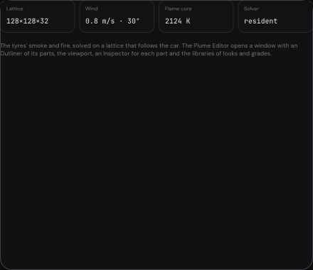
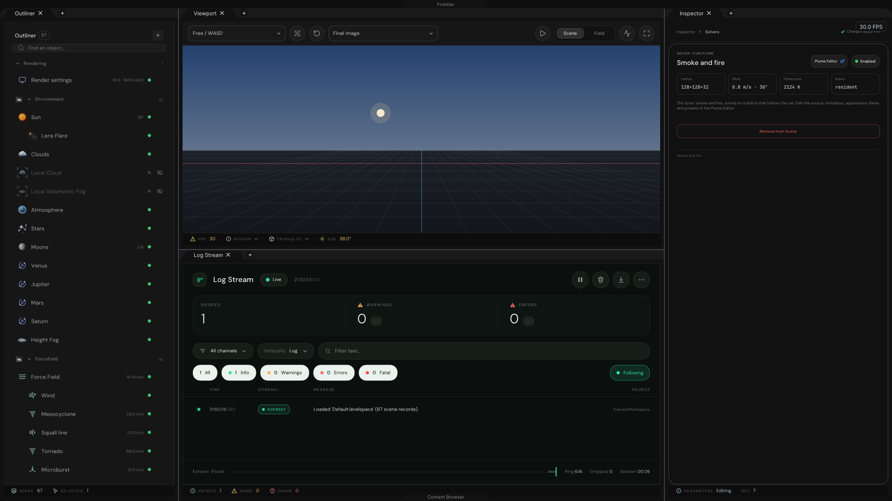
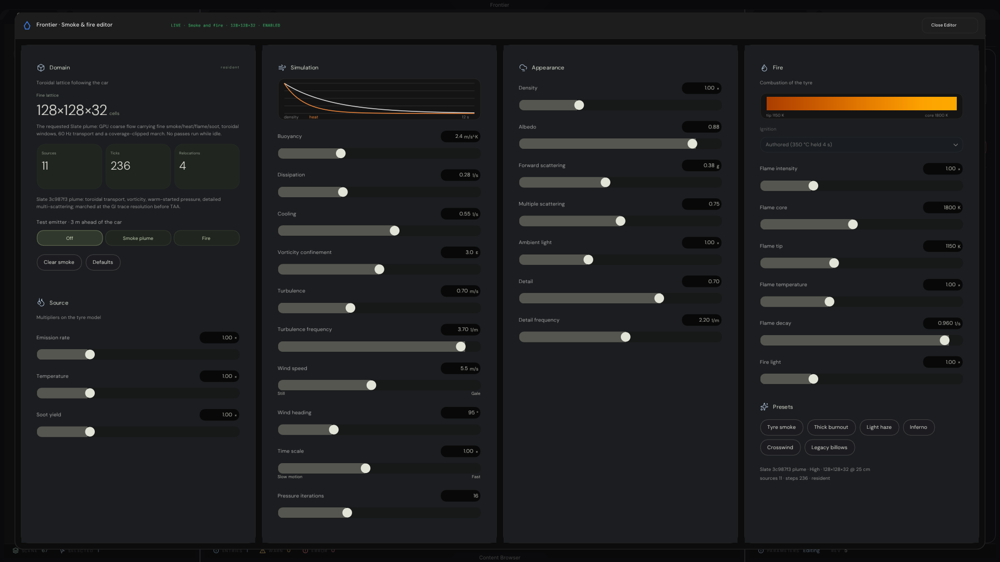
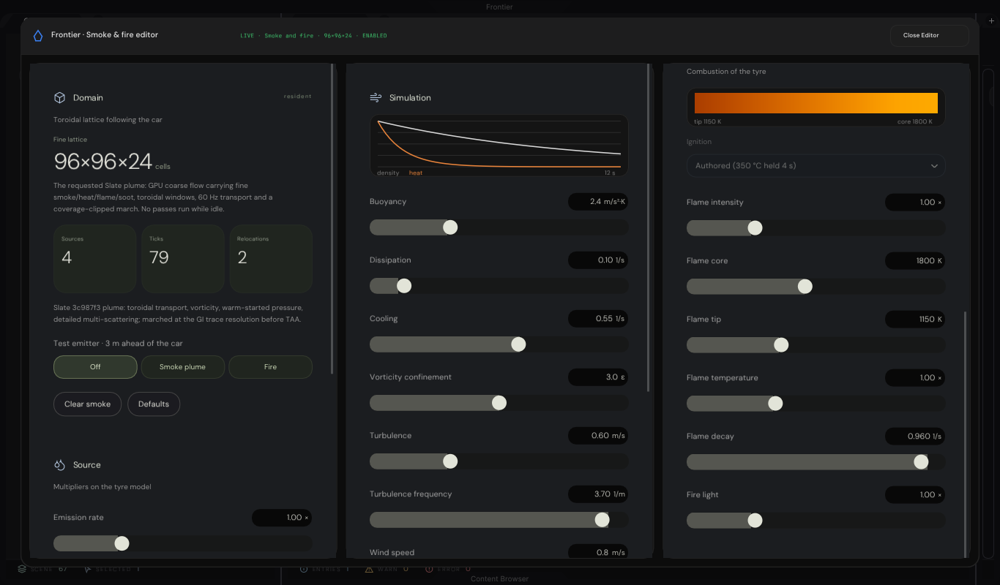

# Smoke & fire editor (C++): evidence

The fluid, gas and plume editor of the HTML prototype (the **Smoke & fire** page of `Experimental/VehicleHmiPrototype`,
`BuildGas` in `Source/InspectorPages.js`, with its presets) in the C++ Frontier editor. It edits the 33 readings of the
plume that `Exhibits/PlumeSimulation` ports, on a **FluidPlume** record of the level.

It opens from the Everest workspace: *Construct* (Ctrl+A) → *Solver · Fluid Plume*, then the Inspector's **Plume Editor**
button. It fills the workspace as a modal window, as the Particle editor's does, and *Close Editor* returns to the scene.
The editor is guarded by `FRONTIER_EDITOR`.

## Where the code lives

| What | Where |
|---|---|
| The record: 33 readings and `enabled`, saved as TOML | `Engine/Scene/EngineConfigurations.h` (`FluidPlumeConfiguration`), `Engine/Scene/WorldSpace.cpp` (`FluidPlumeRecord`) |
| The window, its modal and its readout | `Engine/Interface/FluidPlumeEditor.{h,cpp}` |
| The six cards, the column layout, fit and scroll | `Engine/Interface/FluidPlumeEditor/FluidPlumePages.{h,cpp}` |
| The Inspector's page for the record and the button | `Engine/Interface/Inspectors/FluidPlumeInspector.{h,cpp}` |
| The catalogue (33 entries, ranges, defaults), the six presets, the decay and blackbody instruments | `Engine/PhysicalDynamics/FluidDynamics/`: see `Exhibits/PlumeSimulation` |
| The validation | `Exhibits/FluidPlumeEditor/Code/FluidPlumeEditorValidation.cpp` (target `FluidPlumeEditorValidation`) |

## The window

Six cards on four columns (`Frontier · Smoke & fire editor`):

| Card | Shows |
|---|---|
| **Domain** | The fine lattice (`128 × 128 × 32` cells at High) and what the running plume reports: sources, transport steps, relocations of the toroidal window. The test emitter (Off, Smoke plume, Fire), *Clear smoke* and *Defaults* |
| **Source** | Emission rate, Temperature, Soot yield: multipliers on the tyre model |
| **Simulation** | The decay canvas (density and heat survival over 12 s) and ten sliders: Buoyancy, Dissipation, Cooling, Vorticity confinement, Turbulence, Turbulence frequency, Wind speed, Wind heading, Time scale, Pressure iterations |
| **Appearance** | Density, Albedo, Forward scattering, Multiple scattering, Ambient light, Detail, Detail frequency |
| **Fire** | The blackbody strip (tip to core, in kelvin), the Ignition select, Flame intensity, Flame core, Flame tip, Flame temperature, Flame decay, Fire light |
| **Presets** | Tyre smoke, Thick burnout, Light haze, Inferno, Crosswind, Legacy billows |

26 of the catalogue's 33 readings have a slider, as in the prototype. The other seven (Expansion, Momentum, Tread
ejection, Erosion, Warp, Powder, Flame flicker) are set by the presets only. A slider commits the decimal its figure
shows, as the prototype's range input does.


The page needs about 1,030 px of height at scale 1. At 1920 × 1080 it fits on four columns and is drawn at 0.93: the
window is the display less a 24 px margin on each side (1,032 px), the body 958 px under the 50 px header and the
padding, and `(958 − 2) / 1,030 = 0.928` (worked out from the constants in `FluidPlumeEditor.cpp`, not read off a
capture). Below that it shrinks to 0.82 at most and then scrolls, with a slim thumb on each scrolling column. The
columns are four from a body of 1,500 px, three from 1,000, otherwise two.

## The record

The level file holds a `FluidPlume` record: `enabled` and the 33 readings as snake_case keys. There is no grade key: the
lattice follows the Render settings' quality tier (Low `64 × 64 × 20`, Medium `96 × 96 × 24`, High `128 × 128 × 32`, and
High when no host is attached). A load clamps every reading to its catalogue range; a NaN, an infinity or a string keeps
the reading it replaces; an integer is accepted; a partial file moves only the keys it names. The test emitter is a
setting of the session and is not saved.

The legacy fixture `Exhibits/EverestInterface/Content/Simulation.levelspace` has a `FluidPlume` block from before the editor.
Only its `vorticity` carries over; its `buoyancy_lift` and `blackbody_k` are not readings of the catalogue and are ignored.





## Results

| Check | Program | Result |
|---|---|---|
| The record, the cards driven by input, the window in the workspace | `FluidPlumeEditorValidation` (`Code/RunFluidPlumeEditorValidation.sh`) | 🟢 333 assertions, 0 failures (`Results/Validation.tsv`), 30 s |

`FluidPlumeEditorValidation` runs on a real Dear ImGui context, drawn on the CPU raster of `Exhibits/ControlCentre`, and
asserts:

- **The record.** A new record is enabled with the test emitter off and holds the catalogue's defaults, all 33 readings.
  The file format names every one of them. A save and reload returns all 33 bit for bit. Out-of-range readings clamp; a
  NaN wind heading, a string and a missing `enabled` behave as above. The legacy block of `Simulation.levelspace` moves
  one reading.
- **Every slider.** Each of the 26 is driven by the keyboard on the card: Right moves one step to the decimal the
  figure shows, Left returns to the default exactly, Shift+Right moves ten steps, End reaches the maximum and Home the
  minimum; only its own reading moves, and the record's revision advances.
- **Every action.** Each of the six presets sets exactly the prototype's gas and advances the revision; *Defaults*
  restores all 33 readings and raises no host request; *Clear smoke* raises `clear-smoke` for the host, leaves the
  readings alone, and the host takes the request once; the test emitter selects Off, Smoke plume or Fire and is not an
  authored reading (the revision stays); the Ignition select is inert (no popup opens, no reading moves).
- **The instruments.** Looked for in what the window submits to ImGui, as ordered vertex-colour runs: the Simulation card
  submits the decay instrument's grid and both curves, in the prototype's colours and order; the Fire card submits the
  blackbody strip's bands in order across the card; and the strip is not found for another flame, so its colours follow
  the readings. Each capture also asserts whether they are in view.
- **The readout.** Without a host the counters read `no solver attached`; a resident one reads
  `sources 6 · steps 177 · resident`, an idle one `… · idle`.
- **The layout.** At scale 1 the four columns are 872, 1,023, 659 and 956 px tall; the Simulation column is the
  tallest and `TallestColumnHeight` is tight to it.
- **The workspace.** The modal opens from a `FluidPlume` record the way the Inspector's button opens it and is driven
  there (the Inferno and Crosswind presets, the test emitter, a slider, Clear smoke, Defaults, Close Editor). At
  1920 × 1080 there are four columns and none scrolls; at 1366 × 800 there are three, the Fire strip lies below the fold,
  and the wheel scrolls the third column to its end (681.0 of 681.0 px). After *Close Editor* no column is submitted and no
  popup is open.

## Captures

1920 × 1080 on the CPU raster, except the narrow window.

| Image | Shows |
|---|---|
| `SmokeAndFireEditor-Opening.png` | A new record, no solver attached: the readouts say `no solver`, the status line `NO SOLVER`, every reading at its default |
| `SmokeAndFireEditor-Inferno-live.png` | The Inferno preset with the test emitter on Fire, the host's readout live: 6 sources, 175 steps, 3 relocations (High, refresh 230); the strip is brighter (tip 1357 K, core 2124 K) |
| `SmokeAndFireEditor-Crosswind-live.png` | The Crosswind preset (wind 5.5 m/s at 95°, dissipation 0.28): 11 sources, 236 steps, 4 relocations (High, refresh 300) |
| `SmokeAndFireEditor-Narrow-medium.png` | A 1366 × 800 window at Medium (`96 × 96 × 24`): three columns, scrolling |
| `SmokeAndFireEditor-Narrow-medium-scrolled.png` | The same, with the Fire column wheel-scrolled to the end, the strip in view (4 sources, 79 steps, 2 relocations) |
| `FluidPlumeInspector-Panel.png` | The Inspector's page for the record: lattice, wind, flame core, solver state |
| `Workspace-FluidPlume-selected.png` | The Everest workspace with the record selected |





The readout in the live captures is the C++ plume's own CPU half: `SmokeSequence` runs the burnout script of
`Exhibits/PlumeSimulation/Code/PlumeScenario.h` (Mulberry32, seed `0x51ED270B`) and the validation hands its counters to
the editor, as a host would.

## What is real, and what is not

- **There is no preview inside the editor.** The prototype's page edits the plume that the viewport behind it shows. The
  plume's march into the picture belongs to the illumination host's composite, which is a 1:1 port this work does not
  change, so editing a slider here changes the record and the figures but shows no smoke in the Everest viewport.
  `Exhibits/PlumeSimulation` shows the same plume drawn.
- **The readouts are fed by the host.** Without a host they read `no solver`; the editor never shows counters nothing is
  counting. In the captures the host is the validation.
- **Ignition is shown and inert.** In the prototype it is a setting of the car (when a tyre catches fire), not of the
  gas, and no record owns it here yet; the select is disabled until the Vehicle record takes it.
- **The test emitter and *Clear smoke* are requests.** The emitter is a session setting and *Clear smoke* raises
  `clear-smoke`; the plume that acts on them is the host's.
- **The prototype's separate `FluidNodeEditor.html` is not ported.** It is a shell whose entry script
  (`./FluidEditorEntry.js`) exists nowhere in the reference or the repository. This editor is the `BuildGas` page.
- **CPU raster, not a GPU capture.** The images are the window drawn by Dear ImGui on the CPU.

## Environment and revision

Linux x86-64 sandbox, two cores, no GPU: GCC 12.2.0, CMake 4.4.4, Ninja 1.13.2, Slang 2026.14.1 (`slangc` from `Automation/PrepareVulkanCompute.py`),
Vulkan on SwiftShader. Configured Debug with `-DBUILD_TESTING=ON -DFRONTIER_HOST_VERIFICATION=ON -DGLFW_BUILD_WAYLAND=OFF -DGLFW_BUILD_X11=OFF`
(the last two because the sandbox has no Wayland or X11 headers).

The results are from the sources of `20c674d`: nothing under `Frontier/` or this folder's `Code/` has changed since, and the mutation scripts restore what
they edit. **Not run:** Windows (no Windows binary was built for this exhibit), a GPU, a browser.

## Reproduce

```sh
cmake -S . -B build -G Ninja -DCMAKE_BUILD_TYPE=Debug -DBUILD_TESTING=ON -DFRONTIER_HOST_VERIFICATION=ON
ninja -C build FluidPlumeEditorValidation        # the whole UI library and Jolt: 566 steps, 5 min 47 s here with the plume libraries already built
Exhibits/FluidPlumeEditor/Code/RunFluidPlumeEditorValidation.sh build
```
