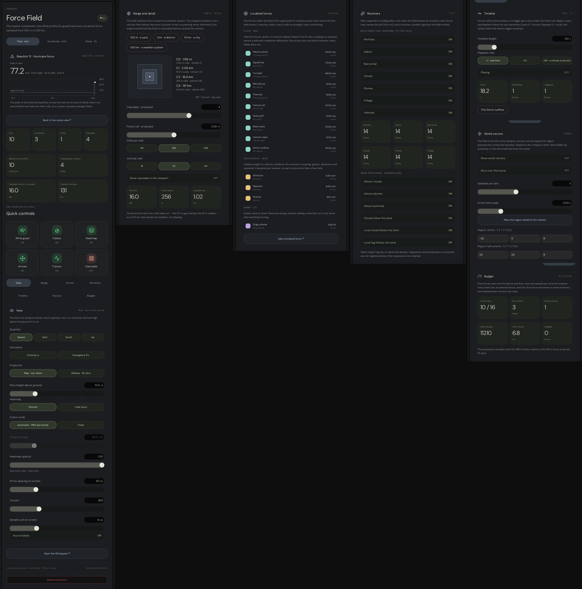
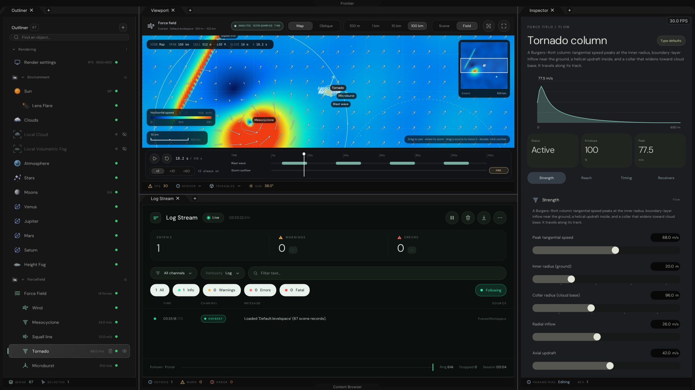
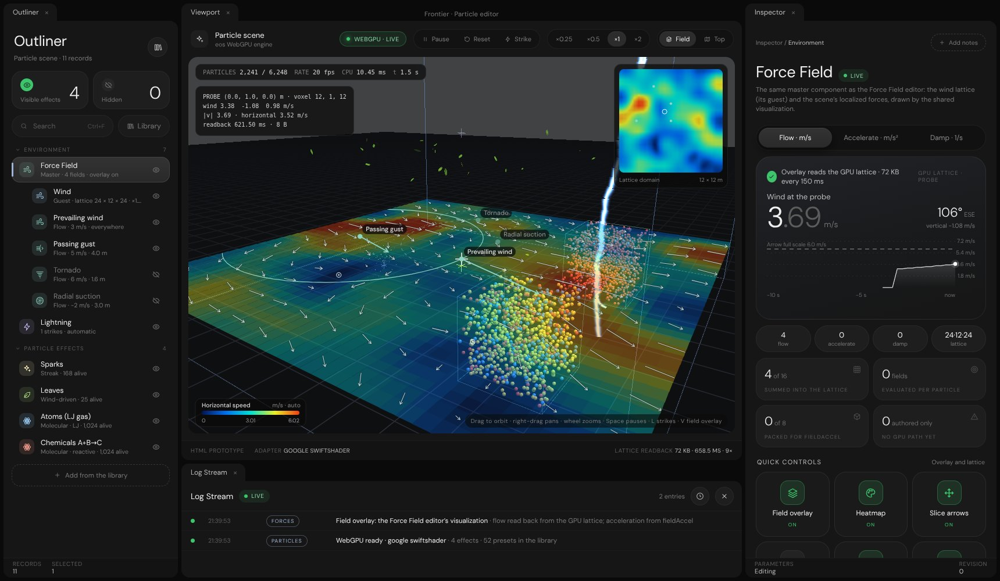
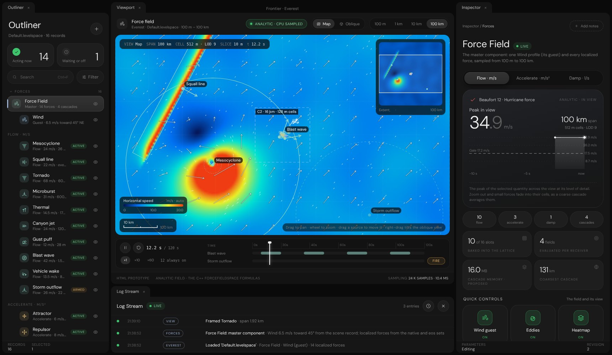

# Force Field editor (C++) and the Force Field and Particle editor prototypes: evidence

The first part covers the Force Field editor in the C++ Frontier editor (the Everest workspace); the second covers
the HTML prototypes it follows (`Experimental/ForceFieldEditor`, `Experimental/ParticleEditor` and the
visualization they share, `Experimental/ForceFieldVisualization`).

## C++ editor

The Force Field is the master record. The Wind is its guest record, and the localized forces (`ForceSource` records)
sit under it in the Outliner. The viewport's Scene · Field switch shows the field slice from 100 m to 100 km with the
eos colours and arrows, a minimap and the timeline lanes. The same slice can lie over the rendered scene. Three
inspector pages follow the Render settings look:

- **Force Field page:** the Field view's peak in view, the forces by contribution and their cost, the quick switches
  and seven sections (View, Range, Forces, Receivers, Timeline, Vectors, Budget).
- **Wind page:** the wind speed now with its last twelve seconds, the bearings, shear and veer, and five sections
  (Flow, Gusts, Altitude, Eddies, Mesoscale).
- **Force page:** one force's radial profile, its status and four sections (Strength, Reach, Timing, Receivers).

The Construct dialog has a **Forces** group (16 types). A force made from the dialog or from the page's
*Add a localized force* lands under the Force Field: in the middle of the Field view while it shows, otherwise on the
ground where the camera looks.

### Results (C++)

| Check | Program | Result |
|---|---|---|
| Catalogue, profiles, budget against the prototype | `ForceFieldCatalogueValidation` | 🟢 23 of 23 |
| Field captures, scene overlay, pages, workspace links | `ForceFieldWorkspaceCapture` | 🟢 22 captures, workspace stage passed |
| Environment pages; the compass's *Home* key | `EnvironmentInspectorValidation` | 🟢 |
| The eight regression tests (list below) | `ctest` | 🟢 8 of 8 |

Every Field capture requires more than 100 samples and a peak above zero. The figures below are from the run with
these images (timeline held at 18.25 s, the Tornado selected, 14 outlines):

| Capture | Span | Lattice | Cell | Refresh | Peak |
|---|---|---|---|---|---|
| `EditorFieldMap6km.jpg` | 6 km | 190 × 60 = 11,400 | 32 m | 6.5 ms | 74.17 m/s |
| `EditorFieldMap100km.jpg` | 100 km | 198 × 62 = 12,276 | 512 m | 7.4 ms | 34.91 m/s |
| `EditorFieldTornadoOblique.jpg` | 1.6 km | 170 × 171 = 29,070 | 8 m | 18.2 ms | 78.34 m/s |
| `EditorFieldAccelerate.jpg` | 2.4 km | 152 × 48 = 7,296 | 16 m | 0.8 ms | 7.98 m/s² |
| `EditorFieldVorticity.jpg` | 3 km | 190 × 59 = 11,210 | 16 m | 6.6 ms | 8.16 1/s |
| `EditorFieldSceneOverlay.jpg` | camera | 52 × 64 = 3,328 | — | 2.2 ms | 9.96 m/s |

The **Workspace** stage asserts:

- the Outliner lists all 14 forces;
- the Construct dialog holds 16 force types, and the bare `ForceSource` type is not offered;
- `add-force:attractor` with the Field view showing makes *Attractor 2* under the Force Field, at the view's centre;
- the dialog's order for a thermal updraft gives the type's defaults;
- `select:`, `field-span:1000`, `field-view:off` and `add-force` (the dialog opens on Forces) all take effect;
- the page reads the Field view's measurement and lists every force.

### Captures (C++)

| Image | Shows |
|---|---|
| `EditorFieldMap6km.jpg` | The Field view at 6 km: HUD, minimap, legend, the pointer's reading, timeline lanes |
| `EditorFieldMap100km.jpg` | 100 km: mesocyclone, squall line and the storm outflow's reach; 512 m cells |
| `EditorFieldTornadoOblique.jpg` | The Tornado on the oblique plate, its column standing on the slice |
| `EditorFieldAccelerate.jpg` | Accelerate: attractor, repulsor and gravity; the pointer's reading in m/s² |
| `EditorFieldVorticity.jpg` | Signed vorticity: the tornado's and the mesocyclone's rotation, the jet's shear |
| `EditorFieldSceneOverlay.jpg` | The slice over the rendered scene (SwiftShader); the Outliner with the forces |
| `EditorForceFieldPage.jpg` | Force Field page: hero, tiles, quick controls, then all seven sections |
| `EditorWindPage.jpg` | Wind page: hero over the last 12 s, compass, gusts, altitude and hodograph, eddies, mesoscale |
| `EditorForceSourcePage.jpg` | The Tornado's page: radial profile and the four sections |





### Reproduce (C++)

| Item | Value |
|---|---|
| Platform | Linux x64 sandbox, Debug host build in `_ClaudeScratch/build/UI` (`FRONTIER_HOST_VERIFICATION=ON`) |
| GPU | SwiftShader Vulkan for the scene overlay; the Field view and pages need no GPU |
| Pages | Rasterized from the ImGui draw lists by `Exhibits/ControlCentre/Code/CpuRasterization` |

```bash
export VK_ICD_FILENAMES="$PWD/ExternalPackages/VulkanCompute/SwiftShader/vk_swiftshader_icd.json"
export LD_LIBRARY_PATH="$PWD/ExternalPackages/VulkanCompute/SwiftShader${LD_LIBRARY_PATH:+:$LD_LIBRARY_PATH}"
_ClaudeScratch/build/UI/ForceFieldCatalogueValidation "$PWD"
_ClaudeScratch/build/UI/ForceFieldWorkspaceCapture EngineContent Projects/Everest EngineContent/ShaderArchives \
  <OutputFolder> [Only]
```

`Only` picks one stage: a capture name (`FieldMap6km` …), `Page` or `Workspace`. The full run took 535 s here; most
of it is the scene overlay's eight SwiftShader frames of about 35 s each.

The regression set is `ForceFieldCatalogueValidation`, `ForceFieldTriggerValidation`, `EverestInterfaceValidation`,
`EverestShippingValidation`, `CelestialWorkspaceValidation`, `EnvironmentInspectorValidation`,
`SceneViewportFlightValidation` and `EnvironmentRealmValidation`.

### Limits (C++)

- Captured offscreen on Linux. The Windows build is cross-compiled and was not run on Windows here.
- The hero's history fills while the Field view shows, so the captures (a few refreshes) show a short line.
- The cascades are budgeted and drawn; the GPU lattice itself comes with the particles (the Particle editor's C++
  port is the next phase).

## Prototypes

### Results

| Check                                                | Script                                     | Result      |
|------------------------------------------------------|--------------------------------------------|-------------|
| Field model, visualization helpers, `fieldAccel` port | `ForceFieldValidation.mjs`                 | 🟢 33 of 33 |
| eos force-field taxonomy (engine unchanged)          | `ParticleEditor/Engine/CheckForceFields.mjs` | 🟢 91 of 91 |
| Rendered pages, interactions, GPU readback agreement | `PrototypeCaptures.mjs`                    | 🟢 11 of 11 |

`ForceFieldValidation.mjs` covers:

- the Wind against an independent transcription of `ForceFieldSpace::EvaluateStepSample` at 400 points from 0 to
  6 km up (worst difference below 1e-9 m/s), and the level-of-detail filter removing the gust bands at 2 km cells;
- divergence-free eddies; Begins / Lasts / Repeats windows with ramps; triggers armed, fired and spent;
- the flow shapes (Burgers–Rott peak at the inner radius, cyclonic spin, microburst downdraft and outflow, thermal
  updraft, gust front ahead / behind its nose, blast shell at r₀ + c·t) and the accelerate / damp types;
- the prepared fast path equal to direct evaluation; every levelspace key shown as existing is read by
  `WindRecord` or `ForceFieldRecord` in `SceneWorld.cpp` (checked against the C++ source);
- distance formatting, scale bars, the camera unprojection, the colour stops; the Particle editor's `fieldAccel` port
  and half-float decoding.

`PrototypeCaptures.mjs` asserts at runtime: the outliner's 16 rows; 512 m cells at 100 km; a library card adding a
force and logging it; the eos default scene running on WebGPU; the lattice readback; the overlay's copy of the probe
voxel equal to the engine's own probe texel (difference 0); 52 presets in 14 groups; a preset joining the scene with
its attractor reaching `fieldAccel`; Render settings still building every section; no page errors. Facts are in
`CaptureReport.json`.

### Captures

| Image                              | Shows                                                                          |
|------------------------------------|--------------------------------------------------------------------------------|
| `ForceFieldMap6km.jpg`             | Master page; 6 km map, LOD 5, sources, minimap of the 100 km extent, timeline  |
| `ForceFieldWindPage.jpg`           | Wind guest page: speed now, gusts above the base speed, Beaufort, chips        |
| `ForceFieldWindAltitude.jpg`       | Variability gust preview and the Ekman altitude profile                        |
| `ForceFieldTornadoOblique.jpg`     | Tornado page, oblique plate with the column standing on it, radial profile     |
| `ForceFieldMap100km.jpg`           | 100 km: mesocyclone, squall line, cascade overlay, 512 m cells                 |
| `ForceFieldAccelerate.jpg`         | Accelerate: attractor and repulsor arrows; gravity marks nothing               |
| `ForceFieldLibrary.jpg`            | The sixteen force types by contribution                                        |
| `ForceFieldSourceSections.jpg`     | A force's Reach, Falloff curve and Strength sections                           |
| `ParticleFieldOverlay.jpg`         | Particle editor: WebGPU scene with the shared overlay, minimap, probe          |
| `ParticleEffectPage.jpg`           | Effect page: particles alive against capacity, chips, readback tiles           |
| `ParticleEffectSections.jpg`       | Source and Particle sections with vector and colour rows                       |
| `ParticleLibrary.jpg`              | The 52-preset library with group tabs                                          |
| `ParticleBlackHoleAccelerate.jpg`  | Black hole preset; the overlay shows its pull (Accelerate) inside the domain   |
| `ParticleTopViewWind.jpg`          | Top view of the lattice slice; Wind guest page                                 |
| `RenderSettingsRegression.jpg`     | Render settings unchanged with the extended `InspectorControls`                |





### Reproduce

| Item          | Value                                                                                         |
|---------------|-----------------------------------------------------------------------------------------------|
| Platform      | Linux x64 sandbox, Node 22.22, headless Chromium 153 (`@sparticuz/chromium@153.0.0`)          |
| Drivers       | `puppeteer-core@25.16.0`; WebGPU and Vulkan on SwiftShader; 2D canvas on the CPU rasterizer   |
| Environment   | `VK_ICD_FILENAMES` → SwiftShader ICD; NSS / NSPR libraries on `LD_LIBRARY_PATH`               |
| Revision      | Recorded in `CaptureReport.json` (`Revision`)                                                 |

```bash
npm install --prefix /tmp/browser @sparticuz/chromium@153.0.0 puppeteer-core@25.16.0
node Exhibits/ForceFieldEditor/ForceFieldValidation.mjs
node Exhibits/ForceFieldEditor/PrototypeCaptures.mjs /tmp/browser
```

The capture script serves the repository on a free local port, drives the pages through the DOM, and calls each
page's capture hold (`ForceFieldEditorHold`, `ParticleEditorHold`: render one frame, stop the loop) before a
screenshot, because a software-rendered page animating at full rate starves capture.

### Limits

- Browser prototypes on SwiftShader. They do not prove the C++ editor renders the same result, and frame rates here
  (about 20 fps for the Particle editor) are not desktop GPU rates.
- Not run in a Windows browser in this session.
