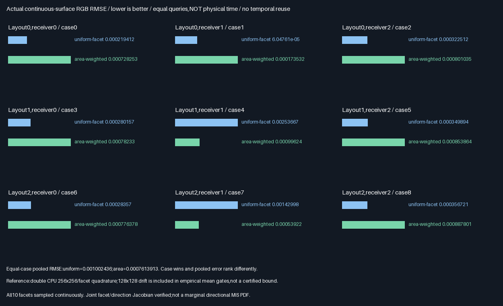
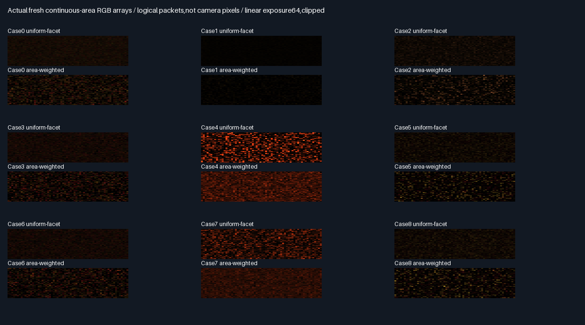

# Continuous-area sampling and PDF-correct reconnection

Fresh traced transport now samples continuous triangle interiors with explicit area PDFs and receiver BRDF,
receiver cosine,source cosine,distance-squared attenuation and visibility. This is an isolated correctness and
same-query variance comparison—not production integration or a temporal-reuse promotion.

## Measured comparison



| Case | Layout/receiver | Uniform-facet RMSE | Area-weighted RMSE | Area/uniform | Winner |
|-----:|-----------------|-------------------:|-------------------:|-------------:|--------|
| 0 | 0/0 | 0.0002194125 | 0.0007282525 | 3.319 | Uniform |
| 1 | 0/1 | 6.047613e-05 | 0.0001735318 | 2.869 | Uniform |
| 2 | 0/2 | 0.000322512 | 0.0008010345 | 2.484 | Uniform |
| 3 | 1/0 | 0.0002801573 | 0.00078233 | 2.792 | Uniform |
| 4 | 1/1 | 0.002536665 | 0.0009962399 | 0.393 | Area |
| 5 | 1/2 | 0.000349894 | 0.0008538636 | 2.440 | Uniform |
| 6 | 2/0 | 0.0002835698 | 0.0007763783 | 2.738 | Uniform |
| 7 | 2/1 | 0.001429977 | 0.0005392199 | 0.377 | Area |
| 8 | 2/2 | 0.0003567215 | 0.0008878012 | 2.489 | Uniform |

Each arm uses2048 packets x eight samples per case and exactly32,768 software-BVH calls per arm/case:one suffix
and one connection query per sample. Equal call counts are not equal physical time. Sampling all ten triangles
continuously is a different integral from the earlier eight fixed points;cross-report RMSEs are not comparable.

| Proposal             | Rating | Decision and reason                                                       |
|----------------------|--------|---------------------------------------------------------------------------|
| Uniform triangle     | ⭐⭐⭐ 🏆 | Case-win winner:lower observed RMSE in7/9;retain reference                 |
| Triangle-area weight | ⭐⭐⭐ 🏆 | Pooled-error winner;wins2/9 cases,with60.73%/62.29% lower RMSE in4/7      |
| Missing area factor  | 🔴     | Deliberately wrong density;must not be used                               |
| Missing Jacobian     | 🔴     | Deliberately wrong measure conversion;must not be used                    |

Equal ratings reflect different winning criteria,not a universal winner;trophies are not production readiness.
Exploratory equal-case pooled RMSE is0.00100244 uniform versus0.000761391 area(24.05% lower for area). The two
bright area-winning cases dominate squared error. This aggregate was not a frozen promotion criterion. Large
triangles can be poorly oriented or contribute nothing at a receiver,so area alone is not transport importance.
On the seven uniform-winning cases,area-weighted RMSE is2.44–3.32x uniform. No proposal tuning after results.

## What is implemented

| Quantity                | Definition                                                          |
|-------------------------|---------------------------------------------------------------------|
| Triangle probability    | Uniform1/10 or area/sumArea                                          |
| Within-triangle sample  | u=1-sqrt(a),v=sqrt(a)*b;anchored affine point A+u(B-A)+v(C-A)         |
| Joint area density      | qArea=pFacet/area                                                   |
| Joint direction density | qOmega=qArea*rSquared/abs(sourceCos);zero sentinel on grazing paths  |
| Surface integrand       | outgoingRGB*receiverAlbedo/pi*receiverCos*max(0,sourceCos)*V/rSquared |
| Area estimate           | Mean of integrand/qArea                                             |
| Direction estimate      | Same visibility/outgoingRGB;divide incident term by qOmega           |

Receiver normal is(0,0,-1),albedo(.6,.5,.4). Source outgoing RGB is the existing directional-light Lambertian
suffix,ray tested using production `NearestFacet`. All ten packed triangles act as both candidates and occluders.
Three blocker layouts and receivers(0,0,4),(4,-2,4),(.8,-2,4) exercise visible,blocked,back-facing and exactly
coplanar/grazing transport. Anchored affine interpolation preserves a constant coordinate on the grazing plane;
no grazing threshold,epsilon truncation or relaxed2e-5 comparison was introduced.

qOmega is JOINT facet/direction density,not a marginal directional PDF summing all overlapping surfaces. This
validates the local area-to-direction Jacobian,not complete BSDF/light MIS. Back-facing directions use the
absolute Jacobian while their one-sided integrand is zero;exactly grazing paths have zero contribution and
zero density sentinel. Fresh samples retain multiplicity;there is no duplicate cache or temporal persistence.

## Verification

| Check                         | Result                                                              |
|-------------------------------|---------------------------------------------------------------------|
| Release and host ASan/UBSan    | Five CTests each plus targeted native validation                     |
| Per-build continuous paths    | 294,912 paths;589,824 independently checked binary visibility results |
| Cross-build parity            | 29 rows,60 runtime hashes/build,nine captures,two SPIR-V files        |
| Independent CPU reference     | Double geometry,area,hash/selection,barycentrics,PDFs,RGB and outputs |
| Precision contract            | CPU max estimate3.60e-8,density7.13e-7;both below fixed2e-5           |
| Grazing coverage              | 16,726 exactly coplanar sampled paths in case8                        |
| Surface-integral reference    | Independent128x128 and256x256 CPU quadrature per triangle             |
| First-moment gates            | 54 RGB gates;6SE+2*abs(fine-coarse)+2e-5                              |
| Barycentric distribution      | 72 empirical first/second-moment gates for u/v                       |
| Area/direction estimators     | Max estimate difference1.86e-9;all per-path density checks pass       |
| Negative controls            | Each omission fails18/18 mean comparisons against quadrature         |
| Actual visual evidence        | 18 exact underlying PNG arrays,nine lossless float readbacks         |

[Full numerical comparison and negative-control failures](Results/AreaReconnection-comparison.md).
The CPU reference independently casts double all-triangle rays;it does not call the production BVH. Per-sample
visibility bits,facet selection,UVs,both densities and contributions are read back and checked. Counters include
all samples,including zero-contribution/back-facing/grazing ones. The first compile was stopped before tests
for the anchored-coordinate robustness change;the final sources are the ones hashed in retained runtime logs.



Linear exposure64/clipped. Display pixels are logical packet estimates,not camera or production GI imagery.

## Limits and practical decision

- Quadrature includes visibility discontinuities and is finite,not an analytic exact integral. Fine/coarse drift
  is an empirical allowance,not a certified error bound or proof of convergence. Means/moments are empirical
  fixed-seed checks,not formal unbiasedness or general-scene/RNG-independence guarantees.
- Area weighting is not radiance/visibility/solid-angle importance;keep both proposals as controls. No universal
  quality or speed winner is claimed. No zero-contribution query elision was applied in this bounded PDF test.
- Software-BVH wrapper counts measure calls,not primitive visits,hardware RT or physical GPU time. CDF scans,
  geometry,BRDF/PDF math,registers/spills and CPU quadrature are untimed and not included in call counts.
- The suffix is one directional Lambertian direct-light evaluation. The connected receiver includes a diffuse
  BRDF now,but arbitrary glossy transport,full MIS,multibounce paths,roulette,dynamic/camera/TAA and production
  mutation hooks remain unvalidated. No application binary is delivered;Windows/MSVC/physical GPUs not tested.
- No persistent descriptor ABI,memory packing,production code/defaults or prior rejection changes. Compact
  production output remains348.046875MiB. Earlier scalar/discrete RGB acceptance cannot transfer to this measure.

## Progress and next bounded work

| Scope                      | Complete | Remaining | Meaning                                    |
|----------------------------|----------|-----------|--------------------------------------------|
| Continuous-area/PDF gate    | 100%     | 0%        | Code,CPU checks,controls,evidence/report    |
| Production/reuse promotion  | None     | Blocked   | No new temporal or full-renderer acceptance |
| Overall ReSTIR/GI effort    | ~63%     | ~37%      | Planning estimates,not acceptance fractions |

Done:descriptor/support,RGB selection/persistence,traced visibility,lossless elision,held-out cost controls,and
continuous-area fresh reconnection with explicit PDFs/receiver BRDF. Next:fresh continuous-area reservoir
selection with explicit proposal densities and same-query raw controls. Temporal reuse stays experimental.
Remaining:continuous RIS acceptance,full MIS/multibounce,dynamic/camera/TAA/general-scene quality,physical GPU
measurements and production integration after acceptance. Packing/editor/vehicle/Jolt remain deferred.

## Reproduction and retained evidence

| Configuration | Tested condition                                                              |
|---------------|-------------------------------------------------------------------------------|
| Source        | Base2a100bf4c176c96853663377cbca6373929d3f8a + hashed exhibit changes             |
| Host          | Linux x86-64,Debian GCC12.2,CMake3.31.6;local isolated validation                |
| Shader        | Slang2026.14.1,SPIR-V1.3,-O0                                                   |
| Vulkan        | Pinned SwiftShader CPU Vulkan,production software BVH;not hardware RT           |
| Sanitizers    | Host ASan+UBSan only;driver/SPIR-V uninstrumented                              |

Prerequisites:pinned tools in `Automation/ReplayToolDependencies.json`,Vulkan-Headers v1.4.321,Python/Pillow.

```bash
BUILD_JOBS=1 bash Exhibits/LightCompute/RunAreaReconnection.sh
SANITIZE=1 BUILD_JOBS=1 bash Exhibits/LightCompute/RunAreaReconnection.sh
_ClaudeScratch/venv/bin/python Exhibits/LightCompute/Code/AreaReconnectionEvidence.py
```

- [Release log](Results/AreaReconnection-release.txt),[host sanitizers](Results/AreaReconnection-sanitized.txt).
- [Final audit](Results/AreaReconnection-parity.txt),[evidence hashes](Results/AreaReconnection-evidence-hashes.txt).
- [GPU code](Code/AreaReconnectionGpu.slang),[CPU reference](Code/AreaReconnectionValidation.h),
  [evidence generator](Code/AreaReconnectionEvidence.py). Native CLI:`--area-reconnection`.
- Retain nine lossless readbacks,two compressed SPIR-V files,18 exact PNG arrays,two plots and full comparison.
  No packing,PR or Actions;GitHub backup remains on the current session branch.

## Protocol frozen before measurements — 2026-10-29

One bounded problem:replace finite point proposals with continuous uniform-within-triangle samples and explicit
joint facet/area PDFs on the fresh traced path. Preserve all historical reuse rejections and production defaults.

| Concern     | Fixed test                                                                                       |
|-------------|--------------------------------------------------------------------------------------------------|
| Inputs      | RgbTraceScene ten packed triangles,three blocker layouts,three receivers(0,0,4)/(4,-2,4)/(.8,-2,4) |
| Arms        | Uniform triangle versus triangle-area-proportional selection;2048 packets/arm,eight draws/packet  |
| Sampling    | Two independent hash domains for square-root barycentrics;uniform interior area measure           |
| Densities   | qArea=pFacet/triangleArea;joint facet/direction qOmega=qArea*rSquared/abs(sourceCos)                  |
| Integrand   | Traced directional Lambertian outgoing RGB,receiver albedo(.6,.5,.4)/pi,both cosines,1/rSquared,V   |
| Queries     | One suffix and one connection query/draw for both arms;no temporal reuse or duplicate caching     |
| Equivalence| Area estimator equals joint-direction estimator;grazing zero-Jacobian paths contribute zero       |
| CPU         | Independent double geometry,all-triangle rays,RNG,selection,densities,per-draw contributions       |
| Precision   | Fixed2e-5 normalized CPU estimate/density contract;selection exceptions<2e-6 margin,maximum16       |
| Reference   | CPU midpoint square-root quadrature128x128 and256x256 per facet,with identical visibility offsets  |
| Mean gate   | RGB means within6SE+2*abs(fine-coarse)+2e-5 of fine quadrature;empirical,not formal convergence      |
| Negatives   | Omit area factor in qArea;omit area/direction Jacobian;both must fail on at least one lit case     |
| Comparison  | Same-input mean/RMSE and actual suffix/connection counts;no required variance winner              |
| Builds      | Release/host ASan+UBSan,five CTests each;exact semantic/capture/module parity                      |

The qOmega conversion is joint facet/direction density,not a marginal directional PDF summed over overlapping
surfaces;no full BSDF/light MIS claim. Finite deterministic quadrature is not an exact integral or certified
error bound. Counts are software-BVH wrapper calls,not physical time. Windows/physical GPUs,multibounce,
camera/TAA,general scenes and production integration remain unvalidated. Production348.046875MiB unchanged.
Phase before work:overall~59% complete/~41% remaining,planning estimates. No packing,PR or Actions.
