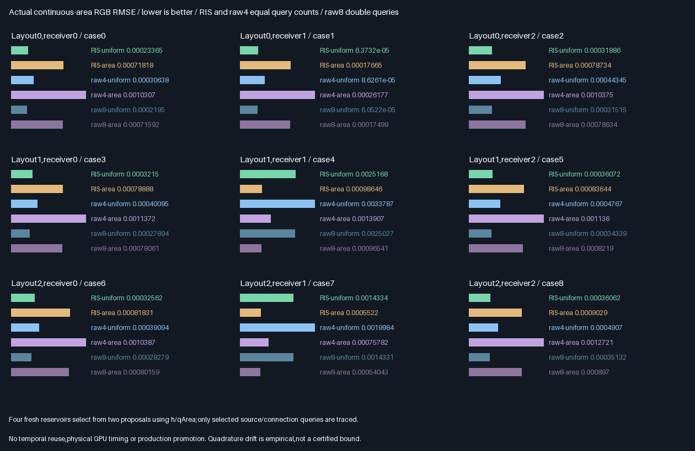
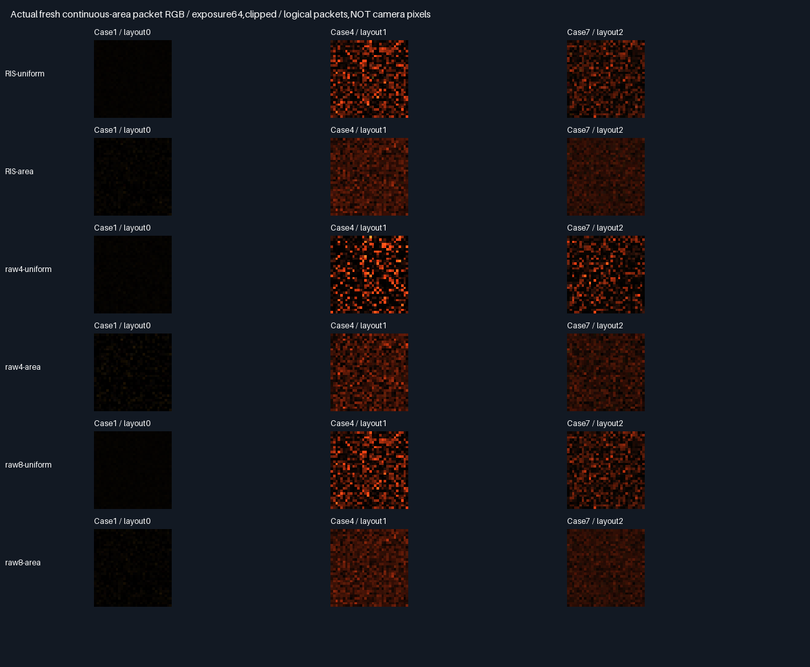

# Fresh continuous-area reservoir selection

Fresh two-proposal RIS passes the frozen same-query RMSE gate in all nine cases for both proposal families.
Uniform-family RMSE improves16.71–28.27%;area-family improves21.22–32.51%. This accepts only the bounded fresh
sampler experiment,not temporal reuse,physical speed or production integration.

## Same-input comparisons



| Arm           | Proposals/packet | Traced samples | Actual calls/packet | Purpose                       |
|---------------|-----------------:|---------------:|--------------------:|-------------------------------|
| RIS-uniform   | 8                | 4              | 8                   | Four two-proposal reservoirs  |
| RIS-area      | 8                | 4              | 8                   | Same with area facet proposal |
| Raw4-uniform  | 4                | 4              | 8                   | Uniform same-query control    |
| Raw4-area     | 4                | 4              | 8                   | Area same-query control       |
| Raw8-uniform  | 8                | 8              | 16                  | Uniform same-proposal control |
| Raw8-area     | 8                | 8              | 16                  | Area same-proposal control    |

One suffix plus one connection query is always made per traced sample,even if its contribution is zero.
Scores do not trace visibility. All6 arms use the same scene,receiver and proposal-seed inputs per packet;
raw4 uses the first proposal of each pair,raw8 uses both,and RIS selects one with PDF-correct probability.
Call counts are a proxy,not wall-clock equality:the chosen rays may have different BVH traversal costs.

| Proposal family | RIS/raw4 gate | Same-query RMSE change | RIS versus same-proposal raw8                     |
|-----------------|---------------|------------------------|---------------------------------------------------|
| Uniform facet   | PASS9/9       | 16.71–28.27% lower      | 50% fewer calls;0.02–15.26% higher RMSE              |
| Area weighted   | PASS9/9       | 21.22–32.51% lower      | 50% fewer calls;0.13–2.18% higher RMSE               |

Raw8 has lower measured RMSE in every same-family case;do not describe the50% call reduction as quality-neutral.
The frozen gate concerns RIS versus raw4 at equal calls,not raw8.
[Every case and paired intervals](Results/AreaReservoir-comparison.md).

### Decision table

Stars rate this measured quality/call tradeoff,not production readiness. Trophy labels a specific criterion.

| Option                 | Rating | Decision and reason                                                    |
|------------------------|--------|------------------------------------------------------------------------|
| Fresh RIS,uniform/area | ⭐⭐⭐ 🏆 | Same-query winner9/9 per family;carry forward to camera-space validation |
| Raw8,uniform/area      | ⭐⭐⭐ 🏆 | Accuracy reference;slightly lower error but twice the calls             |
| Raw4,uniform/area      | ⭐⭐     | Keep as equal-query controls;higher RMSE here                           |
| Previous temporal RIS  | 🔴     | Remains unpromoted;fresh results do not repair rolling-error rejection  |

Exploratory pooled RMSE is reported in the audit,not a new acceptance criterion. Across-case aggregation and
case-win counts can rank proposal families differently,as in [the preceding area gate](AreaReconnection.md).
No universal choice between uniform and area proposals is made here.

## PDF-correct mechanism

For each reservoir,generate two continuous triangle points with known joint facet/area density qArea. Compute
h=1e-6+meanRGB(unoccluded transport),including known source/receiver Lambertian factors,both cosines and1/r².
Visibility is excluded from this cheap proxy. The positive floor retains support,including inactive surfaces.

| Step           | Calculation                                                    |
|----------------|----------------------------------------------------------------|
| Proposal score | w0=h0/q0,w1=h1/q1                                              |
| Selection      | Choose candidate with probability wi/(w0+w1)                   |
| Normalizer     | (w0+w1)/(2*hSelected)                                          |
| Reservoir RGB  | Trace actual F(selected),then multiply by normalizer           |
| Packet RGB     | Average four fresh reservoirs                                  |
| Wrong control  | Keep selection,but omit q from final normalizer:(h0+h1)/(2*hS) |

This is resampling,not duplicate-ray memoization and not reuse across steps. Four reservoir choices preserve
Monte Carlo multiplicity. Each raw sample uses F/qArea. The visibility/radiance query functions and production
BVH are reused;the CPU independently replays double all-triangle rays and the full selection/weight algebra.

## Verification

| Check                   | Result                                                                  |
|-------------------------|-------------------------------------------------------------------------|
| Release/host ASan+UBSan  | Five CTests each plus targeted runtime validation                        |
| Candidate coverage      | 368,640 proposal comparisons/build                                      |
| Traced coverage         | 294,912 paths/build;589,824 binary visibility comparisons                 |
| Cross-build parity      | 11 semantic rows,62 runtime hashes/build,nine buffers,two SPIR-V files    |
| CPU checks              | Hash/UV/facet/PDF/score/selection/normalizer,RGB,selected bits and counters |
| Precision               | CPU max RGB3.36e-8,normalizer1.86e-5;both below fixed2e-5                 |
| Mean gates              | 162 RGB means against the preceding continuous-surface quadrature        |
| Wrong-normalizer means  | Fails9/9 cases per family;selection still uses correct h/q                |
| Prior-result comparison | 18,432 packet RGB comparisons;max normalized difference3.73e-9          |
| Quality acceptance      | Fresh uniform9/9 and fresh area9/9 versus same-query raw4                 |

[Per-case RGB means](Results/AreaReservoir-means.md),[audit](Results/AreaReservoir-parity.txt).
The normalizer error is checked separately from RGB error:large or low-score weights cannot hide behind dark
output. Native selection exceptions are bounded by the original2e-6 margin/max16 rule;contract stays2e-5.



Panels show three blocker layouts at receiver1,linear exposure64/clipped. All underlying float captures and
selected/unselected proposal metadata are retained,not only displayed RGB. These are logical packet arrays,
not production editor or camera images. The next phase must establish camera-space behavior separately.

## Limitations and interpretation

- The score knows the unoccluded directional-Lambertian integrand for this scene. That is not a free exact
  multibounce radiance predictor. CDF scans,geometry/score/BRDF math,temporary candidate storage,register/spill
  effects and raw/RIS branch costs are untimed. Equal call counts do not prove a physical GPU speedup.
- Prototype telemetry uses four float4 slabs per reservoir,not a newly packed production reservoir format.
  No persistent descriptor ABI or production memory allocation changes. Production348.046875MiB stays unchanged.
- All points lie on ten test triangles,with three layouts and three receivers. Receiver normal/albedo are fixed
  as in the area gate. This is not general-scene,camera,motion/TAA,glossy,full MIS or multibounce acceptance.
- Square-root sampling supports continuous triangle interiors. Joint area densities are used directly;this
  phase does not add a marginal directional PDF or BSDF/light MIS beyond the preceding local Jacobian test.
- Quadrature128/256 is finite,not an exact integral or certified error bound. The empirical6SE gate includes
  two times coarse/fine drift plus2e-5. Hash domains/common seeds are not formal RNG independence. Eight-block
  paired intervals are descriptive;the nine cases are not independent general-scene replications.
- Raw8 matches old inputs for the first1024 packets per family/case,not the previous whole2048-packet statistics.
  Arithmetic accumulation order differs;compare within the fixed contract,not bitwise. No cross-report claim
  of a newly improved raw estimator is made. Prior scalar/temporal acceptance does not transfer to fresh RGB.

## Progress and next bounded work

| Scope                       | Complete | Remaining | Meaning                                     |
|-----------------------------|----------|-----------|---------------------------------------------|
| Fresh area RIS experiment   | 100%     | 0%        | Implementation,tests,all controls and report |
| Frozen same-query quality   | 18/18    | 0/18      | Nine cases per proposal family              |
| Production/temporal reuse   | None     | Blocked   | Separate acceptance still required          |
| Overall ReSTIR/GI effort     | ~67%     | ~33%      | Planning estimates,not acceptance fractions  |

Done:area measure/PDF support and a fresh reservoir sampler with same-query quality gains. Next:camera-space
fresh RIS validation with receiver normals/materials and actual image/raw-control comparisons,not a temporal
reuse retry. Remaining:camera/general-scene acceptance,full MIS/multibounce,dynamic/TAA,physical GPU measurement
and production integration after acceptance. Packing/editor/vehicle/Jolt stay deferred;348.046875MiB unchanged.

## Reproduction and retained evidence

| Configuration | Tested condition                                                              |
|---------------|-------------------------------------------------------------------------------|
| Source        | Base499fd1581ead6231ff75e4d293ad6db2c000e6bf + runtime-hashed exhibit changes    |
| Host          | Linux x86-64,Debian GCC12.2,CMake3.31.6;local validation only                    |
| Shader        | Slang2026.14.1,SPIR-V1.3,-O0                                                   |
| Vulkan        | Pinned SwiftShader CPU Vulkan,production software BVH;not hardware RT           |
| Sanitizers    | Host ASan+UBSan;driver/SPIR-V uninstrumented                                    |
| Untested      | Windows/MSVC,physical GPUs,editor/production renderer,multibounce and cameras   |

Prerequisites:pinned tools in `Automation/ReplayToolDependencies.json`,Vulkan-Headers v1.4.321,Python/Pillow.
Previous continuous-area quadrature/readbacks and their hashes are required and retained in this repository.
No application executable delivered. Native CLI:`--area-reservoir`.

```bash
BUILD_JOBS=1 bash Exhibits/LightCompute/RunAreaReservoir.sh
SANITIZE=1 BUILD_JOBS=1 bash Exhibits/LightCompute/RunAreaReservoir.sh
_ClaudeScratch/venv/bin/python Exhibits/LightCompute/Code/AreaReservoirEvidence.py
```

- [Release](Results/AreaReservoir-release.txt),[host sanitizers](Results/AreaReservoir-sanitized.txt).
- [Metrics and intervals](Results/AreaReservoir-comparison.md),[means](Results/AreaReservoir-means.md),
  [audit](Results/AreaReservoir-parity.txt),[evidence hashes](Results/AreaReservoir-evidence-hashes.txt).
- [Shader](Code/AreaReservoirGpu.slang),[CPU reference](Code/AreaReservoirValidation.h),
  [evidence generator](Code/AreaReservoirEvidence.py).
- Retain nine lossless readbacks,two compressed SPIR-V files,18 exact PNG arrays,two graphs and generated tables.
  No packing,PR or Actions;GitHub backup remains on the current session branch.

## Protocol frozen before measurements — 2026-10-29

One bounded problem:two-proposal fresh RIS with explicit area densities,compared to both same-query and
same-proposal raw controls. Temporal reuse stays disabled;prior rejections and production defaults stay unchanged.

| Concern     | Fixed test                                                                                         |
|-------------|----------------------------------------------------------------------------------------------------|
| Inputs      | Previous ten-triangle,three-layout,three-receiver continuous-area cases;1024 packets/arm,nine cases   |
| Arms        | RIS uniform/RIS area;raw4 uniform/raw4 area;raw8 uniform/raw8 area                                    |
| Reservoirs  | Four fresh independent reservoirs/packet,two proposals each;only selected proposal traced            |
| Scores      | h=1e-6+meanRGB(unoccluded two-diffuse transport);no visibility queries to compute h                    |
| Weights     | w=h/qArea;selection w/sum(w);final normalizer sum(w)/(2*hSelected),then average four contributions     |
| Raw controls| Four samples for equal queries;eight samples for equal proposals;ordinary F/qArea                    |
| Query work  | Always suffix+connection per selected/raw sample;RIS/raw4 eight calls,raw8 sixteen;no elision         |
| Densities   | Uniform or area-weighted facet selection;uniform square-root barycentrics;all ten facets supported   |
| CPU         | Independent double geometry/rays,scores,densities,RNG,selection,normalizers and full RGB outputs      |
| Precision   | Fixed2e-5 normalized contract;selector exceptions only at margin<2e-6,maximum16                       |
| Means       | Previous128/256 quadrature reference;6SE+2*abs(fine-coarse)+2e-5 per arm/case/RGB |
| Negative    | Omit qArea from RIS normalizer;must fail at least one mean gate in each proposal family              |
| Quality     | For each family,RIS no worse instant RGB RMSE than raw4 on ALL9 cases at exactly equal query counts  |
| References  | Raw8 and previous area results remain descriptive proposal-budget/other-result comparisons          |
| Builds      | Release and host ASan/UBSan,five CTests each;semantic/capture/module parity                           |

No tuning after held-out results. Source/connection rays differ in physical cost;call counts are not timing.
The score is an unoccluded known directional-Lambertian proxy,not arbitrary multibounce radiance. Four independent
reservoir draws use separated hash counters,not a formal RNG-independence proof. Quadrature is finite and not a
certified exact integral. No temporal,full MIS,multibounce,physical GPU or production acceptance is claimed.
Production348.046875MiB remains unchanged. Overall before phase~63%/~37% remaining,planning estimates.
No packing,PR or Actions;commit/push backup authorized on the current session branch.
