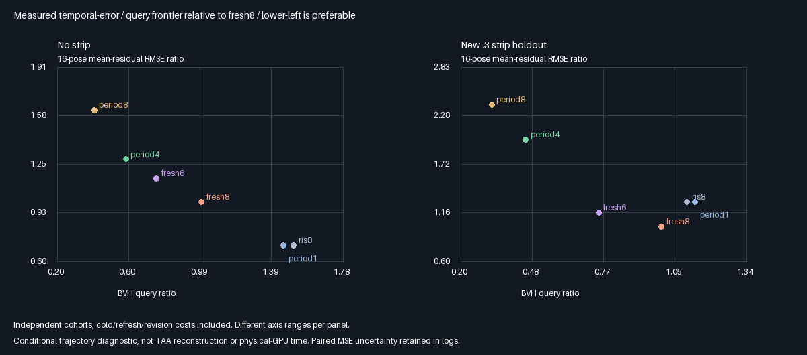
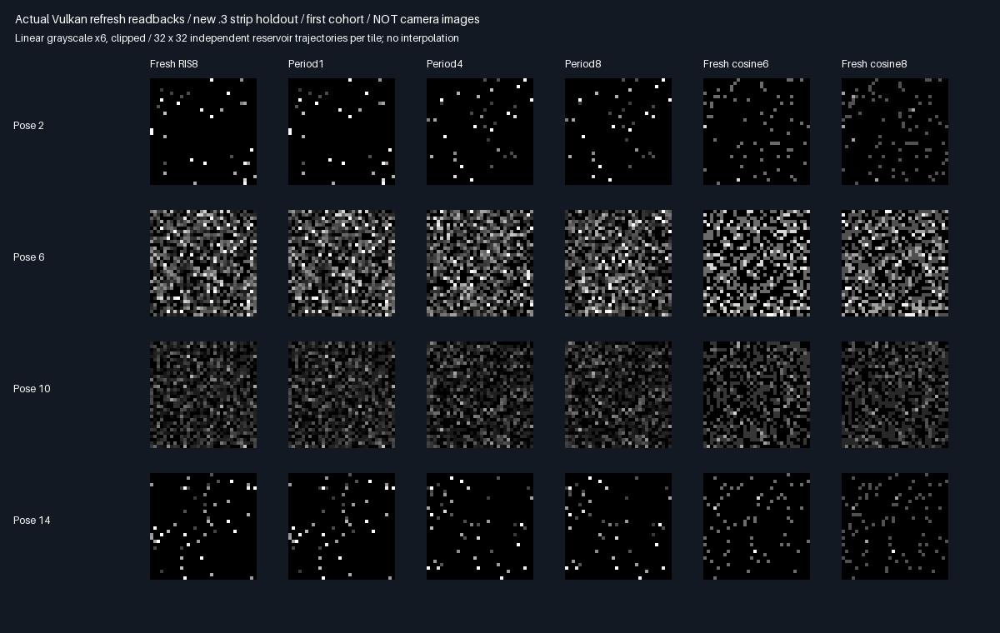

# Bounded vertex-cache refresh and moving-receiver holdouts

## Protocol fixed before measurement

Test refresh before adding accumulation/merging. The prior persistence gate preserves one frozen bank; this phase
measures whether reduced redraw noise conceals correlated error and poor temporal averaging.

| Concern | Fixed choice |
|---------|--------------|
| Arms | Fresh RIS8 inline; cache refresh1/4/8 submissions; fresh cosine6/8 restricted-component controls |
| Cohorts | 32 independent cold cohorts × 1024 reservoirs × 16 receiver poses |
| Fixtures | Triangle square/strip, half-width0/.12/.3/.6; .3 is a new geometry holdout |
| Motion | x=.5−.5cos(2π pose/16), uploaded float coordinates, y=z=0, normal+Z |
| Illumination | Directional light, intensity half at pose9, restored at pose13; explicit revision tokens |
| Refresh | CPU periodic force at pose divisible by1/4/8; light revision always invalidates all cache periods |
| Source | Original donor x=0 and .75 cosine/.25 uniform area; eight candidates, target floor .01 |
| Fresh controls | Six/eight current-receiver cosine paths for this component, not full four-bounce Whole6/Whole8 |
| Randomness | MT19937-64 0x38d29a17 + fixture×0x1000193; new draw each pose/cohort; paired GPU local index |
| Reference | Independent clipped-area midpoint quadrature1024²/2048²; refinement<1e-7 |
| Means | Each pose/method within4 nominal SE+.0001; period1/inline estimates within2e-6 pointwise |
| Temporal metric | RMSE of each reservoir's 16-pose mean residual against changing reference |
| Instant metric | RMSE over all pose/cohort/reservoir residuals |
| Flicker metric | RMS successive residual difference, subtracting physical reference changes |
| Correlation | Centered lag1 residual correlation pooled across within-cohort adjacent poses |
| Paired contrasts | Period4/8 minus fresh6/8 instantaneous and temporal MSE, cohort nominal SE |
| Work | All cold/periodic/revision rebuilds included; actual nearest-facet invocations, not GPU timing |
| Promotion | Zero; no tuning cadence, thresholds or holdouts after measurement |

A low flicker number is not automatically better quality: a frozen wrong estimate can be stable. Temporal RMSE
measures averaging along this prescribed receiver trajectory, not a production TAA reconstruction metric.
Cached estimates share source samples across poses; repeated samples are never counted as independent cohorts.
No new spatial donors, sample-count growth, general material/suffix support or production allocation changes.

## Verified outcome: reduced redraw noise does not preserve temporal averaging quality

| Strip width | Period | Fewer queries vs fresh8 | Instant RMSE change | Temporal RMSE change |
|------------:|-------:|------------------------:|--------------------:|---------------------:|
| 0 | 4 | 41.89% | −29.88% | +28.85% |
| 0 | 8 | 59.36% | −29.98% | +61.82% |
| .12 | 4 | 47.99% | +92.10% | +197.78% |
| .12 | 8 | 63.45% | +92.77% | +274.80% |
| .3 holdout | 4 | 54.07% | +27.31% | +100.05% |
| .3 holdout | 8 | 67.56% | +26.56% | +140.20% |
| .6 | 4 | 52.93% | +31.66% | +66.64% |
| .6 | 8 | 66.76% | +32.62% | +67.51% |

Both periods have higher temporal MSE than **both fresh6 and fresh8 in all four fixtures**. All16 paired temporal
contrasts are positive, at least17.38 nominal SE from zero. That is finite-cohort evidence, not a guaranteed
confidence interval or formal population proof. All384 per-pose reference-mean gates still pass.



No-strip period4/8 lag1 residual correlations are .7166/.8448, versus .0007 for fresh8. For the new .3 strip they
are .4206/.5841, versus .0005 for fresh8. These are pooled, nonstationary empirical correlations, not universal
noise constants. On the .3 holdout, flicker RMS falls .043312→.041981/.035362 while 16-pose mean-residual RMSE
rises .007381→.014765/.017728. A smoother sequence can therefore retain substantially more error.

Period1 matches fresh RIS8 pointwise within **2.39e-7** and has negligible lag correlation. It does not universally
save queries: cache construction can cost more than inline evaluation in the occluded fixtures. The non-cosine
RIS proposal also has worse instantaneous error than fresh8 in the occluded fixtures before freezing is added.
Do not attribute that existing proposal/selection penalty entirely to temporal correlation.

## Actual readbacks



These are reservoir-estimate arrays, **not camera images**. Exposure6 and clipping are display-only. The new
geometry holdout is shown at poses2/6/10/14. Statistics use unclamped data from all32 independent cold cohorts;
repeated cached samples do not become independent samples. See [all metrics](Results/CacheRefresh-comparison.md)
for flicker, correlation, instantaneous/temporal error and actual query totals for every arm.

## Verification and reproduction

| Check | Outcome |
|-------|---------|
| Device | SwiftShader Device (Subzero), CPU Vulkan type4 |
| Release + host ASan/UBSan | Both exit0; five CTests each |
| Mean/reference and identity | 384 pose gates; four period1 aggregate bounds, max2.39e-7 |
| Cross-build parity | 494 identical semantic rows;97 logged hashes verified/build |
| Captures | 64 raw files byte-identical;24 representative PNG pixel arrays exact |
| Cadence/light changes | Period4 reuses10/16 poses;period8 reuses12/16;revision poses9/13 always rebuild |
| Shader/fresh budgets | Exact source rederivation;fresh6/8 loops and normalization verified |
| Acceptance | No promotion, physical-GPU timing or production layout/default change |

[Release](Results/CacheRefresh-release.txt), [sanitizer](Results/CacheRefresh-sanitized.txt),
[parity](Results/CacheRefresh-parity.txt). No sampler, cadence, threshold or holdout was tuned after measurement.
Counters record actual nearest-facet invocations, including source and receiver visibility. Fresh6/8 denote
candidate counts, not exact ray-count matching.

```sh
bash Exhibits/LightCompute/RunCacheRefresh.sh
SANITIZE=1 BUILD_JOBS=1 bash Exhibits/LightCompute/RunCacheRefresh.sh
_ClaudeScratch/venv/bin/python Exhibits/LightCompute/Code/CacheRefreshEvidence.py
```

Tested Linux/GCC12.2 C++20, Slang2026.14.1/SPIR-V1.3, pinned SwiftShader, Vulkan headers1.4.321,
CMake/CTest3.31.6; Python/Pillow for evidence. Both builds use base75f72f4 plus measured prototype source,
subsequently checkpointed as ce05812. Logs contain source/shader/tool hashes. Raw/build inputs are ignored
scratch; metrics, images and generating code are retained. Host sanitizers do not instrument the driver/shaders.
Earlier checkpoint logs remain historical after the shared exhibit host gains another CLI/header.

## Decision and next experiment

Keep the measured cache work savings, but do not promote period4/8 freezing as a quality-preserving fresh-sample
replacement. Repeatedly shading one donor-selected winner preserves correlated error; tightening invalidation
alone does not add independent information. Do not rescue this outcome with retrospective floor/period tuning.

Next, test retaining proposal-density-bearing candidates **before donor-specific winner selection**, followed by
current-receiver evaluation/selection and explicit fresh-candidate injection or bank replacement. That changes
candidate retention rather than relabeling this rejection. It needs fixed memory/query budgets, normalization
checks and the same moving/occluded holdouts; no improvement is assumed in advance.

This remains a scalar diffuse secondary-component experiment with a fixed donor and deterministic directional
suffix. It does not validate production TAA, RGB/general surfaces, multi-donor merging, stochastic multibounce
suffixes, full four-bounce Whole6/Whole8, Windows/editor or physical-GPU execution time. Production output stays
**348.046875 MiB at1080p**, unchanged.

The subsequent [candidate-retention checkpoint](CandidateBank.md) keeps density-bearing proposals instead of
one donor-selected winner. It improves the tradeoff, but does not eliminate temporal or storage constraints.
