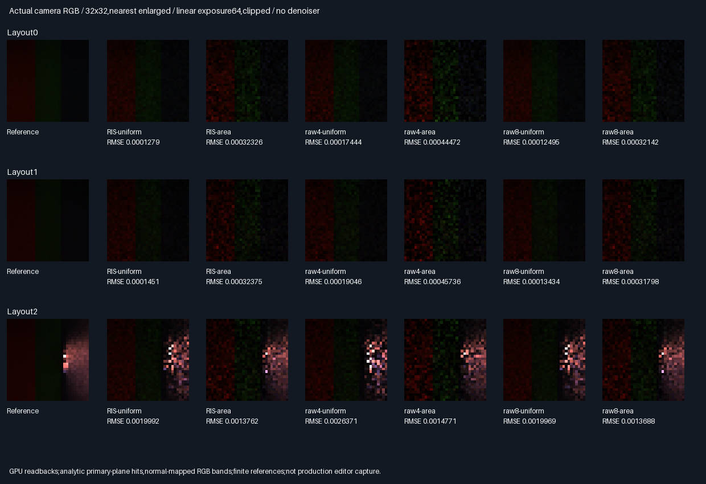
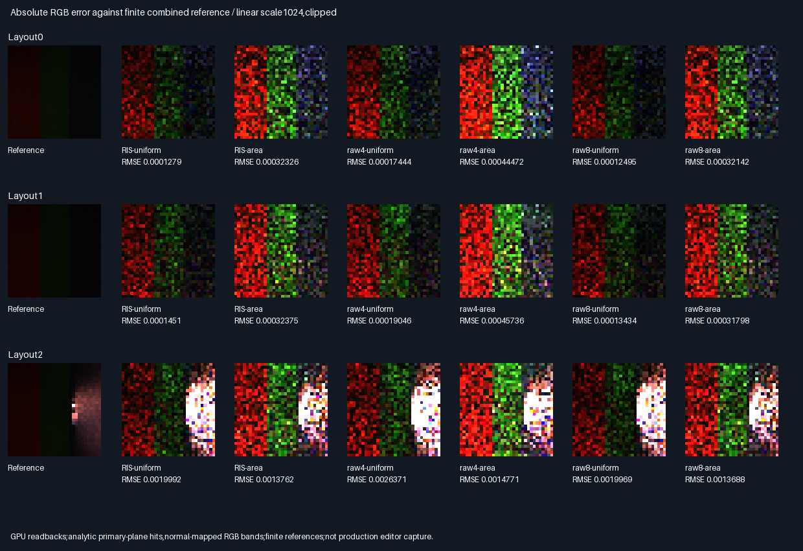

# Camera-space fresh continuous-area RIS

Fresh RIS passes both frozen image-error gates in3/3 layouts for each proposal type. This extends the previous
fixed-receiver experiment to actual orthographic camera pixels,normal mapping and three diffuse materials.
It accepts this shading-patch experiment only,not general-scene integration or physical GPU performance.

## Images and same-input comparison



All arms average four packets per32×32 image pixel. Each packet traces four RIS/raw4 samples or eight raw8
samples. Both suffix/connection queries always execute. Seeds are shared across comparison arms;reference
banks use disjoint domains. Display is linear exposure64/clipped,nearest enlargement,no denoiser or TAA.

| Proposal type | Image gates | RMSE decrease versus raw4 | Versus raw8                          |
|---------------|-------------|---------------------------|--------------------------------------|
| Uniform facet | PASS3/3     | 23.82–26.68%              | 50% fewer calls;0.11–8.01% more RMSE |
| Area weighted | PASS3/3     | 6.83–29.21%               | 50% fewer calls;0.54–1.81% more RMSE |

Both ordinary RMSE and cross-reference MSE must improve for each gate. Raw8 has lower RMSE in every
same-proposal comparison. These are query counts,not measured GPU time;candidate/BRDF/precision math is extra.

| Choice          | Rating | Decision and reason                                                        |
|-----------------|--------|----------------------------------------------------------------------------|
| Fresh RIS       | ⭐⭐⭐ 🏆 | Same-query measured winner;continue bounded geometric-scene testing         |
| Raw8            | ⭐⭐⭐    | Accuracy reference;slightly less error at double the calls                 |
| Raw4            | ⭐⭐      | Retain equal-query controls;higher image error in these layouts            |
| Temporal reuse  | 🔴      | Remains unaccepted;camera stills do not repair previous rolling rejection  |

Stars rate measured quality/query tradeoff,more is better;not production readiness. No universal uniform/area
winner:uniform wins layouts0/1,area wins layout2. Previous point tests also showed scene-dependent rankings.
[All arm metrics,ratios and paired intervals](Results/CameraAreaReservoir-comparison.md).

## Precision repair and verification

The initial camera replay aborted at the normalizer gate near the vertical blocker. A later diagnostic found
normalized error4.58e-5,above the unchanged2e-5 threshold. Changing algebra alone or retaining only a rounded
receiver-to-point vector was insufficient. The final shader retains low-word subtraction/product residuals
through the receiver cosine,with split products rather than assuming single-rounding GLSL Fma behavior.
The physical integrand,positive score floor,proposal budgets and acceptance criteria are unchanged.

| Check                    | Final result                                                        |
|--------------------------|---------------------------------------------------------------------|
| Release/host ASan+UBSan   | Five CTests each plus targeted camera replay                         |
| CPU candidate replay     | 491,520 proposals/build;RNG,UV,facet,PDF,score,selection and weights   |
| CPU traced replay        | 393,216 paths;786,432 binary visibility decisions/build               |
| CPU maximum errors       | RGB7.99e-8;normalizer5.64e-7;both below fixed2e-5                      |
| Selector exceptions      | 0;original margin2e-6/max16 budget unchanged                          |
| Cross-build parity       | Eight semantic rows,61 runtime hashes/build,six buffers,two modules   |
| RGB aggregate means      | 54/54 pass;independent reference residual≤6 estimated SE+2e-5         |
| Wrong-normalizer control | Missing qArea fails in3/3 layouts for each RIS proposal type          |
| Reference work           | 4,718,592 additional GPU paths/build;not included in algorithm budget |
| Images                   | 39 exact32×32 PNG arrays plus two comparison/error sheets              |

[Mean checks](Results/CameraAreaReservoir-means.md),[audit](Results/CameraAreaReservoir-parity.txt).
CPU replay independently evaluates double geometry and all-triangle visibility for experimental arms.
Reference passes use the same GPU raw8 implementation;they are not independently CPU-replayed sample by sample.
No default,packed descriptor or production allocation changes:348.046875MiB remains unchanged.



## What the reference does and does not establish

- Two independent-domain uniform raw8 banks each use768 traced samples/pixel. Combined reference uses1536
  samples/pixel,or3072 suffix/connection calls. Reference draws do not overlap experimental proposal domains.
- Ordinary image RMSE includes finite-reference noise. Cross-reference MSE uses
  mean((estimate-A)·(estimate-B))/3;in the ideal independent unbiased RNG model its expectation removes reference
  variance. Hash domains are not a formal independence proof. Both measured criteria pass,without gate tuning.
- Estimated combined-reference RMS noise is1.87e-5,1.82e-5 and9.37e-4 for layouts0/1/2. The near-wall bright
  region makes layout2 substantially less certain. Its64-tile paired cross-MSE intervals include zero for
  both proposal types;layouts0/1 intervals do not. Point-estimate wins are not confidence-certified wins.
- Tile intervals are descriptive normal approximations,not rigorous bounds. Three related toy layouts do not
  establish general-scene robustness. Display clipping never affects linear float error calculations.

## Camera scope and remaining work

Primary orthographic rays originate at(X,Y,2),travel+z and analytically hit the shading patch at z4. Pixel-centre
coordinates span[-2,2]². Receiver normals vary continuously with sin/cos;RGB reflectance changes in three bands.
This is an actual spatial camera image,not the previous logical packet arrays,and not a production editor shot.

The receiver is shading-only,not inserted into secondary-ray BVH/proposal triangles:it does not cast additional
shadows onto source facets. Normal mapping does not change geometric silhouette. Only the original ten facets
participate in suffix/connection visibility. Therefore this is not a self-consistent complete-scene render.
Known directional-Lambertian source transport supplies the unoccluded proxy;not general cached radiance.

| Progress                          | Complete | Remaining | Meaning                            |
|-----------------------------------|----------|-----------|------------------------------------|
| Camera shading-patch experiment   | 100%     | 0%        | Code,tests,controls,images,report   |
| Frozen image gates                | 6/6      | 0/6       | Two proposal types × three layouts |
| Overall ReSTIR/GI                  | ~71%     | ~29%      | Planning estimates,not acceptance  |
| Production/temporal acceptance     | None     | Separate  | Still requires independent gates  |

Next bounded phase:scene-consistent primary intersections and geometric receivers participating in visibility,
with fresh RIS/raw controls and stronger bright-region references. Remaining:general scenes,MIS/multibounce,
dynamic/TAA,physical GPU timings and production integration. Memory packing,editor,vehicle and Jolt stay deferred.

## Reproduce and provenance

| Configuration | Tested condition                                                               |
|---------------|--------------------------------------------------------------------------------|
| Source        | Basec93a3d27fb0850e5b536e2960da48393bc712cde + runtime-hashed exhibit changes     |
| Host          | Linux x86-64,Debian GCC12.2,CMake3.31.6                                           |
| Shader        | Pinned Slang2026.14.1,SPIR-V1.3,-fp-mode precise,-O0                            |
| Vulkan        | Pinned SwiftShader CPU Vulkan,production software BVH;not hardware RT            |
| Sanitizers    | Host ASan/UBSan;driver/SPIR-V uninstrumented                                     |
| Untested      | Windows/MSVC,physical GPUs,production editor,temporal/glossy/MIS/multibounce      |

Prerequisites:Python/Pillow,CMake,Vulkan-Headers v1.4.321,and pinned tools restored with
`python Automation/PrepareReplayTools.py`. No application executable delivered.

```bash
BUILD_JOBS=1 bash Exhibits/LightCompute/RunCameraAreaReservoir.sh
SANITIZE=1 BUILD_JOBS=1 bash Exhibits/LightCompute/RunCameraAreaReservoir.sh
_ClaudeScratch/venv/bin/python Exhibits/LightCompute/Code/CameraAreaReservoirEvidence.py
```

- [Shader](Code/CameraAreaReservoirGpu.slang),[CPU replay](Code/CameraAreaReservoirValidation.h),
  [evidence generator](Code/CameraAreaReservoirEvidence.py),[runner](RunCameraAreaReservoir.sh).
- [Release](Results/CameraAreaReservoir-release.txt),[sanitizers](Results/CameraAreaReservoir-sanitized.txt),
  [hash manifest](Results/CameraAreaReservoir-evidence-hashes.txt). Retained compressed readbacks/modules are
  lossless;displayed32×32 PNG arrays are verified byte-for-byte against their fixed-exposure encoding.
- [Previous fixed-receiver RIS](AreaReservoir.md) is historical evidence,not a same-input image comparison.
  Its retained manifest is rechecked without rewriting it. Scene/receiver changes prevent cross-report RMSE ratios.
- Workspace recovery restored the verified GitHub backup on this same branch after preserving pre-restore files
  under ignored `_ClaudeScratch/recovery/pre-restore.tgz`. No PR or GitHub Actions.

## Frozen protocol — before measurements

| Scope | Fixed choice |
|-------|--------------|
| Camera | Orthographic,32×32 primary pixel centres;origin z2,forward +z;receiver plane z4 |
| Receiver | Four-unit square;continuous normal map and three diffuse RGB material bands |
| Scenes | Same ten proposal facets and three blocker layouts as preceding fresh RIS |
| Arms | RIS-uniform,RIS-area,raw4-uniform,raw4-area,raw8-uniform,raw8-area |
| Budget | Four independent packets/pixel;four reservoirs/packet,two proposals/reservoir |
| Score | Positive1e-6 plus mean unoccluded two-diffuse RGB,including actual receiver BRDF |
| Reference | Two disjoint uniform raw8 banks;96 packets/bank/pixel,768 traced samples each |
| Quality gate | RIS image MSE no worse than same-proposal raw4 in every layout,per proposal type |
| Metrics | Ordinary RMSE versus combined reference and cross-reference MSE must both pass |
| Cross MSE | mean((estimate-referenceA)·(estimate-referenceB))/3;avoids reference variance bias |
| Means | Per-arm/channel aggregate difference≤6 estimated SE+2e-5;negative control fails both types |
| Replay | Same fixed2e-5 normalized CPU tolerance;selector margin2e-6,max16 exceptions |
| Runtime | Release and host ASan/UBSan,five CTests each;readback/module/semantic parity |

Camera rays hit the analytic receiver plane;secondary visibility uses the existing production triangle BVH.
The plane is a shading receiver,not a new proposal surface. This is a normal-mapped diffuse patch test,not
full-scene camera integration or a curved geometric receiver. Both suffix/connection queries always execute.
No physical GPU timing,temporal reuse,TAA,glossy,multibounce,MIS or production acceptance is implied.
Production348.046875MiB/defaults stay unchanged. No criteria tuning after observing results.
