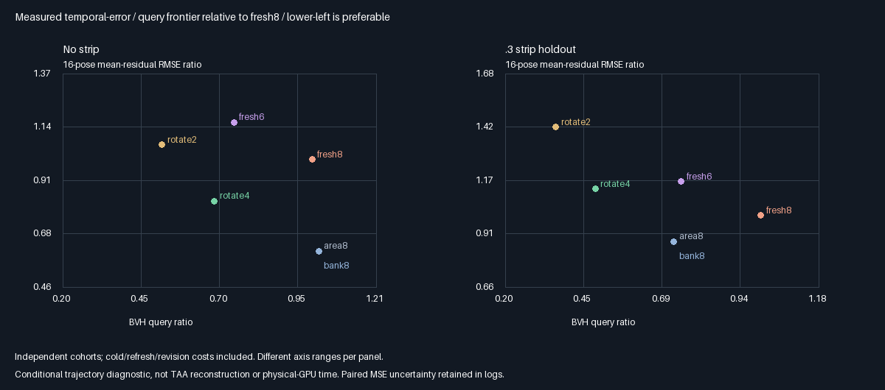
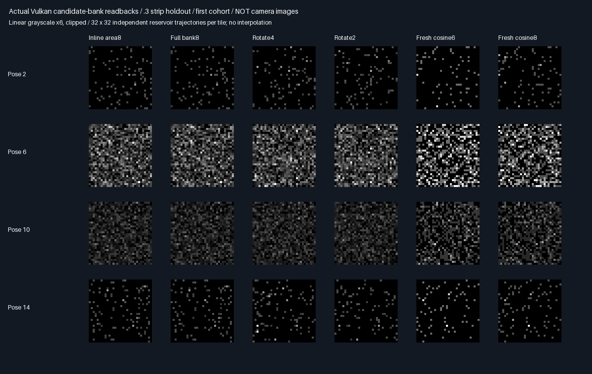

# Density-bearing candidate retention and rotating refresh

Retaining raw candidates recovers a useful query/quality tradeoff, but the larger bank is not production-ready.
Rotate4 beats component fresh6 on work and temporal error in all fixtures;fresh8 still exposes an occluded gap.

## Verified outcome: retention improves the tradeoff, not every holdout

| Arm | Measured result | Decision |
|-----|-----------------|----------|
| Inline area8 | Lower instant/temporal RMSE in4/4; fewer queries in3/4 vs cosine8 | ⭐ Follow-up candidate |
| Rotate4 | Fewer queries and lower temporal RMSE vs cosine6 in4/4 fixtures | 🚩 Continue holdouts/memory checks |
| Rotate2 | Higher temporal RMSE vs cosine8 in4/4 despite lower instantaneous noise | 🔴 Not quality-neutral |
| Full bank8 | Same outputs and query counts as inline area8 | ✔️ Identity control only |

All comparisons concern this restricted diffuse secondary component, not full four-bounce Whole6/Whole8.
Lower is better for both error and work. Negative error changes below are improvements.

| Strip | Rotate4 fewer queries vs fresh6 | Instant RMSE change | Temporal RMSE change |
|------:|-------------------------------:|--------------------:|---------------------:|
| 0 | 8.45% | −47.19% | −28.85% |
| .12 | 22.99% | −35.29% | −15.71% |
| .3 | 35.80% | −25.17% | −3.04% |
| .6 | 34.24% | −29.59% | −12.10% |

These four temporal-MSE contrasts favor rotate4 by at least4.34 nominal cohort SE, not a guaranteed confidence
interval. Against fresh8, rotate4 temporal RMSE changes−17.59%/−3.00%/+12.70%/+1.47%. The .3 penalty is17.99
nominal SE; the .6 difference is only1.69 SE and is not strong evidence of a population penalty.

The nonpersistent area8 control lowers temporal RMSE39.04%/25.23%/12.57%/18.57% versus cosine8. Query count
changes+2.16%/−13.44%/−27.24%/−25.46%. It needs no persistent candidate history, although the shared validation
allocation is unchanged. Full-bank caching itself adds no benefit when every candidate is rebuilt every pose.
Known-area sampling is important here: this is not a general-scene sampler performance claim.

Rotate2 temporal RMSE rises6.30%/21.42%/42.36%/16.32% versus fresh8. It still correlates errors; the .3 lag1 is
.5117 versus .3396 for rotate4 and .0005 for fresh8. Candidate retention helps but does not erase correlation.
All old fresh6/8 controls retain identical numerical results; the new .3 geometry from the prior phase is now
an existing holdout, not a newly blind dataset. No rotation period or proposal density was tuned after results.

## Visible evidence and memory limits





These are logical reservoir arrays, not camera images. Display exposure6/clipping do not affect statistics.
See [all metrics](Results/CandidateBank-comparison.md) for every arm, error, residual flicker and total query cost.

Payload grows32→144B per reservoir, plus the same16B telemetry. That is112B extra, or221.484375MiB for one
reservoir per1080p pixel. The exhibit uses otherwise spare SSBO slots, not spare production storage. No claim
that this fits the current348MiB layout, or that query savings imply lower physical-GPU time/bandwidth cost.
Inline area8 avoids candidate history and is therefore a useful lower-storage follow-up before a bank port.

## Verification

| Check | Verified result |
|-------|-----------------|
| Release + host ASan/UBSan | Both exit0;five CTests each;494 semantic rows identical |
| Source provenance | 163 logged hashes verified/build;shader rederivation exact |
| Means/identity | 384 pose mean gates;full-bank/inline estimates and query counts identical |
| Retention | 17,039,360 native retained-slot comparisons across32 cohorts |
| Raw parity | 128 captures exact across builds;24 representative PNG arrays exact |
| Independent payload check | 1,572,864 candidates,532,480 byte-identical retained slots |
| Density/reconstruction | Max errors1.36e-7 /5.34e-8;196,608 bank estimates reconstructed |
| Normalization negative check | Replacing fixed8 divisor with nonnull count disagrees at121,428 estimates |
| Unchanged controls | 136 fresh6/8 mean/result rows identical to prior experiment |

[Release](Results/CandidateBank-release.txt), [sanitizer](Results/CandidateBank-sanitized.txt),
[parity](Results/CandidateBank-parity.txt). All statistics use32 cohorts; raw payload reconstruction uses cohort0.
The reused telemetry field now counts retained slots, not a boolean:4/6 per partial rotate4/2 update,0 on full
refresh. Query totals include every submission. Inline source-query counters include receiver evaluation too;
only total counts are compared across inline and split architectures.

Tested GCC12.2 C++20, Slang2026.14.1/SPIR-V1.3, SwiftShader CPU Vulkan type4, Vulkan headers1.4.321,
CMake/CTest3.31.6, Python/Pillow. Release uses base0fa8a6e plus prototype changes; sanitizer uses c9f535e with
the same measured source hashes. Raw/build data are ignored scratch; generating code, metrics and images are
retained. Host sanitizers do not instrument the driver or shader instructions. Earlier exhibit source hashes
remain historical when the shared host gains a new CLI/header.
Reproduce:

```sh
bash Exhibits/LightCompute/RunCandidateBank.sh
SANITIZE=1 BUILD_JOBS=1 bash Exhibits/LightCompute/RunCandidateBank.sh
_ClaudeScratch/venv/bin/python Exhibits/LightCompute/Code/CandidateBankEvidence.py
```

## Decision and next experiment

No production promotion. Retain rotate4's measured wins versus component fresh6, but do not call it a
quality-neutral replacement for fresh8 across occlusion. Keep nonpersistent area8 as a lower-storage control;
it already improves the restricted estimator without attributing that gain to temporal caching.

Next, test receiver-anchored proposals while retaining each historical candidate's actual generation density,
not substituting the current density into old samples. Keep the same candidate count/rotation/storage and
motion/occlusion gates. That targets the fresh8 holdout gap without increasing the bank or retrospective period
tuning. General-scene coverage, storage practicality and physical-GPU cost still need separate acceptance.

Fixed diffuse normals, one known secondary square, one directional deterministic suffix and explicit revision
tokens remain restrictions. No RGB/general surfaces, arbitrary stochastic multibounce suffix, production TAA,
Windows/editor or physical-GPU timing acceptance. Production output remains348.046875MiB;no layout/default
or Engine source changes, PR or Actions run.

## Protocol fixed before measurement

Retain eight proposals before donor-specific RIS winner selection. Every slot stores XY, outgoing scalar radiance
and its unconditional area-mixture density. Invalid/null proposals remain zero slots and still count in M=8.
At the receiver, sum F_receiver/q_area/8 across all eight slots, evaluating current visibility and geometry.
For this scalar component, exact receiver-contribution-proportional RIS would return this same sum; no extra
winner-selection RNG is needed. This is not a claim about exact RGB/luminance-target equivalence.

| Concern | Fixed choice |
|---------|--------------|
| Arms | Nonpersistent area-IS8; bank full-refresh8; replace4/2 slots per pose; current-receiver cosine6/8 |
| Rotation | Replace contiguous cyclic slots starting pose×replacementCount modulo8 |
| Invalidations | Force full8 on cold pose0 and explicit light revisions at poses9/13 |
| Retention | Rotate4 keeps4 slots, rotate2 keeps6; every slot replaced within2/4 poses |
| Storage | Eight float4 candidates128B + epoch metadata16B + telemetry16B =160B/test reservoir |
| Source | Fixed donor x=0; unchanged .75 cosine/.25 uniform area full-support mixture |
| Cohorts | Same32 independent cold cohorts ×1024 trajectories ×16 poses ×4 fixtures0/.12/.3/.6 |
| Motion | x=.5−.5cos(2π pose/16), float-upload coordinates, fixed normal+Z |
| Light | Half intensity at9, restored at13, mandatory explicit revisions |
| Randomness | MT19937-64 0x38d29a17 + fixture×0x1000193, independent new seed each pose/cohort |
| Means | Independent clipped-area1024²/2048² reference; refinement<1e-7;4 nominal SE+.0001 mean gate |
| Identity | Full-refresh bank versus separately implemented inline area8, pointwise tolerance2e-6 |
| Work | Include all cold/revision/rotation generation and up to8 current-receiver nearest-facet queries |
| Metrics | Instant RMSE,16-pose mean-residual RMSE, successive residual-difference RMS, centered pooled lag1 |
| Contrasts | Rotate4/2 vs cosine6/8, instantaneous and temporal MSE paired across32 cohorts, nominal SE |
| Acceptance | No automatic promotion; do not tune rotation, density or holdout after measurement |

Temporal averaging measures residuals along this prescribed moving receiver, not a production TAA image.
A slot always retains its actual source proposal density; it is not assigned the current receiver's density.
Deterministic replacement does not depend on candidate value. M remains8: retained proposals never become
new independent draws. Correlation may remain despite replacing the donor-selected winner representation.

This replaces the prior32B single-winner payload with144B candidate/epoch payload, plus16B telemetry; it is
an explicit prototype memory tradeoff, not a claim to fit the existing production allocation. Existing exhibit
SSBO spare slots hold the bank. Production348.046875MiB/defaults/layout remain unchanged.

A preliminary run was stopped after fixture0 to add direct payload-preservation/canonical-null checks and
payload captures, and to eliminate a redundant visibility query for out-of-domain cosine misses. No sampler,
rotation, density, thresholds or holdout changed. The full-refresh control now also requires exact query identity.

The subsequent [receiver-anchored checkpoint](ReceiverBank.md) closes these component fresh8 quality holdouts.
It also identifies redundant visibility rechecks in the inherited controls:earlier query reductions remain actual
counts against those implementations,not proof of superiority against an optimized ray budget.
