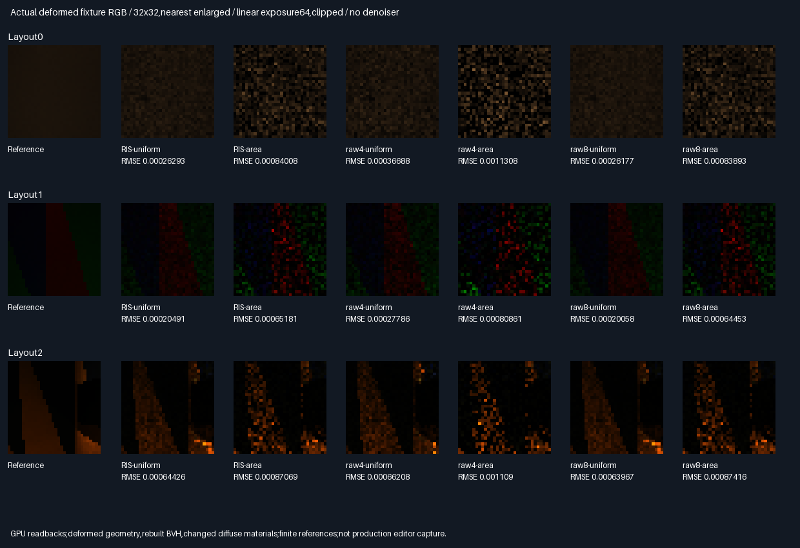

# Deformed geometry and diffuse-material fresh area RIS holdout

## Outcome — bounded geometry/material holdout accepted

Uniform and area-proportional RIS pass ordinary AND cross-reference image-MSE gates in all3 fixtures versus
same-query raw4. Geometry,normals,BVH ordering and diffuse palettes changed;camera/light/estimator settings
were frozen. This accepts these paired fixtures,not arbitrary topology,materials or a production renderer.

| Choice        | Rating   | Decision and reason                                                   |
|---------------|----------|-----------------------------------------------------------------------|
| Uniform RIS   | ⭐⭐⭐ 🏆 | Lowest same-query RMSE in all3 fixtures;carry forward                   |
| Uniform raw8  | ⭐⭐⭐ 🏆 | Lowest absolute RMSE in all3 fixtures;68 versus36 counted calls/pixel  |
| Area RIS      | ⭐⭐       | Passes own raw4 gates,but higher absolute error than uniform here      |
| Raw4 controls | ⭐        | Same ray-query budget as RIS,lower measured quality                    |
| Production    | 🔴        | Not enabled;fresh stills do not establish temporal or device acceptance |

Stars rate the measured quality/query tradeoff;trophies identify the stated criterion,not universal winners.

### Baselines and other results

| Fixture | Uniform RIS RMSE | Uniform raw4 RMSE | Uniform raw8 RMSE | RIS/raw4 RMSE decrease |
|---------|------------------|-------------------|-------------------|------------------------|
| 0       | .000262930       | .000366877        | .000261769        | 28.33%                 |
| 1       | .000204907       | .000277862        | .000200582        | 26.26%                 |
| 2       | .000644261       | .000662085        | .000639672        | 2.69%                  |

| Fixture | Area RIS RMSE | Area raw4 RMSE | Area raw8 RMSE | RIS/raw4 RMSE decrease |
|---------|---------------|----------------|----------------|------------------------|
| 0       | .000840083    | .001130835     | .000838932     | 25.71%                 |
| 1       | .000651808    | .000808614     | .000644526     | 19.39%                 |
| 2       | .000870693    | .001108971     | .000874160     | 21.49%                 |

RIS/raw4 use36 calls/pixel including four primaries;raw8 uses68. RIS therefore uses47.06% fewer total ray
queries than raw8,not47.06% less elapsed time. Uniform RIS has0.44/2.16/0.72% higher RMSE than uniform raw8.
Area RIS is0.14/1.13% worse than area raw8 in fixtures0/1 and0.40% lower in fixture2:a realized difference,
not evidence of expected dominance over a same-proposal raw8 average. Scoring/CDF work is not timed.

[Every arm,ratios and paired intervals](Results/DeformedAreaReservoir-comparison.md).
Fixture2 uniform's paired cross-MSE interval `[-1.72054e-7,1.25484e-7]` includes zero:its2.69% realized gain
is uncertain. The other five intervals are below zero. These64-tile normal approximations are descriptive,
not confidence-certified general-scene performance. No deformation,palette,target or gate was retuned.

### Actual images



[Absolute errors](Images/DeformedAreaReservoirErrors.png),
[normal/depth/material evidence](Images/DeformedAreaReservoirGeometry.png).
All three sheets were visually inspected:neutral fixture0,high-contrast facet colours in fixture1 and the
bright/dark material split plus wall silhouette in fixture2 are visible. Uniform is less speckled than the
area proposal;RIS/raw8 differences are small. These are actual32×32 GPU estimates,nearest enlarged,linear
exposure64/clipped,no denoiser or TAA. Error scale1024 clips bright errors;metrics use unclipped linear RGB.
Geometry depth maps world z in[3.2,4.8],clipping nearer wall points. No generated illustrations are used.

### Verification and limits

- Linux GCC12.2,CMake3.31.6,Slang2026.14.1,SwiftShader CPU Vulkan. Release and host ASan/UBSan,five CTests each.
- Per build:491,520 independent candidate replays,393,216 selected/raw paths,786,432 binary visibility checks,
  73,728 double all-triangle primary checks. Visibility is conditioned on validated actual float rays below.
- Maximum normalized RGB error6.24e-8,normalizer error5.85e-7;fixed2e-5 tolerances unchanged. Two allowed
  CDF/selector boundary ambiguities,within the predeclared16 cap;no visibility exceptions.
- All54 RGB mean gates pass;wrong density normalizers fail3/3 fixtures per RIS proposal type.
- All3,072 primary pixel results change relative to the undeformed perspective fixture;158 wall-primary
  pixels are exercised. Pinhole reprojection,primary normals/materials and new triangle geometry are checked.
- Removing six receivers changes2,035 positive source-light suffix decisions using the same recorded origins.
- Nine identical semantic rows,69 runtime hashes/build,six byte-identical readbacks,two identical modules.
- New two3072-sample/pixel reference banks;18,874,368 reference GPU paths/build,2,359,296 primary-invariance
  checks. Combined-reference RMS noise1.774e-5/1.500e-5/4.774e-5;not an external independent renderer.
- Previous perspective manifest is unchanged. The shared submission default32-slab regression reruns the
  previous perspective experiment and requires all six buffers to be byte-identical to retained captures.
- Retained:48 exact32×32 PNG arrays,three sheets,six compressed buffers,two modules,all generating sources,
  logs/means/metrics/manifests,about19MiB. Debug ray storage is explicitly opt-in,not production memory.
- Driver/SPIR-V are not host-sanitizer instrumented. Windows/physical GPU timing,new topology,textures,
  glossy/multibounce and temporal/spatial reuse are untested. These3 paired fixtures are not a factorial study.

### Completion and next problem

Bounded implementation/evaluation100%,remaining0%. Overall renderer~82% complete/~18% remaining,
**planning estimates**,not measured product readiness. Production348.046875MiB/defaults remain unchanged.
Packing/editor/vehicle/Jolt remain deferred;no PR or Actions. Next distinct problem:an opt-in C++ port of the
validated fresh area-RIS sampler with equivalence tests,without enabling a production default. Broader scene
coverage,production integration,temporal acceptance and physical-device/Windows verification remain undone.

The checkout initially lacked the last verified phase. Current local files were preserved in a Git stash and
ignored `_ClaudeScratch/recovery/before-session-rehydrate.tgz`,then the same branch was fast-forwarded to its
verified GitHub backup3095f4d. No alternate branch or historical evidence was overwritten.

### Reproduce

Use pinned [tool preparation](../../Automation/PrepareReplayTools.py),Vulkan headers1.4.321 and Python/Pillow:

```bash
BUILD_JOBS=1 bash Exhibits/LightCompute/RunDeformedAreaReservoir.sh
SANITIZE=1 BUILD_JOBS=1 bash Exhibits/LightCompute/RunDeformedAreaReservoir.sh
_ClaudeScratch/venv/bin/python Exhibits/LightCompute/Code/DeformedAreaReservoirRegression.py
_ClaudeScratch/venv/bin/python Exhibits/LightCompute/Code/DeformedAreaReservoirEvidence.py
```

[Shader](Code/DeformedAreaReservoirGpu.slang),[independent replay](Code/DeformedAreaReservoirValidation.h),
[evidence audit](Code/DeformedAreaReservoirEvidence.py),
[default-layout regression](Code/DeformedAreaReservoirRegression.py),
[Release](Results/DeformedAreaReservoir-release.txt),[sanitizers](Results/DeformedAreaReservoir-sanitized.txt),
[regression](Results/DeformedAreaReservoir-regression.txt),[54 means](Results/DeformedAreaReservoir-means.md),
[parity](Results/DeformedAreaReservoir-parity.txt),[manifest](Results/DeformedAreaReservoir-evidence-hashes.txt).
Logs identify parent3095f4d plus changed sources;runtime source/tool hashes identify the tested working tree.


## Frozen protocol — before measurements

| Scope       | Fixed choice                                                                             |
|-------------|------------------------------------------------------------------------------------------|
| Fixtures    | Three deformations/palettes below,on the original16 triangles;new normals and production BVH |
| Camera      | Same three perspective cameras as previous phase;all primary hits required                 |
| Arms        | RIS-uniform,RIS-area,raw4-uniform,raw4-area,raw8-uniform,raw8-area                           |
| Estimators  | Unchanged target1e-6+mean unoccluded RGB;two-proposal h/q reservoirs;four packets/pixel      |
| Visibility  | Selected suffix/connection only for RIS;endpoint offsets0.002,far minus1e-5 unchanged        |
| Queries     | RIS/raw4=36,pixel including primary;raw8=68;not equal total computation or elapsed time      |
| References  | New two disjoint uniform raw8 banks,3072 samples/bank/pixel;no historical reference reuse   |
| CPU replay  | Double primary all-triangle rays,RNG,CDF,UV,PDF,RGB,selector,Z and visibility                |
| Tolerance   | Fixed normalized2e-5;CDF/selection margin2e-6,max16;no secondary visibility exceptions        |
| Mean gate   | All54 RGB aggregate residuals≤6 estimated SE+2e-5                                          |
| Negative    | Wrong density normalization fails at least one mean gate per RIS type                      |
| Geometry    | Deformation changes primary geometry;wall-primary pixels and receiver occlusion exercised |
| Quality     | Per type,RIS ordinary AND cross-reference MSE≤raw4 in all three fixtures                    |
| Validation  | Release/host ASan+UBSan,five CTests each,semantic/buffer/module parity,actual RGB images     |

For each original point(x,y,z),the fixed transformations are:

- Fixture0:`x'=1.05*x,y'=.95*y,z'=z+.12*sin(1.3*x)*cos(.7*y)`;all diffuse RGB=(.55,.55,.55).
- Fixture1:`x'=.95*x,y'=1.08*y,z'=z+.18*sin(.9*x+1.1*y)`;original facet index modulo3 selects
  RGB=(.8,.08,.05),(.06,.75,.12),(.08,.15,.85).
- Fixture2:`x'=x+.07*y,y'=.95*y,z'=z+.14*cos(1.2*x-.8*y)`;original centroid y>0 selects
  RGB=(.9,.65,.12),otherwise(.04,.08,.2).

Transformation expressions use original coordinates. These operate on vertices,not analytic curved surfaces.
Each triangle remains planar;formerly joined planar panels can become noncoplanar. Recompute flat normals
from transformed float vertices and rebuild/reorder all facets using the production triangle BVH. Material
roughness stays0.7;this is Lambertian transport,not a roughness/glossy test. Cameras/light direction stay fixed.

No deformation,palette,score,seed budget or gate tuning after measurements. Retain quality rejection if observed.
This is three paired geometry/material fixtures,not a factorial study,new topology or arbitrary-scene acceptance.
Production348.046875MiB/defaults remain unchanged;no packing,PR or Actions.

### Execution diagnostics before quality measurements

The initial strict replay stopped on fixture0,pixel20714,raw8-area,lane3,proposal1,facet6:GPU connection
visibility0 versus CPU1. The CPU had reconstructed source endpoints in double arithmetic,while the shader
queried float endpoints. The final audit therefore records every emitted source origin,connection direction
and range,validates them against independent double construction within the unchanged2e-5 interface tolerance,
and then runs double all-triangle visibility on those exact float rays. Radiometric geometry,UVs,PDFs and
scores still use independent double reconstruction. Every executed visibility decision must match;none is
exempted for zero transport. No angular epsilon,view/palette change,query elision or quality retuning is used.

This adds16 validation-only ray slabs:39 captured slabs in an explicitly opted-in40-slab exhibit allocation.
The shared submission default remains32 slabs;production buffers/defaults remain unchanged. This is diagnostic
storage,not memory packing or a rendering-memory improvement. The float-ray conditioning limits the claim:
it verifies actual emitted-ray visibility,not exact-real endpoint visibility at discontinuities.
