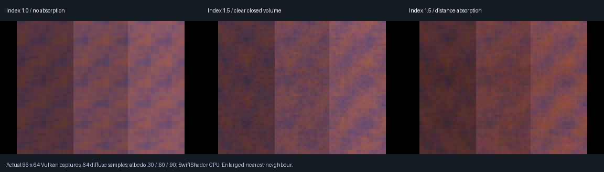
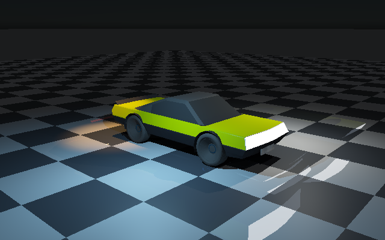

# Compact diffuse receivers through smooth glass — 2026-10-25

> Historical checkpoint: [VehicleGlazing](VehicleGlazing.md) subsequently adds derived vehicle panes,
> shared-edge evaluation and a 2,048-interaction bound. Earlier 32-step descriptions below refer to the
> original checkpoint, not the current runtime limit.

**The retained compact material path now receives transported light through smooth closed volumes.** This
closes the previous material-address-zero gap without replacing its uploaded cosine samples with GGX proposals.



Actual **96×64 Vulkan readbacks**, 64 cosine samples per receiver, enlarged nearest-neighbour. Each image
contains compact diffuse albedos **0.30 / 0.60 / 0.90**, left to right. The closed glass and emissive checker
are behind the camera; camera rays see only the diffuse receivers. Diffuse integration blurs the checker;
these are lighting-transfer checks, not sharp refraction or final-quality vehicle images.

## Mechanism and estimator preservation

| Mechanism | Detail |
|-----------|--------|
| One shared trace site | Compact receivers join authored materials in `IntegrateBoundaryRays` |
| Compact direction samples | Existing uploaded local cosine hemisphere, same tangent basis and 0.002 origin offset |
| Compact response | Existing `DiffuseTransportResponse * pi`; one proposal per uploaded sample |
| Boundary random stream | Independent from direction samples and the root emissive-sampling stream |
| Initial compact visibility | Previous zero lower hit bound; subsequent boundary intersections retain geometric-origin tolerances |
| Counters | 13 counts compact sample rays; 14/15 classify whether their first trace hit any scene geometry or missed |
| Diagnostics | Compact marker 7, `y = capped`, `z = unsupported`; material-address channel remains unassigned/nonpositive |
| Existing history revision | Native compact-only moving-history policy unchanged; mixed authored/compact scenes retain the authored reset policy |

With root emitter sampling enabled, ordinary unscattered emitter hits are still excluded from the BSDF
estimator and the existing area-emitter estimator remains active. A path that encounters a **closed-solid
boundary** keeps its terminal emission: the direct estimator's conservative opaque-volume shadow test cannot
sample that specular path. A shielded-source fixture isolates this rule and requires exact BSDF-only/emitter-
sampling equality with positive transmitted energy. This is not a general MIS or caustic solver.

## Acceptance

| Check | Result |
|-------|--------|
| Device | SwiftShader Device (Subzero), CPU type 4; software Vulkan only |
| Index-matched RGB Beer absorption | **15,360 channels** decrease by more than 0.01 |
| Absorbed / clear RGB totals | **0.903583 / 0.761600 / 0.632968** |
| Beer monotonicity | Every channel absorbed ≤ clear + 1e-6; red > green > blue totals |
| Exact seeded repeat | Pass |
| Compact address / ray counters | 327,680 rays = 146,417 hits + 181,263 misses; every receiver asserts no authored address |
| Bounds/medium state | Every tested compact receiver asserts zero capped and unsupported paths |
| Shielded emitter routing | Emitter sampling on/off exactly equal; positive refracted RGB total **71.4212** |
| Source removal | All **6,144** output pixels exactly black without an explicit history-reset request |
| Retained vehicle native oracle | 901 probes; mean RGB error 2.03274e-8, maximum 4.6271e-6 |
| Analytic/emissive/environment separation | Additive combination maximum RGB error 8.44436e-6; each family positive; all-sources-off black |
| Compact reconstruction | RMSE 0.0103498 → 0.0058573; 210 native spatial probes, max error 4.8961e-8 |
| Six moving poses | Reuse counts 0 / 12,076 / 12,067 / 0 / 12,064 / 12,079; current emission preserved; max direct delta 3.8147e-6 |
| History resets | Emission revision and camera cut equal cold results; source-off exactly black |
| Pinned previous transport | `02d5d13` reproduces ignored compact glass absorption |

The Beer test uses index matching to separate absorption from Fresnel noise and bending. The shielded fixture
restricts every active emitter segment to cross the glass, so its direct-emitter contribution is blocked while
its refracted BSDF contribution must remain. This is stronger than merely checking finite output.

These are focused optical and estimator-routing fixtures, not independent converged diffuse-plus-volume
quadrature or full material/PDF acceptance. Boundary, slab, mirror, rough-reflector and sheet tests remain
separate regressions. Fresh source removal is not a new full temporal-denoising claim.

## Retained vehicle transport



This actual vehicle readback verifies the retained compact path, not newly authored closed-glass vehicle
bindings. The regression separates analytic, emissive and environment contributions, checks their additive
combination against the native oracle and verifies all-sources-off black. Six moving vehicle poses are also
checked at **160×100** using the original reuse/reset, visible-emission and direct-light invariance assertions;
this focused motion check does not claim a new full-resolution motion-quality study.

## Remaining limitations

- Smooth closed volumes still require exterior rays, outward winding and one active medium; 32 interactions are bounded, not infinite transport.
- No saved closed-glass material authoring, actual vehicle volume bindings, nested/rough glass, inside-camera transport or transmitted analytic-light shadow/caustic solver.
- The compact path retains its diffuse-only response rather than becoming the authored full-BRDF integrator.
- Pure thin-sheet emitter-sampling attenuation is not newly validated here; previous direct-emitter sheet approximation remains. Only closed-solid specular paths trigger terminal-emission retention.
- No real-time/device-timing, physical RTX/GTX, Windows/editor or completed renderer claim.

## Reproduce and inspect

```bash
bash Exhibits/LightCompute/RunDiffuseDielectric.sh
# Reuse an explicitly completed build:
DIFFUSE_BUILD=0 bash Exhibits/LightCompute/RunDiffuseDielectric.sh
```

Requires the existing pinned native/Slang/SwiftShader/Pillow setup and the negative-control Git revisions.
The completed wrapper exited **0**, including all four native CTests. The final manifest verifies **167 sources / 221 products**.
The wrapper runs all previous glass regressions, the retained vehicle transport oracle and compact moving-
history/reconstruction checks. The negative control compiles three pinned transport files with unchanged
shared scattering math, not an entire pinned application.

- [Diffuse optics, counters and emitter routing](Results/DiffuseDielectric.txt)
- [Pinned negative control](Results/DiffuseDielectricOriginal.txt)
- [Vehicle transport regression](Results/DiffuseDielectricTransportRegression.txt)
- [Compact history/motion regression](Results/DiffuseDielectricHistoryRegression.txt)
- [Capture hashes and scope](Results/DiffuseDielectric.json)
- [Done and remaining](RendererProgress.md)
