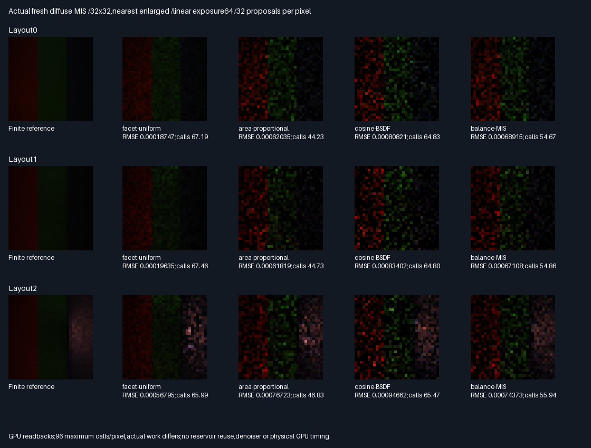

# Fresh diffuse BSDF/area multiple importance sampling

## Outcome — correct estimator,50/50 quality default rejected

The fixed mixture passes all numerical and RGB mean checks,but fails the all-three-layout image gate.
Keep the BSDF/area density implementation as validated experimental groundwork;do not promote this mixture.
All arms use32 proposals/pixel and the same96 maximum calls/pixel ceiling. Actual work differs substantially.

| Choice              | Rating   | Decision and reason                                          |
|---------------------|----------|--------------------------------------------------------------|
| Uniform-facet area  | ⭐⭐⭐ 🏆 | Lowest measured RMSE in all3 layouts;more actual calls         |
| Area-proportional   | ⭐⭐ 🏆  | Fewest actual calls;better RMSE than MIS in layouts0/1          |
| Fixed50/50 MIS       | ⭐        | Correct;quality gate passes only layout2;reject general default |
| Cosine BSDF alone   | ⭐        | Correct null-miss control;highest measured RMSE in all3 layouts |
| Production/temporal | 🔴        | Not accepted or exercised by this fresh-only experiment        |

Stars rate the measured tradeoff;the trophies identify different criteria,not universal winners.

### Image comparison

| Layout | Uniform RMSE | Area RMSE   | BSDF RMSE   | MIS RMSE    | MIS vs area RMSE |
|--------|--------------|-------------|-------------|-------------|------------------|
| 0      | .000187470   | .000620347  | .000808212  | .000689148  | 11.09% worse     |
| 1      | .000196354   | .000618186  | .000834025  | .000671082  | 8.56% worse      |
| 2      | .000567953   | .000767228  | .000946618  | .000743731  | 3.06% lower      |

Actual primary+proposal+suffix calls/pixel,arm order uniform/area/BSDF/MIS:

- Layout0:67.1875/44.2334/64.8271/54.6709.
- Layout1:67.4580/44.7305/64.8008/54.8584.
- Layout2:65.9902/46.8281/65.4727/55.9385.

MIS uses more actual calls than area in every layout. No speedup or exact equal-work claim is supported.
Both ordinary and cross-reference MSE prefer MIS over area only in layout2. The approximate64-tile paired
cross-MSE intervals include zero in layouts1/2;the small layout2 gain is not established as a robust advantage.
Uniform's quality win also is not an equal-actual-work comparison. No mixture or thresholds were retuned.
The old RIS phase uses a different endpoint/integrand convention;its RMSE is not directly comparable here.



[Absolute-error sheet](Images/DiffuseMisErrors.png),[all metrics and intervals](Results/DiffuseMis-comparison.md),
[36 mean checks](Results/DiffuseMis-means.md),[parity summary](Results/DiffuseMis-parity.txt).
Both sheets were visually inspected:uniform is less speckled in the bands;MIS retains pronounced noise.
These are actual32×32 GPU estimates,nearest enlarged,linear exposure64;error scale1024 clips bright errors.

### Verification and limits

- Linux GCC12.2,Slang2026.14.1,SwiftShader CPU Vulkan;Release and host ASan/UBSan,five CTests each,exit0.
- 393,216 independently replayed experimental samples/build;all executed first hits use double all-triangle
  replay. Maximum normalized RGB error4.64e-8,PDF/Jacobian error3.18e-7 versus the fixed2e-5 tolerance.
- All36 RGB mean gates pass;wrong-Jacobian negative control fails3/3 layouts in both BSDF and MIS arms.
- Eight identical semantic rows,65 runtime hashes/build,six byte-identical buffers,two identical shader modules.
  No CDF ambiguities.136,722 null outcomes remain zero samples,not redraws;66,515 suffix queries/build.
- Reference banks are disjoint from each other and experiment seeds:1024 samples/bank/pixel,
  6,291,456 reference proposals/build. Every reference primary matches the experimental geometry.
- Combined finite-reference RMS noise estimates:2.494e-5/2.343e-5/9.490e-5. This is not an independent renderer.
- 27 exact32×32 PNG arrays,two sheets,six lossless compressed buffers,two compressed modules retained,about11MiB.
- Driver/SPIR-V are not sanitizer-instrumented. Windows,physical GPU timing,perspective/general scenes,
  temporal/spatial reuse,glossy transport,multiple bounces and production renderer integration remain untested.
- Bounded implementation/evaluation100%,remaining0%;the rejected quality goal is not production acceptance.
  Overall renderer~76% complete/~24% remaining,**planning estimates**,not measured product readiness.
- Production348.046875MiB/defaults unchanged. Packing/editor/vehicle/Jolt remain deferred;no PR or Actions.
  Next distinct gate:use these explicit proposal measures in a fresh reservoir comparison,not temporal reuse
  or tuning this rejected50/50 arm against the same measurements.

### Reproduce and retained provenance

Run pinned [tool preparation](../../Automation/PrepareReplayTools.py),then:

```bash
BUILD_JOBS=1 bash Exhibits/LightCompute/RunDiffuseMis.sh
SANITIZE=1 BUILD_JOBS=1 bash Exhibits/LightCompute/RunDiffuseMis.sh
_ClaudeScratch/venv/bin/python Exhibits/LightCompute/Code/DiffuseMisEvidence.py
```

The Python environment requires Pillow;native prerequisites match the previous geometric exhibit.
[Shader](Code/DiffuseMisGpu.slang),[double replay](Code/DiffuseMisValidation.h),
[evidence audit](Code/DiffuseMisEvidence.py),[runner](RunDiffuseMis.sh),
[Release log](Results/DiffuseMis-release.txt),[sanitizer log](Results/DiffuseMis-sanitized.txt),
[retained manifest](Results/DiffuseMis-evidence-hashes.txt).
Logs identify parent4da2efd plus changed files;runtime source/tool hashes identify the tested working tree.
The previous geometric manifest is verified without rewriting historical evidence.


## Frozen protocol — before measurements

| Scope | Fixed choice |
|-------|--------------|
| Scene/camera | Same16 triangles,three layouts,32×32 BVH primary pixels as geometric receiver phase |
| Arms | Uniform-facet area,area-proportional,cosine BSDF,50/50 area-proportional+BSDF mixture |
| Estimator | 32 independent proposals/pixel;single-sample balance MIS:F/(.5*qArea+.5*qBsdfArea) |
| Integrand | Two-diffuse directional-light transport;receiver position offset0.002 along geometric normal |
| Area sample | Square-root barycentrics;one first-hit query from offset receiver verifies visibility |
| BSDF sample | Cosine hemisphere at receiver;first visible facet or null miss;no resampling misses |
| BSDF density | qOmega*cosSourceAbsolute/r² in area measure,only on the first-visible branch |
| Suffix | Trace directional source-light visibility only for visible,positive transport geometry |
| Work | All arms32 primary,at most32 proposal and32 suffix queries/pixel;actual calls reported |
| Controls | All arms share the96 maximum calls/pixel ceiling;not exact equal actual work or physical timing |
| Reference | Two disjoint uniform-facet banks,1024 proposals/bank/pixel;new visibility integral,not old buffers |
| CPU replay | Independent hash,technique,CDF,UV,cosine basis;double closest hits and PDF/Jacobian/RGB/work |
| Interfaces | CPU validates recorded float primary and BSDF ray/hit attributes before double transport replay |
| Tolerance | Fixed normalized2e-5;CDF boundary margin2e-6,max16;no visibility exceptions |
| Mean gate | All arm RGB aggregate residuals≤6 estimated SE+2e-5 |
| Negative control | Omit area/solid-angle Jacobian;must fail at least one mean gate in BSDF and MIS arms |
| Quality gate | MIS ordinary MSE AND cross-reference MSE≤area-proportional in all three layouts |
| Comparisons | Uniform-facet and BSDF-only descriptive controls;actual-call costs and paired intervals retained |
| Validation | Release/host ASan+UBSan,five CTests each;exact semantic/readback/module parity |

Mixture weight,proposal count and acceptance criteria will not be tuned after measurements. A rejected quality
result is retained,not repaired by changing the test. First-hit visibility and Jacobian use the same offset
receiver origin;unoffset radiometric geometry from the prior phase is not silently mixed into this density.
This is ordinary fresh diffuse MIS,not reservoir/temporal/multibounce MIS or production acceptance.
Production348.046875MiB/defaults remain unchanged. No packing,PR or Actions.

### Execution correction before quality measurements

Initial replay found unnecessary grazing first-hit queries on area samples outside the receiver hemisphere.
Such samples have exactly zero integrand and zero BSDF density. They now skip that query with canonical zero
metadata. This is a zero-support elision,not an angular epsilon or a visibility exception. Proposal count32,
mixture.5,maximum96-call ceiling,numerical tolerances and quality/mean gates remain unchanged. Actual calls
are lower for these samples;no exact equal-work or physical speedup claim is made.

Zero-query samples record a zero direction,nearest-index sentinel and distance100;they remain zero terms in
all32-proposal averages. Executed rays retain strict direction and double closest-hit validation.
BSDF azimuth uses range-reduced sine/cosine polynomials:the device's intrinsic approximation exceeded the
fixed direction tolerance. Area directions and Jacobians use compensated barycentric coordinate differences,
including low-word receiver cosine evaluation,matching the already-compensated radiometric geometry.
These are numerical execution repairs,not changes to proposal distributions or acceptance thresholds.
