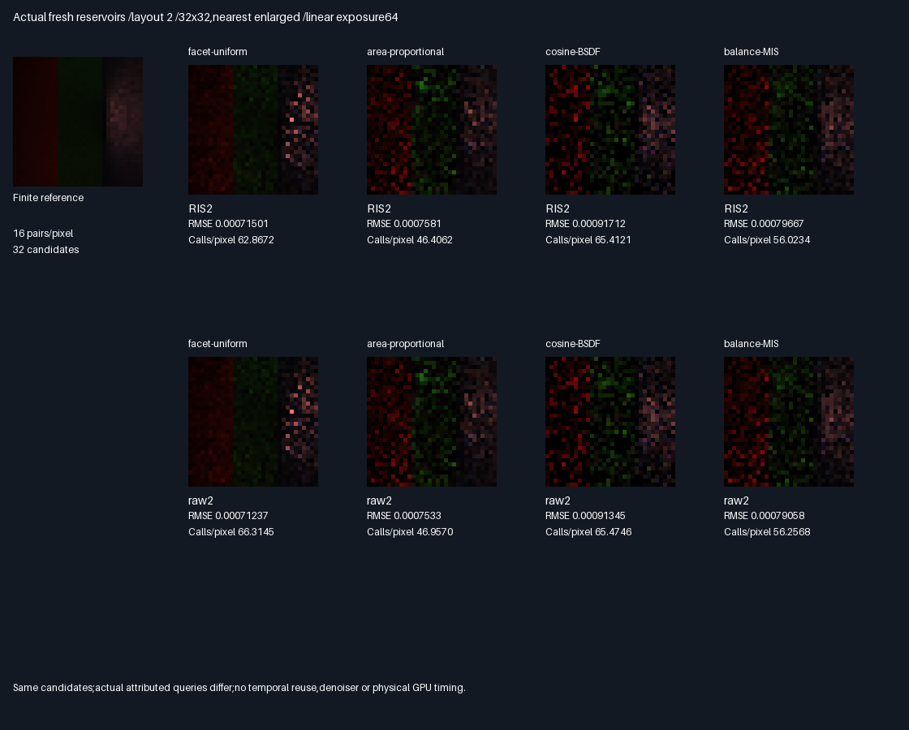

# Fresh diffuse reservoirs with explicit BSDF/area proposal measures

## Outcome — correctness accepted,quality-neutral replacement rejected

All four proposal types pass mean,normalizer,visibility and actual-call checks. All save some suffix calls,
but none passes the frozen all-three-layout quality gate versus its same-candidate raw2 control.
Keep the explicit-measure reservoir implementation as validated groundwork,not a promoted renderer default.
The fixed50/50 mixture remains a diagnostic;it was not tuned after either experiment.

| Choice             | Rating   | Measured decision                                                    |
|--------------------|----------|----------------------------------------------------------------------|
| Uniform raw2       | ⭐⭐⭐ 🏆 | Lowest RMSE across all8 arms in all3 layouts;accuracy choice           |
| Uniform RIS2       | ⭐⭐       | 5.20–5.95% fewer calls,0.37–5.40% higher RMSE;budget tradeoff only      |
| Area raw2          | ⭐⭐ 🏆  | Fewest calls among raw controls;worse absolute error than uniform      |
| Area RIS2          | ⭐        | Saves0.15–1.17% calls;passes only1/3 realized quality gates              |
| BSDF/MIS RIS2      | ⭐        | Saves≤0.42% calls;no all-layout quality acceptance                     |
| Production/reuse   | 🔴        | No production,temporal,spatial or physical-device acceptance           |

Stars rate the measured tradeoff;trophies identify their stated criterion,not universal winners.
The small isolated BSDF/area quality wins are not evidence of a universal expected improvement.

### Baseline and alternative comparisons

Percentages below compare RIS2 with the same-proposal raw2 control. All include primary/candidate/suffix calls.
A negative RMSE change means a lower measured error. Same proposals does not mean equal actual work.

| Proposal          | RMSE change layouts0/1/2 | Calls saved layouts0/1/2 | Quality gates | Cost gates |
|-------------------|--------------------------|-------------------------|---------------|------------|
| Uniform-facet     | +0.76/+5.40/+0.37%       | 5.95/5.91/5.20%          | 0/3           | 3/3        |
| Area-proportional | +0.11/−0.05/+0.64%       | 0.15/0.17/1.17%          | 1/3           | 3/3        |
| Cosine BSDF       | −0.08/+0.46/+0.40%       | 0.024/0.017/0.095%       | 1/3           | 3/3        |
| Fixed balance MIS | +0.14/+0.85/+0.77%       | 0.072/0.077/0.415%       | 0/3           | 3/3        |

RIS suffix calls53,666 versus raw66,470 across all layouts/proposals:12,804 fewer/build. Both still pay
393,216 primary queries and253,663 executed candidate queries/build. These common queries dominate cost.
Shared candidate execution is attributed once to each standalone arm;the two final controls execute their own
suffix queries. Adding attributed arm costs is not a count of unique shared GPU execution. No time is measured.

[All24 arm metrics](Results/DiffuseReservoirMis-comparison.md),including64-tile paired cross-MSE intervals,
are retained. Uniform's adverse cross-MSE intervals exclude zero in all3 layouts;many smaller contrasts
include zero. Intervals are descriptive normal approximations,not confidence-certified general-scene results.



[Layout0](Images/DiffuseReservoirMisComparison-0.png),[layout1](Images/DiffuseReservoirMisComparison-1.png),
[layout2 error sheet](Images/DiffuseReservoirMisErrors-2.png).
All three RGB comparison sheets were visually inspected:uniform is less speckled than the alternative proposals,
while RIS/raw differences are small at this resolution. Pixels are actual32×32 GPU estimates,nearest enlarged,
linear exposure64;absolute-error sheets use scale1024/clipped. Metrics use unclipped linear RGB captures.
No denoising,TAA or generated illustration is involved.

### Why selection does not provide a free quality win

For the same two candidate paths,let `w_i=h_i/q_i`, `W=sum(w_i)` and `p_i=w_i/W`.
The selected estimate is `F_i*W/(2*h_i)`,including the selected source-light visibility in `F_i`.
Its conditional expectation equals `(F_0/q_0+F_1/q_1)/2`:the raw2 estimator. Consequently the conditional
selection variance is nonnegative. Zero-weight candidates contribute zero but still count in M2.

The evidence audit checks this conditional-mean identity against GPU raw2 values over all196,608 pairs;
maximum normalized discrepancy3.73e-9. It also retains the nonnegative added conditional image MSE per layout
and proposal. The occasional lower realized RIS image error does not overturn this expectation identity.
This identifies the practical limitation:paying first-hit visibility for every candidate leaves little
suffix work to save,especially for BSDF nulls. Candidate rays cannot be treated as free RIS proposals.

### Verification

- Linux GCC12.2,Slang2026.14.1,SwiftShader CPU Vulkan. Release and host ASan/UBSan both exit0,five CTests each.
- Independent CPU replay/build:393,216 candidate draws and196,608 reservoir/raw pairs;RNG,CDF,cosine directions,
  double all-triangle first hits,area/solid-angle PDFs,weights,selector,normalizer,RGB,suffix visibility,work.
- Fixed normalized2e-5 tolerance;candidate RGB/PDF maximum errors3.20e-7/4.16e-7. Selected RGB/weight/normalizer
  checks also pass2e-5. Zero CDF and selection ambiguities;no executed-query visibility exceptions.
- All72 RGB mean gates pass. Wrong-M negative control counts only positive candidates and fails3/3 layouts
  for each of all4 proposals,including both BSDF and MIS.136,423 null outcomes are retained,not redrawn.
- Five identical semantic rows,64 runtime hashes/build,three byte-identical readbacks,two identical modules.
- References reuse the unchanged previous MIS integral,two1024-sample/pixel banks. Previous manifest and
  seed-bank separation are verified;new experiment seeds are disjoint from those banks and old experiments.
- 51 exact32×32 PNG arrays,six comparison/error sheets,three lossless compressed readbacks,two modules,
  all generating code/logs/means/metrics/manifests retained,about14MiB.

### Completion and remaining scope

Bounded implementation/evaluation100%,remaining0%;this is not quality-neutral or production acceptance.
Overall renderer~78% complete/~22% remaining,**planning estimates**,not measured product readiness.
Production348.046875MiB/defaults remain unchanged. Packing/editor/vehicle/Jolt remain deferred;no PR or Actions.
Driver/SPIR-V are not sanitizer-instrumented. Windows/physical GPU timing,perspective/general-scene holdouts,
production C++ integration,temporal/spatial reuse,glossy and multibounce acceptance remain undone.

Next distinct gate:perspective/general-scene holdout for the previously accepted cheap pre-visibility
uniform-area RIS path. Do not extend this expensive first-hit-per-candidate scheme into temporal reuse or
retune the rejected50/50 arm against these same measurements. Old geometric RIS uses another endpoint
convention;its image-error numbers are not directly comparable to this experiment.

### Reproduce and retained provenance

Use the pinned [tool preparation](../../Automation/PrepareReplayTools.py) and a Python environment with Pillow:

```bash
BUILD_JOBS=1 bash Exhibits/LightCompute/RunDiffuseReservoirMis.sh
SANITIZE=1 BUILD_JOBS=1 bash Exhibits/LightCompute/RunDiffuseReservoirMis.sh
_ClaudeScratch/venv/bin/python Exhibits/LightCompute/Code/DiffuseReservoirMisEvidence.py
```

[Shader](Code/DiffuseReservoirMisGpu.slang),[independent replay](Code/DiffuseReservoirMisValidation.h),
[evidence generator](Code/DiffuseReservoirMisEvidence.py),[runner](RunDiffuseReservoirMis.sh),
[Release log](Results/DiffuseReservoirMis-release.txt),[sanitizers](Results/DiffuseReservoirMis-sanitized.txt),
[72 means](Results/DiffuseReservoirMis-means.md),[parity](Results/DiffuseReservoirMis-parity.txt),
[retained manifest](Results/DiffuseReservoirMis-evidence-hashes.txt).
Logs identify parent5528d24 plus changed sources;runtime source/tool hashes identify the tested working tree.
The previous [MIS report](DiffuseMis.md) and evidence remain historical and unchanged.


## Frozen protocol — before measurements

| Scope          | Fixed choice                                                                          |
|----------------|---------------------------------------------------------------------------------------|
| Scene/integral | Previous diffuse MIS16-facet scene,three layouts,32×32 pixels,offset origin0.002         |
| Proposals      | Uniform-facet,area-proportional,cosine BSDF,fixed50/50 area+BSDF mixture                  |
| Comparisons    | Two-proposal reservoir versus raw mean of the same two candidates,per proposal type    |
| Sampling       | 16 independent pairs/pixel;32 candidate proposals;null/zero candidates count toward M2 |
| Target         | h=mean unshadowed nonnegative RGB integrand;zero exactly when integrand has no support |
| Selection      | w=h/q;select one of two with w/sum(w);all-zero pair returns zero,no suffix query         |
| Normalizer     | Z=sum(h/q)/(2*hSelected);selected shadowed integrand times Z                            |
| Visibility     | First-hit candidate queries before selection;source-light suffix only after selection |
| Raw control    | Evaluate suffix for each positive candidate;average both,including null zeros          |
| Work           | Both charge two primary and measured candidate rays/pair;RIS≤one suffix,raw≤two         |
| Fairness       | Same proposals,not exact equal calls;shared primary/candidate execution attributed once |
| References     | Reuse previous MIS banks,unchanged integral;verify manifest and new seed disjointness   |
| CPU replay     | Independent RNG,CDF,cosine basis,all-triangle first hits,PDFs,RGB,selection,Z,work        |
| Tolerances     | Normalized2e-5;CDF/selection margin2e-6,max16 each;no visibility exceptions               |
| Mean gates     | All72 RGB aggregate gates≤6 estimated SE+2e-5                                          |
| Negative       | Wrong M counts only positive candidates;must fail at least one BSDF and MIS mean gate   |
| Quality gate   | Per proposal type,RIS ordinary AND cross-reference MSE≤raw2 in all three layouts        |
| Cost gate      | Per proposal type,RIS actual attributed queries strictly lower in all three layouts    |
| Verification   | Release/host ASan+UBSan,five CTests each,semantic/buffer/module parity,actual RGB images |

No mixture,target,sample-count or quality-gate tuning after measurements. This tests selection and suffix
deferral,not temporal reuse or a production implementation. With identical candidates,raw2 is the conditional
mean of the randomized reservoir estimate:reservoir selection adds conditional variance. Therefore a universal
same-proposal quality improvement is not expected;the fixed realized image gate is retained rather than relaxed.
Query savings are not physical-GPU timing or a speedup. Candidate first-hit work is not free.

This phase preserves the previous rejected50/50 arm as a diagnostic,not an accepted default. Old geometric RIS
used cheaper pre-visibility proposal scoring and a different endpoint convention;its quality/call results must
not be treated as directly comparable. Production348.046875MiB/defaults remain unchanged;no packing,PR or Actions.
