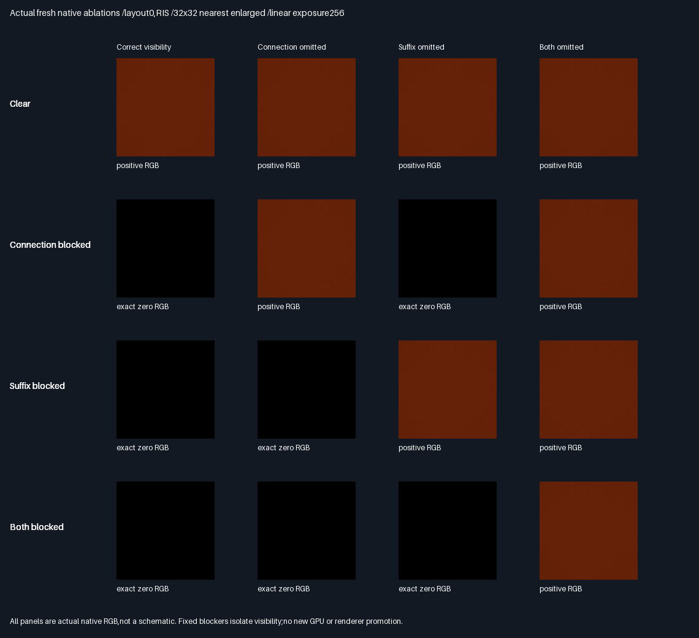
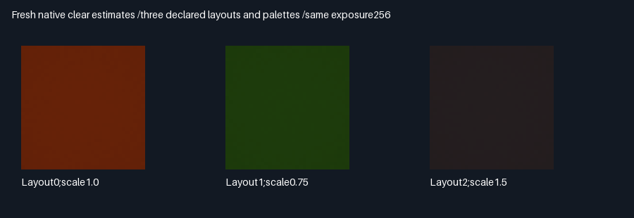

# Analytic native occlusion-sensitivity fixtures

## Frozen protocol — before measurement

- Keep the previous nine-fixture transport report and its failed omission gates unchanged. This is a separate
  native visibility-coverage diagnostic,not a retroactive pass or new GPU/renderer acceptance.
- Predeclare three layouts:uniform scales1,.75,1.5;translations(0,0,0),(-1.5,.4,.3),(.7,-.6,-.2).
  Source diffuse RGB(.7,.4,.2),(.2,.7,.3),(.25,.35,.8);receiver RGB(.6,.5,.4),unchanged fixed light(.8,0,.6).
- In local coordinates:source square[-.25,.25]² at z0,normal+z;receiver square[-.3,.3]² at z2,normal-z.
  Camera XY spans[-.2,.2]² at z1.5,looks+z. Each rectangle is two triangles;use the production packed BVH.
- Four visibility variants per layout:clear;connection blocker only;suffix blocker only;both blockers.
  Connection rectangle x/y[-.6,.6] at z1;suffix rectangle x[.95,1.75],y[-.6,.6] at z1. Blockers are black.
  Light rays cross z1 near x=sourceX+4/3,while connection rays cross near the source/receiver midpoint.
  Fixed existing .002 world-space origin offsets leave positive analytic separation margins at every scale.
- Proposals are restricted to the two source triangles,with explicit mapping into packed scene ordinals.
  This diagnostic integrates the source square only;it is not a general-scene sampler-quality comparison.
- Native32x32 images,four seed packets/pixel,uniform-facet RIS/raw4/raw8,unchanged components.
  Seed=Hash((packet+0x82c4d719)^(layout*0x6c8e9cf5));same seeds across visibility variants for paired ablation.
  Do not treat paired variants/methods as independent replicates.
  Per layout/variant:4096 packets×(4+4+8) traced paths;total786432 paths and1572864 visibility rays.
- Every ray must agree with both the analytic variant classification and the independent double BVH.
  Clear=(suffix true,connection true),connection-only=(true,false),suffix-only=(false,true),both=(false,false).
  No visibility exceptions. Fresh primary hits must resolve to the receiver with z/normal/albedo error≤2e-5.
- Blocked variants must have exactly zero correct RGB. Omitting the affected single visibility operation must
  produce positive RGB in every packet of its isolated variant,for all three layouts and all three methods.
  Omitting the other visibility operation must leave zero RGB. In the both-blocked variant neither single
  omission restores transport,but jointly omitted visibility must restore positive RGB. No threshold tuning.
- Correct estimates use108 RGB mean gates (quadrature for clear,zero for blocked);joint-omission
  estimates use another108 quadrature mean gates. All216 must pass6*SE+2e-5.
  Geometry formula is4/(dx²+dy²+4)² times both diffuse BRDFs and fixed-light cosine.
  Quadrature32²/64² maximum channel difference≤2e-6. Reference generation does not trace or use native RGB.
- Release/host ASan+UBSan,five CTests,prior component units;captures and semantic rows identical across builds.
  Include synthetic exact-center crossing and finite-interval rejection tests. Show actual fresh native images
  and ablation controls. Preserve all prior manifests;no engine arithmetic changes to force these fixtures.
- No new GPU capture,physical timing,Windows verification,renderer wiring or general BSDF/material acceptance.
  Production348.046875MiB/defaults/32B layouts unchanged;no packing,PR or Actions.

## Measured results — 2026-10-30

**PASS for this separately frozen native diagnostic. Previous transport acceptance remains HELD.**
Engine arithmetic,production defaults and the entire prior transport manifest are unchanged.

| Gate                                      | Result                                                   |
| ----------------------------------------- | -------------------------------------------------------- |
| Release + host ASan/UBSan                  | Five CTests/build;17,274 focused unit checks/build        |
| Fresh receiver primary checks             | 147,456;position,normal and albedo agree                  |
| Selected paths /visibility decisions      | 786,432 /1,572,864 per build;analytic and double BVH agree |
| Isolated connection/suffix omissions      | Positive RGB restored in every packet,all three layouts  |
| Unaffected omission /both-blocked singles  | Exactly zero;both-blocked joint omission restores RGB    |
| Correct + joint-omission channel means    | 216/216 pass6SE+2e-5 against independent quadrature       |
| Independent midpoint32² /64² convergence   | Maximum channel difference2.28908945e-8;gate≤2e-6         |
| Cross-build determinism                   | 12 buffers and14 semantic rows byte-identical            |
| Prior numerical evidence and failed gate  | All old manifest hashes verified;acceptance=0 retained   |

### Baseline comparison

RGB RMSE versus independent64² midpoint integration,clear variant,four packets per32² image pixel.
Other variants have exactly zero correct RMSE;their joint-omission estimates retain the clear error profile.
Paired methods and variants are not independent replications. These are diagnostic,not acceptance-quality scores.

| Layout | RIS RGB RMSE | Raw4 RGB RMSE | Raw8 RGB RMSE | RIS vs raw4 RMSE |
| ------ | ------------ | ------------- | ------------- | ---------------- |
| 0      | 4.33214e-6   | 6.16955e-6    | 4.33204e-6    | −29.78%          |
| 1      | 2.69340e-6   | 3.74958e-6    | 2.69339e-6    | −28.17%          |
| 2      | 2.22727e-6   | 3.15032e-6    | 2.22729e-6    | −29.30%          |

RIS scores8 candidates and traces4 selections;raw4 scores/traces4;raw8 scores/traces8.
RIS/raw4 have equal visibility-query counts,not equal total work or measured wall time.
The source has constant diffuse colour and the score is close to the integrand:near-raw8 accuracy is expected
here and is not evidence of general-scene quality,temporal stability or physical speedup.
[All method/variant RMSEs](Results/FacetAreaOcclusion-comparison.md),
[216 mean residual/SE gates](Results/FacetAreaOcclusion-means.md),
[packetwise positive/zero controls](Results/FacetAreaOcclusion-controls.md).

### Actual native images



Rows are clear,connection-blocked,suffix-blocked,both-blocked. Columns are correct,connection omitted,
suffix omitted,both omitted. Panels are actual freshly calculated native RIS RGB,not scene illustrations.
The camera sees only the receiver;the source/blockers are outside its primary view. Flat-looking illuminated
patches and black blocked patches are intentional. Common linear RGB exposure256,nearest enlargement,no gamma.



All144 method/variant/ablation32² PNG arrays are retained and checked against their float32 source buffers.
The12 `.f32.gz` archives retain the complete lossless captures,including fresh primary positions.
Compression is evidence storage only,not new production packing. Five float4 slabs,12,288 packets/slab:
correct,omit connection,omit suffix,joint omit,primary XYZ. Within each slab:RIS/raw4/raw8 blocks of4096;
packet=seed row×1024+pixel,with four seed rows. Every fourth float is zero.

## Reproduction and scope

Tested Linux x86_64,GCC12.2,C++17,strict floating point,no fast math/no FMA contraction,CMake3.31.6,
Python3.11 and Pillow13.0.0. Sources were uncommitted additions over parent22d606a when measured;
[build logs](Results/FacetAreaOcclusion-release.txt) and
[sanitizer logs](Results/FacetAreaOcclusion-sanitized.txt) pin source/capture hashes.
The [evidence manifest](Results/FacetAreaOcclusion-evidence-hashes.txt) also pins this report and collector.
A repository CMake/Python environment is needed;override CMAKE/CTEST with equivalent installed executables.
No GPU input,compiler or driver is needed for this native diagnostic.

```bash
bash Exhibits/LightCompute/RunFacetAreaOcclusion.sh
SANITIZE=1 bash Exhibits/LightCompute/RunFacetAreaOcclusion.sh
python Exhibits/LightCompute/Code/FacetAreaOcclusionEvidence.py
```

The collector verifies previous evidence first,then both build logs,all capture bytes and semantic rows,
analytic primary positions,finite buffers,all visibility ablations,independent quadrature and actual PNG arrays.
It fails rather than waiving a gate. Existing17142 unit checks run alongside132 new focused checks in each build.
Old deformed scenes are not rerendered here;their retained evidence is verified unchanged.

The exhibit constructs receiver/source/blocker geometry and calls the unchanged opt-in production proposal,
score,reservoir and transport APIs. Proposal integration is explicitly limited to the two source triangles,
with packed scene ordinal translation. Layouts are scaled/translated versions of one rig,not broad geometry
coverage. No unrestricted scene sampler,production renderer activation,new GPU parity,Windows binary,
physical-device performance,history/TAA,general materials or editor acceptance is established.

## Decision and progress

Stars indicate fitness for closing this specific visibility-coverage gap;more is better,not measured speed.

| Option                         | Fitness | Decision | Reason                                       |
| ------------------------------ | ------- | -------- | -------------------------------------------- |
| Separate analytic native rigs  | ⭐⭐⭐   | 🏆 Keep  | Both controls independently alter nonzero RGB |
| Existing deformed corpus       | ⭐⭐     | Retain   | Useful GPU parity,but sensitivity gate HELD   |
| Waive old gate /promote now    | ⭐       | Reject   | Would erase the failed frozen requirement    |

- Focused diagnostic100% complete /0% remaining,including independent comparison,visuals and retained evidence.
- Overall rendering~90% complete /~10% remaining:planning estimates,not measured production readiness.
- Done:independent positive-transport controls,three layouts,all methods,both builds,quadrature and prior regression.
- Next distinct phase:GPU-side parity of these sensitive controls,then explicit renderer integration decisions.
  Production/history/material coverage,physical-GPU/Windows/editor/TAA and timing acceptance remain separate.
- Production348.046875MiB output,32B descriptors and defaults unchanged;packing/editor/vehicle/Jolt deferred.
  No pull request or Actions. Source and evidence backed up on the existing session branch.
