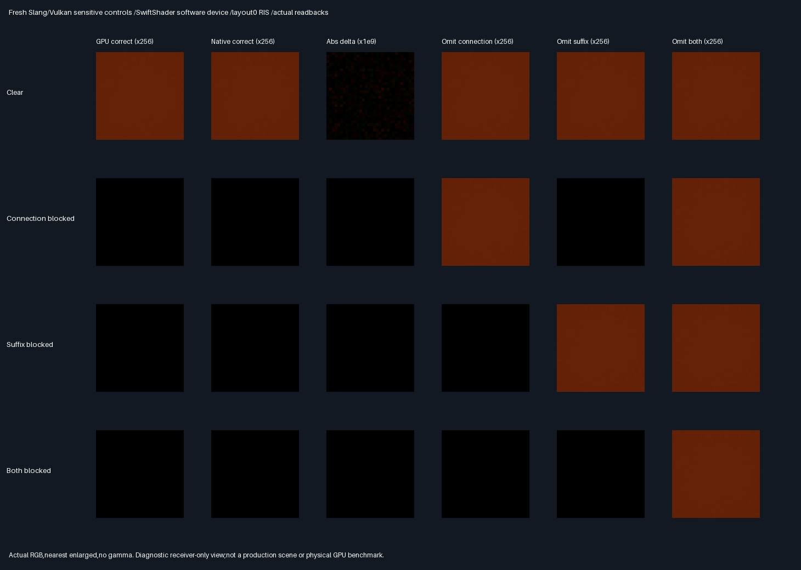

# Sensitive occlusion fixtures — fresh Vulkan/Slang parity

## Frozen protocol — before GPU measurement

- Separate evaluation over parenta041a32. Preserve both previous transport and analytic native evidence manifests.
  Previous failed transport acceptance is not reclassified. No engine/shader production arithmetic edits.
- Same three layouts,four variants,source-restricted profile,32² pixels,four packets/pixel and RIS/raw4/raw8
  as [the native protocol](FacetAreaOcclusion.md). Geometry and seeds are scene inputs,not CPU RGB answers.
- Dispatch fresh Slang through Vulkan on pinned SwiftShader,which is software execution,not a physical GPU.
  Reuse exact existing shared submission prefix and shader geometry/visibility routines;retain their hashes.
- Fresh GPU proposals must match native facet identity,barycentric coordinates and density exactly.
  Selected identities and both visibility bits must agree exactly with native and analytic classification.
  Independently reconstruct native proposals,score and selected paths in the host for diagnostic comparisons.
- Primary attributes,targets,normalizers and emitted connection rays must agree within2e-5 absolute error
  (normalizers use abs(delta)/max(1,abs(native))). Every RGB packet/ablation/image channel must agree within2e-5.
  Require finite numeric channels;packed integer identities are decoded as integers,not floats.
- Every GPU correct blocked packet is exactly zero. Isolated affected omission restores positive RGB everywhere;
  unaffected omission stays zero;both-blocked single omissions remain zero,joint omission positive everywhere.
- All216 GPU correct/joint-omission RGB means must pass6SE+2e-5 against independent64² midpoint quadrature.
  32²/64² reference convergence≤2e-6. No use of native/GPU RGB to generate analytic references.
- Release/host ASan+UBSan:five existing CTests,132+17142 native units plus new GPU-host checks;all12 fresh
  captures and semantic rows identical. Driver binary is external and unsanitized;no physical timing claim.
- Actual fresh GPU/native/difference/omission images,lossless buffers,hash manifest,all-method RMSE comparison.
  If any frozen gate fails,retain evidence and report HELD;do not tune fixtures,thresholds or seeds.
- No renderer activation,unrestricted scene sampler,temporal/material acceptance,Windows verification or PR/Actions.
  Production348.046875MiB/defaults/32B descriptors unchanged;packing/editor/vehicle/Jolt remain deferred.

## Measured results — 2026-10-30

**PASS for this fresh software-Vulkan parity diagnostic. Not production or physical-GPU acceptance.**
All three layouts independently expose both visibility omissions. No frozen gate was weakened.

| Gate                                   | Result                                                   |
| -------------------------------------- | -------------------------------------------------------- |
| Release + host ASan/UBSan               | Six CTests and17,282 focused unit checks per build        |
| Fresh primary observations             | 147,456;identities exact,attributes/strike gates pass     |
| Fresh source proposals                 | 983,040;facet/barycentrics/density exact                  |
| Selected paths /visibility decisions   | 786,432 /1,572,864;identities and both masks exact        |
| Targets /emitted connection rays        | Maximum absolute error0 /0                               |
| RIS normalizers                        | Maximum relative error5.96046448e-8                       |
| Packet/ablation RGB versus native       | Maximum absolute channel delta3.49245965e-10              |
| Averaged image RGB versus native        | Maximum absolute channel delta1.45519152e-10              |
| GPU correct + joint-omission means      | 216/216 pass6SE+2e-5 against independent quadrature       |
| Independent32² /64² midpoint references  | Maximum channel difference2.28908945e-8;gate≤2e-6         |
| Cross-build determinism                 | 12 captures,14 semantic rows,two SPIR-V binaries identical |
| Previous native/transport manifests     | Both unchanged;historical acceptance=0 preserved          |

Native and GPU blocked correct packets are exactly zero. In each isolated blocked variant,the affected
omission restores positive RGB in every one of12,288 packets per layout. The unaffected omission stays zero.
With both blockers present,single omissions remain zero and joint omission restores positive RGB everywhere.
Every emitted ray also agrees with independent double-BVH visibility and the declared analytic classification.

### Baseline and method comparison

Clear variant RGB RMSE against64² analytic integration,four seed packets per32² image pixel.
The [full comparison](Results/FacetAreaOcclusionGpu-comparison.md) includes all methods,variants,native/GPU
RMSEs,joint-omission RMSEs and image deltas. [Mean gates](Results/FacetAreaOcclusionGpu-means.md) retain each
residual and SE;[control counts](Results/FacetAreaOcclusionGpu-controls.md) retain exact zero/positive outcomes.

| Layout | Native RIS RMSE | GPU RIS RMSE | GPU raw4 RMSE | GPU raw8 RMSE |
| ------ | --------------- | ------------ | ------------- | ------------- |
| 0      | 4.33213538e-6    | 4.33213539e-6 | 6.16955180e-6 | 4.33204023e-6 |
| 1      | 2.69339885e-6    | 2.69339864e-6 | 3.74957548e-6 | 2.69339140e-6 |
| 2      | 2.22727467e-6    | 2.22727460e-6 | 3.15031941e-6 | 2.22728956e-6 |

RIS/raw4 trace4 suffix+connection pairs per packet;raw8 traces8. RIS scores8 candidates versus raw4's4.
GPU RIS RMSE is28.17–29.78% lower than raw4 here,near raw8. Proxy cost differs:no measured total-work or
wall-time advantage. These constant-colour source-only rigs favour the proxy;no general-scene quality claim.
Variants share seeds and methods share draws;they are paired controls,not independent replications.

### Actual readback images



Rows:clear,connection-blocked,suffix-blocked,both-blocked. Columns:GPU correct,native correct,absolute RGB
difference,then the three GPU omissions. RGB exposure256;difference exposure1e9,explicitly amplified,not error
at ordinary display scale. Nearest enlargement,no gamma. Every panel comes from actual float32 readback;
receiver-only views deliberately show smooth coloured patches rather than visible blocker geometry.
All180 GPU/absolute-difference32² PNG arrays are checked against captures. Native images are unchanged.

## Reproduction and retained evidence

Tested Linux x86_64,GCC12.2,C++20 host/C++17 libraries,CMake3.31.6,Python3.11,Pillow13.0.0,
Slang2026.14.1,SPIR-V1.3,precise/O0 shaders,strict host float with no fast math or FMA contraction.
Vulkan device:`SwiftShader Device (Subzero)`,CPU device type4. ASan/UBSan instrument the host,not the external
driver;LSan is disabled for this driver-backed run. Earlier native-only leak-enabled evidence remains unchanged.
No Khronos validation-layer,hardware performance or Windows binary claim is made.

Tools use [the existing pinned recovery](../../Automation/ReplayToolDependencies.json),verified before each run.
Vulkan-Headers1.4.321 comes from the KhronosGroup GitHub tag archive,verified SHA256
`7c1874f9186d9e7d5245e279cdccaa77a66ed8f52871b428630aeb771dc7623c`,under ignored `ExternalPackages/`.
The CMake/Python environment and these headers are prerequisites;CMAKE/CTEST can override installed tools.

```bash
python Automation/PrepareReplayTools.py
bash Exhibits/LightCompute/RunFacetAreaOcclusionGpu.sh
SANITIZE=1 bash Exhibits/LightCompute/RunFacetAreaOcclusionGpu.sh
python Exhibits/LightCompute/Code/FacetAreaOcclusionGpuEvidence.py
```

Sources were uncommitted additions over parenta041a32 when measured. Final
[Release](Results/FacetAreaOcclusionGpu-release.txt) and
[sanitized](Results/FacetAreaOcclusionGpu-sanitized.txt) logs pin source,driver,compiler,SPIR-V and capture hashes.
The [manifest](Results/FacetAreaOcclusionGpu-evidence-hashes.txt) also pins the collector and this report.
The [audit history](Results/FacetAreaOcclusionGpu-audit-history.txt) records the formatting/hash rejection and
successful complete reruns;all original GPU captures stayed byte-identical. No numeric gate failed or changed.

The submission adapter extracts the exact existing `LightComputeSubmission` prefix,not a second maintained
Vulkan implementation. SHA256 of extracted original text:
`7dccc8b11c155c5c83e67dcf9d42f05fb303deb8d4f4d39268759cb6334c7928`.
The fixture constructor is directly reused from the unchanged native exhibit. GPU inputs contain geometry,
source facet ordinals,camera rays and seeds,not CPU shading/proposals/visibility answers. The shared uploader
poisons `ExpectedDirect` with NaNs. GPU proposal area,RNG,barycentrics,score,selection and tracing execute in Slang.
Shared Slang geometry,primary reconstruction,suffix tracing and segment visibility remain unchanged.

Twelve `.f32.xz` archives retain40 float4 slabs of12,288 packets. Slabs0–4 match the native five-slab layout;
5/6 primary normal/albedo,7 primary packed identity+strike,8–15 paired proposals,16–19 targets/normalizer/selection,
20–27 origins+packed identity/visibility,28–35 directions+maximum,36 work counts,37–39 reserved zero.
Four seed rows×1024 pixels per method block;method order RIS/raw4/raw8. Packed IDs must be decoded as uint32.
Compression is lossless evidence storage,not production memory packing.

## Decision,progress and remaining work

Stars rate fitness for verifying this bounded shader/native path,not physical performance or production readiness.

| Option                       | Fitness | Decision | Reason                                           |
| ---------------------------- | ------- | -------- | ------------------------------------------------ |
| Fresh Slang/native parity     | ⭐⭐⭐   | 🏆 Keep  | Sensitive masks,rays,RGB and analytic means agree |
| Native-only evidence         | ⭐⭐     | Retain   | Independent analytic baseline,not shader coverage |
| Enable production defaults   | ⭐       | Reject   | Integration/history/device acceptance still open |

- Focused phase100% complete /0% remaining:implementation,both builds,independent comparisons,visuals and backup.
- Overall rendering stays~90% complete /~10% remaining:planning estimates,not measured release readiness.
- Done:new fresh software-Vulkan sensitive-control coverage,without rewriting the historical failed gate.
- Next bounded problem:compose the validated native proposal/score/reservoir/transport APIs into an opt-in
  packet-estimator caller,with independent baseline and regression evidence,not editor/default activation.
- Remaining:unrestricted scene sampling/material/history coverage,renderer integration decisions and physical-GPU,
  Windows/editor/TAA/timing acceptance. Production348.046875MiB output/defaults/32B descriptors unchanged.
  Packing/editor/vehicle/Jolt deferred. No PR/Actions;source and evidence backed up on the existing branch.
