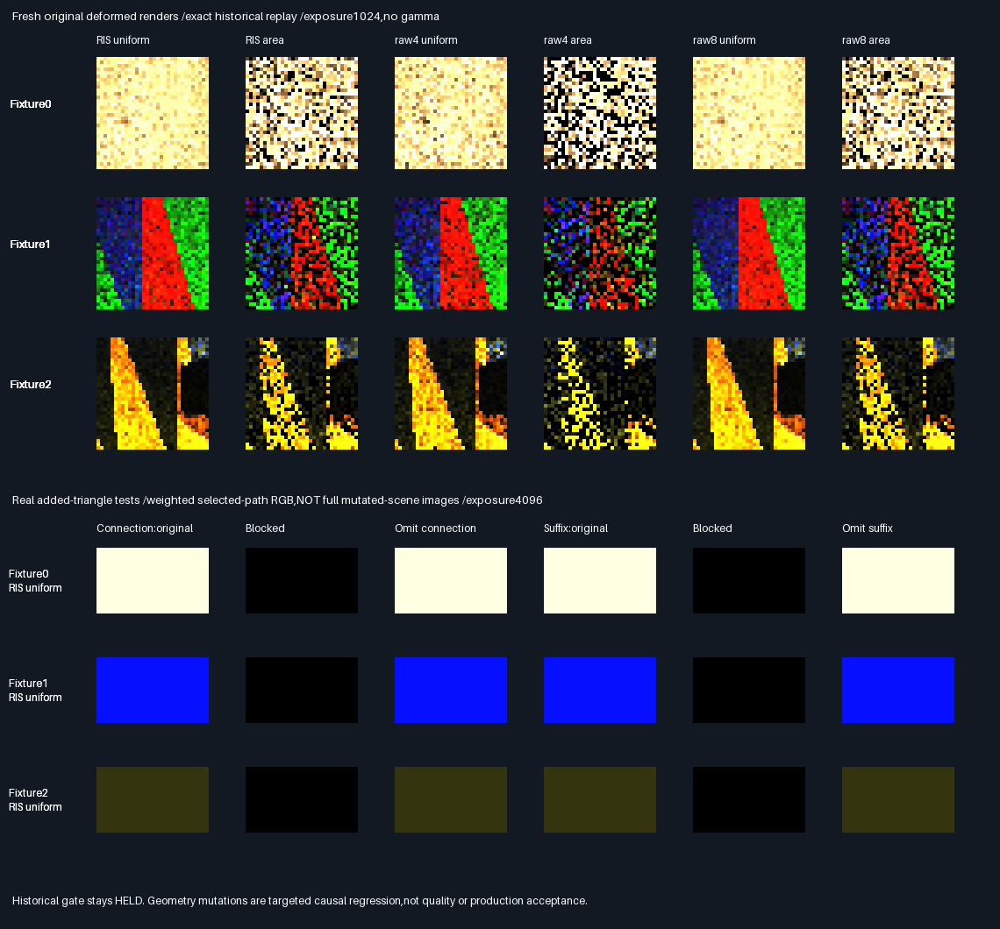

# Deformed transport — energy attribution and causal occluder regression

## Frozen protocol — before measurement

- Parent b30abc0. Diagnose the original three deformed fixtures without rewriting their failed acceptance,
  geometry,materials,camera,seeds,source proposals,score,floor,selection or captures. No engine/API/shader change.
- Replay all six original estimators,4096 packets each,three fixtures. Fresh native correct/omit-connection/
  omit-suffix buffers must exactly match original retained slabs0/39/40. Verify all selected path visibility
  against independent double BVH and linear double triangles. Attribute each blocked operation to zero proxy,
  positive proxy hidden by the other operation,or positive restorable transport. Preserve packet sensitivity
  counts using the original >1e-12 threshold. No GPU input enters the native executable.
- Independently for each fixture/method,choose the FIRST selected path with every visibility true,positive
  correct max RGB>1e-10,and |connection cross light|>.1. Selection is deterministic qualification for a
  targeted causal regression,NOT an independent quality holdout. Fail explicitly if no qualifying path exists.
- For each of18 qualifying paths,construct two separate real-geometry mutations:one black triangle centred
  along connection;one along suffix. Distance=min(.125,.125*connection maximum). Triangle normal follows the
  target ray;radius=min(.01,.05*distance to opposite ray,.05*distance to camera ray). Reject radius≤1e-6.
  A centred equilateral triangle encloses the target ray. No searching,adaptive resizing or seed tuning.
- Rebuild production BVH with the extra triangle,remap original facet identities,resolve primary again and
  evaluate the unchanged production Connect function. Require identical primary/source/ray coordinates,
  unchanged opposite visibility,blocked target visibility,zero correct contribution,restoration by omitting
  only the target operation,and zero contribution when omitting only the opposite operation.
- All36 geometry mutations must pass. For every mutation,simulate bypassing its visibility multiplication;
  the same causal predicate must reject the resulting RGB. These are test-only fault injections,not engine code.
- Release and host ASan+UBSan+leaks;all eight previous CTests plus a focused causal unit. Baseline buffers and
  semantic rows byte-identical across builds. Preserve source hashes,attribution tables,mutation coordinates,
  lossless baseline buffers and actual baseline images/contribution comparisons. Record any failed gate.
- This diagnoses coverage and adds a regression;it CANNOT retroactively turn the historical frozen gate green.
  It makes no estimator quality/speed claim and does not promote the failed RGB-norm candidate. Physical GPU,
  Windows,history,general materials and renderer wiring remain unaccepted. Production348.046875MiB/defaults/
  32B descriptors unchanged;packing/editor/vehicle/Jolt deferred. No PR or Actions.

## Result — cause identified;targeted regression passes

The old failure is a **coverage blind spot**,not evidence that either visibility operation can be removed.
All blocked paths in each of the three insensitive fixture/operation pairs already have exactly zero
unoccluded proxy RGB. Omitting the gate therefore cannot restore positive energy. The historical acceptance
remains **HELD**;the norm-target promotion remains **FAIL**. Neither result is overwritten by this phase.

| Fixture /operation | Blocked selected paths | Zero proxy paths | Restorable paths | Changed original packets |
| ------------------ | ---------------------- | ---------------- | ---------------- | ------------------------ |
| 0 /connection      | 67,935                 | 67,935           | 0                | 0                        |
| 0 /suffix          | 62,001                 | 62,001           | 0                | 0                        |
| 1 /connection      | 70,734                 | 70,734           | 0                | 0                        |
| 1 /suffix          | 70,790                 | 61,486           | 9,304            | 7,247                    |
| 2 /connection      | 72,975                 | 65,929           | 6,890            | 4,158                    |
| 2 /suffix          | 69,359                 | 64,884           | 4,319            | 3,841                    |

Fixture2 also has156 positive-proxy paths hidden by both operations,for each operation's attribution.
Path counts are not packet counts:each packet averages four selected paths,or eight for raw8. Zero proxy is
classified before checking the other visibility. The [projection table](Results/FacetCausal-projection.md)
additionally distinguishes zero source projection,zero receiver projection,both,or neither. For example,
all67,935 blocked connection paths in fixture0 have zero source projection;47,066 also have zero receiver
projection. The table does not infer a nonzero RGB contribution merely from a blocked boolean.

### Regression coverage versus previous evidence

Ratings measure targeted visibility-test coverage,not image quality or production readiness;more stars=better.

| Evidence                              | Rating    | What it establishes                                      |
| ------------------------------------- | --------- | -------------------------------------------------------- |
| New deformed causal geometry tests    | ⭐⭐⭐⭐ 🏆 | Original surfaces,real blockers;both bypass faults caught |
| Prior sensitive analytic holdouts    | ⭐⭐⭐      | Independent references and broad packet/mean coverage     |
| Original deformed omission controls  | ⭐⭐        | Historical parity,but three zero-energy blind spots       |

The new tests deliberately condition on a positive path. They are NOT random-scene coverage,an independent
estimator-quality holdout,or permission to waive the original frozen gate. No sampler or engine repair was
needed for these targeted tests to pass. No new MSE reduction,query-cost reduction or physical speedup is claimed.
The unchanged six-estimator baseline renders are retained so this diagnosis is not confused with a quality win.

### Verified execution

| Check                                      | Result                                                  |
| ------------------------------------------ | ------------------------------------------------------- |
| Release /host ASan+UBSan,leaks enabled      | 9 CTests/build;20,302 focused unit checks/build           |
| Original deformed packet replay            | 73,728 packets,491,520 candidates,393,216 selected paths |
| Original independent visibility checks     | 786,432/build,double BVH and linear double triangles    |
| Historical exact parity                    | All41 slabs of all3 captures identical,not just RGB     |
| Positive-path real geometry mutations      | 36/36 pass across3 fixtures ×6 methods ×2 operations    |
| Wrong visibility multiplication simulated  | 36/36 bypass faults rejected by the same causal predicate |
| Independent new-triangle verification      | Target hit;opposite and camera rays miss,36/36          |
| Source /primary /constructed rays          | Preserved exactly,including material and primary strike |
| Release /sanitizer retained equivalence    | 3 buffers,attribution CSV,mutation buffer,42 semantic rows |
| Previous evidence                          | All1,467 entries across6 prior manifests unchanged       |

Each mutation adds one black triangle to the original16 deformed facets and repacks the production BVH.
The original source/receiver identities are explicitly remapped;proposal U/V,density and weight are unchanged.
The native primary is freshly resolved,not copied into a new scene without checking it. Both original source
and mutated source position/normal/albedo agree. Correct weighted RGB becomes exactly zero;omitting only the
blocked operation restores the exact original weighted RGB. Omitting the other operation leaves it zero.
A bypass fault keeps the real visibility booleans but substitutes the omitted-operation RGB;the causal
predicate rejects every such faulty result. No production visibility implementation is modified.

Mutation radius is0.003352737–0.00625m,well above the frozen1e-6 rejection bound. Selection indices,weights,
triangle corners,ray coordinates and RGB are losslessly retained,not reconstructed from PNGs. A separate
NumPy float64 Möller–Trumbore calculation verifies that the added triangle intersects only the targeted ray,
not the opposite visibility ray or selected camera ray. C++ independently audits the entire mutated scene
with double BVH and linear double triangles. These audit queries are extra verification work,not estimator cost.

### Actual visual and lossless evidence



- Top panel:actual newly rendered original32² RGB images,four packets/pixel,all six methods. Common linear
  exposure1024,no gamma,nearest enlargement. Some pixels clamp;float buffers,not display pixels,prove equality.
- Bottom panel:actual weighted selected-path RGB from real added-triangle executions,uniform RIS shown.
  Common exposure4096 for this separate panel. These are contribution swatches,NOT full mutated-scene renders.
  [All36 contribution comparisons](Images/FacetCausalContributions.png) include all six methods.
- Exploratory exposure64 was too dark for inspection;only display exposure changed. No geometry,seeds,
  qualification,threshold,numeric capture or acceptance gate changed. All54 correct/omission PNG arrays
  are verified against their generating encoded RGB;lossless floats drive the checks.
- [Exact replay and original omission counts](Results/FacetCausal-replay.md),
  [aggregated path-energy attribution](Results/FacetCausal-attribution.md),
  [full per-method attribution CSV](Results/FacetCausal-attribution.csv),
  [all mutation magnitudes](Results/FacetCausal-mutations.md),
  [verdict](Results/FacetCausal-parity.txt),[SHA256 manifest](Results/FacetCausal-evidence-hashes.txt).
- Three `FacetCausal-baseline-*.f32.gz` files retain original slabs[0,39,40],shape[3,24576,4],little-endian
  float32. The full41-slab buffers are recreated in ignored build storage and compared with the original
  retained XZ archives,which are not duplicated in this patch.
- `FacetCausal-mutations.f32.gz`:shape[36,18,4],little-endian float32. Quartets0–2 store fixture/method/
  operation/packet,lane/source/U/V,and density/weight/radius/distance. Quartets3–6 store origin+maximum,
  connection direction,camera origin/direction;7–9 added triangle corners;10–13 original/blocked/restored/
  wrong-omission weighted RGB;14 connection/suffix booleans and independent expected booleans;15–17 primary
  position/normal/albedo. Unused quartet components are zero. Method ordering follows the visible table.

### Reproduce,provenance and remaining work

Tested Linux x86-64,GCC12.2.0,CMake3.31.6,Python3.11,NumPy2.2.6,Pillow13.0.0. Native replay reuses the exact
historical fixture constructors and historical capture loop,with only corpus scope,counter expectations and
a diagnostic call inserted by `FacetCausalScenes.py`. It changes no estimator arithmetic. Source and generated
replay hashes are in both complete logs. Final attribution/source-resolution assertions preserve all original
capture hashes. Tested revision is b30abc01b40b507d2d008f9d8c9efd8b3fb85484 plus the new causal files in the
accompanying source/evidence commit. No previously tracked fixture,engine,API,shader or result was edited.

```bash
bash Exhibits/LightCompute/RunFacetCausal.sh
SANITIZE=1 bash Exhibits/LightCompute/RunFacetCausal.sh
_ClaudeScratch/venv/bin/python Exhibits/LightCompute/Code/FacetCausalEvidence.py
```

All three commands return0 for this bounded regression. They do not rerun or rewrite older collectors.
The runner defaults to the existing ignored CMake installation;CMAKE/CTEST overrides are supported. Native
code requires C++20 for the retained fixture exhibit,CMake/CTest≥3.20 and plain Python at configure time;
the collector also requires NumPy/Pillow and standard-library LZMA. No new downloads are needed. Release uses
strict float arithmetic;sanitized Debug uses-O1,ASan+UBSan,frame pointers,no PIE and leak detection. No Linux
binary is delivered;Windows/MSVC and new GPU execution are not tested.

**Phase100% complete /0% remaining** as a diagnosed coverage problem plus tested causal regression.
**Overall~91% complete /~9% remaining**,planning estimates,not measured release readiness. Historical
acceptance stays HELD. Next bounded problem:Slang/Vulkan parity for these deformed causal mutations,then
explicit renderer wiring,history/general materials and physical-GPU/Windows/editor/real-time acceptance.
The failed norm score is not promoted. Production348.046875MiB output,32B descriptors and defaults unchanged;
packing/editor/vehicle/Jolt remain deferred. No PR or Actions.
