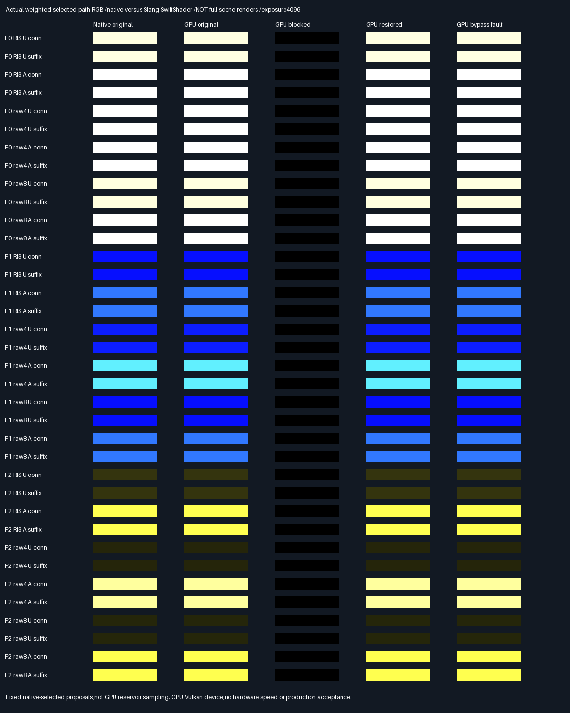

# Deformed causal visibility — selected-proposal Slang/Vulkan parity

## Frozen protocol — before GPU measurement

- Parent988ade1. Exercise the36 retained native deformed causal triangles with shared Slang primary/source,
  compensated geometry,suffix and connection tracing. Engine/API/defaults and all seven prior manifests stay
  unchanged. Historical transport acceptance stays HELD;norm promotion stays FAIL.
- This is FIXED SELECTED-PROPOSAL replay,not fresh GPU proposal generation or reservoir selection. Inputs are
  original fixture constructors plus native camera,source facet,U/V,weight and added triangle vertices.
  Neither native visibility nor native RGB enters shader execution. Native RGB is read only for comparison.
- For each36 test cases execute original geometry,one-triangle mutation,and that mutation with a shader-only
  bypass of the targeted visibility multiplication. Repack production BVHs/remap facet indices on host.
  Shader resolves primary/source and constructs both rays freshly,not from recorded native ray coordinates.
- Require all primary/source facet identities and visibility bits exact;primary/source/ray float coordinates
  within2e-5,without boolean waivers. Native baseline/mutated transport must match native retained RGB and
  independent double-BVH visibility. GPU weighted RGB tolerance1e-10+2e-4*max absolute native channel.
- All36 original paths have positive RGB;all36 mutated correct RGB exactly zero. Omitting only the target
  restores positive original RGB within the RGB tolerance;omitting only the other operation stays exactly zero.
  The same causal predicate must reject36/36 actual GPU shader-bypass readbacks,not copied CPU fault buffers.
- Release and host ASan+UBSan;all nine previous native CTests plus a new GPU comparison unit. Regenerate native
  causal inputs in each build. Readback buffers and semantic rows must match across builds. Preserve actual
  readbacks,shader/source/tool hashes,all36 comparison magnitudes and actual native/GPU contribution images.
- Verify pinned Slang/SwiftShader/Vulkan headers;report device identity. SwiftShader is a software CPU Vulkan
  device,not physical GPU testing. Host ASan does not instrument the driver;leaks disabled for driver execution.
  Native-only tests retain their previous leak-enabled evidence;do not relabel it as new driver coverage.
- No physical timing,Windows,history,general materials,editor or renderer acceptance. Production348.046875MiB,
  32B descriptors/defaults unchanged;packing/editor/vehicle/Jolt deferred. No PR or Actions.

## Result — bounded software-Vulkan parity passes

The shared Slang visibility path reproduces the36 native causal tests. Correct RGB is zero under the added
occluder,omitting only the targeted operation restores the original contribution,and actual shader-bypass
faults are rejected. This does **not** constitute fresh GPU proposal/selection or production integration.

| Verification                                  | Measured result                                         |
| --------------------------------------------- | ------------------------------------------------------- |
| Device                                        | SwiftShader Device (Subzero),CPU Vulkan,type4            |
| Release and host ASan+UBSan                    | 10 CTests/build;20,306 focused unit checks/build         |
| Original /mutated /shader-fault executions     | 36 each;108 GPU primary/source/path executions/build    |
| Suffix /connection visibility                 | 216 decisions/build;exact native/double-BVH agreement  |
| Real-geometry causal tests                    | 36/36 block correct RGB and restore only targeted gate |
| Actual GPU shader-bypass faults               | 36/36 rejected by the causal predicate                  |
| Maximum weighted native/GPU RGB difference     | 0 across baseline,omissions and shader faults           |
| Maximum primary/source/ray coordinate error    | 0 in the reported coordinate comparisons               |
| Release /sanitized readbacks                  | Byte-identical;38 GPU semantic rows match               |
| Historical evidence                          | All1,541 entries across7 prior manifests unchanged      |

Primary facet identities,selected source identities,U/V,weights and work telemetry are also exact.
Ray range has its own2e-5 comparison. All coordinate/colour gates remain the frozen ones;observed zero error
is specific to this software device and corpus,not a portable bitwise guarantee. Native inputs are regenerated
in each build and match the retained causal mutation buffer and attribution CSV exactly.

### Choice and limits

Ratings measure this bounded diagnostic's verification coverage,not rendering quality;more stars=better.

| Evidence                     | Rating    | What is accepted                                     |
| ---------------------------- | --------- | ---------------------------------------------------- |
| Native + Slang causal replay | ⭐⭐⭐⭐ 🏆 | Real mutated geometry,independent rays,actual GPU faults |
| Native causal regression     | ⭐⭐⭐      | Real geometry and host fault rejection               |
| Physical GPU /renderer       | Untested  | No hardware,viewport,speed or release claim            |

- The shader imports unchanged `GeometricAreaReservoirGpu.slang` and shared tracing. It resolves camera
  primary and source material,then constructs both source visibility rays afresh. It receives no native
  visibility,ray coordinates or RGB. The host does use native camera,U/V,selected source and normalization
  weight,as explicitly declared. Labels such as RIS U identify native proposal provenance,not a GPU sampler.
- The test-only bypass uses an input token to skip only the selected visibility multiplication in RGB.
  Both actual visibility queries still run;their booleans remain blocked. This is an actual shader result,
  not a CPU-written imitation. No engine or shared shader is edited to create the fault.
- Each execution traces one camera primary,one suffix and one connection. The216 figure counts suffix/
  connection decisions,not the108 primary traces or additional native/double audit work. Counts are not timing.
- Host ASan/UBSan covers this executable and native dependencies,not the prebuilt SwiftShader driver.
  Leak detection is disabled for the complete Vulkan runner. Prior leak-enabled native evidence remains
  unchanged;it is not relabelled as new driver leak coverage. Khronos validation layers were not run.
- Historical transport acceptance stays **HELD** and the norm-score promotion stays **FAIL**. These targeted,
  positive-path-conditioned tests cannot waive either historical gate or establish arbitrary-scene coverage.

### Actual readbacks and retained evidence



Each row is one retained native-selected path with one real added triangle. Columns show native original,
actual GPU original,actual GPU occluded,actual GPU restored via target-only omission,and actual faulty GPU RGB.
These are weighted RGB contribution swatches,NOT full mutated-scene renders. All36 cases use one common
exposure4096,linear clamp,no gamma. Numeric checks use unclipped float32 readbacks,not display pixels.

- [All36 comparison magnitudes](Results/FacetCausalGpu-comparison.md),
  [verdict](Results/FacetCausalGpu-parity.txt),[SHA256 manifest](Results/FacetCausalGpu-evidence-hashes.txt).
- `FacetCausalGpu-readback.f32.gz` expands to[36cases,3executions,16float4slabs],little-endian float32.
  Executions are original,mutation,mutation+shader fault. Slabs0–2 are correct/omit-connection/omit-suffix RGB;
  3–5 primary position/normal/albedo;6 packed primary identity+strike;7–9 source position/normal/albedo;
  10 source-ray origin+connection maximum;11 connection direction;12 connection/suffix flags+query counts;
  13 packed selected-source identity,U,V,weight;14–15 zero. Identity fields are bit-cast uint32,not numeric IDs.
- The existing submission permits32 or40 allocated diagnostic slabs. This exhibit uses its unchanged32-slab
  private allocation and records only the16 written slabs. It does not add a production output allocation.
- [Release log](Results/FacetCausalGpu-release.txt) and [sanitized log](Results/FacetCausalGpu-sanitized.txt)
  record device/tool/source/generated-prefix/SPIR-V/readback hashes. Finalized source is rerun in both builds;
  the final Release readback also matches the initial complete run's SHA256.

### Reproduce and provenance

Tested Linux x86-64,GCC12.2.0,CMake3.31.6,Slang2026.14.1,SwiftShader pins in
`Automation/ReplayToolDependencies.json`,Vulkan-Headers1.4.321,Python3,NumPy2.2.6,Pillow13.0.0. Tested source is
parent988ade19f2ab553d6470fa293a0f03dc37347a61 plus the new causal-GPU files in the accompanying evidence commit.
No previously tracked engine,API,shader,fixture,result or tool specification is changed.

Pinned host-tool recovery,if the ignored tools are absent:

```bash
python3 Automation/PrepareReplayTools.py
mkdir -p _ClaudeScratch/tmp
curl -L https://codeload.github.com/KhronosGroup/Vulkan-Headers/tar.gz/refs/tags/v1.4.321 \
  -o _ClaudeScratch/tmp/Vulkan-Headers-v1.4.321.tar.gz
printf '%s  %s\n' 7c1874f9186d9e7d5245e279cdccaa77a66ed8f52871b428630aeb771dc7623c \
  _ClaudeScratch/tmp/Vulkan-Headers-v1.4.321.tar.gz | sha256sum -c -
tar -xzf _ClaudeScratch/tmp/Vulkan-Headers-v1.4.321.tar.gz -C ExternalPackages
```

Recovery was verified locally;no downloaded tools or headers are committed. The runner verifies pinned local
Slang/SwiftShader files before executing and records the used Vulkan header hashes. Then:

```bash
bash Exhibits/LightCompute/RunFacetCausalGpu.sh
SANITIZE=1 bash Exhibits/LightCompute/RunFacetCausalGpu.sh
_ClaudeScratch/venv/bin/python Exhibits/LightCompute/Code/FacetCausalGpuEvidence.py
```

All three commands return0 for this bounded parity study. CMAKE/CTEST overrides are supported. Configure-time
Python needs only its standard library;the collector requires NumPy/Pillow. Native fixtures require C++20.
Release uses strict floating arithmetic;sanitized Debug uses-O1,ASan+UBSan,frame pointers,no PIE and leaks0.
An earlier script run finished GPU comparisons but returned a launcher parse error during concurrent edits;
only the complete final stable-script reruns are retained as acceptance evidence. No Linux binary is delivered.
Windows/MSVC,physical GPU,real-time throughput,history,general materials and editor execution remain untested.

**Phase100% complete /0% remaining** as fixed-selected-proposal parity,not GPU reservoir or production acceptance.
**Overall~91% complete /~9% remaining**,planning estimates,not measured release readiness. Next bounded problem:
GPU-generated candidate/selection replay for the deformed causal regression,removing the native-selected
proposal input before renderer wiring. Production348.046875MiB/defaults/32B unchanged;packing/editor/vehicle/
Jolt remain deferred. No PR or Actions.
