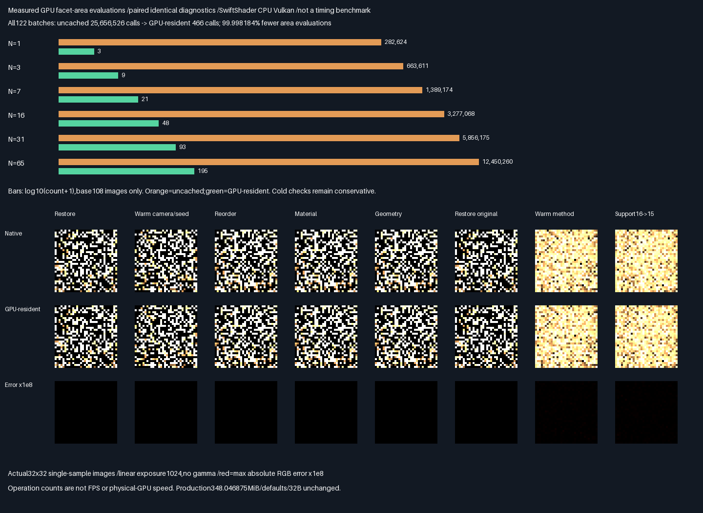

# GPU-resident facet area/CDF preparation

**PASS:**prepare and retain profile validity,areas,CDF and PDFs on GPU;reuse them across image submissions.
Paired uncached GPU diagnostics are bit-identical across all80 slabs. This is bounded cache correctness and
measured operation reduction,not renderer integration,physical-GPU speed or quality acceptance.

## Verified results

| Measurement                    | Result                                               |
| ------------------------------ | ---------------------------------------------------- |
| Release + host ASan/UBSan       | 14 CTests/20,342 focused checks per build              |
| Positive corpus                | 116 images/118,784 packets,three original layouts      |
| Candidate/path/pair/visibility  | 802,816 /647,168 /155,648 /1,294,336                    |
| Paired uncached GPU            | All80 slabs bit-identical on all122 submissions        |
| Native/double-shadow audit     | Zero packet/native/visibility failures                |
| Packet RGB max /RMSE           | 3.7252902985e-9 /3.4299106163e-11                       |
| Weighted RGB /coordinate max   | 7.4505805969e-9 /0                                    |
| Scalar/cache scaled residual   | 1.7163382096e-7 /4.4227597884e-7                       |
| GPU area evaluations           | Uncached25,656,526 -> cached466,99.998183698% fewer      |
| Preparation/reuse              | 30 preparations,92 submissions reuse retained results |
| Malformed profiles             | All6,144 pixels reject exactly;other components zero  |
| Revision preparation counts    | 8,8,9,10,11,12,12,13                                  |
| Original108 image controls     | All80 GPU/native slabs byte-identical to prior phase   |
| Cross-build                    | Seven captures/124 semantic rows identical            |
| Prior evidence                 | Eleven manifests/1,761 entries unchanged               |

Ratings indicate fit for this bounded mechanism,not image quality or measured speed;more stars is better.

| Choice                 | Area calls | Correctness              | Rating      | Decision          |
| ---------------------- | ---------- | ------------------------ | ----------- | ----------------- |
| GPU-resident area/CDF   | 466        | Exact uncached GPU match | ⭐⭐⭐⭐⭐ 🏆 | Retain for wiring |
| Repeated uncached work | 25,656,526 | Same accepted images     | ⭐⭐⭐       | Control only      |

```text
Geometry/profile change -> GPU preparation -> compute-write/read barrier -> GPU sampling
Camera/seed/method only -----------------------------------------------> retained cache
```



- Graph uses actual GPU atomic counts;logarithmic bar lengths are labelled with exact counts. No timing claim.
- Images show all eight additional revision controls in the same16-facet allocation,including valid support15.
  Native/GPU pairs have identical display bytes. Acceptance uses unclipped float diagnostics,not these PNGs.
- Sources1/3/7/16/31/65 retain the original108 images;the extra eight images are not a quality-improvement corpus.
  Single-sample32×32 output is not converged quality evidence. Historical transport **HELD**,norm promotion **FAIL**.

## Frozen protocol — before measurement

- Parent8d892f25a6092813f969d87af09a72511a8df7ca. Prepare profile validity,areas,CDF and PDFs once on GPU;
  reuse them across camera/seed/method submissions. No native area,CDF,PDF,target,selection or RGB uploads.
- Preserve the previous108 image corpus:three layouts,sizes1/3/7/16/31/65,six arms,sample0,32×32 pixels.
  Run a paired instrumented uncached GPU baseline for every batch;require all80 diagnostic slabs bit-identical.
  Independently retain native proposal/score/selection/transport assembly and double-shadow audits.
- Keep scalar2e-5*max(1,abs(native)),coordinate absolute2e-5,RGB1e-10+2e-4*max(abs(native RGB));IDs/U/V,
  selections,work and visibility exact,no edge waivers. GPU cache area/CDF/PDF also pass the scalar gate
  against independent geometric area/CDF calculations and production proposal densities where available.
- Private binding5 grid scratch is repurposed for a dynamically sized cache:four header quartets,one per
  geometry facet,and one untouched guard quartet. No fixed source-count/image-count coupling is introduced.
  Other diagnostic allocations and production348.046875MiB/defaults/32B remain unchanged.
- One preparation invocation writes the cache in original support order;an explicit compute-write/read
  barrier precedes sampling in the same command buffer. No CPU readback separates preparation and sampling.
  Cache persists across submissions. Detect changes to geometry/enclosures and header/profile bytes,but not
  camera rays,seeds or estimator methods. Conservative material changes also rebuild. Lifetime counters are GPU-
  written.
- Reuse all six actual malformed-profile submissions at layout0,N16,with exact codes[1,1,1,2,2,3] and6,144
  rejected pixels. Only slab79.x is nonzero on rejection. Compare paired uncached output and guards as well.
- Eight additional layout0,N16 batches after malformed submissions:restore valid,warm camera/seed change,
  reverse source order,material change,geometry change,restore original,warm estimator change,valid16-to15 support
  change within the same allocation. Expected lifetime
  preparations in this context:[8,8,9,10,11,12,12,13]. Original six methods share preparation1.
- Warm change rotates camera pixels by1 and XORs seeds with0x31415927. Reverse profile order;scale first
  selected source's red albedo by.9;translate every geometry vertex+x.001 and rebuild/repack BVH/profile;
  restore the saved original scene/profile. Extra batches use method5 except the final two method0. The last batch
  removes the last source index.
- Total positive116 images/118,784 packets plus six negative batches. Expected30 cached preparation dispatches
  and466 cached area evaluations across all contexts. Count actual area-function calls with GPU atomics in
  both cached and uncached routes;report work reduction,NOT FPS or wall-time/hardware speedup.
- Retain full cache snapshots,actual diagnostics,validity,first failure and per-batch work rows. Reconstruct
  full captures from lossless XOR deltas against previous retained buffers where applicable;validate exact
  hashes. This is evidence storage only,not production memory packing. Keep large generated files out of Git.
- Release and host ASan+UBSan,all prior13CTests plus focused cache-input units. Driver uninstrumented,leaks0.
  Buffers/work/semantic rows must be identical across builds. Preserve11 prior manifests/1,761 entries.
- Retain actual native/GPU/error images and measured work graph. Exposure1024,no gamma,nearest enlargement;
  red RGB error×1e8. Retained scenes/one sample are not a converged quality or independent-scene holdout.
- Failed comparisons remain failed;do not retune gates,math,seeds,cameras or geometry after observation.
  SwiftShader CPU Vulkan only;no physical-GPU,Windows,renderer/history/general-material/performance acceptance.
  Historical transport HELD,norm promotion FAIL preserved. Packing/editor/vehicle/Jolt deferred. No PR/Actions.

## Implementation and retained evidence

The exhibit extends the previous checked source extraction rather than forking maintained transport code.
Private descriptor slot5 uses `(geometryCount+5)*16` bytes:four header quartets,one quartet per geometry facet,
then an untouched guard quartet. At65 geometry facets this is1,120B of private cache,not a production change.
The cache stores float area,CDF,uniform PDF and packed identity;the header stores area PDF,validity and work
counters. One invocation preserves the original float accumulation order. Sampling evaluates no facet areas.

Geometry/enclosure changes and exact header/profile bytes invalidate the cache. Camera rays,seeds and methods
do not. Material changes conservatively rebuild. Preparation and sampling share one command buffer with an
explicit shader-write to shader-read/write compute dependency;no CPU data bridge occurs between them.
CPU cache-input comparisons do not calculate or upload area/CDF/PDF/selection/normalization/RGB answers.
Cache snapshots are read only after submission completes. The paired uncached route counts the same area
function using a previously unused counter in the active profile path;instrumentation is not a speed benchmark.

The eight additional images restore valid input,warm camera/seed,reverse profile,change material,translate/repack
geometry,restore original,warm estimator,and change support16->15 without reallocating. Six negative images
exercise zero/excess count,bad capacity,bad index,duplicate index and degenerate geometry. Exact rejection codes
are1,1,1,2,2,3;only slab79.x is nonzero. Output tails on both routes and the prepared cache guard remain untouched.

- [Numerical summary](Results/FacetCdfGpu-parity.txt) and [all122 work rows](Results/FacetCdfGpu-comparison.md).
- [Release log](Results/FacetCdfGpu-release.txt),[sanitized log](Results/FacetCdfGpu-sanitized.txt),
  [first failure](Results/FacetCdfGpu-first-failure.txt),[SHA-256 manifest](Results/FacetCdfGpu-evidence-hashes.txt).
- Full cached/native float captures use lossless XOR archives against prior profile captures for original images;
  extra images use zero reference. Rejections use the previous rejection capture as reference. Archived work rows
  determine positive-image order and previous `[layout,size,method]` reference selection. Dimensions are
  `[116,1024,80,4]` float32 for positives and `[6,1024,80,4]` for negatives. Paired uncached readbacks are compared
  byte-for-byte before native audits;their identical diagnostic bytes are not redundantly archived.
- Cache archive is `[122,72,4]` uint32:two metadata quartets,then up to70 private cache quartets including guard;
  unused archive padding is zero. Metadata is layout,support,method,category,revision,geometry count,runs,rejection.
  Categories0/1/2 mean original/negative/revision. Cache header words0/1/2/3 are status,support,runs,current areas;
  4/5/6 are total-area bits,area-PDF bits,geometry count;8/9/10 are validation count,sampling calls,lifetime areas.
  Quartet4 onwards contains area,CDF,uniform-PDF float bits and packed identity. Guard is0x5a5a5a5a per word.
- Work archive is `[122,12]` uint32:layout,support,method,category,revision,runs,cached area calls,uncached calls,
  new runs,lifetime sample calls,lifetime area calls,rejection. Validity archive is `[116,1024]` uint8.
  The collector verifies lifetime counters,guards,stored CDF/PDF arithmetic,native diagnostic gates,old-capture
  equality and exact cross-build reconstruction. Archived reconstruction separately verifies all seven capture hashes.

## Reproduction and provenance

Parent8d892f25a6092813f969d87af09a72511a8df7ca plus the source/evidence in this commit. Linux x86-64,GCC12.2,
CMake3.31.6,Slang2026.14.1,Vulkan-Headers1.4.321,pinned SwiftShader CPU Vulkan(type4),Python3.11,NumPy2.2.6,
Pillow13.0.0. Tool dependencies stay ignored;use
[pinned recovery instructions](FacetCausalGpu.md#reproduce-and-provenance).
Generated prefix/shader/SPIR-V and raw-capture hashes are logged. Release uses strict arithmetic;sanitized Debug
uses-O1,ASan+UBSan,frame pointers,no PIE and leaks0. Driver code is uninstrumented. Only final stable runs are
retained;an earlier complete pair also passed before host declaration/name cleanup,without numerical changes.
No gates,math,seeds,cameras or geometry were retuned after measurement.

```bash
bash Exhibits/LightCompute/RunFacetCdfGpu.sh
SANITIZE=1 bash Exhibits/LightCompute/RunFacetCdfGpu.sh
_ClaudeScratch/venv/bin/python Exhibits/LightCompute/Code/FacetCdfGpuEvidence.py
```

Reconstruct all seven captures from retained archives alone,without a GPU or original scratch readbacks:

```bash
_ClaudeScratch/venv/bin/python Exhibits/LightCompute/Code/FacetCdfGpuEvidence.py --reconstruct
```

## Progress and remaining work

**Phase100% complete /0% remaining** as bounded GPU-resident area/CDF preparation and reuse.
**Overall~95% complete /~5% remaining**,planning estimates,not measured release readiness.
Next bounded problem:wire the verified GPU-generated proposal/cache route into renderer-owned resources and
submission lifetime while retaining these controls. General scene/material/history validation,physical GPU,
Windows and real-time performance acceptance remain. Do not treat this exhibit as a production renderer port.
Production348.046875MiB,32B descriptors and defaults unchanged. Memory packing/editor/vehicle/Jolt deferred.
No PR or Actions.
