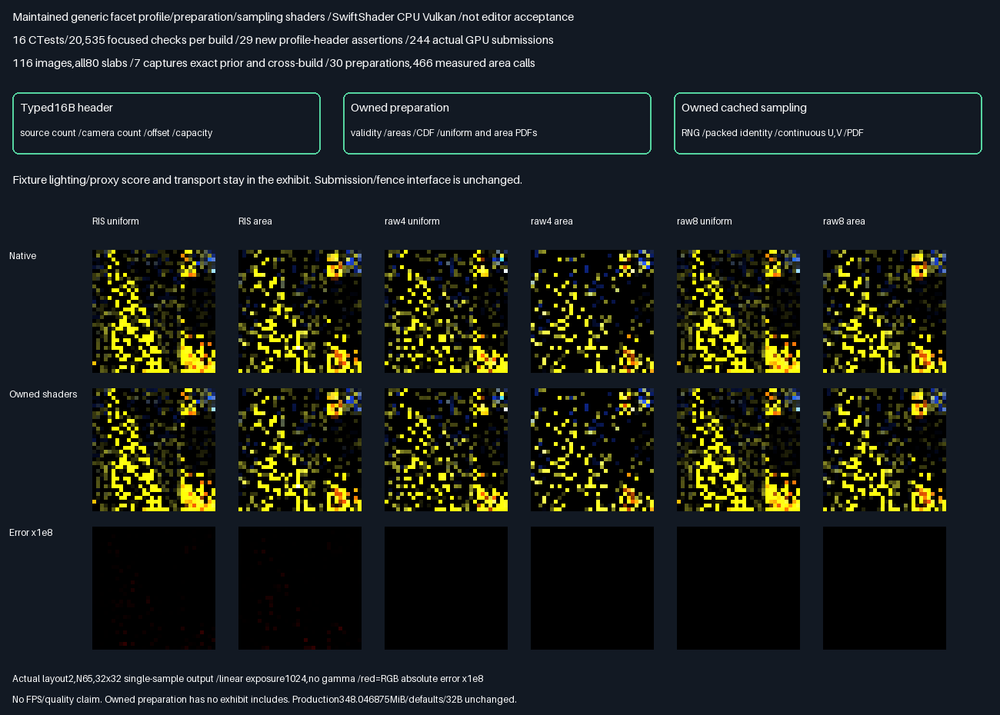

# Maintained facet CDF shader ownership

**PASS:**generic source-profile decoding,validity,area/CDF/PDF preparation and cached continuous triangle sampling
now live in maintained rendering shaders. Preparation compiles directly without exhibit includes. The unchanged
submission interface executes the owned shader;fixture lighting/proxy scores and transport remain exhibit-owned.

## Verified results

| Measurement                    | Result                                                |
| ------------------------------ | ----------------------------------------------------- |
| Release + host ASan/UBSan       | 16 CTests/20,535 focused checks per build               |
| New typed-header assertions    | 29 passing;layout,extent,limits,overflow                |
| Existing lifetime assertions   | All164 remain passing                                  |
| Actual API submissions         | 244 per build through maintained fence publication     |
| Images/packets                 | 116 /118,784,all80 diagnostic slabs                     |
| Native/paired uncached audit   | Zero failures;unchanged numerical and identity gates   |
| Negative profiles              | 6,144 exact rejections,other components zero            |
| Previous phase/cross-build     | Seven complete captures/124 semantic rows exact        |
| Cached work                    | 30 preparations,466 GPU area evaluations                |
| Uncached work                  | 25,656,526 area evaluations,not timing/FPS               |
| Packet RGB maximum/RMSE        | 3.7252902985e-9 /3.4299106163e-11                        |
| Previous evidence              | Thirteen manifests/1,834 entries unchanged              |

Ratings indicate fit for reusable shader ownership,not image quality or measured speed. More stars is better.

| Choice                      | Numerical result | Scope boundary                       | Rating      |
| --------------------------- | ---------------- | ------------------------------------ | ----------- |
| Maintained generic CDF code  | Exact prior      | Generic sampling,fixture score apart | ⭐⭐⭐⭐⭐ 🏆 |
| Previous generated sampler | Same accepted    | Generic logic embedded in exhibit    | ⭐⭐⭐       |

```text
Typed16B header + source permutation -> owned GPU validation/area/CDF/PDF preparation
                                    -> compute dependency -> owned cached RNG/identity/U/V/PDF
                                                         -> caller-specific score/selection/transport
```



- Actual layout2,N65,six-method32×32 single-sample output;exposure1024,no gamma,nearest enlargement.
  Red is absolute RGB error×1e8. Six displayed native/GPU pairs match display bytes exactly;numeric acceptance
  uses full unclipped float data. These are not converged-quality or independent-scene holdout images.
- Candidate/path/pair/visibility counts remain802,816 /647,168 /155,648 /1,294,336 per build. Weighted RGB
  max7.4505805969e-9,coordinates0,scalar residual1.7163382096e-7,cache residual4.4227597884e-7.
- SPIR-V identity across the ownership change is not an acceptance gate:source/type/function boundaries changed.
  All six binaries match across builds;the three uncached control binaries also match the prior phase.
  Preparation/generation binaries changed;cached resolve and all three uncached programs are unchanged.
  Full old/new shader hashes are retained rather than assuming executable identity from unchanged images.
- Production348.046875MiB/defaults/32B unchanged. Original transport **HELD**,norm promotion **FAIL** remain.

## Frozen protocol — before measurement

- Parent4456d81450ad5b4c0d5a87a1dae167545680158e. Complete one bounded ownership step:maintained generic
  profile decoding,validity,geometry areas,CDF/PDF preparation and cached RNG/identity/U/V/PDF sampling.
- Keep fixture lighting/proxy scores,transport assembly and80-slab diagnostic writing in the exhibit. Do not
  promote hardcoded fixture illumination into rendering. Preparation must compile directly from maintained
  source with maintained-only include paths;no Exhibits/generated-source dependency in owned shader files.
- Preserve float accumulation,hash/RNG,selection rules and rejection codes. New source ownership/type/function
  boundaries may alter SPIR-V bytes;numeric output must remain byte-identical across all seven captured buffers,
  all122 paired batches/all80 slabs,previous native/uncached GPU corpus and both builds. Do not retune failures.
- Add a typed16B host profile-header contract and focused extent/layout tests. Keep Vulkan submission/lifetime
  unchanged. Test through the maintained encoder with actual driver fences. Retain all15 prior CTests plus new
  profile units,Release and host ASan+UBSan;driver uninstrumented,leaks0.
- Keep all scalar/coordinate/RGB/identity/visibility/work gates. The established corpus is116 positive
  images/118,784 packets plus6,144 exact rejections,30 cached preparations and466 cached area evaluations.
- Verify all thirteen previous manifests unchanged. Reconstruct retained prior archives and verify every new
  capture hash;do not duplicate identical raw diagnostic buffers. Retain actual native/GPU/error images and logs.
- Production348.046875MiB/defaults/32B unchanged. Private cache slot5 is not an active lighting grid;80-slab
  diagnostic layout is not the compact renderer output ABI. No renderer/editor activation or GPU allocation.
- SwiftShader CPU only;no physical-GPU/Windows/general-material/history/performance or quality acceptance.
  Transport HELD,norm FAIL preserved. Packing/editor/vehicle/Jolt deferred. No PR or Actions.

## Ownership and ABI

- [FacetCdfProfile.h](../../Frontier/Engine/Rendering/FacetCdfProfile.h):a16B,four-uint32 host header with checked
  extent construction. Upload its bit patterns to `Receivers[0].PositionHit`;do not numerically convert uints
  to floats. Fields are source count,camera count,source-quartet start and quartet capacity. The typed header
  is used by actual positive-path uploads,not just compiled in an isolated unit.
- [FacetCdfProfile.slang](../../Frontier/Engine/Rendering/Shaders/FacetCdfProfile.slang):decoding,packed identity
  lookup,geometry area,validity,CDF/PDF preparation and score-independent cached sampling. `ProposeFacetCdf`
  returns packed index,U,V,density;the caller computes its own receiver-dependent score. Its precondition is
  successful preparation/status0 and matching cached support;measure0 is uniform,measure1 proportional area.
- [FacetCdfPreparation.slang](../../Frontier/Engine/Rendering/Shaders/FacetCdfPreparation.slang):maintained
  one-invocation preparation entry,including only maintained LightInfluence/profile sources. No generated code
  or exhibit include directory is supplied when compiling this entry. Recursive include closure is retained.
- [FacetCdfSubmission.h](../../Frontier/Engine/Rendering/FacetCdfSubmission.h) is unchanged. The caller still owns
  allocations,compatible descriptors/pipelines,upload/output/ownership dependencies,lifetime counters and fences.
  Geometry/profile/allocation revisions and fence-publication requirements remain unchanged.

Shader/profile input uses the established slots0–7 and128B push constants. Profile source count supports the
existing native bound up to16,777,216;the tested GPU corpus covers1/3/7/16/31/65 and a valid16->15 transition.
A separate65-source/one-camera host extent control establishes that source count is not camera-count bounded;
maximum extents are arithmetic tests,not large-scene GPU scalability or memory/performance acceptance.

The private cache has four header quartets,one entry per geometry facet,and a guard quartet. Sampling uses
cached CDF/PDF/identity;preparation retains original float accumulation and validation order. Counter20 counts
actual area evaluations. Cache words2/9/10 are GPU lifetime counters and must be initialized on new allocation.
The caller handles invalid prepared status before sampling. Exact source-count/capacity/index/duplicate/area
rejections and guarded writes are retained. No native area/CDF/PDF/selected identity/U/V/weight/RGB answers upload.

The exhibit adapter now only maps the generic sample into its retained candidate type and computes the original
fixture proxy/score. Hardcoded fixture light colour/direction,score floor,packet selection/transport and80-slab
writing are deliberately not promoted into generic rendering. The uncached GPU baseline and independent native
production proposal/score/selection/transport/double-shadow audit remain unchanged.
This does not activate a production renderer or map80 diagnostic slabs onto the compact production output ABI.
Slot5 private CDF cache cannot simultaneously serve as an active lighting grid for another shader.

## Evidence and reproduction

- [C++17 header compile](Results/FacetCdfShader-header17.txt):PASS,syntax only;runtime uses C++20.
- [Result summary](Results/FacetCdfShader-parity.txt),[Release log](Results/FacetCdfShader-release.txt),
  [sanitized log](Results/FacetCdfShader-sanitized.txt),
  [ownership closure](Results/FacetCdfShader-ownership.txt),
  [old/new shader hashes](Results/FacetCdfShader-spirv-comparison.txt),
  [capture references](Results/FacetCdfShader-capture-references.txt),
  [SHA-256 manifest](Results/FacetCdfShader-evidence-hashes.txt).
- Every new actual capture matches the reconstructed previous archived bytes. The previous
  [lossless archives/schema](FacetCdfGpu.md#implementation-and-retained-evidence) retain all diagnostics,
  validity,cache,work and first-failure data without duplicating another~300MiB raw corpus. The collector
  reconstructs archives without a GPU and verifies all seven new readbacks against them and across builds.
- Parent4456d81450ad5b4c0d5a87a1dae167545680158e plus accompanying source/evidence. Linux x86-64,GCC12.2,
  CMake3.31.6,Slang2026.14.1,Vulkan-Headers1.4.321,pinned SwiftShader CPU Vulkan(type4),Python3.11,
  NumPy2.2.6,Pillow13.0.0. [Pinned tool recovery](FacetCausalGpu.md#reproduce-and-provenance).
- Release strict arithmetic;sanitized Debug-O1,ASan+UBSan,frame pointers,no PIE,leaks0. Driver code uninstrumented.
  All prior fifteen unit targets remain. No post-observation math/gate/seed/camera/geometry retuning. Separate
  configurations may run concurrently;operation counts are not timing or physical-GPU speed measurements.

```bash
bash Exhibits/LightCompute/RunFacetCdfShader.sh
SANITIZE=1 bash Exhibits/LightCompute/RunFacetCdfShader.sh
_ClaudeScratch/venv/bin/python Exhibits/LightCompute/Code/FacetCdfShaderEvidence.py
```

## Progress and remaining work

**Bounded generic shader/header ownership phase100% complete /0% remaining.**
**Overall~97% complete /~3% remaining**,planning estimates,not measured release readiness.
Next:production scene/output wiring for the maintained sampler/cache and submission interface,retaining the
compact348MiB allocation. Full renderer/editor activation,broader scenes/material/history,physical GPU,Windows,
validation layers and real-time performance remain unverified. No new quality/speed/default promotion.
Memory packing/editor/vehicle/Jolt deferred. No PR or Actions.
