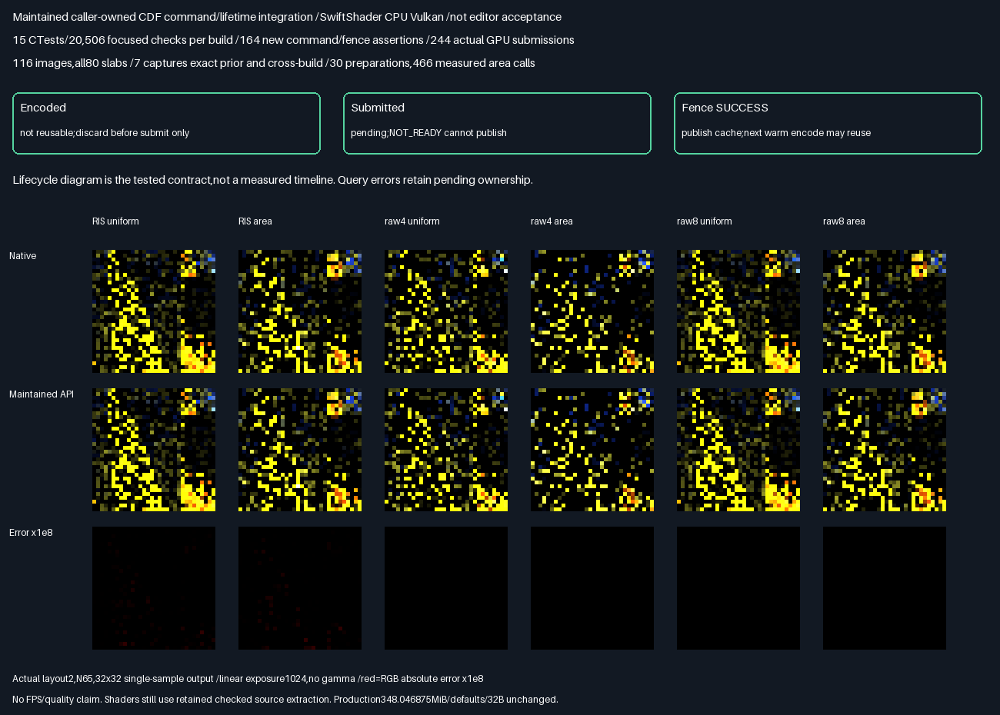

# Renderer-facing facet CDF submission lifetime

**PASS:**maintained caller-owned Vulkan command encoding and fence-published cache residency now replace the
exhibit's manual dispatch sequence. All prior GPU/native diagnostics are unchanged. This completes the bounded
submission/lifetime interface,not a complete renderer/editor port or activation of production sampling defaults.

## Verified results

| Measurement                        | Result                                             |
| ---------------------------------- | -------------------------------------------------- |
| Release + host ASan/UBSan           | 15 CTests/20,506 focused checks per build            |
| New command/fence assertions        | 164 passing,including range/overflow/transition tests |
| Actual maintained-API submissions   | 244 per build,122 cached +122 paired uncached        |
| Positive corpus                    | 116 images/118,784 packets                          |
| Native/double-shadow checks         | Zero failures;all original gates retained            |
| Malformed profiles                 | 6,144 exact rejections;other diagnostic fields zero  |
| Cross-build + previous phase        | All seven captures/124 semantic rows byte-identical |
| Compiled shader controls           | All six SPIR-V binaries unchanged                    |
| Cache work                         | 30 preparations,466 cached area evaluations           |
| Uncached area evaluations           | 25,656,526;not a timing or FPS result                 |
| Packet RGB max /RMSE               | 3.7252902985e-9 /3.4299106163e-11                     |
| Previous evidence                  | Twelve manifests/1,803 entries unchanged              |

Ratings indicate fit for reusable command/lifetime integration,not image quality or measured speed.
More stars is better. The old synchronous exhibit was correct;it did not expose this reusable ownership contract.

| Choice                       | Diagnostics          | Ownership boundary             | Rating      |
| ---------------------------- | -------------------- | ------------------------------ | ----------- |
| Maintained submission API    | Exact prior output   | Explicit pending/fence publish | ⭐⭐⭐⭐⭐ 🏆 |
| Private manual dispatches    | Same accepted output | Exhibit-local synchronous flow | ⭐⭐⭐       |

```text
Cold encode: bind/push -> prepare -> compute dependency -> generate -> dependency -> resolve
Warm encode: bind/push ---------------------------------> generate -> dependency -> resolve

Encoded -> successful QueueSubmit -> Acknowledge -> Submitted -> fence SUCCESS -> reusable
   |                                                  |
   +-> Discard (never submitted)                       +-> NOT_READY/error:keep ownership pending
```



- Actual layout2,N65,six-method32×32 output,one sample,linear exposure1024,no gamma;red is RGB error×1e8.
  All six displayed native/GPU pairs have identical display bytes. Float acceptance does not use PNG quantization.
- Candidate/path/pair/visibility counts remain802,816 /647,168 /155,648 /1,294,336 per build. Weighted RGB
  maximum7.4505805969e-9,coordinate difference0,scalar residual1.7163382096e-7,cache residual4.4227597884e-7.
- Query errors and not-ready transitions are deterministic host-spy controls,not physical device-loss recovery
  or validation-layer acceptance. Actual GPU submissions use the driver's real completion-fence queries.
- Production348.046875MiB/defaults/32B unchanged. Transport **HELD**,norm promotion **FAIL** remain unchanged.

## Frozen scope — before measurement

- Parentffc4a8e329e5656417d5804271ffdc37a8ef04f7. Complete one bounded integration problem:reusable maintained
  Vulkan command encoding and fence-published cache lifetime for caller-owned resources. Not an editor port.
- Add a maintained header-only rendering interface,consistent with the existing caller-owned PathReplayVulkan
  boundary. No Vulkan allocation,window,presentation,default change or production348.046875MiB/32B change.
  The caller retains buffers,descriptors,pipelines,commands and synchronization ownership.
- Explicit geometry/material,profile and allocation revisions drive conservative invalidation. Descriptor/device/
  pipeline identity and cache capacity/geometry changes also invalidate. Camera/seed/method changes do not.
- Validate all ranges,overflow,group/push limits,callbacks,handles and stateless diffuse constraints before any
  command is encoded. Reject overlapping work on one submission object. Disallow copying or moving residency.
- Encode prepare when cold,then a compute-write/read-write dependency,generate,dependency,resolve. External
  upload/output/queue-ownership barriers remain caller responsibilities. No CPU bridge between dispatches.
- Require an unsignalled completion fence before encoding. Separate encoded and successfully submitted work.
  Publish reusable residency only after the recorded fence query returns VK_SUCCESS. VK_NOT_READY retains
  pending ownership. Query errors fail closed. Discard is permitted only before successful queue submission;
  invalidate/re-encode while pending is rejected. Callers must acknowledge successful QueueSubmit immediately.
- Deterministic command-spy/fence tests exercise cold/warm,each revision,descriptor/pipeline/allocation changes,
  malformed ranges,callbacks and handles,unsignalled/signalled fences,overlap,discard,not-ready and query errors.
  Spy tests are host tests,not claims of injected physical device failure or validation-layer acceptance.
- Replace only the prior generated host's manual prepare/generate/resolve sequence with the maintained API;
  retain the exact previous sampler,fixtures,all122 paired batches/native audits/80 slabs and frozen numeric
  gates. Re-run Release and host ASan+UBSan,all prior14 CTests plus submission units. Actual GPU/capture/work
  results must remain byte-identical to the retained previous cache phase. Do not retune observed comparisons.
- Reconstruct prior archived captures without GPU;compare seven actual new captures and semantic rows across
  builds and prior phase. Retain actual native/GPU/error images,command/lifetime results and source hashes.
- All twelve prior manifests remain unchanged. SwiftShader CPU Vulkan only;driver uninstrumented,leaks0.
  No physical-GPU/Windows/full-renderer/history/general-material/speed/quality promotion. Preserve transport
  HELD,norm promotion FAIL. No PR/Actions. Packing/editor/vehicle/Jolt remain deferred.

## Maintained interface and caller responsibilities

[FacetCdfSubmission.h](../../Frontier/Engine/Rendering/FacetCdfSubmission.h) is header-only and directly included
by the tested caller. No existing rendering library/CMake/default is changed. Its Vulkan function pointers follow
existing caller-owned submission conventions;no Vulkan loader linkage or resource allocation is imposed.

| Operation      | Permitted condition             | Effect                                      |
| -------------- | ------------------------------- | ------------------------------------------- |
| Encode         | Idle,valid ranges,fence reset   | Encode commands;reusable publication revoked |
| Acknowledge    | Encoded,QueueSubmit succeeded   | Mark successfully submitted ownership        |
| Resolve        | Submitted                       | Poll captured device/fence callback          |
| Resolve ready  | Fence VK_SUCCESS                | Publish pending revision/resource signature  |
| Resolve wait   | Fence VK_NOT_READY              | Return false;keep ownership pending           |
| Resolve error  | Other fence result              | Throw;keep ownership pending,not reusable     |
| Discard        | Encoded,never submitted         | Invalidate;no publication of discarded work   |
| Invalidate     | No work pending                 | Force next preparation                       |

The caller owns and retains device,fence,pipelines,layout,descriptors,command pool/buffer and all buffer ranges.
It supplies upload/output and queue-ownership dependencies,cache lifetime-counter initialization and counter
clearing. Never mutate or reclaim pending resources. Serialize access externally;the object cannot be copied
or moved. Before Encode,reset the completion fence. Immediately after successful QueueSubmit,Acknowledge;
if command completion/submission fails before successful QueueSubmit,Discard. Poll Resolve only after
acknowledgement. On query failure,keep resources pending until the device is drained/torn down;this interface
cannot enforce external queue calls,fence resets,aliasing or recovery from a lost device.

Use nonzero,equality-stable revision tokens:Geometry for geometry/enclosures/material,Profile for source
header/permutation,Allocation for descriptor rewriting/resource replacement. Tokens must not wrap/recur while
old residency can be reused. Device/layout/descriptor/pipeline identity and geometry/cache-capacity changes
also force preparation. Camera,seed,method and fence rotation alone do not invalidate area/CDF contents.
Descriptor compatibility and underlying content are caller contracts,not inferred from buffer sizes.

The current ABI is the retained stateless diffuse diagnostic route:slots0–7,128B push constants,geometry-sized
private cache at slot5 and80 float4 diagnostic slabs. It is **not** the compact production output ABI. No default
allocation is instantiated by this header. Shader/scene ownership and production-output mapping still need
separate integration;do not substitute this private cache for an active lighting grid in another shader.
The sampler remains exact checked extraction from prior sources;no new material/history/renderer capability
is implied by moving command encoding into maintained C++.

## Evidence and reproduction

- [C++17 standalone header compile](Results/FacetCdfSubmission-header17.txt):PASS,syntax only;runtime uses C++20.
- [Result summary](Results/FacetCdfSubmission-parity.txt),[Release log](Results/FacetCdfSubmission-release.txt),
  [sanitized log](Results/FacetCdfSubmission-sanitized.txt),
  [capture references](Results/FacetCdfSubmission-capture-references.txt),
  [source/evidence SHA-256 manifest](Results/FacetCdfSubmission-evidence-hashes.txt).
- All seven actual new readbacks exactly match the reconstructed prior buffers. They are retained by immutable
  references to [the previous lossless archives/schema](FacetCdfGpu.md#implementation-and-retained-evidence),
  rather than duplicating another~300MiB raw corpus or~6MiB compressed deltas. The collector reconstructs
  those archives without a GPU,then verifies every new raw buffer hash across both builds and the prior phase.
- Actual new RGB/error tiles are retained alongside the lifetime diagram. The collector also verifies all124
  semantic rows and six compiled SPIR-V binaries against the previous phase,and all twelve previous manifests.
- Parentffc4a8e329e5656417d5804271ffdc37a8ef04f7 plus accompanying source/evidence. Linux x86-64,GCC12.2,
  CMake3.31.6,Slang2026.14.1,Vulkan-Headers1.4.321,pinned SwiftShader CPU Vulkan(type4),Python3.11,
  NumPy2.2.6,Pillow13.0.0. Use [pinned tool recovery](FacetCausalGpu.md#reproduce-and-provenance).
- Source/generated prefix/shader/SPIR-V and raw capture hashes are logged. An earlier complete pair also passed
  before declaration-only formatting cleanup;only final stable runs are retained. No math/gates/seeds/geometry
  were retuned. Release uses strict arithmetic;sanitized Debug uses-O1,ASan+UBSan,frame pointers,no PIE,leaks0.
  Driver code is uninstrumented. Separate configurations can run concurrently;no timing measurements are claimed.

```bash
bash Exhibits/LightCompute/RunFacetCdfSubmission.sh
SANITIZE=1 bash Exhibits/LightCompute/RunFacetCdfSubmission.sh
_ClaudeScratch/venv/bin/python Exhibits/LightCompute/Code/FacetCdfSubmissionEvidence.py
```

## Progress and remaining work

**Bounded command/lifetime phase100% complete /0% remaining.**
**Overall~96% complete /~4% remaining**,planning estimates,not measured release readiness.
Next:move the checked sampler/cache shader and source-profile ABI into maintained rendering ownership,then
wire scene resources and production output without changing348MiB/defaults. The current API is caller-owned;
it does not allocate a complete renderer or link the editor. Broader scenes/material/history,physical GPU,
Windows,validation layers and actual real-time performance remain unverified. No new quality or speed claim.
Memory packing/editor/vehicle/Jolt remain deferred. No PR or Actions.
