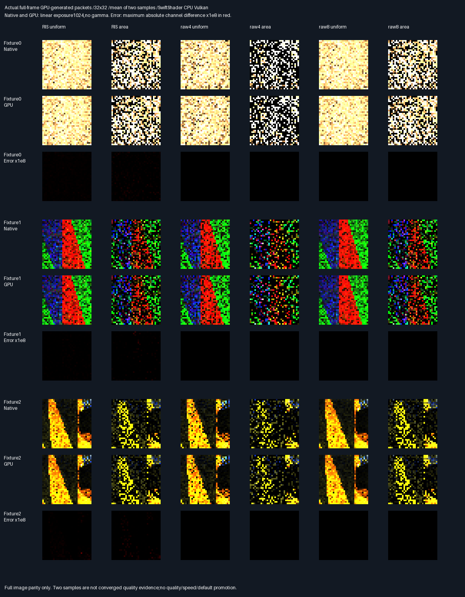

# Batched GPU-generated deformed packet image parity

## Frozen protocol — before measurement

- Source parent:82d4f6c94b11c05dcf7558e2488c2e23510236e1. Reuse unchanged production native components,
  previous packet comparison routines and previous Slang packet arithmetic through checked source extraction.
- Three unchanged deformed scenes,six estimator arms,two sample indices,32×32 complete perspective images:
  36 images and36,864 packets. Cameras use ConstructPerspectiveAreaRay for every pixel,no positive-path filtering.
  Seeds use HashFacetAreaBits((sample*1024+pixel+0x5e92b341)^(fixture*0x6c8e9cf5)).
- One batched dispatch per image,1,024 camera/seed/method inputs plus four original16-facet profile entries.
  No native proposals,PDFs,targets,selections,weights,rays or RGB enter the shader. Original support order retained.
  Profiles are shared across invocations;all80 diagnostic slabs use slab-major stride1,028. Four tail invocations
  must not write. Reset private counters per pixel. No maintained engine/shared shader or default changes.
- Candidate identity/U/V,selected ordinal,work and visibility exactly match native,without edge waivers.
  Reuse frozen scalar gate2e-5*max(1,abs(native)),coordinate absolute2e-5,and RGB
  1e-10+2e-4*max(abs(native RGB)). Check all80 slabs per pixel,not only displayed RGB.
- Native references independently use production proposal,score,pair,transport calls;all native shadow rays
  retain independent double-BVH audits. Compare native packet RGB against retained historical full replay.
- Scan all pixels even on failure. Retain failure counts,first diagnostic,full GPU/native RGB and frame metrics.
  Do not tune arithmetic,gates,seeds or cameras after observing a failure. A completed FAIL investigation is not
  accepted parity. No new blocker/fault test replaces prior36mutation/36fault evidence.
- Release and host ASan+UBSan,all prior11CTests plus focused image indexing units;driver uninstrumented,leaks0.
  Require exact cross-build RGB/readback hashes and semantic reports. Verify nine prior manifests unchanged.
- Retain actual full-frame native/GPU/error images and unclipped numeric metrics. Display uses a common
  documented exposure,not per-image optimization;error display labelled separately. These32×32,two-sample
  images test parity,not converged quality,independent scenes,physical GPU performance or renderer readiness.
- SwiftShader CPU Vulkan only. Production348.046875MiB,32B descriptors,defaults unchanged. Original transport
  HELD and norm promotion FAIL remain. Editor/vehicle/Jolt/packing deferred. No PR or Actions.

## Result — bounded image parity PASS

Release and host ASan+UBSan both finish with zero failed packets,zero invalid native references and zero
metadata-tail writes. All gates above remain unchanged. No camera,seed,math or tolerance was retuned.

| Measurement per build                          | Result                   |
| ---------------------------------------------- | ------------------------ |
| Full perspective images /packets               | 36 /36,864               |
| Generated candidate draws /pair choices        | 245,760 /49,152          |
| Traced paths /independent visibility decisions | 196,608 /393,216         |
| Failed packet comparisons /native audits       | 0 /0                     |
| Guarded metadata-tail writes                   | 0                        |
| Packet RGB max difference /RGB RMSE            | 3.7252903e-9 /4.5525e-11 |
| All compared weighted RGB maximum difference   | 7.4505806e-9             |
| Primary and traced-ray coordinate max error    | 0                        |
| Target/normalizer max scaled residual          | 1.4859597e-7             |
| Native versus historical packet RGB max delta  | 3.7252903e-9             |
| CTests /focused checks                         | 12 /20,322               |
| Previous manifest entries unchanged            | 1,568 across9 manifests  |

The target/normalizer residual uses max(1,absolute native),not relative error near zero. PDFs and path weights
also use the frozen scalar tolerance. RGB maxima and RMSE above use unclipped floating channels. RMSE covers
all36,864 original packet RGB vectors,not a reference-to-converged quality metric. The larger weighted RGB
maximum includes diagnostic path and omission outputs. Native/historical RGB are tolerance comparisons,not
bitwise claims:the independently assembled diagnostic sums weighted paths,while the historical caller sums
lane contributions before dividing by4.

### Comparison and choice

Ratings measure tested spatial coverage,not image quality or throughput;more stars=better.

| Route                         | Rating    | Verification scope                                        |
| ----------------------------- | --------- | --------------------------------------------------------- |
| Batched GPU-generated images  | ⭐⭐⭐⭐ 🏆    | Every image pixel,shared profile,guarded tail,all80 slabs |
| Prior generated causal packet | ⭐⭐⭐       | Qualified packet inputs,36 blocker/36 shader-fault tests  |
| Prior fixed-proposal GPU      | ⭐⭐        | Transport from native-selected proposals and weights      |

Batched generation is the verified route for this bounded image corpus. Previous mutation/fault evidence is
preserved,not replaced or counted as newly rerun. It remains a correctness result,not permission to promote
normalization policy or a claim that the noisy two-sample images are production-ready.

### Actual full-frame evidence



Each fixture shows native and GPU images for all six estimator arms,followed by errors. Native/GPU images
average the two samples per pixel;linear exposure1024,no gamma,clamp and nearest enlargement from32×32.
All18 displayed native/GPU image pairs have identical decoded RGB bytes. Numeric checks precede clipping.
The red error image uses the maximum absolute discrepancy over both samples and all three channels at each
pixel,multiplied by1e8;it is NOT a physical radiance image or the error of the averaged display images.

- [All18 fixture/method metrics](Results/FacetImageGpu-comparison.md).
- [Exact verdict,maxima and limits](Results/FacetImageGpu-parity.txt).
- [First-failure diagnostic](Results/FacetImageGpu-first-failure.txt):no failure found.
- [SHA256 evidence manifest](Results/FacetImageGpu-evidence-hashes.txt).
- `FacetImageGpu-Gpu.f32.gz` and `FacetImageGpu-Native.f32.gz`:little-endian float32,
  shape[3fixtures,6methods,2samples,1024pixels,80slabs,4channels]. Slab meanings are unchanged from
  [the prior packet diagnostic](FacetPacketGpu.md#actual-contributions-and-retained-evidence).
- `FacetImageGpu-Valid.u8.gz`:shape[3,6,2,1024],one iff native assembly and double-shadow audit succeeded.
  Every entry is1. Full GPU/native diagnostics,validity and first-failure files match byte-for-byte between
  Release and sanitized runs. All38 frame/total/exit semantic rows also match exactly.
- The collector independently rechecks identity/U/V,selections,PDFs,targets,weights,rays,RGB,work,masks,
  reserved components and unused slots across the full retained diagnostic buffers:zero failed packets.

### Submission,provenance and reproduction

`FacetImageGpuSources.py` extracts the unchanged prior Slang source and applies checked pixel/profile/stride
substitutions plus explicit private counter reset. It does not maintain another sampling implementation.
The same script extracts the prior native assembly/comparison prefix and invokes the existing80-slab private
submission generator. Generated C++ prefixes,Slang,SPIR-V and readback hashes are retained in both logs.
Each batch has1,028 receiver entries:1,024 camera/token inputs and four shared source-index profile entries.
Dispatch uses17 groups of64 threads;all64 non-camera invocations are guarded. Each of80 output slabs retains
four sentinel quartets:11,520 untouched tail quartets across36 images. No native proposal/weight is uploaded.
The public production allocation,ABI,engine code and shared shaders are untouched.

Tested Linux x86-64,GCC12.2.0,CMake3.31.6,Slang2026.14.1,pinned SwiftShader CPU Vulkan,type4,
Vulkan-Headers1.4.321,Python3.11,NumPy2.2.6,Pillow13.0.0. Source parent is
82d4f6c94b11c05dcf7558e2488c2e23510236e1 plus the new image-GPU sources in the accompanying evidence commit.
A configure-dependency reference was corrected before the final complete reruns;shader/native math,SPIR-V
and all four capture hashes remained unchanged. The retained logs are the final stable runs.
No downloaded tools,headers or Linux binaries are delivered. Windows/MSVC and physical GPU are untested.

Recover missing ignored tools using the [pinned recovery commands](FacetCausalGpu.md#reproduce-and-provenance).
CMAKE/CTEST overrides are supported. The collector requires NumPy/Pillow;configure-time Python needs only
its standard library. All12 CTest targets build and run locally. Reproduction:

```bash
bash Exhibits/LightCompute/RunFacetImageGpu.sh
SANITIZE=1 bash Exhibits/LightCompute/RunFacetImageGpu.sh
_ClaudeScratch/venv/bin/python Exhibits/LightCompute/Code/FacetImageGpuEvidence.py
```

Strict Release floating point;sanitized Debug uses-O1,ASan+UBSan,no PIE,frame pointers,leaks0. The driver is
not instrumented. Previous leak-enabled native evidence remains intact. GPU data are actual readbacks,not
CPU results substituted into images. Prior collectors were not rerun and their evidence was not rewritten.

Before work,the unexpected local checkout was preserved in
`/home/user/FrontierRecovery/before-82d4f6c-restore.tgz`,SHA256
1756d8afee6ee676fd285d95b560533e36d5a7cdda05ce336a880810cd51643e.
With explicit user approval,this same branch was restored to verified82d4f6c;the archive remains outside Git.

### Progress and limits

**Phase100% complete /0% remaining** as batched full-frame packet parity.
**Overall~93% complete /~7% remaining**,planning estimates,not measured release readiness.
Next bounded problem:variable-size GPU proposal support,removing the fixed16-facet diagnostic limit before
renderer integration. Broader scene/material/history validation,physical-GPU and Windows acceptance remain.
The current images reuse historical geometry,cameras and seeds;they are not an independent quality holdout.
There is no quality gain,physical-GPU,renderer/editor,history or throughput claim. Work counts are not timings.
Historical transport **HELD** and norm promotion **FAIL** remain explicit.
Production348.046875MiB,32B descriptors and defaults remain unchanged. Packing/editor/vehicle/Jolt deferred.
No PR or Actions.
