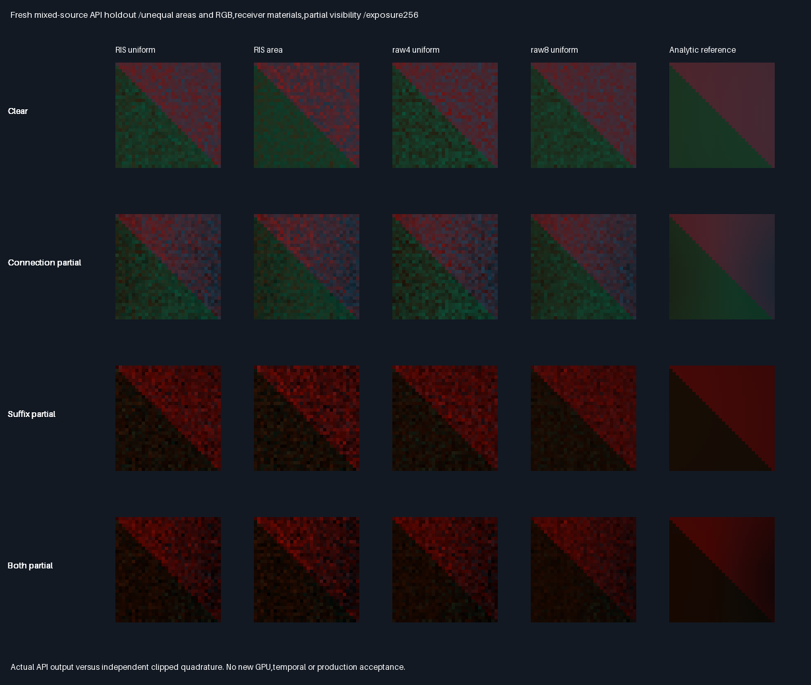
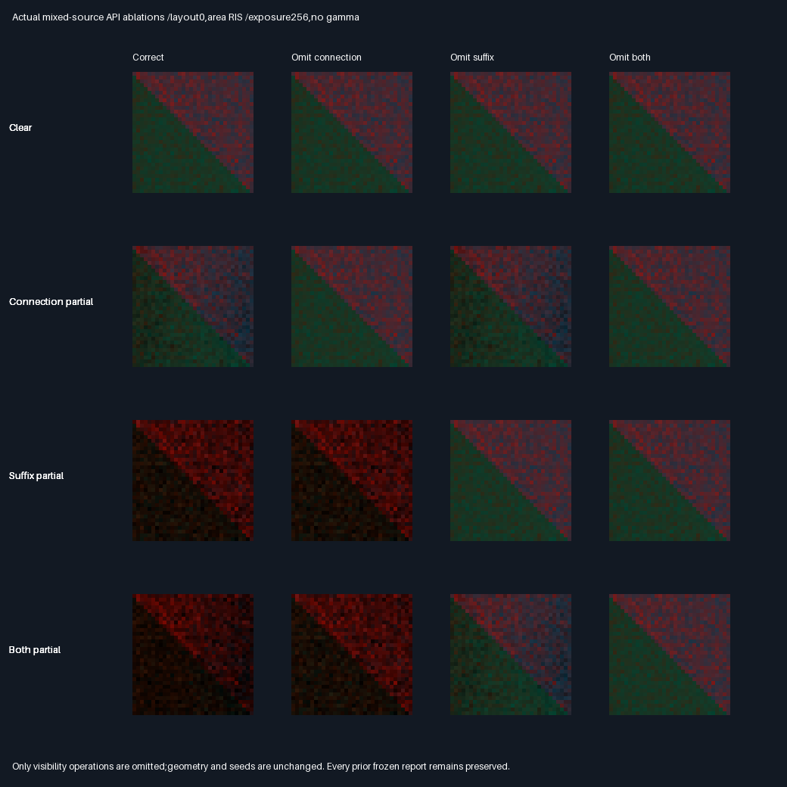

# Mixed-source native packet holdout

## Frozen protocol — before measurement

- New bounded diffuse holdout over596273f. No engine/API/shader arithmetic or previous evidence changes.
  Test the existing FacetAreaPacket with unequal areas,colours,receiver materials and partial visibility.
- Local source rectangles:z0,normal+z;left x[-.8,-.4],y[-.2,.2],RGB(.8,.1,.05),area.16;
  right x[.1,.7],y[-.3,.3],RGB(.05,.3,.9),area.36. Two triangles each;area ratio2.25.
- Receiver square[-.35,.35]² at z2,normal-z. Its lower-right triangle usesRGB(.6,.5,.4),upper-left(.2,.7,.3).
  Camera z1.5,looks+z;32² pixel centres span x[-.195,.205],y[-.2,.2],avoiding the material diagonal.
- Three scale/translation layouts:(1,(0,0,0)),(.65,(-1.2,.3,.2)),(1.4,(.6,-.5,-.1)).
  Black connection rectangle:x[-.22,.07],y[-.1,.15],z1. Black suffix rectangle:x[1.5,2.2],y[-.6,.6],z1.
  Four variants:clear,connection-only,suffix-only,both. Fixed existing light(.8,0,.6),RGB(1,.7,.4),offset.002.
  Proposals use original source ordinals in order3,0,2,1,then explicitly map into packed scene ordinals.
- Six arms:uniform RIS,area RIS,uniform raw4,area raw4,uniform raw8,area raw8. Four packets per32² pixel.
  Seed=Hash((packet+0x391b7ca5)^(layout*0x6c8e9cf5));same draws across variants,paired not independent cohorts.
- Every API packet must match a separately assembled lower-level native caller exactly in all RGB outputs,
  primary attributes and work counts. All native primary/material values agree with analytic expectations≤2e-5.
  Every selected path visibility must agree with independent double BVH and axis-aligned analytic ray rectangles.
- Independent reference integrates each source rectangle with closed-form clipping at all connection/suffix
  visibility boundaries,then midpoint32²/64² on each smooth subrectangle. Maximum RGB reference change≤2e-6.
  Reference uses declared geometry,not native RGB,proposal draws,trace results or native score arithmetic.
- All864 RGB mean gates (12 cases×6 methods×4 ablations×3 channels) must pass6SE+2e-5.
  Every variant has positive correct mean. For each layout/method,the affected single omission must change at
  least64 packets in its isolated blocker variant;unaffected single omission must leave RGB exactly unchanged.
  Clear omissions must equal correct within2e-7 per channel;both blockers must each affect some RGB when omitted.
  No expected universal RIS/raw4 or uniform/area winner;report all RMSEs/query counts without tuning.
- Release/host ASan+UBSan,all six prior CTests plus new focused tests;12 captures and semantic rows byte-identical.
  Preserve all four prior evidence manifests and historical transport acceptance=0. Include actual API/reference/
  baseline comparison images and lossless float buffers. No new GPU or physical timing claim.
- Production348.046875MiB/defaults/32B descriptors unchanged;no renderer/editor activation,packing,PR or Actions.

## Measured results — 2026-10-30

**PASS for frozen correctness/support coverage. No universal quality promotion.**
The unchanged packet API handles mixed source areas/colours,receiver materials and partial visibility.
The historical failed transport gate is still HELD;this holdout does not replace it.

| Gate                                   | Result                                                       |
| -------------------------------------- | ------------------------------------------------------------ |
| Release + host ASan/UBSan               | Seven CTests;20,101 focused checks per build                  |
| New focused checks                     | 2,796;both measures,all methods,material/profile remapping     |
| API versus separate lower-level caller | All294,912 packets exact in RGB,primary attributes and counts |
| Baseline draws /selected paths         | 1,966,080 /1,572,864 per build                                |
| Analytic and double-BVH visibility     | All3,145,728 baseline decisions agree                        |
| Independently integrated RGB means     | 864/864 pass6SE+2e-5                                         |
| Clipped32² /64² quadrature convergence | Maximum channel difference9.60257968e-9;gate≤2e-6              |
| Release versus sanitized build         | All12 buffers and14 semantic rows byte-identical             |
| Historical regression evidence         | All639 prior manifest entries unchanged;acceptance=0 retained |

The independently assembled caller also executes the proposals/selection/paths;its work is additional to the
API evaluation. The counts above describe one execution of each arm,not the combined two-caller physical cost.
No primary material disagreements were allowed. All correct variant/method channel means are positive.

### Visibility controls

Affected isolated omissions changed1,400–2,467 connection packets and3,690–4,096 suffix packets out of4096,
for every layout/method. Unaffected omissions were exactly unchanged. With both blockers present,connection
omission changed1,090–2,103 packets and suffix omission3,620–4,093. Clear omission RGB agrees within the frozen
2e-7 bound. [Every exact count](Results/FacetMixed-controls.md) is retained,not pooled into one sensitivity score.

### Accuracy and work comparison

These are descriptive equal-case averages of RGB image RMSE over12 paired cases,not independent confidence
intervals. Stars rank observed mean RMSE here;more is better,not cost-normalized or a general-scene ranking.

| Method       | Paths/packet | Candidate scores | Mean correct RGB RMSE | Quality | Rank |
| ------------ | ------------ | ---------------- | --------------------- | ------- | ---- |
| raw8 uniform | 8            | 8                | 9.19006159e-5         | ⭐⭐⭐⭐⭐ | 🏆   |
| raw8 area    | 8            | 8                | 1.07764824e-4         | ⭐⭐⭐⭐   | 🥈   |
| RIS uniform  | 4            | 8                | 1.29275327e-4         | ⭐⭐⭐     | 🥉   |
| raw4 uniform | 4            | 4                | 1.29439577e-4         | ⭐⭐⭐     | —    |
| RIS area     | 4            | 8                | 1.42507951e-4         | ⭐⭐       | —    |
| raw4 area    | 4            | 4                | 1.52247426e-4         | ⭐         | —    |

- Uniform RIS versus uniform raw4:6/12 wins;RMSE changes range−5.51% to+8.10%. Their aggregate averages differ
  by only−0.13%;this does not establish a reliable universal four-path winner. RIS evaluates twice as many scores.
- Area RIS versus area raw4:12/12 wins,RMSE−9.41% to−3.58%,at equal visibility-query counts,not equal total work.
- Area RIS versus uniform RIS:0/12 wins,RMSE+0.72% to+20.29%. More area coverage is not automatically lower error
  when coloured source contribution and visibility differ. Uniform proposals put more draws on the smaller red patch.
- Raw8 uniform has the lowest observed aggregate error,but traces twice as many paths as RIS/raw4. Query counts
  are not physical time. No engine policy,score,geometry,seed,threshold or production default was tuned afterward.
- Unoccluded scalar mean-RGB scoring is not a minimum-vector-RGB-error/visibility-aware target. This is a reason
  to study an alternative score separately,not evidence of a normalization bug:all independent mean gates pass.

[All72 method/case/ablation comparisons](Results/FacetMixed-comparison.md),
[descriptive aggregate](Results/FacetMixed-aggregate.md),and
[all864 residual/SE gates](Results/FacetMixed-means.md) are retained. Methods/variants share draws and are paired.
The three layouts are scaled/translated versions,not twelve independent broad-scene benchmarks.

## Actual fresh images



Rows:clear,partial connection blocker,partial suffix blocker,both. Columns:uniform RIS,area RIS,uniform raw4,
uniform raw8,independent clipped analytic reference. These are actual fresh native RGB images,not illustrations.
Common linear RGB exposure256,no gamma,nearest enlargement from32². Receiver-only views show two diffuse
materials;the source and blockers are intentionally outside the primary camera view.



Area-RIS ablations:correct,omit connection,omit suffix,omit both. Colours/geometry/seeds are unchanged across
omissions. All288 API32² image arrays and48 independently integrated reference arrays are verified and retained.

## Independent reference and reproduction

The double reference never calls native trace/score/proposal functions or consumes their RGB. For each source
rectangle and declared receiver pixel,it integrates4/(dx²+dy²+4)² times diffuse colours,light RGB and.6/pi².
Uniform scaling cancels between geometry and source area;the fixed world-space origin offset does not cancel
from visibility. Its local value is.002/scale and is included explicitly.

Connection intersection at z1 is the source/receiver midpoint:the source-domain blocked rectangle is
x[-.44-receiverX,.14-receiverX],y[-.2-receiverY,.3-receiverY]. Suffix blocked x lies in
[1.5-(1-.002/scale)*(.8/.6),2.2-(1-.002/scale)*(.8/.6)];its y bounds cover both source rectangles.
All these boundaries split the integration domain before midpoint quadrature,avoiding sampling across a step.
Receiver colour is chosen analytically from x>y,with camera centres separated from the shared diagonal.
Native float geometry differs slightly from declared decimal geometry;no native arithmetic is used to adjust it.

Tested Linux x86_64,GCC12.2,C++17 validation/estimator,existing C++20 fixture intake,CMake3.31.6,
Python3.11,Pillow13.0.0 and NumPy2.2.6. Host strict floats,no fast math/no contraction. ASan/UBSan and leak
detection enabled. No new GPU execution,Khronos-layer,physical timing or Windows binary verification.

```bash
bash Exhibits/LightCompute/RunFacetMixed.sh
SANITIZE=1 bash Exhibits/LightCompute/RunFacetMixed.sh
python Exhibits/LightCompute/Code/FacetMixedEvidence.py
```

Prerequisites:C++ compiler,CMake/CTest and Python/Pillow/NumPy. CMAKE/CTEST can override local tool paths.
Sources were uncommitted additions over parent596273f during measurement. Final
[Release](Results/FacetMixed-release.txt) and [sanitized](Results/FacetMixed-sanitized.txt) logs pin all native
sources/generated fixtures and captures. The [evidence manifest](Results/FacetMixed-evidence-hashes.txt) also
pins the collector and this report. Final additional primary-strike assertions changed no capture bytes.

Twelve `.f32.gz` archives contain six float4 slabs ×24,576 packets:correct,omit connection,omit suffix,
omit both,primary XYZ,then work(candidate/path/visibility counts). Six method blocks each contain4096 packets;
packet=seed row×1024+image pixel. All w fields are zero. Three `.f64.gz` reference archives contain
shape[2,4,4,1024,3],little-endian float64:32/64 resolutions,variant,ablation,pixel,RGB. Evidence compression is
not production packing. Previous reports and buffers remain unchanged.

## Decision and progress

- Keep the API opt-in with explicit method/measure selection. Raw8 uniform is the observed accuracy choice if
  twice the trace budget is acceptable;uniform raw4/RIS remain a cost/variance tradeoff,not a universal upgrade.
- This focused holdout100% complete /0% remaining:implementation,both builds,independent geometry/integration,
  full baseline/alternative comparisons,actual images,lossless evidence and branch backup.
- Overall rendering stays~91% complete /~9% remaining:planning estimates,not measured production readiness.
  Done:mixed-support correctness and visibility sensitivity. Broad quality promotion remains unestablished.
- Next separately frozen problem:RGB-vector-norm score prototype on fresh holdouts,without changing engine policy
  from these development results;then shader/renderer integration decisions. History/general BSDF/texture and
  physical-GPU/Windows/editor/TAA/timing acceptance remain open.
- Production348.046875MiB output/defaults/32B descriptors unchanged;packing/editor/vehicle/Jolt deferred.
  No pull request or Actions. Source and evidence backed up on the existing session branch.
