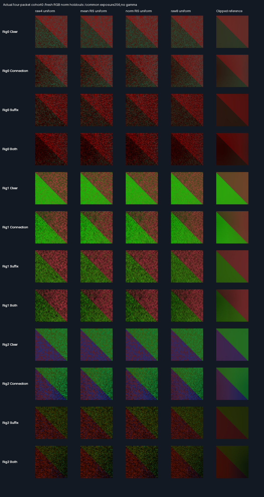
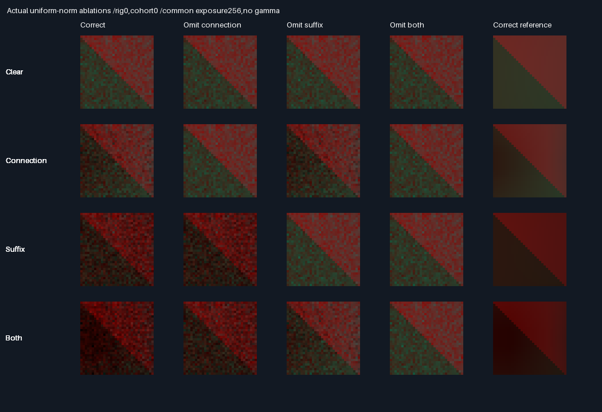

# RGB-vector-norm score — fresh held-out evaluation

## Frozen protocol — before measurement

- Exhibit-only target study over6b4087a. Engine score,packet API,shaders,defaults and all five prior manifests stay
  unchanged. Previous mixed holdout is development evidence,not reused as the new quality acceptance corpus.
- Candidate target:1e-6 + RMS(unoccluded proxy RGB). Compute with scaled float32 components to preserve finite
  range:maximum RGB times sqrt(mean squared normalized RGB). Zero proxy retains the positive floor.
  Baseline retains1e-6+mean(proxy RGB). Change selection weights and selected-target denominator together.
- Three new rigs,each with clear,connection-only,suffix-only,both-blocked variants. Receiver z2,normal-z;
  square[-.35,.35]²,two materials. Source rectangles z0,normal+z,two triangles each. Profile order1,3,0,2.
  Fixed light direction(.8,0,.6),RGB(1,.7,.4),world offset.002. Camera z1.5,looks+z,32² pixel centres over
  x[-.195,.205],y[-.2,.2]. All following coordinates are local and rectangles use x/y interval bounds.
- Rig0:scale1,translation(0,0,0);left[-.9,-.5]×[-.25,.25],RGB(.9,.035,.02);
  right[.05,.75]×[-.2,.2],RGB(.2,.45,.8);receiver lower/upper(.55,.5,.45)/(.25,.65,.45).
  Connection[-.20,.11]×[-.12,.12];suffix[1.65,2.25]×[-.6,.6],both at z1.
- Rig1:scale.8,translation(-.9,.2,.15);left[-.75,-.3]×[-.3,.3],RGB(.025,.85,.05);
  right[.15,.85]×[-.25,.25],RGB(.5,.45,.5);receiver(.65,.3,.6)/(.3,.7,.2).
  Connection[-.18,.14]×[-.15,.08];suffix[.68,1.0]×[-.6,.6],both at z1.
- Rig2:scale1.25,translation(.5,-.4,-.2);left[-.85,-.45]×[-.15,.15],RGB(.75,.65,.015);
  right[.12,.82]×[-.32,.32],RGB(.015,.4,.85);receiver(.5,.7,.25)/(.75,.25,.6).
  Connection[-.25,.08]×[-.06,.17];suffix[1.55,2.12]×[-.6,.6],both at z1.
- Eight arms:mean RIS,norm RIS,raw4,raw8 for uniform proposals;then the same four for area proposals.
  RIS targets score8 candidates and trace4 suffix/connection pairs;raw4 scores/traces4;raw8 scores/traces8.
  Eight disjoint cohorts,each four packets/pixel. Seed=Hash((packet+0x6db41895)^(rig*0x6c8e9cf5)^
  (cohort*0x9e3779b9));packet0..4095. Arms/variants are paired,not independent replicates.
- All non-candidate arms exactly match the existing API in RGB/omissions/primary/work counts. Every prototype
  selected path agrees with independent double BVH and analytic axis-aligned blocker intersections.
- Independent source-domain clipping followed by midpoint32²/64² integration;max channel convergence≤2e-6.
  All1152 RGB mean gates (12 cases×8 arms×4 ablations×3 channels) pass6SE+2e-5. Reference uses no native RGB.
- Correctness gates above are separate from quality promotion. Primary candidate is uniform norm RIS. Promote
  only if its correct-image MSE is no greater in EACH of12 cases than BOTH uniform mean RIS and uniform raw4,
  AND its equal-case mean MSE is at least2% lower than EACH baseline. All query counts must match.
  Case MSE averages eight independent four-packet cohort images,not one32-packet average. Report paired
  cohort MSE contrast SEs descriptively;no tolerance or post-measurement tuning changes these point gates.
  Area-norm and raw8 comparisons are descriptive and do not rescue a failed primary gate.
- Release/host ASan+UBSan,all seven prior CTests plus new finite/range/support tests. Twelve cohort buffers,
  semantic rows identical across builds. Preserve lossless evidence,all method comparisons and actual images.
  Display cohort0 four-packet images with one common exposure. If quality fails,retain the complete evidence
  and return nonzero after writing it;do not port the candidate or rewrite previous gates.
- No new GPU,history,physical timing,Windows/editor or production acceptance. Production348.046875MiB output,
  defaults and32B descriptors unchanged;packing/editor/vehicle/Jolt deferred. No PR or Actions.

## Measured result — promotion failed

Correctness **PASS**;frozen uniform-norm promotion **FAIL**. Aggregate improvement does not waive the required
no-regression case gates. No rig,seed,target,floor,threshold or image exposure was retuned after measurement.

| Choice               | Paths | Scores | Equal-case image MSE | Rating     | Decision                              |
| -------------------- | ----- | ------ | -------------------- | ---------- | ------------------------------------- |
| Uniform raw8         | 8     | 8      | 1.55413518616e-8      | ⭐⭐⭐⭐⭐ 🏆 | Best aggregate accuracy;twice paths    |
| Uniform norm RIS     | 4     | 8      | 2.80620319057e-8      | ⭐⭐⭐⭐     | Best four-path aggregate;gate FAIL     |
| Uniform mean-RGB RIS | 4     | 8      | 2.90453701984e-8      | ⭐⭐⭐       | Existing policy remains unchanged     |
| Uniform raw4         | 4     | 4      | 3.09621251451e-8      | ⭐⭐⭐       | Simpler baseline;fewer score calls     |

Ratings compare this corpus only,not production readiness. A path includes two visibility decisions;equal path
counts are not equal execution time. Raw8 uses16 decisions/packet versus8 for the four-path arms. No physical
GPU/CPU speedup was measured. All eight arms,including area proposals,are retained in the
[aggregate table](Results/FacetNorm-aggregate.md) and [per-case comparison](Results/FacetNorm-comparison.md).

### Frozen quality gates

- Uniform norm beats mean-RGB RIS10/12 cases;MSE ratios0.839181051–1.06739345. Equal-case mean MSE is3.3855%
  lower,passing the aggregate2% requirement,but rig1 suffix/both regress6.7393%/5.6502% and fail case gates.
- Uniform norm beats raw4 in10/12 cases;MSE ratios0.789470027–1.11963789. Equal-case mean MSE is9.3666%
  lower,passing the aggregate requirement,but rig2 suffix/both regress11.9638%/10.5856% and fail case gates.
- Only8/12 cases pass BOTH comparisons. Area proposals and raw8 are descriptive,not rescue arms.
- [Paired cohort contrasts](Results/FacetNorm-contrasts.md) retain all24 differences and their SEs. For example,
  rig1 suffix norm-minus-mean MSE=2.54391686906e-9,paired SE=1.08829975e-10. These are descriptive,not an SE
  allowance on the frozen point gates. The eight cohorts are independent;arms/variants within a cohort are paired.
- MSE averages eight independent four-packet cohort-image MSEs against the64² reference. It is NOT the MSE
  of an eight-cohort averaged image. The visible sheet displays cohort0 only,not a best-picked cohort.

### Correctness and retained evidence

| Verification                                 | Result                                                 |
| -------------------------------------------- | ------------------------------------------------------ |
| Release and host ASan+UBSan,leaks enabled      | 8 CTests/build;20,294 focused checks/build              |
| Norm finite/range/support units               | 193 checks,including zero,subnormal,max RGB and invalid |
| Prototype packets/build                       | 3,145,728                                             |
| Six non-norm arms versus unchanged packet API | 2,359,296 packets/build,exact RGB/primary/work parity   |
| Candidate draws /selected paths per build    | 22,020,096 /15,728,640                                  |
| Independent analytic and double BVH checks   | 31,457,280 visibility decisions/build;0 disagreements   |
| RGB mean gates                               | 1,152/1,152 pass6SE+2e-5                                |
| Independent32²/64² clipped quadrature         | Max channel difference2.84876638318e-8,limit2e-6         |
| Release /sanitized equivalence               | 12 buffers and14 semantic rows byte-identical          |
| Prior five evidence manifests                | All1,004 entries unchanged;original acceptance=0 HELD   |

- Final checks/format refinements preserve all12 original Release capture hashes. Final logs contain hashes
  of all compiled native inputs,generated scene prefix and readbacks. Shared scene types/analytic intersections
  come from the unchanged mixed exhibit prefix;transport,proposal,score and pair selection reuse production C++.
  The only alternative target exists inside this exhibit,not the production packet API.
- Each lossless `.f64.gz` case expands to shape[8cohorts,4ablations,8arms,1024pixels,3RGB],little-endian float64.
  Entries are four native float32 packet results summed in float64 and divided by4. Individual packet outputs
  are checked in-process,not retained separately. References store[coarse/fine,4variants,4ablations,1024,3].
- [Mean gates](Results/FacetNorm-means.md),[omission controls](Results/FacetNorm-controls.md),
  [verdict](Results/FacetNorm-parity.txt) and [SHA256 manifest](Results/FacetNorm-evidence-hashes.txt) are retained.
  Each isolated omission changes positive RGB pixels;unaffected visibility omissions remain exactly unchanged.
  Clear correct/visibility-omitted paths match exactly;the both-omitted proxy can differ by float operation order.
- 384 actual cohort0 PNG arrays and48 clipped-reference arrays are verified against their encoded bytes.
  Every image uses exposure256,linear clamp,no gamma and nearest-neighbour enlargement. Lossless cohort buffers,
  not the display PNGs,drive every numeric gate. These are native exhibit renders,not editor/GPU screenshots.





### Reproduce and scope

Tested Linux x86-64,Debian GCC12.2.0,CMake3.31.6,Python3,NumPy2.2.6,Pillow13.0.0. Tested source is parent
6b4087af4466cfbd350ebd45b905964393b4cd4e plus the new norm files in the accompanying source/evidence commit.
No previously tracked engine/shader/API/fixture/result was edited. Logs record exact input hashes.
Release uses CMake Release;sanitizer uses Debug with-O1,ASan+UBSan,frame pointers,no PIE and leak detection.
Both disable fast-math and floating contraction. An earlier unoptimized sanitizer run was stopped after source
assertion refinements;only the complete final-O1 rerun is retained as acceptance evidence.

```bash
bash Exhibits/LightCompute/RunFacetNorm.sh
SANITIZE=1 bash Exhibits/LightCompute/RunFacetNorm.sh
_ClaudeScratch/venv/bin/python Exhibits/LightCompute/Code/FacetNormEvidence.py
# Expected collector exit1:complete evidence written,correctness PASS,promotion FAIL.
```

The launchers default to the existing ignored CMake installation;override CMAKE/CTEST for another installation.
The collector needs NumPy/Pillow;configure-time scene extraction uses plain Python3. No network downloads or
new external dependencies are needed if the existing environment is present. Do not rerun older collectors:
this collector verifies their manifests without rewriting their files. Native build/test launchers exit0;
the collector intentionally exits1 only after writing this failed promotion's complete evidence.

Phase **100% complete /0% remaining** as an evaluated problem,not a successful production promotion.
Overall remains **~91% complete /~9% remaining**,planning estimates,not measured release readiness.
Next bounded problem:resolve the original deformed-transport visibility-sensitivity acceptance gap with a
separate regression,retaining its historical failure rather than using later diagnostics to waive it.
Then shader/renderer wiring,history/general materials,physical-GPU/Windows/editor and real timing remain.
Production348.046875MiB output,32B descriptors and defaults unchanged. Packing/editor/vehicle/Jolt remain
outside this phase. No PR or Actions.
