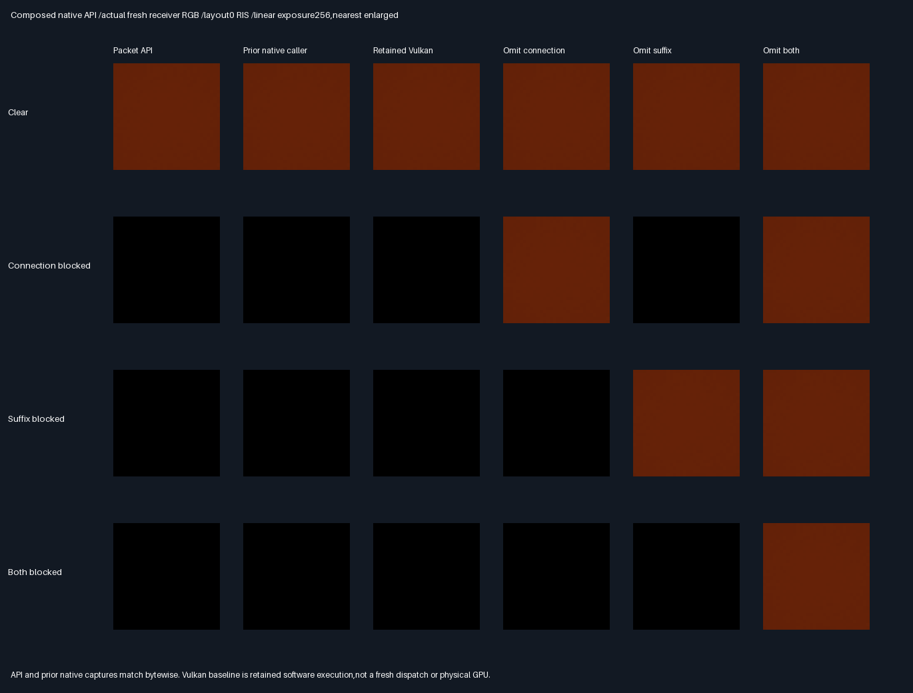

# Opt-in native facet packet estimator

## Frozen protocol — before measurement

- Compose unchanged proposal/score/reservoir/transport APIs in a reusable header-only native packet estimator.
  Do not modify existing arithmetic,CMake defaults,shaders or historical evidence. Source support stays explicit.
- Prepare caller-specified packed shading surfaces,BVH and unique source facet ordinals transactionally.
  Failed preparation preserves the last valid configuration. Empty,duplicate,out-of-range sources are rejected.
- Evaluate one primary ray and four lanes using RIS/raw4/raw8 with uniform-facet or area proposals.
  Draw/selection ordinals,score floor,light,offsets and accumulation order retain the established contracts.
  No allocation during evaluation;finite nonnegative outputs only;rejection returns no partial RGB.
  A primary miss is an unsuccessful estimate,not environment/sky radiance. No temporal or general BSDF support.
- Same three analytic layouts ×four variants ×three methods ×4096 packets,for both proposal measures.
  Uniform captures must exactly match all five slabs of retained native captures. Area results must exactly
  match uniform on this equal-area profile. Compare all four RGB ablations and primary positions to retained
  software-Vulkan captures within2e-5. No fresh GPU execution is claimed.
- Correct blocked RGB must be exactly zero;isolated affected omissions positive in every packet,unaffected
  omission zero;both-blocked single omissions zero,joint omission positive. All216 uniform RGB mean gates
  pass independent64² midpoint references with6SE+2e-5;32²/64² convergence≤2e-6.
- New focused units cover preparation failures,preserved configuration,replacement,unprepared/miss/nonfinite
  rays,invalid enum inputs,black transport,unequal-area source profiles and hot-path allocation detection.
- Release/host ASan+UBSan,all five prior CTests plus new packet tests. Twelve buffers and semantic rows
  byte-identical across builds. Retain actual estimator images,lossless captures,quantitative comparisons.
- Verify all three prior manifests unchanged,including failed transport acceptance=0. No retroactive pass.
  Production348.046875MiB/defaults/32B descriptors unchanged;no packing,PR,Actions or Windows binary claim.

## Measured results — 2026-10-30

**PASS for the bounded opt-in packet API. Historical transport acceptance remains HELD.**
The caller now invokes one reusable estimator rather than reproducing the proposal/score/selection/trace loop.
No established component arithmetic,shader or engine CMake file changed.

| Gate                                    | Result                                                    |
| --------------------------------------- | --------------------------------------------------------- |
| Release + host ASan/UBSan                | Six CTests;17,305 focused checks per build                 |
| New API units                           | 31;transactional failures,replacement,invalid/black cases  |
| Hot-path ordinary allocation audit      | 6,144 successful evaluations;zero allocation calls        |
| Both proposal measures /all methods     | 294,912 packets;1,966,080 draws;1,572,864 paths per build   |
| Uniform versus area,equal-area fixtures | Every packet's four RGB outputs identical                |
| Prior native caller                      | All12 complete five-slab captures byte-identical          |
| Release versus ASan/UBSan                | All12 captures and14 semantic rows byte-identical         |
| Retained software-Vulkan RGB             | Maximum packet/ablation delta3.49245965e-10                |
| Independent quadrature                   | All216 means pass;32²/64² max channel difference2.28909e-8 |
| Historical evidence                      | All471 prior manifest entries unchanged;acceptance=0 kept |

Correct blocked packets are exactly zero. Both isolated affected omissions restore positive RGB in every
packet,while unaffected omissions stay zero. Both-blocked single omissions stay zero;joint omission is positive.
The allocation audit intercepts ordinary new/new[] during6144 evaluations across three methods,two measures
and1024 seeds on an unequal-area profile. Evaluation has fixed stack scratch and no allocation calls in its code.
It is not a production allocator,bandwidth or wall-time benchmark. Preparation intentionally allocates copies.

### Quantitative comparison

Clear-variant RGB RMSE against independent64² midpoint quadrature,four packets per image pixel.
API and previous native RMSE are exactly identical. GPU means a retained SwiftShader capture,not a new dispatch.

| Layout | API RIS RMSE | API raw4 RMSE | API raw8 RMSE | Retained Vulkan RIS RMSE |
| ------ | ------------ | ------------- | ------------- | ------------------------ |
| 0      | 4.33213538e-6 | 6.16955180e-6 | 4.33204023e-6 | 4.33213539e-6            |
| 1      | 2.69339885e-6 | 3.74957548e-6 | 2.69339140e-6 | 2.69339864e-6            |
| 2      | 2.22727467e-6 | 3.15031941e-6 | 2.22728956e-6 | 2.22727460e-6            |

RIS retains the earlier28.17–29.78% RMSE reduction versus raw4 on these proxy-favourable fixtures,not a new gain
from this API. Raw8 traces twice as many suffix/connection pairs;RIS scores twice as many candidates as raw4.
There is no general-scene quality or physical speed claim. Unequal-area support is a boundary/unit test here,
not independently integrated unequal-area image acceptance. Paired methods/variants are not independent cohorts.
[All36 method/variant comparisons](Results/FacetPacket-comparison.md) and
[all216 residual/SE gates](Results/FacetPacket-means.md) are retained.

### Actual fresh API images



The first column is fresh API output;the next two are retained native and software-Vulkan baselines. Remaining
columns omit connection,suffix,both. All144 actual API32² PNG arrays are verified against float32 captures.
Common linear exposure256,nearest enlargement,no gamma. Smooth receiver-only patches are intentional diagnostic
views,not production scene screenshots or generated illustrations.

## API contract and example

Reusable [FacetAreaPacket.h](../../Frontier/Engine/Rendering/FacetAreaPacket.h) is header-only and has no exhibit
or driver dependency. Consumers link the existing transport and reservoir libraries,which supply proposal/score
symbols transitively. Nothing is registered in editor or production renderer defaults.

```cpp
Frontier::FacetAreaPacket Packet;
if (!Packet.Prepare(PackedShadingSurfaces, PackedVisibility, UniqueSourceOrdinals))
{
    // Handle invalid support or geometry;any previous valid preparation is preserved.
}
const auto Estimate = Packet.Evaluate(CameraOrigin, CameraDirection, Seed,
    Frontier::FacetPacketEstimator::Ris, Frontier::FacetAreaMeasureCategory::UniformFacet);
if (Estimate.Accepted)
{
    // Estimate.Rgb is the four-lane result over exactly the declared source support.
}
```

- Preparation owns copies,checks unique/in-range source ordinals and invokes existing geometry/PDF validation.
  All allocating copies are prepared before replacing live fields;failure preserves the last configuration.
- Evaluation resolves one primary ray,uses unchanged draw/selection ordinals,and returns RGB plus optional-use
  diagnostic omission RGB and candidate/path/visibility counts. These are transient results,not32B descriptors.
- A miss or invalid/unrepresentable evaluation returns an empty rejected result with no partial radiance/counts.
  The API does not supply sky/environment radiance. Black valid transport remains accepted with exactly zero RGB.
- Light direction/RGB,score floor,origin offsets and path policy remain the existing fixed diffuse contract.
  SourceProfile is the entire integral support;other surfaces still occlude but are not silently sampled.
- No configuration mutation may run concurrently with evaluation. Read-only evaluation does not mutate the class;
  concurrency stress/performance was not tested. Header-only integration adds no new engine build target.

## Reproduction and evidence

Tested Linux x86_64,GCC12.2,C++17 API,strict floats,no fast math/no contraction,CMake3.31.6,
Python3.11 and Pillow13.0.0. Existing proposal validation target uses its established C++20 fixture intake.
Both Release and host ASan/UBSan pass,with leak detection enabled. No GPU runtime/tools are needed for this phase.
Sources were uncommitted additions over parent20020fa during measurement.

```bash
bash Exhibits/LightCompute/RunFacetPacket.sh
SANITIZE=1 bash Exhibits/LightCompute/RunFacetPacket.sh
python Exhibits/LightCompute/Code/FacetPacketEvidence.py
```

Prerequisites:CMake/CTest,C++ compiler,Python/Pillow;CMAKE/CTEST override the repository-local tool paths.
[Release](Results/FacetPacket-release.txt) and [sanitized](Results/FacetPacket-sanitized.txt) logs pin actual
sources/generated fixtures/captures. The [manifest](Results/FacetPacket-evidence-hashes.txt) pins this report,
collector,API and lossless evidence. Twelve `.f32.gz` archives retain five float4 slabs of12,288 packets:
correct,omit connection,omit suffix,omit both,primary XYZ. Method blocks RIS/raw4/raw8,4096 packets each;
packet=seed row×1024+pixel. All fourth floats zero. Compression is evidence storage,not production packing.

At startup the local branch unexpectedly pointed to68f3016 with older untracked files. Before recovery,all
non-Git files were archived to `/home/user/FrontierRecovery/before-20020fa-recovery.tgz`,SHA256
`b524b58a04109954e1f85c4170307832fbb731b7211795663b565912e2ac3cd8`,and saved in a local stash.
The same session branch was then fast-forwarded to the verified GitHub20020fa backup. Neither archive nor stash
was discarded or reapplied. This preservation step did not rewrite previous evidence or switch branches.

## Decision and progress

Stars rate suitability for bounded integration,not quality or speed. More stars is better.

| Choice                        | Fitness | Decision | Reason                                     |
| ----------------------------- | ------- | -------- | ------------------------------------------ |
| Reusable opt-in packet caller | ⭐⭐⭐   | 🏆 Keep  | Removes duplicated orchestration,exact RGB |
| Manual exhibit loop           | ⭐⭐     | Retain   | Independent historical baseline            |
| Enable renderer defaults      | ⭐       | Reject   | General integration/device gates still open |

- Focused phase100% complete /0% remaining:API,units,both builds,baselines,quadrature,images and source backup.
- Overall rendering~91% complete /~9% remaining:planning estimates,not measured release readiness.
- Done:bounded end-to-end native packet composition with transactional source intake and checked hot path.
- Next distinct gate:mixed-area/material/partial-visibility holdout through this API;then explicit renderer
  integration decisions. General source support/history and physical-GPU/Windows/editor/TAA/timing remain open.
- Historical failed transport acceptance remains HELD. Production348.046875MiB output/defaults/32B descriptors
  unchanged. Packing/editor/vehicle/Jolt deferred. No PR/Actions;backup remains on the existing session branch.
