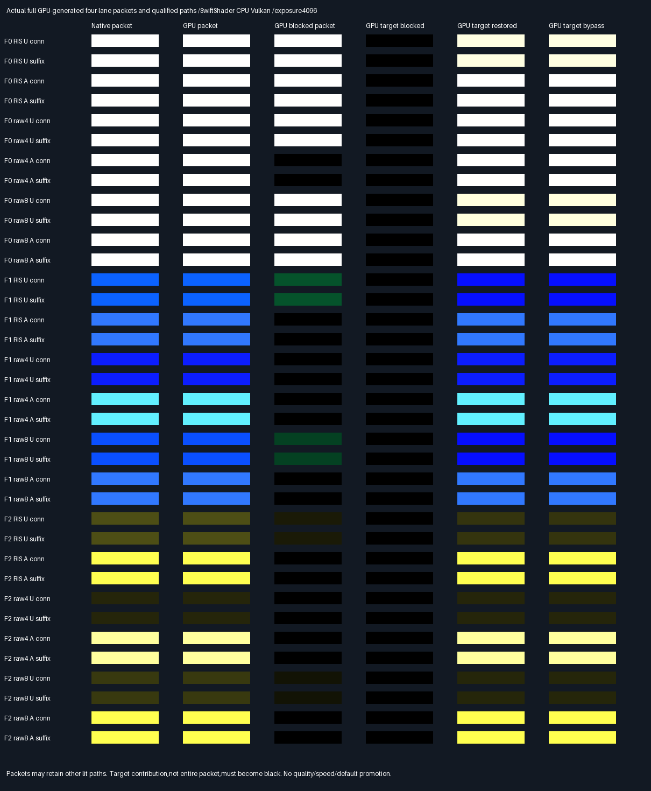

# GPU-generated deformed causal packets

## Frozen protocol — before measurement

- Parent93e7a92. Remove native selected-facet,U/V,density and weight inputs from the previous causal GPU test.
  Shader inputs are original deformed geometry,camera,seed,estimator,source-profile facet mapping and a fault
  token. Black blocker geometry and which original packet to test remain from the retained targeted native
  regression. This is GPU-generated four-lane packet parity,not an independent quality/random-scene holdout.
- Original16-facet source profile retains its original order through BVH repacking;added black triangles are
  visibility-only,not proposal support. GPU computes triangle areas,CDF,uniforms,barycentrics,PDFs,mean-RGB
  targets,pair selection and normalization. No native proposal,selection,weight,visibility or RGB enters shader.
- Three fixtures ×six original methods ×two causal operations ×three states(original,blocker,shader bypass):
  108 complete packets. Preserve original seeds,cameras,floors and ray offsets. RIS scores8/traces4,raw4
  scores4/traces4,raw8 scores8/traces8. Compare all candidate identities/U/V exactly;PDFs,targets,normalizers
  within2e-5*max(1,absolute native). All selections and visibility booleans exact,no threshold/edge waivers.
- Native independently assembles each full packet from production proposals,score,pair selection and transport,
  using original source profile order. Check every traced ray against independent double BVH. GPU primary and
  all traced origins/directions/ranges agree within2e-5. Weighted path/packet RGB gate1e-10+2e-4*max absolute
  native channel. Verify original full-packet RGB against the unchanged historical native replay.
- The affected qualified path must be found among GPU-generated paths by its diagnostic identity after readback,
  not supplied as a shader selection. All36 real blockers zero that path;target-only omission restores its
  original weighted RGB;wrong-only omission stays zero. The same path predicate rejects36 actual GPU shader
  bypass faults. Other packet paths may remain lit;do not require an entire packet to become black.
- Release/host ASan+UBSan,all ten prior CTests plus new predicate units. Driver uninstrumented,leaks disabled.
  Readbacks and semantic rows identical across builds. Retain native/GPU packet and affected-path RGB,
  comparisons,actual contribution visuals and source/tool/SPIR-V hashes. Preserve a failed gate without tuning.
- Use an exhibit-only80-slab diagnostic allocation adapted from the existing submission prefix;no engine
  allocation/default or shared shader change. SwiftShader software CPU Vulkan is not physical GPU acceptance.
  Original transport HELD,norm promotion FAIL and all eight previous manifests remain unchanged.
- No new quality/speed,history,general materials,Windows/editor/renderer acceptance. Production348.046875MiB,
  32B descriptors/defaults unchanged;packing/editor/vehicle/Jolt deferred. No PR or Actions.

## Result — GPU-generated packet composition

The shader now generates complete four-lane RIS/raw4/raw8 packets. Native selected facet,U/V,PDF,chosen
ordinal and normalization weight are no longer shader inputs. The native implementation remains an audit
reference,not a source of sampling results for GPU execution. This closes the selected-proposal dependency
of the preceding bounded causal test,not arbitrary-scene,history,quality or renderer acceptance.

### Verification and comparison

| Verification                                     | Result                                                |
| ------------------------------------------------ | ----------------------------------------------------- |
| Device                                           | SwiftShader Device (Subzero),CPU Vulkan,type4         |
| Release /host ASan+UBSan                          | 11 CTests/build;20,316 focused unit checks/build      |
| Complete four-lane packets                        | 108/build,including original/mutation/shader fault    |
| Candidate observations                           | 720/build;identities and U/V exact                    |
| RIS pair selections                              | 144/build;all chosen ordinals exact                   |
| Traced paths /visibility decisions                | 576 /1,152 per build;exact native/double-BVH masks     |
| Real causal mutations /actual shader faults       | 36/36 pass /36/36 rejected                           |
| Maximum packet/path weighted RGB absolute error   | 9.31322574615e-10                                     |
| Maximum primary/path coordinate error             | 0,including connection ranges                        |
| Maximum score/normalizer scaled residual          | 1.01348009606e-7,limit2e-5                             |
| Release /sanitized equivalence                    | 3 buffers and38 packet semantic rows byte-identical   |
| Historical evidence                              | All1,553 entries across8 prior manifests unchanged    |

The scaled residual uses max(1,absolute native),as frozen. PDF checks use the same frozen scalar gate;
the reported maximum scalar residual covers targets/normalizers. RGB uses the separate,scale-sensitive
1e-10+2e-4*maximum absolute native RGB gate. The maximum RGB difference is across all compared packet and
path outputs,not an image RMSE. These work observations repeat paired seeds/geometry states;they are NOT
720 independent samples supporting a quality claim. No selection or visibility edge waiver was used.

Ratings below measure verification coverage,not image quality;more stars=better.

| Approach                      | Rating    | What is verified                                      |
| ----------------------------- | --------- | ----------------------------------------------------- |
| GPU-generated full packets    | ⭐⭐⭐⭐ 🏆 | RNG,PDF,target,selection,normalization and all4 lanes   |
| Prior fixed-proposal GPU      | ⭐⭐⭐      | Primary/source/ray transport,given native U/V and weight |
| Native assembled packets     | ⭐⭐⭐      | Independent production-component audit and old RGB     |

- All six original estimator/measure arms remain:uniform/area proposals for RIS,raw4 and raw8. Original
 16-facet proposal order survives BVH repacking via a source profile. The added black triangle is visible to
  rays but excluded from proposal support. Source-profile geometry is input;areas,CDFs and PDFs are not.
- Every candidate's exact identity/U/V,PDF,target and selected ordinal is compared with native generation.
  Every traced path's packed identity/visibility,origin,direction,maximum,weight and RGB is compared.
  Native rays independently query the double BVH. No shader input supplies a native receiver hit or traced ray.
- Native full-packet correct RGB also agrees with the unchanged historical native deformed replay within
  the frozen RGB tolerance. That check is not bitwise:the new diagnostic sums weighted paths directly,
  whereas the historical implementation first sums each lane and divides its contribution by4.
- The affected qualified path is identified only after generation/readback,using the retained diagnostic
  identity. It is not selected for the shader. All four lanes still execute;raw8 traces both candidates.
  A real blocker zeros that path,while other lit paths can keep the full packet nonzero. Target-only
  omission restores the old path contribution;wrong-only omission stays zero.
- The shader-only fault bypasses the targeted multiplication on traced contributions,while retaining actual
  visibility queries and their blocked booleans. All36 actual fault readbacks fail the same causal predicate.
  No fault is fabricated by copying CPU RGB into a supposed GPU result.
- Old transport acceptance remains **HELD**,norm-score promotion remains **FAIL**. These tests are conditioned
  on the old positive-path qualification and are not an independent random-scene or estimator-quality holdout.

### Actual contributions and retained evidence



Each row is one causal test. The first three columns show native original packet,GPU original packet and
GPU mutated packet. The last three show the qualified GPU path blocked,restored,and under actual shader fault.
These are actual packet/path RGB swatches,NOT full-frame scene images. All use linear exposure4096,clamp,
no gamma. Numeric checks use unclipped float32,not the display image. Some bright swatches saturate.

- [All36 measured comparisons](Results/FacetPacketGpu-comparison.md),
  [verdict and exact maxima](Results/FacetPacketGpu-parity.txt),
  [SHA256 evidence manifest](Results/FacetPacketGpu-evidence-hashes.txt).
- `FacetPacketGpu-Gpu.f32.gz` and `FacetPacketGpu-Native.f32.gz`:shape[36cases,3states,80float4slabs],
  little-endian float32. States:original,one-triangle mutation,the same mutation with shader bypass.
- `FacetPacketGpu-Qualified.f32.gz`:shape[36,3,4],storing case,state,traced-slot,operation. This diagnostic
  mapping is written after GPU execution and is not uploaded as a candidate or selection.
- Slabs0–3:packet correct/omit-connection/omit-suffix/omit-both RGB. Slabs4–7:primary position/normal/albedo/
  packed identity+strike. Slabs8–15:eight candidate identity/U/V/PDF quartets;16–19:four lane targets,
  normalizer,selected ordinal. Unused raw4 candidate slots are zero.
- Slabs20–27:weighted correct paths;28–35:omit-connection paths;36–43:omit-suffix paths;44–51:path origin+
  maximum;52–59:direction+packed source/visibility;60:candidates,paths,suffix calls,connection calls;
  61–68:weighted proxy paths;69–76:lane,ordinal,weight,zero. Slabs77–79 and unused trace slots are zero.
  Identity/mask fields are bit-cast integers. Readbacks include all diagnostics,not just final RGB.

### Submission boundary and reproduction

The submission prefix is extracted from unchanged `LightComputeValidation.cpp`. One generated,exhibit-only
capacity predicate admits80 diagnostic slabs in addition to the original32/40 choices. No maintained copy
or production allocation is edited. A second exact source prefix reuses the previous comparison/shading
routines. Both generated hashes are logged. This private allocation has five receiver records:one camera/
seed/method/fault token plus four records containing16 source-profile indices. Only receiver0 executes;
the other four are profile input. They contain no native proposal coordinates or normalization results.

Tested Linux x86-64,GCC12.2.0,CMake3.31.6,Slang2026.14.1,pinned SwiftShader,Vulkan-Headers1.4.321,Python3,
NumPy2.2.6,Pillow13.0.0. Source is parent93e7a92350f74d7bab6028f291224000d340bded plus the new packet-GPU
files in the accompanying source/evidence commit. Old engine/API/shared shaders/fixtures/results are unchanged.
Pinned tools are verified on every run;header,compiler,driver,source,generated-prefix,SPIR-V and readback
hashes are in the complete logs. Native causal inputs are regenerated in both builds and compared with the
retained buffer. No downloaded tools,headers or host binaries are delivered.

Use the [existing pinned tool recovery instructions](FacetCausalGpu.md#reproduce-and-provenance) if needed.
CMake/CTest≥3.20,C++20 and Python are required;the collector also requires NumPy/Pillow. Then:

```bash
bash Exhibits/LightCompute/RunFacetPacketGpu.sh
SANITIZE=1 bash Exhibits/LightCompute/RunFacetPacketGpu.sh
_ClaudeScratch/venv/bin/python Exhibits/LightCompute/Code/FacetPacketGpuEvidence.py
```

The runner supports CMAKE/CTEST overrides. It reruns all eleven native unit targets,but does not rerun older
GPU collectors or rewrite their evidence. Release is strict floating point;sanitized Debug uses-O1,
ASan+UBSan,frame pointers,no PIE and leaks0. Host instrumentation does not instrument the driver. Previous
leak-enabled native evidence remains unchanged. No Khronos validation-layer,physical-GPU,Windows/MSVC,
history,general-material,editor or throughput result is claimed. Work counts are not timings.

**Phase100% complete /0% remaining** as GPU-generated targeted packet parity.
**Overall~92% complete /~8% remaining**,planning estimates,not measured release readiness. Next bounded problem:
batched full-frame deformed packet/image parity using this GPU-generated route,before renderer wiring and
broader history/material/physical-GPU/Windows/real-time acceptance. Historical failures remain explicit.
Production348.046875MiB output,32B descriptors and defaults unchanged. Packing/editor/vehicle/Jolt deferred.
No PR or Actions.
