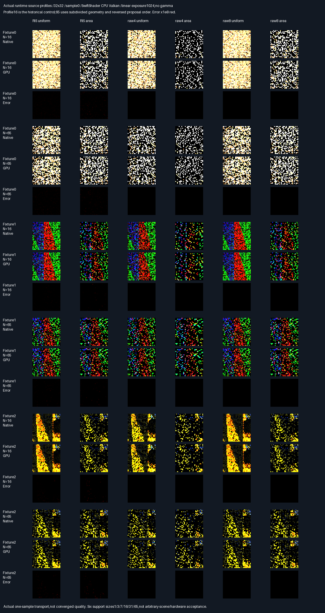

# Runtime-sized GPU facet proposal profiles

## Frozen protocol — before measurement

- Source parent4ef3d608be28cd5728134439aa6915279f7b5ab0. One bounded problem:replace fixed16-facet Slang
  proposal support with runtime-sized source profiles,without changing estimator math or production defaults.
- Three retained deformed layouts ×profile sizes[1,3,7,16,31,65] ×six methods ×one sample ×1,024 pixels:
  108 complete32×32 images,110,592 packets. Same camera/seed construction as prior image sample0.
- Geometry starts with the retained16 facets. For counts>16,bisect the largest-area triangle repeatedly
  along its longest edge,preserving material and interpolated corner normals,until geometry has N facets.
  For N<16,use a reversed prefix of the original geometry as proposal-only support;all16 remain visible.
  N16 preserves the original order as a direct historical control. N31/N65 reverse support order before
  BVH repacking. Preserve explicit source-to-packed mappings. All proposal triangles must have positive area.
- Header input carries source count,camera count,profile start and quartet count. Camera inputs carry only
  camera rays,seed and method. Profile inputs contain packed facet indices,not native areas,CDFs,PDFs,
  coordinates,targets,selections,normalizers,rays or RGB. Partial final quartets contain UINT32_MAX padding.
- Source count,capacity,unique/in-range indices,positive finite areas and monotonic float CDF are validated
  on GPU before sampling. Rejection diagnostics use slab79.x;all other slabs must be zero on rejection.
  Six actual GPU negative submissions at fixture0,N16:zero count,excessive count,wrong quartet count,
  out-of-range index,duplicate index,degenerate source triangle. Expected codes[1,1,1,2,2,3].
- Positive input uses explicit header+camera+profile layout;output slab-major stride equals receiver count.
  Every non-camera output slot remains sentinel. Each of80 diagnostic slabs is compared for every pixel.
  Actual negative readbacks,not only host predicate tests,are retained and compared with exact rejection output.
- Candidate identity/U/V,selections,work and visibility exact,no edge waivers. Scalar gate
  2e-5*max(1,abs(native));primary/ray coordinate absolute2e-5;RGB1e-10+2e-4*max(abs(native RGB)).
  Reuse previous native production proposal/score/pair/transport assembly and independent double-shadow audit.
  Profile16 original packet RGB also passes the unchanged historical sample0 gate. No quality/default promotion.
- Scan the complete corpus on comparison failures;retain actual buffers and first failure. Never retune
  geometry,seeds,cameras,math or gates after observing a failed measurement. Rejection tests are not a waiver.
- Release and host ASan+UBSan,all prior12CTests plus profile/index units. Driver uninstrumented,leaks0.
  Require cross-build exact buffers and semantic rows. Preserve all ten previous manifests/1,637 entries.
- Actual image evidence:show profile16/native,GPU and difference;show65 likewise across all layouts/arms.
  Linear exposure1024,no gamma,nearest enlargement;red max channel error x1e8. Retain raw unclipped diagnostics.
- SwiftShader CPU Vulkan only. These retained layouts/seed0 and subdivisions are not an independent quality
  holdout or arbitrary-scene acceptance. No physical GPU,Windows,renderer/history/general-material/timing claim.
- Production348.046875MiB,32B descriptors and defaults unchanged. Original transport HELD,norm promotion FAIL
  remain. Packing/editor/vehicle/Jolt deferred. No PR or Actions.

## Result — bounded runtime-profile parity PASS

Release and host ASan+UBSan pass all108 positive images and all six malformed-profile submissions.
No seeds,cameras,geometry,estimator arithmetic or tolerance gates were retuned after measurements.

| Measurement per build                           | Result                    |
| ----------------------------------------------- | ------------------------- |
| Tested runtime source counts                    | 1,3,7,16,31,65            |
| Complete images /positive packets               | 108 /110,592              |
| Generated draws /pair selections                | 737,280 /147,456          |
| Traced paths /visibility decisions              | 589,824 /1,179,648        |
| Packet/native comparison failures               | 0 /0                      |
| Malformed inputs /correctly rejected pixels     | 6 /6,144                  |
| Guarded sentinel quartets /unexpected writes    | 58,560 /0                 |
| Packet RGB max delta /RMSE                      | 3.7252903e-9 /3.45452e-11 |
| All weighted diagnostic RGB max delta           | 7.4505806e-9              |
| Primary/traced-ray coordinate maximum delta     | 0                         |
| Target/normalizer maximum scaled residual       | 1.7163382e-7              |
| Profile16 native/historical RGB maximum delta   | 1.8626451e-9              |
| Profile16 versus prior GPU,all80 slabs          | Byte-identical            |
| CTests /focused checks                          | 13 /20,334                |
| Prior evidence manifests /unchanged entries     | 10 /1,637                 |

Targets/normalizers use the frozen max(1,absolute native) scaling,not relative error near zero. PDFs and path
weights use the same scalar gate. RGB RMSE is native-versus-GPU parity over110,592 original packet RGB
vectors,not estimator error against a converged reference. The larger RGB maximum includes weighted path
and omission diagnostics. Different supports change the integration domain or proposal distribution,so
aggregate RMSE must not be interpreted as a quality improvement over the previous phase.

### Choice and scope

Ratings indicate verified profile flexibility,not quality or throughput;more stars=better.

| Route                       | Rating    | Verified scope                                            |
| --------------------------- | --------- | --------------------------------------------------------- |
| Runtime-sized GPU profiles  | ⭐⭐⭐⭐ 🏆    | Six counts,subsets,reordering,partial quartets,rejections |
| Fixed16 GPU image route     | ⭐⭐⭐       | Complete image parity for one fixed support size          |
| Fixed selected-proposal GPU | ⭐⭐        | Native proposals/weights supplied to GPU transport        |

The runtime route removes the hardcoded16 support assumption in this exhibit. It does not establish
arbitrary-scene,size,material or renderer acceptance. It is deliberately diagnostic:profile validation,
including duplicate detection,and area sums/CDF work are repeated per pixel/draw. There is no speed claim.

### Actual images and negative submissions



All six arms are shown for the historical16 control and65-facet subdivision,across all three layouts.
Each tile is an actual32×32 single-sample transport image,enlarged by nearest sampling. Native/GPU use
linear exposure1024,no gamma and clamp. All36 displayed native/GPU pairs have identical decoded RGB bytes.
Numeric acceptance precedes clipping. Red error tiles show maximum absolute RGB channel difference×1e8.
These images are noisy correctness evidence,not converged quality or an independent camera/scene holdout.

- [All108 fixture/support/method comparisons](Results/FacetProfileGpu-comparison.md).
- [Verdict and exact maxima](Results/FacetProfileGpu-parity.txt).
- [First failure diagnostic](Results/FacetProfileGpu-first-failure.txt):no positive comparison failure.
- [Evidence SHA256 manifest](Results/FacetProfileGpu-evidence-hashes.txt).

| Actual GPU malformed input | Rejection code | Pixels checked | Correct outputs |
| -------------------------- | -------------- | -------------- | --------------- |
| Zero source count          | 1              | 1,024          | 1,024           |
| Source count exceeds scene | 1              | 1,024          | 1,024           |
| Wrong profile capacity     | 1              | 1,024          | 1,024           |
| Out-of-range source index  | 2              | 1,024          | 1,024           |
| Duplicate source index     | 2              | 1,024          | 1,024           |
| Zero-area source triangle  | 3              | 1,024          | 1,024           |

Each rejected pixel has exactly the expected code in slab79.x and zero in every other diagnostic component.
Rejection outputs and guards are actual GPU readbacks,not just host predicate tests. Empty/excessive support
and capacity have native layout unit checks;source uniqueness matches the existing production packet
contract,while finite positive area/float-CDF constraints match production proposal preparation.
This is not exhaustive malformed-descriptor,floating-overflow or device-memory safety acceptance.

### Retained buffers and submission boundary

All files below are lossless gzip archives of actual little-endian readbacks:

- `FacetProfileGpu-Gpu.f32.gz` and `FacetProfileGpu-Native.f32.gz`:float32,
  shape[3layouts,6supportSizes,6methods,1024pixels,80slabs,4channels]. Support axis follows1/3/7/16/31/65;
  method axis follows RIS uniform/area,raw4 uniform/area,raw8 uniform/area. All80 positive slabs keep the
  [previous diagnostic meanings](FacetPacketGpu.md#actual-contributions-and-retained-evidence).
- `FacetProfileGpu-Valid.u8.gz`:shape[3,6,6,1024],one iff native assembly/double-shadow auditing succeeded.
  Every entry is1. It is diagnostic,not a shader input or a way to waive failing pixels.
- `FacetProfileGpu-Rejections.f32.gz`:float32,shape[6negativeCases,1024pixels,80slabs,4channels],case order above.
  Rejection uses reserved slab79.x;all positive pixels keep slab79 zero.
- All four buffers,first failure file and116 image/rejection/total/exit semantic rows are byte-identical
  across builds. The collector also executes only the unchanged previous offline diagnostic predicate block;
  it does not run old collectors or rewrite old evidence. Offline full-diagnostic failures=0.

Each receiver allocation contains a header,1,024 camera inputs and ceil(N/4) profile quartets. Header fields
are bit-cast unsigned source count,camera count,profile start and capacity. Quartet padding is UINT32_MAX;
unused padding is not read. Header/profile fields never contain native sampler outputs. Output uses the
receiver allocation's stride;only pixels0..1023 write. Positive cases preserve56,160 tail sentinel quartets;
negative cases preserve another2,400. Header/profile output slots remain untouched.

The shader validates descriptor arithmetic,source count against geometry/native count bounds,unique packed
indices,positive finite areas,finite positive density and strictly increasing float CDF. It then computes
uniform/area draws and pair weights on GPU. The source-to-packed mapping is explicit and not inferred from
BVH order. Native production proposal/score/selection/transport calls remain independent of shader outputs.
Every native shadow decision is checked with the double BVH;there are no edge or selection waivers.

The script extends checked extraction of the previous Slang packet source;it does not maintain another
transport implementation. Native assembly/comparisons and the fixture area calculation reuse exact retained
source excerpts. Geometry bisection is fixture construction,not a production topology change. The original
16-facet control matches historical native RGB within the unchanged tolerance and previous GPU output across
all80 slabs bit-for-bit. No maintained engine,shared shader,production allocation,descriptor or default changes.

### Reproduction and provenance

Source parent4ef3d608be28cd5728134439aa6915279f7b5ab0 plus the new profile-GPU files in the accompanying
source/evidence commit. Tested Linux x86-64,GCC12.2.0,CMake3.31.6,Slang2026.14.1,pinned SwiftShader CPU Vulkan
(type4),Vulkan-Headers1.4.321,Python3.11,NumPy2.2.6,Pillow13.0.0. Generated source/prefix/SPIR-V and capture
hashes are logged. A retained fixed-count source comment was corrected before the final reruns;shader
SPIR-V and numeric results are unchanged. Only final stable runs are retained as acceptance logs.
No downloaded headers,tools or Linux binaries are delivered. Physical GPU and Windows/MSVC are untested.

Missing ignored tools:use [the pinned recovery instructions](FacetCausalGpu.md#reproduce-and-provenance).
CMAKE/CTEST overrides supported;collector requires NumPy/Pillow. Configure-time Python uses its standard
library. Reproduction builds/runs all13 native unit targets plus complete GPU/native image comparisons:

```bash
bash Exhibits/LightCompute/RunFacetProfileGpu.sh
SANITIZE=1 bash Exhibits/LightCompute/RunFacetProfileGpu.sh
_ClaudeScratch/venv/bin/python Exhibits/LightCompute/Code/FacetProfileGpuEvidence.py
```

Strict Release arithmetic;sanitized Debug uses-O1,ASan+UBSan,frame pointers,no PIE and leaks0. Driver code is
not instrumented. Previous leak-enabled evidence is preserved. Work counts are not timings. No validation-layer,
physical-GPU,Windows,history,material-generalization,full-renderer/editor or real-time performance result claimed.

### Progress and remaining work

**Phase100% complete /0% remaining** as bounded runtime-sized profile correctness.
**Overall~94% complete /~6% remaining**,planning estimates,not measured release readiness.
Next bounded problem:prepare and retain the area/CDF profile once on GPU instead of repeating diagnostic
validation and area work per pixel/draw;preserve these exact parity/rejection controls before renderer wiring.
Broader scene/material/history validation,renderer integration,physical-GPU and Windows acceptance remain.
Original transport **HELD** and norm promotion **FAIL** remain explicit.
Production348.046875MiB,32B descriptors and defaults unchanged. Packing/editor/vehicle/Jolt deferred.
No PR or Actions.
