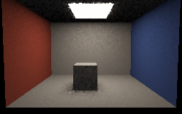
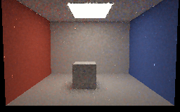
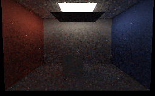

# Facet-sampled dynamic GI captures

Four actual **SwiftShader CPU Vulkan readbacks** of the same authored 24-triangle room, now using explicit
emissive-triangle sampling. Each 256×160 image averages the last 12 of 24 frames in linear RGB, with primary
visibility, temporal/spatial replay, exposure 0.45 and display gamma 2.2. The images below are **unfiltered**;
remaining speckles are sampling variance. They are not hardware-GPU or editor captures.

| One hit, open | Four hits, open |
|---|---|
|  [Filtered preview](Images/FacetRoomOnePreview.png) |  [Filtered preview](Images/FacetRoomOpenPreview.png) |

| Four hits, blocker under lamp | Four hits, blocker moved away again |
|---|---|
|  [Filtered preview](Images/FacetRoomBlockedPreview.png) |  [Filtered preview](Images/FacetRoomReopenedPreview.png) |

Filtered previews use a display-only 9×9 geometry-guided Gaussian over linear RGB. They can blur shadows and
spread bright outliers and are **not** used for numerical validation. The older
[BSDF-only captures](ReplayCaptures.md) use 48 frames rather than 24, so these images are not an equal-time
or equal-sample performance comparison.

The moving-blocker transitions each retained 35,886 temporal records without a global reset, capped old
represented history at one for the transition, and considered more than 147,000 spatial links. A fixed
lower-image region had unfiltered linear mean luminance 0.4509 (one hit), 0.5399 (four hits open), 0.0212
(blocked) and 0.5970 (reopened). Those are scene sanity checks, not independent photometric ground truth.
For quantitative comparisons and scope see [FacetReplay.md](FacetReplay.md).

Reproduce with `bash Exhibits/LightCompute/RunFacetReplayCapture.sh` after preparing the pinned tools with
`python3 Exhibits/LightCompute/Code/Prepare.py`; Pillow is required for PNG conversion.
[Capture log and source hashes](Results/FacetReplay-capture.txt).
