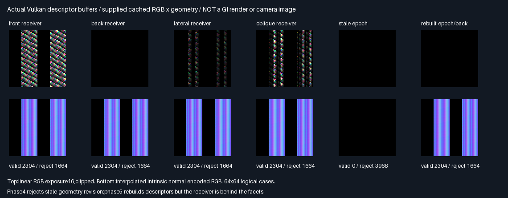
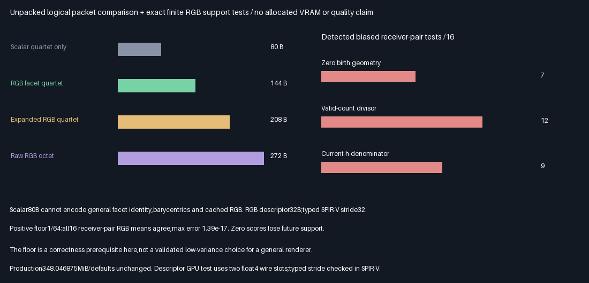

# RGB facet descriptor and positive-support gate

## Outcome — 2026-10-29

**Descriptor/support prerequisite passes;production promotion remains off.** Arbitrary tested facets require a32B
unpacked RGB descriptor and144B quartet,not the previous80B scalar quartet. The fixed positive-floor target
preserves the enumerated RGB first moments;zero birth-geometry scores fail when a sample later becomes visible.

| Verification                                      | Result                                      |
|---------------------------------------------------|---------------------------------------------|
| Release and host ASan+UBSan Vulkan runs             | Both exit0;five CTests each                  |
| Descriptor roundtrips per build                    | 24,576;every32B compared                     |
| Canonical empty / valid / rejected                 | 768 /11,520 /12,288                          |
| Position / normal / RGB estimate max absolute error| 2.319e-7 /1.074e-7 /2.774e-8                 |
| Fixed error ceiling                               | 2e-5 in all six phases                       |
| Release versus sanitized                          | Eight semantic rows and six captures equal  |
| Runtime source,tool,module,readback hashes          | 54 verified per build                       |
| Native C++ ABI in both builds                      | Descriptor32B,quartet144B                    |
| Typed-buffer SPIR-V probe                          | Stride32;offsets0,4,8,12,16,28                |
| Exact finite RGB checks                            | 768;maximum first-moment error1.388e-17      |
| Negative-control failures out of16 receiver pairs  | Zero support7;valid-count12;current-target9  |
| Production output allocation / defaults            | Unchanged348.046875MiB / unchanged           |



Top row is actual linear RGB readback at exposure16,clipped;bottom is the actual interpolated intrinsic normal
encoded as RGB. Each64×64 panel maps logical descriptors,not camera pixels. Invalid/empty cases are black.
Phase4 rejects stale descriptors after a geometry translation;phase5 rebuilds them but uses a back-side receiver,
so valid normals return while geometry-weighted RGB remains black. No denoising,TAA or visual GI claim follows.

## Choice and honest comparisons

Stars rate **fitness for this prerequisite**,more is better;they are not measured renderer-quality scores.

| Choice                              | Logical packet | Fitness | Decision and reason                       |
|-------------------------------------|----------------|---------|-------------------------------------------|
| RGB facet quartet + positive support | 144B           | ⭐⭐⭐ | 🏆 Advance to integration;bounded gate passes |
| Expanded world-space RGB quartet     | 208B           | ⭐⭐   | Reference;stores position and normal       |
| Raw eight-candidate RGB packet       | 272B           | ⭐⭐   | Required future equal-format comparison    |
| Previous known-square scalar quartet| 80B            | ⭐     | Preserve prior result;not general RGB ABI  |
| Zero birth-geometry selection target | Same layout    | —       | Reject;loses future-visible support        |

The144B packet is30.77% smaller than the208B expanded quartet and47.06% smaller than the272B raw RGB packet.
These are compiled native logical layouts,including16B packet metadata,not measured GPU allocations or bandwidth.
Telemetry remains a separate16B. The prior scalar144→80B comparison remains valid only in its original scope;
its five-fixture quality/query results do **not** establish quality for this RGB format.



## Reconstruction, rejection and support

- One shared C++/Slang descriptor definition stores uint facet/revision,float u/v,float3 outgoing RGB,float weight.
  C++ asserts32B,alignment16,and member offsets;native baseline sizes are separately compiled and run twice.
- Eight noncoplanar facets and interpolated normals exercise production `FacetSurface`. The CPU reference computes
  positions,normals and RGB geometry in double precision,independently of the shader reconstruction arithmetic.
- Each phase dispatches4,096 descriptors. Canonical empty,valid descriptors and13 corruption categories cover
  invalid index/revision,NaN/Inf,negative RGB/weight,zero weight,and out-of-triangle barycentrics.
- Four receiver positions include both sides. Phase4 translates geometry by.125X and changes revision7→8;
  phase5 rebuilds revision8 descriptors. A shared epoch rejection contract covers geometry/topology/lighting
  changes,but this test does not install production mutation hooks or independently animate all three classes.
- Runtime transport uses **two float4 wire slots**,then constructs the shared descriptor in the shader.
  All32 bytes,including invalid descriptors,roundtrip exactly. The standalone typed `RWStructuredBuffer` probe
  separately verifies compiled SPIR-V member offsets and array stride. It is **not** a runtime typed-buffer test.
- The RGB suffix is supplied,not traced. The GPU validates `RGB * birth normalizer * current geometry`,not RGB RIS
  candidate generation,selection,merge or visibility queries.

The finite test enumerates two draws from three RGB outcomes plus null for four birth×four current receiver
configurations. It uses `h_birth=1/64+max(0,n·direction)/distance²`,selects by `h_birth/q`,and divides by the
**birth** target and the full proposal count,including null draws. For each proposal pair,the conditional RGB
mean equals the dense two-draw estimate;the conditional second moment is no smaller than its squared mean.
Across all draws,the RGB first moment agrees with the exact reference. Three deliberately incorrect alternatives
must fail. This is a finite support/normalization result,not a general unbiasedness or variance guarantee.
The1/64 floor was fixed before measurement;its variance and scene-scale robustness remain unvalidated.

## Six-phase native evidence

| Phase | Receiver / revision             | Valid | Empty | Rejected | Max RGB estimate error |
|-------|---------------------------------|-------|-------|----------|------------------------|
| 0     | Front /7                        | 2304  | 128   | 1664     | 2.615e-8               |
| 1     | Back /7                         | 2304  | 128   | 1664     | 0                      |
| 2     | Lateral /7                      | 2304  | 128   | 1664     | 7.638e-9               |
| 3     | Oblique /7                      | 2304  | 128   | 1664     | 2.774e-8               |
| 4     | Changed geometry /stale7        | 0     | 128   | 3968     | 0                      |
| 5     | Changed geometry /rebuilt8,back | 2304  | 128   | 1664     | 0                      |

## Progress and remaining work

| Scope                    | Complete | Remaining | Meaning                                             |
|--------------------------|----------|-----------|-----------------------------------------------------|
| This bounded gate        | 100%     | 0%        | Implementation,native tests,baseline,evidence,report  |
| Overall ReSTIR/GI effort  | ~43%     | ~57%      | Planning estimate,not a measured acceptance fraction |

Done:prior scalar quartet comparison;shared facet/RGB descriptor;revision/corruption barrier;actual reconstruction
and byte transport;finite positive-support and divisor controls. Prior overall estimate was~40%;this prerequisite
moves planning only,it does not promote the renderer.

Next bounded problem:integrated RGB weighted-quartet GPU selection and normalization,with raw RGB/fresh controls
and explicit support/revision tests. Then traced RGB suffixes,visibility/reconnection and noncoplanar quality/query
comparisons;dynamic scene invalidation,camera/TAA and general-scene acceptance;physical GPU performance and
production C++ integration only after acceptance. Further packing,editor/vehicle/Jolt work remain deferred.

## Reproduction and retained evidence

| Environment | Tested configuration                                                        |
|-------------|-----------------------------------------------------------------------------|
| Host        | Linux x86-64,Debian GCC12.2;local validation,no Linux deliverable binary       |
| Shader      | Slang2026.14.1;direct SPIR-V1.3 compilation,-O0                               |
| Vulkan      | Pinned SwiftShader CPU Vulkan device;no physical-GPU performance measurement |
| Build       | Release and host ASan+UBSan;external driver/SPIR-V not sanitizer-instrumented |
| Source      | Base6313a1c5bed9f3ff8e21ab404aeaa6a22c48a654 + hashed changes retained here    |
| Untested    | Windows/MSVC,physical GPUs,runtime typed descriptor SSBO,full editor/renderer|

Prerequisites are the pinned Slang/SwiftShader tools in `Automation/ReplayToolDependencies.json`,Vulkan-Headers
v1.4.321,CMake3.31.6+,GCC/Python,and Pillow. Local scratch builds and binary/module hashes are disposable;the
actual six captures are also retained losslessly as `Results/FacetReservoir{0..5}.f32.gz`. Decompression SHA256
matches both native logs. Twelve64×64 PNG arrays are checked byte-for-byte before making the labelled montage.
The static stride SPIR-V is retained separately in Results,not substituted for runtime evidence.

```bash
bash Exhibits/LightCompute/RunFacetReservoir.sh
SANITIZE=1 BUILD_JOBS=1 bash Exhibits/LightCompute/RunFacetReservoir.sh
_ClaudeScratch/venv/bin/python Exhibits/LightCompute/Code/FacetReservoirEvidence.py
```

- [Release log](Results/FacetReservoir-release.txt),[sanitized log](Results/FacetReservoir-sanitized.txt).
- [Final audit](Results/FacetReservoir-parity.txt),[finite results](Results/FacetReservoir-finite.txt).
- [Release ABI](Results/FacetReservoir-layout-release.txt),[sanitized ABI](Results/FacetReservoir-layout-sanitized.txt).
- [Supplementary hashes](Results/FacetReservoir-supplementary-hashes.txt).
- [Evidence generator](Code/FacetReservoirEvidence.py),[finite enumeration](Code/FacetReservoirFinite.py).
- [Previous five-fixture scalar quartet evidence](WeightedQuartet.md),unchanged and not rerun for this gate.

No PR or Actions. Production348.046875MiB/layout/defaults are intentionally unchanged.

## Frozen protocol — before measurements,2026-10-29

This phase completes the descriptor/support prerequisite,not a general-scene GI quality promotion. The previous
80B scalar quartet cannot carry arbitrary facet identity,barycentrics and RGB without a revised format.

| Concern         | Fixed test                                                                            |
|-----------------|---------------------------------------------------------------------------------------|
| Descriptor      | uint facet/revision,float u/v,float3 outgoing RGB,float birth normalizer:32B,alignment16|
| Quartet         | Four descriptors+16B revision metadata=144B logical;telemetry16B separate                |
| Geometry        | Eight noncoplanar triangles,interpolated normals,reconstructed with production FacetSurface|
| Transport       | Four receiver positions on both sides of facets;RGB flux supplied as a descriptor input|
| Epoch           | Reject any geometry/topology/lighting revision mismatch before dereferencing or reuse |
| Corruption      | Bad index/epoch,NaN/Inf,negative RGB/weight,barycentrics outside triangle,canonical empty|
| Baselines       | Independent double precision reconstruction and expanded world-position/normal/RGB reference|
| Support         | Enumerate two-proposal RGB RIS cases with nulls and backface→frontface changes          |
| Target          | Positive floor1/64 + nonnegative geometry score;floor fixed,not quality-tuned            |
| Negative controls| Zero geometry score,valid-count divisor,current-target denominator must be detected   |
| GPU             | Release/host ASan+UBSan,actual raw buffers;position/normal/estimate error≤2e-5            |
| Layout          | sizeof/alignof/offsetof checks and actual descriptor byte roundtrip in the shader       |
| Evidence        | Source/module/readback hashes,exact cross-build parity,generated results table and charts|
| Limits          | No new ray tracing,RGB suffix tracing,5-fixture GI comparison,TAA or production-port claim|

Production348.046875MiB/defaults/layout stay unchanged;no packing,PR or Actions.
