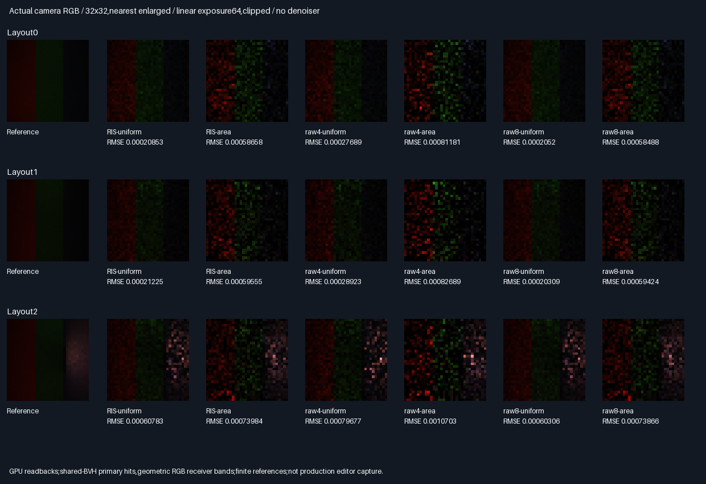
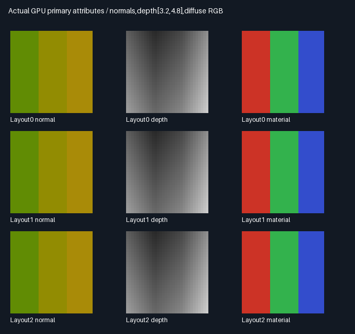
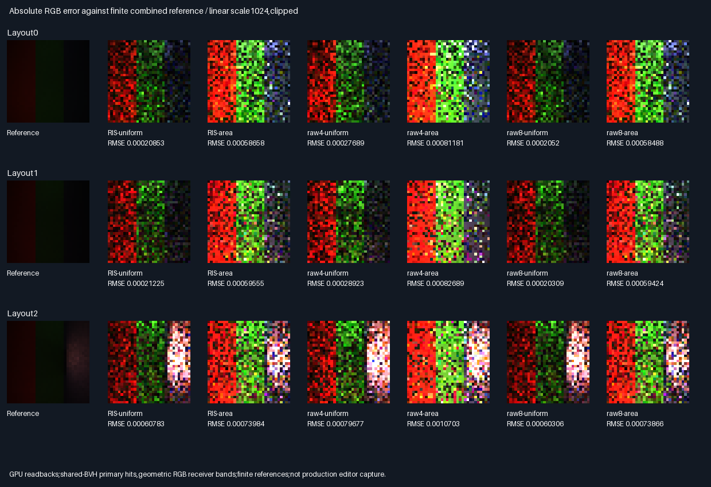

# Scene-consistent geometric-receiver fresh RIS

Fresh RIS passes the frozen ordinary/cross-reference image-error gates in3/3 layouts per proposal type.
The receiver now participates in real BVH primary hits and secondary visibility. An endpoint-query defect was
repaired without relaxing numerical or quality criteria. This accepts the bounded diffuse scene experiment only.

## Actual images and measured choices



Each32×32 pixel averages four packets. All six arms share geometry,camera inputs and proposal seeds;references
use disjoint seed domains. Images use linear exposure64/clipped,nearest enlargement,no denoiser or TAA.
Metrics use unclipped linear float captures.
[Every arm and paired interval](Results/GeometricAreaReservoir-comparison.md).

| Proposal type | Image gates | RMSE decrease versus raw4 | RIS RMSE versus raw8             |
|---------------|-------------|---------------------------|----------------------------------|
| Uniform facet | PASS3/3     | 23.71–26.61%              | 0.79–4.51% higher                 |
| Area weighted | PASS3/3     | 27.74–30.88%              | 0.16–0.29% higher                 |

Both ordinary MSE against the combined reference and cross-reference MSE must improve versus same-proposal raw4.
All six64-tile paired cross-MSE intervals are below zero here;they remain descriptive normal approximations,
not confidence-certified general-scene performance. Raw8 is more accurate in all same-proposal comparisons.

| Option         | Rating | Choice and reason                                                       |
|----------------|--------|-------------------------------------------------------------------------|
| Uniform RIS    | ⭐⭐⭐ 🏆 | Best measured same-query error in all three layouts;carry forward        |
| Uniform raw8   | ⭐⭐⭐ 🏆 | Best measured accuracy;nearly twice the counted queries                 |
| Area RIS       | ⭐⭐      | Passes own raw4 gates,but higher absolute error than uniform here        |
| Raw4 controls  | ⭐        | Keep equal-query baselines;selection improves their image error         |
| Temporal reuse | 🔴      | Still unaccepted;fresh still images do not repair rolling-error failures |

Stars rate measured quality/query tradeoff,more is better;trophies identify their stated criterion.
Uniform beating area here is not a universal proposal-selection rule.

## Query budget — include the primary rays

| Arm/budget                | Primary calls/pixel | Suffix+connection calls/pixel | All calls/pixel |
|---------------------------|--------------------:|-----------------------------:|----------------:|
| RIS,each proposal type    | 4                   | 32                           | 36              |
| Raw4,each proposal type   | 4                   | 32                           | 36              |
| Raw8,each proposal type   | 4                   | 64                           | 68              |
| Combined reference banks  | 768                 | 12,288                       | 13,056          |

RIS has50% fewer secondary queries than raw8,or47.06% fewer total counted queries. It is not quality-neutral.
Primary work is deliberately repeated per packet for all arms,not shared via an optimized camera cache.
Candidate CDF scans,score/BRDF/compensated arithmetic,storage and BVH traversal costs are untimed. These counts
do not establish a physical GPU speedup;raw controls could also omit validation-only score telemetry math.

## Scene consistency and endpoint repair



The three joined planar bands use six actual triangles with varying geometric normals and RGB reflectance.
All16 triangles,including these receivers,participate in the same production software BVH and proposal PDFs.
Receiver radiance under the chosen directional light is zero,but their proposals retain positive floor support.
No precomputed receiver normal/material/hit position is uploaded:only orthographic ray origins and RNG/method IDs.

| Scope                    | Previous camera patch        | This experiment                     |
|--------------------------|------------------------------|-------------------------------------|
| Primary hit              | CPU analytic plane           | GPU BVH closest facet               |
| Receiver normals         | Normal map on flat plane     | Actual joined geometric planes      |
| Receiver secondary rays  | Not in BVH                   | Same BVH as original source facets  |
| Proposal support         | Ten original facets          | All16 original+receiver facets      |
| Reference samples/bank   | 768/pixel                    | 3072/pixel                          |
| Removing receiver facets | No geometric shadow effect   | 2076 suffix decisions change        |

The omitted-receiver negative control independently traces only the original ten facets on the CPU. It changes
2076 selected,positive-light-facing original-source suffix decisions that the full scene blocks. This verifies
that receiver geometry really participates in secondary visibility,not merely the displayed primary attributes.
Different geometry/support prevents direct cross-report RMSE or reference-noise improvement ratios.

The initial strict replay failed at layout0,pixel2839,lane3,proposal1:GPU connection visible,CPU blocked.
The inherited connection query offset its origin but retained the unoffset direction/range. The repaired query
joins source and receiver endpoints each offset0.002 test units along their geometric normals,with1e-5 target
shortening. Radiometric geometry still uses the original unoffset points. All arms and references in this
exhibit use the same
repaired connection query;no rays are skipped. Historical shaders and production defaults are unchanged.
[Initial failure log](Results/GeometricAreaReservoir-initial-endpoint-failure.txt).

## Verification and reference uncertainty

| Check                    | Result                                                              |
|--------------------------|---------------------------------------------------------------------|
| Release/host ASan+UBSan   | Five CTests each plus targeted runtime replay                         |
| Experimental primary     | 73,728 double closest-hit checks/build                              |
| Reference primary        | 2,359,296 exact primary-record invariance checks/build                |
| CPU candidate replay     | 491,520 proposal comparisons/build                                  |
| CPU selected replay      | 393,216 paths;786,432 binary visibility decisions/build               |
| Maximum normalized error | RGB7.29e-8;normalizer5.36e-7;below unchanged2e-5                       |
| MC selector exceptions   | 0;original margin2e-6/max16 rule unchanged                            |
| Cross-build parity       | Nine semantic rows,63 runtime hashes/build,six buffers,two modules    |
| RGB means                | 54/54 pass at6 estimated SE+2e-5                                     |
| Wrong normalizer         | Omitting qArea fails3/3 layouts per RIS proposal type                 |
| Reference paths          | 18,874,368 additional GPU paths/build,excluded from algorithm budget   |

[Means](Results/GeometricAreaReservoir-means.md),[audit](Results/GeometricAreaReservoir-parity.txt).
CPU independently intersects all triangles in double precision for primary validation. It verifies closest
distance,UV/position,normal and material;only equal-distance,same-material shared-edge ties may change identity.
Transport then independently replays double geometry/rays conditioned on these validated float32 GPU primary
attributes. This separates primary float-interface error from transport replay;it is not an all-double end-to-end
camera oracle. Reference passes reuse the GPU raw8 path,not a second independent renderer.

Two disjoint reference banks each average3072 samples/pixel. Cross-reference MSE uses
mean((estimate-A)·(estimate-B))/3 to remove reference-variance bias in the ideal independent unbiased RNG model.
Seed domains are verified disjoint;that is not a formal RNG-independence proof. Estimated combined-reference
RMS noise is1.35e-5,1.41e-5,5.18e-5 across layouts. References remain finite,not certified exact integrals.



## Progress,limits and next bounded work

| Scope                           | Complete | Remaining | Interpretation                       |
|---------------------------------|----------|-----------|--------------------------------------|
| Geometric receiver experiment   | 100%     | 0%        | Code,tests,controls,images and report  |
| Frozen image quality gates      | 6/6      | 0/6       | Three layouts per proposal type       |
| Overall ReSTIR/GI               | ~74%     | ~26%      | Planning estimates,not acceptance     |
| Production/temporal acceptance  | None     | Separate  | More acceptance gates remain          |

This is orthographic,opaque Lambertian,two-diffuse transport on16 toy triangles,not a production editor render.
The score knows unoccluded transport under the fixed directional light,not arbitrary cached/multibounce radiance.
Finite endpoint offsets are scale-dependent. General perspective views,miss pixels,curved scenes,glossy/full MIS,
multibounce,dynamic/TAA and physical GPU measurements are not established. No Windows/MSVC test or executable.
Production348.046875MiB/defaults and packed descriptor ABI stay unchanged;23-slab telemetry is validation-only.

Next bounded phase:fresh diffuse BSDF/area MIS with explicit PDFs and equal-work controls on this geometric
receiver. Production integration follows acceptance;temporal rolling gates still need separate resolution.
Packing,editor,vehicle and Jolt stay deferred. No PR or GitHub Actions.

## Reproduction and retained evidence

| Configuration | Tested condition                                                             |
|---------------|------------------------------------------------------------------------------|
| Source        | Basebb572ca30ac37114159c2a5182ae229ff0b972e5 + runtime-hashed exhibit changes   |
| Host          | Linux x86-64,Debian GCC12.2,CMake3.31.6                                         |
| Shader        | Pinned Slang2026.14.1,SPIR-V1.3,-fp-mode precise,-O0                          |
| Vulkan        | Pinned SwiftShader CPU Vulkan,production software BVH;not hardware RT          |
| Sanitizers    | Host ASan/UBSan only;driver/SPIR-V uninstrumented                              |

Prerequisites:Python/Pillow,CMake,Vulkan-Headers v1.4.321 and pinned tools from
`python Automation/PrepareReplayTools.py`. Native CLI:`--geometric-area-reservoir`.

```bash
BUILD_JOBS=1 bash Exhibits/LightCompute/RunGeometricAreaReservoir.sh
SANITIZE=1 BUILD_JOBS=1 bash Exhibits/LightCompute/RunGeometricAreaReservoir.sh
_ClaudeScratch/venv/bin/python Exhibits/LightCompute/Code/GeometricAreaReservoirEvidence.py
```

- [Shader](Code/GeometricAreaReservoirGpu.slang),[CPU replay](Code/GeometricAreaReservoirValidation.h),
  [evidence generator](Code/GeometricAreaReservoirEvidence.py),[runner](RunGeometricAreaReservoir.sh).
- [Release](Results/GeometricAreaReservoir-release.txt),[sanitizers](Results/GeometricAreaReservoir-sanitized.txt),
  [hashes](Results/GeometricAreaReservoir-evidence-hashes.txt). Six lossless compressed buffers,two modules,
  48 exact32×32 PNG arrays and three sheets are retained. Encodings are verified against actual GPU readbacks.
- [Previous camera patch](CameraAreaReservoir.md) remains historical;its retained manifest is verified,not rewritten.
  The pre-restore workspace is preserved under ignored `_ClaudeScratch/recovery/before-geometric-restore.tgz`.

## Frozen protocol — before measurements

| Scope | Fixed choice |
|-------|--------------|
| Camera | Orthographic32×32;pixel-centre origins(X,Y,2),directions+z;production BVH closest hits |
| Receiver | Three joined planar RGB bands,six triangles;slopes−.25,.15,.35 in x,+.1 in y |
| Height | z4 at x−2;continuous across x boundaries−2,−.6,.7,2;geometric normals,no normal map |
| Scenes | Original ten facets/three blocker layouts plus all six receiver triangles in shared BVH |
| Support | All16 facets have positive proposal support;receiver directional-Lambertian radiance is zero |
| Arms | RIS-uniform,RIS-area,raw4-uniform,raw4-area,raw8-uniform,raw8-area;four packets/pixel |
| Budget | RIS/raw4:32 suffix/connection calls/pixel;raw8:64;all add four primary calls/pixel |
| RIS | Four independent two-proposal reservoirs/packet;score1e-6+mean unoccluded transport;h/q selection |
| References | Two disjoint uniform raw8 banks,384 packets/bank/pixel;3072 samples/bank,4× previous phase |
| Quality | Per proposal type:RIS ordinary image MSE AND cross-reference MSE≤raw4 in all three layouts |
| Means | Each RGB aggregate residual≤6 estimated SE+2e-5;wrong normalizer fails both RIS types |
| CPU primary | Independent double all-triangle closest hits;position,normal,UV,distance/material validated |
| CPU transport | Independent double replay conditioned on validated float32 GPU primary attributes |
| Tolerances | Primary2e-5;transport/normalizer normalized2e-5;MC selector margin2e-6,max16 exceptions |
| Ties | Primary triangle identity may differ only for a valid same-material,equal-distance shared-edge hit |
| Occlusion | Removing receiver triangles in a CPU negative control must change at least one suffix decision |
| Verification | Release and host ASan/UBSan,five CTests each;exact semantic/readback/module parity |

Connection queries use source/receiver endpoints offset0.002 test units along their geometric normals,then shorten the
segment by1e-5 at the target. This repairs the old offset-origin/unoffset-direction endpoint inconsistency.
No criteria tuning after held-out measurements. Primary records must also match during every reference pass.
Six geometric receiver facets participate in primary,suffix and connection visibility and proposal PDFs.
Physical GPU timing,temporal reuse,TAA,glossy,MIS,multibounce and production acceptance remain out of scope.
Production348.046875MiB/defaults remain unchanged. No PR or GitHub Actions.
