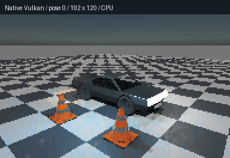
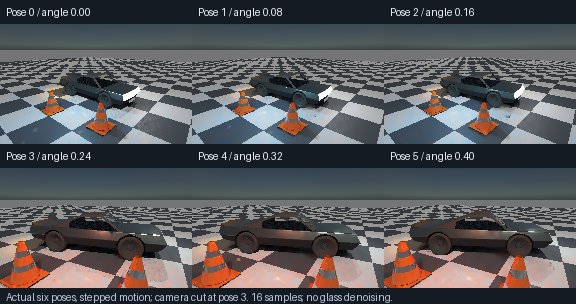

# Moving closed-glass ControlVehicle — 2026-10-26

**Six-pose Vulkan acceptance and the complete retained optical regression both passed (exit0).**
Device: **SwiftShader Device (Subzero), type4 / CPU Vulkan**. Triangle BVH, no hardware ray queries.
Actual192×120 readbacks,16samples,2048interaction limit. Not a real-time or physical RTX/GTX result.





## Measured acceptance

| Pose | Body angle (radians) | Glass pixels | Mirror pixels | Reused opaque indirect pixels | Caps / unsupported |
|---|---:|---:|---:|---:|---:|
|0|0|319|11|0|0/0|
|1|.08|316|10|0|0/0|
|2|.16|314|5|0|0/0|
|3 (camera cut)|.24|606|5|0|0/0|
|4|.32|587|4|0|0/0|
|5|.40|543|13|0|0/0|
|Static warmup at pose0|0|319|11|17718|0/0|
|Static emission revision at pose5|.40|543|13|0|0/0|

- All3547tested glass observations and72mirror observations across those eight submissions retain **exactly
  fresh directional transport**, with no temporal/spatial filtering. These are observations, not unique pixels.
- Independent native planar previous-position probes: maximum error **1.91807e-7m**. Maximum matched
  direct-history subtraction error **3.8147e-6**. Glass/mirror raw-to-resolved and fresh-reference differences are0.
- Every authored body revision conservatively resets all indirect history. The stationary warm frame exercises
  opaque reuse separately. **This does not implement continuous opaque reuse across moving authored geometry.**
- Static emissive RGB revision changes output and rejects stale indirect history. After removing analytic,
  emissive and environment sources, all**23040pixels** are black despite populated history.
- Native six-pose assembly:24pose groups,284closed triangles/4mirror triangles at each pose;12mirror facet
  corners checked in local coordinates per pose; enclosed-volume drift<1e-7m³. Same native path passes ASan+UBSan.
- Native saved material exporter:39checks,4disk round trips,5legacy controls,11invalid files rejected.

The GIF enlarges the192×120 source with nearest-neighbour pixels and adds labels; there are no interpolated or
invented frames. Camera cut at pose3 and loop-back are intentional. The16sample images remain visibly noisy
and low-resolution; they are transport evidence, not finished appearance or a glass denoiser.

## Mechanism

Shared `VehicleGlazingScene.h` serves static and moving fixtures. Saved IOR1.52/RGB absorption[1,4,12]/m
bind to actual category4 atlas data. Each native archive rebuilds its284derived closed pane triangles and BVH;
the original74open triangles/source archive remain unchanged. Nominal thickness remains6mm/3components.
The two added reflector quads now rotate/translate with the body rather than staying in world space.

Moving derived tokens100700(glass)/100301(mirrors) exceed the archive's vehicle threshold. Keeping the static
fixture's700/301 tokens would incorrectly classify these added primitives as static for previous-position
reconstruction. Native inverse/forward rigid transforms check the shader's previous pane/mirror positions.
A reconstruction-disabled reference follows exactly the same direct histories and seeds as the reconstructed
submission; this is a matched-history directional oracle, not an entirely cold direct-light renderer.

Racing Green cellular flakes, rubber tyres, cones, BVH mirrors, analytic and emissive lighting and existing sky
data are retained. This phase does not restyle the sun, flare, stars or clouds.

## Why the first attempt failed, and what changed

The first run passed poses0–3, then failed the unchanged zero-cap gate at pose4. Production diagnostic:
**2capped paths,0unsupported boundaries**, pixel12015, position[1.38482,-.742537,1.15988]. Packed135164
means2×65536+4092TIR events. Failed controls remain in `Results/GlazingMotionFirstAttempt.txt` and
`Results/GlazingMotionPose4Diagnostic.txt`.

An isolated pre-remedy shader copy measured**36822mm combined in-medium travel** at those capped paths.
Its minimum-segment aggregate saturated65535nm; individual minima/distances were not recovered. The audit
repurposes diagnostic fields, so its36822 is **not** a production unsupported-boundary count. Reproduce this
negative control with `RunGlazingRayAudit.sh`, pinned to pre-remedy1b5691e. It never emits a six-posePASS.

The remedy is **unbiased faint-path Russian roulette**, not a radiance/absorption cutoff: after32interactions,
maxRGBthroughput<1e-6 latches a faint state. Every8interactions thereafter, survive with probability1/2 and
double surviving RGB weight. Each trial preserves `0.5×(2×weight)+0.5×0=weight`. The latch prevents compensation
from disabling later trials; a separate RNG stream leaves ordinary boundary draws alone. Short/bright paths
are unchanged. **2048interaction/128sample limits and zero-cap acceptance were not relaxed.**

`RunFaintPath.sh` extracts the actual production block into a numerical Vulkan kernel: **240cases/76trials/
38terminations** pass exact paired-draw RGB first moments, activation/depth/.5-draw boundaries and inherited
latch state. This checks the survival block, not PRNG independence or general estimator convergence. The
finite hard cap remains a limitation for arbitrary lossless/guiding geometry; this is not unrestricted unbiased
transport, nested media, rough glass, inside-camera or caustic acceptance.

## Regression evidence

Static native/320×200 Vulkan regression passed both before and after survival:887glass pixels,1851changed
channels,0caps/unsupported, exact repeats, moved=cold and64000black source-off pixels. **All five previous
published vehicle PNGs remain byte-for-byte identical to2e3eb62**, including the contact sheet. Before survival
all13SPIR-V digests matched; afterwards only`Transport.spv` changes (12/13unchanged). All4native CTests pass.
See `Results/GlazingMotionRegression.json` and `Results/VehicleGlazingGpu.txt`.

Because a production shader changed, the complete retained boundary/slab/history/mirror/rough/window/diffuse/
vehicle regression chain was rerun and **finished exit0**. `Results/GlazingMotionRetainedRegression.txt`
retains the full current log, not merely a reference to the pre-remedy run. Among the retained results:
199boundary cases/149reciprocal identities;4slab,4mirror and4window cases;3rough screen/BVH comparisons;
diffuse absorption/emitter routing;901vehicle oracle probes(max4.5973e-6);both analytic/emissive/environment
routes(2053.59/19571.8/612.624);linearity max8.44436e-6;160×100reconstruction RMSE.0103498→.00585726;
210native spatial probes(max4.23087e-8);old-material six-pose history/direct refresh and all4native CTests.
Those retained old-material poses are regression evidence, not a substitute for the new closed-glass film.

## Reproduce

```bash
bash Exhibits/LightCompute/RunGlazingMotion.sh
# Already completed static setup/acceptance:
MOTION_BUILD=0 bash Exhibits/LightCompute/RunGlazingMotion.sh
# Retained optical suite after the shader change:
DIFFUSE_BUILD=0 bash Exhibits/LightCompute/RunDiffuseDielectric.sh
```

Dependencies/device selection follow [static glazing](VehicleGlazing.md). `--glazing-motion-native` does not
load Vulkan. Default motion wrapper also runs ASan+UBSan native validation and the extracted-production
survival probe. `MOTION_SANITIZE=0` skips an already-completed sanitizer rebuild. `GLAZING_DEBUG_POSE=4`
is isolated diagnosis only: no paired reference or fullPASS. Image production requires the fullPASS marker
and actual visible-mirror/warm-history coverage.

Still unverified: physical RTX/GTX/Windows/editor/full-renderer integration; a general CAD/body collision
certificate; full denoising/prior-screen exitance; unified baked-distance-field/cloud/fog moving scene.
The old project's half-pole shadow defect remains un-reproduced, not fixed.
