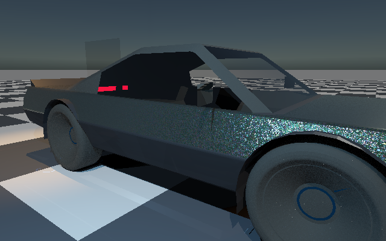
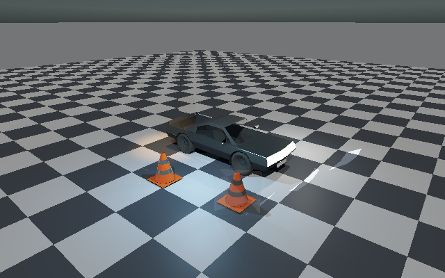
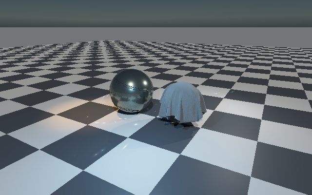

# Vehicle materials and native specimens

**Cellular flakes retained. The material library is not yet fully integrated or physically accepted.** This native C++/Slang scene variant binds the existing presets to the actual ControlVehicle and demonstrates scene reflections; it does not replace the editor viewport or declare every library option complete.

## Actual renders

**Racing Green cellular flakes, clearcoat, transmitting windows and rubber — close-up**



**Vehicle, plastic cones, reflective bands, side mirrors, large calibration mirror and clear calibration pane**



**Reused C++ shaderball and draped cloth — Racing Green / Indigo Denim**



| Requested surface | Implemented in this native scene | Important boundary |
|---|---|---|
| Green metallic clearcoat | Existing `racing-green.material`, three cellular layers beneath its authored clearcoat | Explicit compute footprint; not complete per-layer normal/orange-peel parity |
| Tyre rubber | Existing `performance-rubber.material` and committed albedo/normal maps | Vehicle archive lacks UVs here; documented object-planar mapping |
| Windows / glass | Existing Crystal Glass IOR/roughness plus explicit transmitting thin-sheet transport override | Original preset is **opaque**; no solid-volume Snell refraction, dispersion or caustics |
| Side mirrors | Added reflective panes at both sides, actual triangle-BVH reflection | One shaded opaque secondary bounce; not hardware ray-query execution |
| Plastic cones | Reused polypropylene parameters with orange tint; procedural radial geometry and band regions | [Sampled rough-lobe screen/BVH transport](RoughReflections.md), full shared BRDF |
| Reflective cone bands | Metallic reflective band material, including metallic Fresnel in reflection | Not a retroreflector model or safety certification |
| Shaderball / fabric | Existing C++ shaderball and draped-cloth geometry; retained layered/scattering equations | Selected samples, **not** proof that the entire PBR library works |

## Executed checks

Device: **SwiftShader Device (Subzero), Vulkan CPU software device, Linux**. Primary intersections, BVH secondary rays, material shading and output execute through native Vulkan/Slang, not a browser imitation. The atmosphere cube is prepared by the native reference code. Cloud/fog are disabled for these material-isolation captures; their existing presets and Sun/flare/star work are not rewritten.

| Check | Evidence |
|---|---|
| Original vehicle | All 25,068 original facets retained; 778 paint, 21,348 rubber, 74 glass facets assigned |
| Overview reflection coverage | 733 mirror pixels hit scene geometry; 59 are side-mirror pixels |
| Close-up side mirrors | 930 side-mirror pixels hit scene geometry |
| Plastic overview | 918 pixels with accepted screen rays / 184 with none; [per-ray routing acceptance](RoughReflections.md) |
| Independent mirror queries | 64 native double-precision BVH comparisons per vehicle view |
| Reused evaluator parity | 128 native scattering probes per capture; scaled error below 0.005 acceptance limit |
| Repeat | Entire vehicle HDR readback repeats exactly; PNG wrapping is lossless |
| Current build / regression | [4/4 native CTest, 13 compute shaders, 2 production material shaders](Results/MaterialVerification.json); targeted [rough-lobe acceptance](RoughReflections.md) |
| Historical legacy transport | [901 probes at `05e4090`](Results/MaterialTransportRegression.txt), max RGB error 4.63e-6; not rerun in the rough-reflection phase |

Exact errors, device, source hashes, capture hashes and coverage: [report](Results/MaterialScene.json), [raw log](Results/MaterialScene.txt). Counters count visible samples, not reflection quality or performance. The large mirror/pane are calibration geometry, separate from the small vehicle panes.

The ordinary authored-material path reuses the [energy-corrected](../TextureStudio/MaterialEnergyAcceptance.md) `ScatteringEvaluation.slang` and integrates cosine/GGX proposals with deterministic-mixture weights. Mirrors use a delta direction through the existing BVH. Glass transmits through up to eight parallel thin sheets with Fresnel and tinted Beer attenuation, including direct-light shadows. Plastic now samples cosine/GGX directions through the full shared BRDF. Screen depth proposes a facet, the reflected ray/facet intersection and clear segment are checked, and unavailable or unsuitable hits use BVH fallback. Accepted hits are freshly shaded for the reflected direction; no roughness-mip colour history or temporal specular reconstruction is implied.

## Procedural versus baked

| Work | Evaluation strategy |
|---|---|
| Rubber / denim detail | Existing baked PNGs decoded once; bounded 256² linear-colour/normal mip pyramids uploaded to a float atlas |
| Cellular flakes | Still evaluated procedurally with a ray-footprint estimate; not baked into a fixed final colour |
| Clearcoat, glass, mirrors, lighting | Evaluated for the actual viewing/light directions at render time |
| Shared material/map atlas | 6,296,888 bytes for these five presets; validation float storage, not an optimized compressed GPU texture layout |

A [native sampling benchmark](../TextureStudio/Results/MaterialBakeTiming.json) evaluates the existing denim field versus bilinear sampling of its four-channel baked albedo/height maps: 512² samples, seven timed repetitions, one warmup. The two measured runs gave **55.85 / 16.22 ms (3.44×)** and **88.81 / 16.91 ms (5.25×)** procedural/bilinear p50, respectively. [Earlier raw run](../TextureStudio/Results/MaterialBakeTimingEarlier.txt). Baked lookup was faster in these CPU runs, but this **does not establish a GPU or full-frame speedup**. The float maps cost 4 MiB; texture-centre error is zero, while off-grid linear-albedo MAE is **0.0301**, maximum **0.3857**—baking/interpolation is not equal quality. Shared-VM scheduling affects timings; the raw measurements must be read with their scope.

Baking is useful for expensive, view-independent surface detail and amortizes its initial cost. Texture reads consume bandwidth/memory and can alias or lose fine detail; cheap formulas can outperform texture fetches. Final reflections, Fresnel and view-dependent glint filtering cannot generally be replaced by one baked colour image.

## Reproduction

```bash
# Restore pinned Slang/Vulkan tools if missing:
python3 Exhibits/LightCompute/Code/Prepare.py
python3 -m pip install --target _ClaudeScratch/tmp/MaterialTools Pillow==12.0.0
bash Exhibits/LightCompute/RunMaterialScene.sh
python3 Exhibits/TextureStudio/Code/VerifyMaterialBakeTiming.py
```

The fixture compiler reads the existing TOML presets; its ignored float atlas is validation interchange, not a new production material format. Legacy yellow-car regression fixtures remain intact; select `RunMaterialScene.sh` for this green-material scene variant.

## What remains incomplete

- [Scoped energy correction](../TextureStudio/MaterialEnergyAcceptance.md) passes 384 native and 34 actual Vulkan cases. The original three excess fixtures are corrected; this is **not** acceptance of all anisotropic/exact-Fresnel options, the analytic environment approximation, legacy BRDF or all 399 assets.
- General live-editor material assignment, authored vehicle UV recovery, moving-object paint coordinates, all authoring maps, independent per-stratum normals, anisotropy/dispersion and full texture-filtering parity.
- Solid-volume glass/refraction, nested specular bounces, roughness-mip screen-colour history and complete temporal/disocclusion acceptance. [Limited angular-aware reflection history](ShadowHistory.md) is now separately verified; these vehicle captures remain the `65939de` checkpoint.
- Physical RTX/GTX/Windows/viewport and validation-layer execution. No hardware performance claim or overall-renderer completion percentage follows from these samples.

## Linked branch

Rechecked `SultanAladin/Frontier` branch `arena/5e581235-frontier` at **a76dbd34d12d5e0dbfafe24dd5aa9d4d5b414c73**. All 399 material archive files already match. Latest scoped comparison is **448/455 identical**: three existing vector-gradient ABI differences, the cellular compute-footprint extension, two energy-allocation evaluators and reciprocal coat factor grouping in the production surface shader. Production SPIR-V intentionally changes after the energy correction; byte identity was only the earlier paint-extension comparison at `b6bc49e`.

The newer upstream commit adds Baking Studio AO/curvature geometry baking and its UI; it does not replace these optical material definitions. No blind branch merge or unrelated vector/UI import was performed. [Reuse audit](../TextureStudio/MaterialReuse.md).
