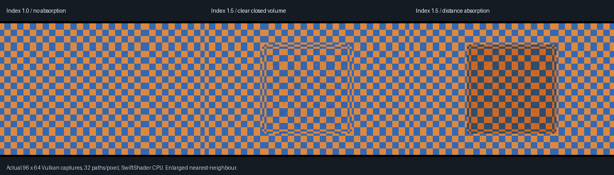

# Mirror-to-volume refraction — 2026-10-25

> Historical checkpoint: [VehicleGlazing](VehicleGlazing.md) subsequently adds derived vehicle panes,
> shared-edge evaluation and a 2,048-interaction bound. Earlier 32-step descriptions below refer to the
> original checkpoint, not the current runtime limit.

**A primary planar mirror can now see through a smooth closed dielectric volume.** This extends the primary
volume checkpoint; it does not enable rough sampled reflections, recursive mirror chains or full glass authoring.



Actual **96×64 Vulkan readbacks**, 32 paths per mirror pixel, enlarged nearest-neighbour. The mirror fills the
camera view. The glass box and emissive checker are **behind the camera**, so none is directly visible to the
primary camera. The middle image shows refractive displacement; the right image adds RGB distance absorption
0.2/0.6/1.2 per scene-length unit. Visible finite-sample noise and triangle-edge artifacts are not concealed.

A subsequent [rough-reflection extension](RoughDielectric.md) now supports sampled reflector rays through
smooth glass; statements below about the rough-path blocker describe this mirror checkpoint.

The table below reflects the current regression readback; finite averaging order changed last-bit values
when the integrator was flattened in the rough-reflection phase.

A later [window-to-volume phase](WindowDielectric.md) also adds primary thin-sheet paths; the original
checkpoint limitations below are historical.

## Verification

| Check | Actual result |
|-------|---------------|
| Device | SwiftShader Device (Subzero), CPU type 4; software Vulkan only |
| Mirror slab, index 1.0, no absorption | Maximum central RGB mean error **1.16825e-7** |
| Mirror slab, index 1.0, absorption | **9.1864e-8** |
| Mirror slab, index 1.5, no absorption | **0.00307568** |
| Mirror slab, index 1.5, absorption | **0.00230352** |
| Analytic coverage | 196 central pixels per case; every primary pixel asserts mirror classification |
| Bounds/medium state | Every mirror pixel asserts zero capped and unsupported paths in the four slab cases |
| Negative control: disable the new mirror routing | 196 central pixels reproduce blocked-black solid reflection |
| Remove emission without an explicit history reset | All **6,144** pixels exactly black |

The independent native slab series is multiplied by the existing mirror throughput **0.94**:
`0.94 * (1-F)^2 A / (1-F^2 A^2)`, `A = exp(-sigma / cos(theta_transmitted))` for unit slab thickness.
The comparison is a central **mean**, not a per-pixel or whole-image convergence proof. Declared thresholds
are 0.0001 for index matching and 0.08 for index 1.5; the observed errors above are substantially smaller.

The current negative control compiles the three transport shader files from `8a1f38f`, with unchanged shared
scattering math. It is not a full pinned-application replay. The same fixture returns exactly black for all
196 central samples. This replaces the earlier dispatch-condition-editing control.

## Driver-safe integration

| Change | Scope |
|--------|-------|
| Single volume-integration site | Primary category 4 and mirror category 1 share `IntegrateBoundaryRays` |
| Ray origin/direction | Camera ray for glass; reflected ray from the mirror for category 1 |
| Mirror sampling | Up to 128 paths, using the configured transport sample count; prior ordinary mirrors used one ray |
| Existing mirror throughput | Preserved at 0.94; finite averaging may change last-bit rounding |
| Mirror diagnostics | Marker 1; `y` is any scene hit, `z = capped*256 + unsupported` |
| Primary glass diagnostics | Marker 5 and previous packed cap/TIR/unsupported layout retained |
| Other secondary rays | Existing sampled material-ray route still rejects category-4 hits black |

The previous nested secondary implementation segfaulted the software driver even when moving the call out of
the thin-sheet loop, requesting no-inlining, forcing early inlining or increasing host stack size to 64 MiB.
The single integration-site arrangement passes pipeline creation and actual mirror captures with the normal
stack limit. This is an empirically verified arrangement, **not a diagnosis or repair of SwiftShader internals**,
not a performance improvement and not proof about physical GPUs.

Existing category-2 windows retain their primary thin-sheet approximation. A mirror path may encounter thin
sheets in air through the shared bounded tracer; it does not reinterpret sheets as closed volumes. Analytic
and emissive lighting, existing cellular flakes and the sun/flare/star implementations remain present.

## Reproduce

```bash
bash Exhibits/LightCompute/RunMirrorDielectric.sh
# Reuse an explicitly completed build:
MIRROR_BUILD=0 bash Exhibits/LightCompute/RunMirrorDielectric.sh
```

The wrapper also reruns the 199-case native/GPU boundary comparison, primary slab/rejection tests, opaque
reflection-history acceptance and four native CTests. Tools and Pillow follow the existing pinned exhibit setup.
No GitHub Actions dispatch is needed.

- [Mirror slab and source-off log](Results/MirrorDielectric.txt)
- [Routing-disabled negative control](Results/MirrorDielectricOriginal.txt)
- [Capture hashes and scope](Results/MirrorDielectric.json)
- [Primary glass acceptance](SolidDielectric.md)
- [Opaque reflection regression](Results/SolidDielectricOpaqueRegression.txt)
- [Done and remaining](RendererProgress.md)

Still excluded: rough sampled solid refraction, solid transport through primary thin-sheet windows, nested or
overlapping media, camera-inside transport, rough glass, caustics/transmitted direct shadows, saved TOML
material-authoring integration, complete denoising, editor integration, physical RTX/GTX and Windows acceptance.
