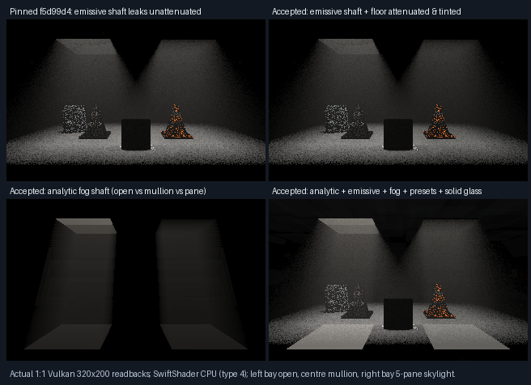
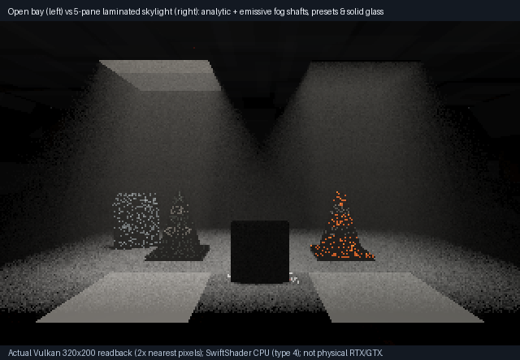

# Thin-pane spectral transmittance, volumetric shafts and multi-stratum mixtures

**Accepted (exit 0) on native C++ and SwiftShader CPU Vulkan (`type=4`).** Previously (`f5d99d4`), `Occluded(...)`
treated thin dielectric sheets (`Category == 2`) as binary unoccluded (`false`), so compact area-emitter sampling
(`SampleEmissiveFacet`), emissive volumetric fog (`SampleFogFacet`) and analytic volumetric fog (`IntegrateFogScattering`)
all leaked **100% unattenuated radiance** behind thin windows—and dropped eight-pane NEE+BSDF paths to zero.
`SegmentShadowTransmittance` and `CrossedPanes < 8` close all four defects while trimming procedural surface-baking code
out of shadow/fog loops. All five previous static `VehicleGlazing` PNGs remain byte-for-byte identical to `2e3eb62`.





## Verified results

| Check | Scope / fixture | Result |
|-------|-----------------|--------|
| Native arithmetic + ASan/UBSan | 0, 1, 2, 7, 8 panes, 60° tilt, opaque tail, balance-heuristic vs cosine | **8/8 pass**; `mixture_cosine_diff = 7.36863e-7`; zero leaks/UB |
| Surface area-emitter quadrature | 0, 1, 2 and oblique panes (`320×200`, 128 samples, 2,016 native probes) | **Max RGB error `1.53749e-8`**; single-pane RGB `0.918637 / 0.922243 / 0.920854` (`G > B > R`) |
| NEE vs cosine BSDF consistency | Wide emitter behind thin pane (`128` samples) | **Relative error `0.0031442` (`0.31%`)**; pinned `f5d99d4` over-predicted by **`+12.97%`** |
| Eight-pane BSDF continuation | 8 parallel panes (`MaterialShadowTransmission` caps after 7 panes / 8 queries) | **`EightNee == EightBsdf` exact**, green mean **`1.04007`**; pinned `f5d99d4` dropped to **`0`** |
| Multi-stratum mixture convergence | 4 reused presets (`racing-green`, `performance-rubber`, `pp-polypropylene`, `indigo-denim`) | Furnace mean **`0.541175 ≤ 1.01`**; error **`0.009686` (8) → `0.007453` (32) → `0.007295` (128)** |
| Analytic volumetric fog shafts | Two-bay clerestory hall (left open, centre mullion, right 5-pane skylight; 922 probes) | **Max RGB error `7.09163e-7`**; mullion **`0`**; right/left RGB **`0.70798 / 0.72316 / 0.71728`** (pinned `1.07943`) |
| Emissive volumetric fog + floor | Matched overhead canopies isolated by vertical divider (541 volume probes) | **Max RGB error `1.45148e-6`**; floor **`0.65628`**, shaft **`0.65576`** (pinned `f5d99d4` leaked **`0.99371`**) |
| Combined studio hall | Analytic + emissive + fog + presets + closed 6 mm glass (`1,366` solid, `1,120` window px) | **Zero capped/unsupported paths**; exact seeded repeat; **all `64,000` pixels black** with sources off |
| Retained optical regressions | Window, compact diffuse, vehicle emissive, fog facets, fog rays, static vehicle glazing, 4 CTests | **All pass**; **5/5** static `VehicleGlazing` PNGs byte-identical to `2e3eb62` |

## Mechanism

```text
SegmentShadowTransmittance(Origin, Direction, Far)
 ├── (Extent.Primary.w & 32u) == 0 ──► OccludedGeometry (unchanged BVH + Counters[2])
 └── (Extent.Primary.w & 32u) != 0 ──► MaterialShadowTransmission (up to 7 thin panes / 8 queries, Fresnel + RGB Beer)
                                        ├── SampleEmissiveFacet      (surface area-emitter quadrature)
                                        ├── SampleFogFacet           (emissive volumetric fog shafts)
                                        ├── IntegrateFogScattering   (analytic volumetric fog shafts)
                                        └── TraceSolidDielectric     (CrossedPanes < 8 suppresses straight NEE; ≥ 8 retains BSDF)
```

## Explicit limitations

- ⚠️ **Device scope:** all captures and probes executed on **SwiftShader CPU Vulkan (`type=4`)** via shader triangle BVH—not physical RTX hardware ray-query, physical GTX, Windows, or interactive editor frame rates.
- ⚠️ **Thin-sheet model:** `Category == 2` remains a non-refracting parallel-pane Fresnel + Beer approximation (`σ = [0.8, 0.15, 0.4] m⁻¹` over nominal `6 mm`), distinct from `Category == 4` refractive Snell volumes.
- ⚠️ **Authored direct-emitter MIS:** compact receivers use `SampleEmissiveFacet`; authored multi-stratum surfaces (`!Delta && !Compact`) integrate emitters via their cosine + per-stratum GGX mixture proposals without separate area-emitter MIS weights.
- ⚠️ **Remaining renderer items:** roughness-mip prior-screen exitance/denoising, unified moving `ControlVehicle` + baked distance-field + sun/sky/cloud/fog scene, physical GPU/Windows integration and the unlocated legacy half-pole shadow defect remain open.

## Reproduce

```bash
bash Exhibits/LightCompute/RunPaneTransmittance.sh
# Reuse compiled binaries/shaders:
PANE_BUILD=0 bash Exhibits/LightCompute/RunPaneTransmittance.sh
```

- [Accepted Vulkan & native log](Results/PaneTransmittance.txt) · [Pinned `f5d99d4` negative control](Results/PaneTransmittanceOriginal.txt)
- [ASan/UBSan native log](Results/PaneTransmittanceSanitized.txt) · [Focused optical regressions](Results/PaneTransmittanceRegression.txt)
- [Digests and metadata](Results/PaneTransmittance.json) · [Renderer progress](RendererProgress.md)
