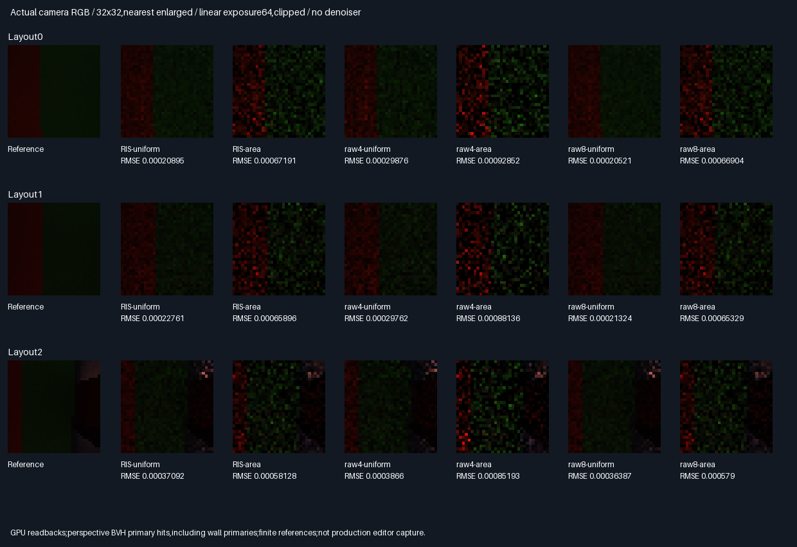

# Perspective-camera fresh area RIS holdout

## Outcome — bounded perspective holdout accepted

Both proposal types pass the frozen ordinary AND cross-reference image-MSE gates in all3 new views.
This extends the cheap pre-visibility fresh area-RIS result to pinhole cameras and wall-primary geometry.
It does not accept arbitrary scenes,physical GPU performance,temporal reuse or production integration.
No camera,score,proposal count or acceptance criterion was changed after measurements.

| Choice          | Rating   | Decision and reason                                                    |
|-----------------|----------|------------------------------------------------------------------------|
| Uniform RIS     | ⭐⭐⭐ 🏆 | Lowest same-query RMSE in all3 views;carry forward to broader holdouts   |
| Uniform raw8    | ⭐⭐⭐ 🏆 | Lowest absolute RMSE in all3 views;68 rather than36 counted calls/pixel |
| Area RIS        | ⭐⭐       | Passes own raw4 gates,but worse absolute RMSE than uniform here         |
| Raw4 controls   | ⭐        | Same query counts as RIS,lower measured image quality                  |
| Production/reuse| 🔴        | Not accepted by this bounded fresh diffuse test                        |

Stars rate the measured quality/query tradeoff;trophies identify their stated criterion.
Neither same-query evidence nor candidate counts establish equal elapsed time or physical GPU speed.

### Baseline and higher-query comparisons

| View | Uniform RIS RMSE | Uniform raw4 RMSE | Uniform raw8 RMSE | Uniform RIS/raw4 improvement |
|------|------------------|-------------------|-------------------|------------------------------|
| 0    | .000208947       | .000298760        | .000205212        | 30.06% lower                 |
| 1    | .000227607       | .000297622        | .000213242        | 23.52% lower                 |
| 2    | .000370916       | .000386599        | .000363871        | 4.06% lower                  |

| View | Area RIS RMSE | Area raw4 RMSE | Area raw8 RMSE | Area RIS/raw4 improvement |
|------|---------------|----------------|----------------|---------------------------|
| 0    | .000671912    | .000928525     | .000669041     | 27.64% lower              |
| 1    | .000658964    | .000881362     | .000653291     | 25.23% lower              |
| 2    | .000581284    | .000851933     | .000578996     | 31.77% lower              |

RIS/raw4 use36 calls/pixel including four primary queries;raw8 uses68. RIS therefore uses47.06% fewer total
calls than raw8,but has1.82–6.74% higher uniform RMSE and0.40–0.87% higher area RMSE. These are query counts,
not timings. RIS scores more candidate geometry than raw4;the shared ray budget is not equal total computation.
The previous BSDF/MIS reservoir test charged a candidate first-hit ray before selection;this area-only path
scores proposals without those rays and pays secondary visibility only for selected candidates.

[Every arm and paired interval](Results/PerspectiveAreaReservoir-comparison.md).
The view2 uniform paired cross-MSE interval is `[-1.32744e-7,1.08984e-7]`:it includes zero,so the4.06% realized
RMSE gain is not a robustly established advantage in that view. The other five intervals are below zero.
These64-tile normal approximations are descriptive,not confidence-certified general-scene performance.

### Actual images and primary geometry



[Absolute-error sheet](Images/PerspectiveAreaReservoirErrors.png),
[primary normal/depth/material sheet](Images/PerspectiveAreaReservoirGeometry.png).
All three sheets were visually inspected. Perspective produces slanted band boundaries;the third view includes
wall-primary silhouettes and different normal/material regions. Uniform RIS is less noisy than raw4 in the
first two views;the wall-view difference is modest. Raw8 remains the accuracy control,not a discarded result.

Each32×32 pixel averages four packets;images are nearest enlarged with linear exposure64/clipping,no denoiser
or TAA. Errors use linear scale1024/clipping;metrics use unclipped float readbacks. Geometry depth encodes
world z in[3.2,4.8],clipping nearer wall points. These are actual GPU captures,not generated illustrations.
Old orthographic images are not used as perspective references or compared as directly matching image errors.

### Verification and provenance

- Linux GCC12.2,Slang2026.14.1,SwiftShader CPU Vulkan. Release and host ASan/UBSan exit0,five CTests each.
- Nine identical semantic rows,67 runtime hashes/build,six byte-identical readbacks,two identical modules.
- Per build:491,520 independent candidate replays,393,216 selected/raw paths,786,432 binary secondary
  visibility decisions,73,728 double all-triangle primary checks. Zero selector/CDF ambiguities.
- Maximum normalized RGB error2.92e-8,normalizer error5.69e-7;fixed2e-5 tolerances unchanged. No secondary
  visibility exceptions. Primary ties permit only valid same-material,equal-distance shared-edge hits.
- All54 RGB aggregate mean gates pass;wrong density normalizer fails3/3 views per RIS proposal type.
- All3,072 unique primary pixel results differ from the old orthographic setup;view2 has172 wall-primary
  pixels. Independent image-plane reprojection checks validate the uploaded pinhole geometry.
- Removing six receiver facets changes2,047 positive source-light suffix decisions in the CPU control.
- New references:two3072-sample/pixel banks;18,874,368 reference GPU paths/build. Reference primary attributes
  match2,359,296 times/build. Seed banks are disjoint from experiments and each other;old manifest is unchanged.
- Combined-reference RMS noise estimates:1.532e-5/1.557e-5/2.262e-5. References use the same renderer/integral,
  not an external independent renderer;the independent native replay covers experimental paths.
- Retained:48 exact32×32 PNG arrays,three sheets,six lossless compressed buffers,two compressed modules,
  generating code/logs/means/metrics/manifests,about8.5MiB. PNG arrays are checked against GPU readbacks.

### Completion and next gate

Bounded implementation/evaluation100%,remaining0%. Overall renderer~80% complete/~20% remaining,
**planning estimates**,not measured product readiness. This accepts the perspective holdout only.
Production348.046875MiB/defaults remain unchanged. Packing/editor/vehicle/Jolt are deferred;no PR or Actions.
Host sanitizers do not instrument the driver/SPIR-V. Windows,physical GPU timing,arbitrary scene/material
holdouts,production C++ integration,temporal/spatial reuse,glossy and multibounce acceptance remain undone.

Next distinct problem:broader geometry/material holdouts before production integration. Preserve this camera
holdout and the rejected50/50 MIS results;do not tune against them or infer temporal acceptance from stills.

### Reproduce

Prepare the pinned [tools](../../Automation/PrepareReplayTools.py) and a Python environment with Pillow:

```bash
BUILD_JOBS=1 bash Exhibits/LightCompute/RunPerspectiveAreaReservoir.sh
SANITIZE=1 BUILD_JOBS=1 bash Exhibits/LightCompute/RunPerspectiveAreaReservoir.sh
_ClaudeScratch/venv/bin/python Exhibits/LightCompute/Code/PerspectiveAreaReservoirEvidence.py
```

[Shader](Code/PerspectiveAreaReservoirGpu.slang),[independent replay](Code/PerspectiveAreaReservoirValidation.h),
[evidence audit](Code/PerspectiveAreaReservoirEvidence.py),[runner](RunPerspectiveAreaReservoir.sh),
[Release](Results/PerspectiveAreaReservoir-release.txt),[sanitizers](Results/PerspectiveAreaReservoir-sanitized.txt),
[54 means](Results/PerspectiveAreaReservoir-means.md),[parity](Results/PerspectiveAreaReservoir-parity.txt),
[retained manifest](Results/PerspectiveAreaReservoir-evidence-hashes.txt).
Logs identify parent30ac222 plus changed files;runtime source/tool hashes identify the tested working tree.
The historical [geometric receiver phase](GeometricAreaReservoir.md) remains unchanged.


## Frozen protocol — before measurements

| Scope          | Fixed choice                                                                          |
|----------------|---------------------------------------------------------------------------------------|
| Scene          | Existing16-facet shared-BVH scene,three blocker layouts;not a new arbitrary-scene suite |
| Camera         | Pinhole eyes and screen planes below;32×32 pixel-centre rays,normalized float directions |
| Primary        | Actual closest BVH hit,including wall hits;face-oriented geometric normal and material |
| Arms           | RIS-uniform,RIS-area,raw4-uniform,raw4-area,raw8-uniform,raw8-area                        |
| Estimators     | Unchanged geometric phase;four packets/pixel,four two-proposal reservoirs/packet        |
| Target         | 1e-6+mean unoccluded transport;h/q selector;W/(2*hSelected) normalizer                    |
| Visibility     | Only selected suffix/connection rays for RIS;both endpoints offset0.002,far minus1e-5  |
| Calls          | RIS/raw4=36,pixel including four primary queries;raw8=68;not physical timing             |
| References     | New two disjoint uniform raw8 banks,3072 proposals/bank/pixel per camera/layout          |
| CPU            | Independent perspective construction,double primary all-triangle rays,RNG,PDFs,RGB,Z   |
| Tolerance      | Fixed normalized2e-5;selector/CDF margin2e-6,max16;no secondary visibility exceptions     |
| Means          | All54 RGB aggregate residuals≤6 estimated SE+2e-5                                       |
| Negative       | Wrong density normalization fails at least one mean gate per RIS proposal type         |
| Primary control| Perspective closest hits must differ from old orthographic hits in at least one pixel |
| Occlusion      | Removing six receiver facets changes at least one positive source-light suffix decision |
| Quality        | Per type,RIS ordinary AND cross-reference image MSE≤raw4 in all three new views         |
| Validation     | Release/host ASan+UBSan,five CTests each,semantic/readback/module parity,actual images    |

Pinhole eye positions for cases0/1/2:`(-.3,0,1.2)`, `(-.6,.15,1)`, `(-.4,-.25,1.3)`.
At z4,the image-plane point is `(centreX+halfX*(2u-1),1.2*(2v-1),4)`:
centreX/halfX are `(-.35,1)`, `(-.35,1)`, `(.25,1.25)` respectively. u/v are pixel-centre fractions.
Case2 deliberately includes wall-primary rays,not just the old receiver bands. All primary hits are required;
no background/miss handling or general-scene acceptance is inferred from this bounded holdout.

No score,mixture,sample-count,view or quality-gate tuning after measurements. Retain rejected outcomes.
Old orthographic images are not reused as perspective references. This is fresh area RIS,not BSDF/MIS or
temporal reuse. Production348.046875MiB/defaults remain unchanged;no packing,PR or Actions.
