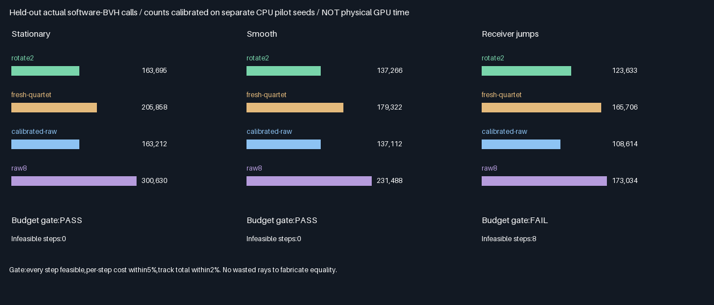
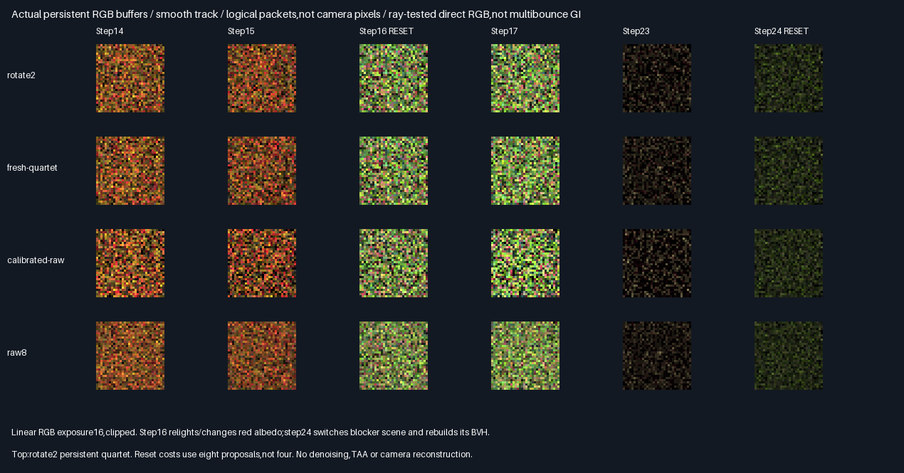

# Held-out expected-query-budget control

Implemented separate-seed pilot allocation and held-out GPU evaluation. Stationary/smooth costs match within
0.30%/0.11%,but rotate2 still has8.09%/4.48% worse rolling error. Jumping has8 infeasible zero-contribution steps.
No production promotion;the earlier reuse rejection remains.

## Actual held-out results



Methods use identical scene,receiver,epoch and candidate-seed inputs within this experiment. Count allocation is
frozen from4096 separate CPU pilot packets before any held-out output;1024 held-out packets/arm are measured.
Counts include suffix and connection queries,including all cold/relight/BVH resets,but exclude pilot CPU work.

| Track      | Rotate2 calls | Calibrated raw calls | Raw/rotate gap | Feasible steps | Budget gate |
|------------|--------------:|---------------------:|---------------:|---------------:|-------------|
| Stationary | 163,695       | 163,212              | -0.30%         | 32/32          | PASS        |
| Smooth     | 137,266       | 137,112              | -0.11%         | 32/32          | PASS        |
| Jumping    | 123,633       | 108,614              | -12.15%        | 24/32          | FAIL        |

Both feasible tracks satisfy every per-step5% and per-track2% held-out cost gate. Jumping fails because steps
4–7 and20–23 have zero raw contribution/queries for every held-out packet,while rotate2 still incurs birth
suffix queries. Pilot raw costs also saturate at zero:the positive rotate2 target cannot be bracketed by1..32
fresh samples. The protocol clamps to32 and marks infeasible;no wasted rays are introduced to fake equality.
The jumping aggregate must NOT be described as query-matched.

### Error at the measured budgets

RGB RMSE,lower is better. Rolling averages errors over up to four steps,restarting at epochs0/16/24—not TAA.

| Track      | Rotate2 instant | Raw instant | Rotate2 rolling | Raw rolling | Rotate instant gap | Rotate rolling gap |
|------------|----------------:|------------:|----------------:|------------:|-------------------:|-------------------:|
| Stationary | .009564490      | .011364224  | .007069822      | .006540812  | -15.84%            | +8.09%             |
| Smooth     | .009563775      | .011479585  | .006701587      | .006414074  | -16.69%            | +4.48%             |
| Jumping    | .007229241      | .008654673  | .005626963      | .005368181  | -16.47%            | +4.82%             |

Jumping errors are descriptive only at unequal costs. Both eligible tracks reject rotate2 on rolling quality,
despite better instant error. No thresholds,seed domains,mixture probabilities or scene parameters were tuned
after held-out results. [All four arms,counts,errors and paired intervals](Results/QueryCalibration-comparison.md).

| Additional reference | Stationary calls | Smooth calls | Jumping calls |
|----------------------|-----------------:|-------------:|--------------:|
| Fresh quartet        | 205,858          | 179,322      | 165,706       |
| Raw8                 | 300,630          | 231,488      | 173,034       |

### Decision

More stars means better measured accuracy;the trophy is accuracy only,not speed or production readiness.

| Method         | Accuracy | Decision and reason                                                       |
|----------------|----------|---------------------------------------------------------------------------|
| Raw8           | ⭐⭐⭐ 🏆 | Lowest instant and rolling error on all tracks;more queries               |
| Fresh quartet  | ⭐⭐     | No-history reference;lower rolling error than rotate2                     |
| Calibrated raw | ⭐⭐     | Lower rolling error at matched expected calls on two eligible tracks     |
| Rotate2        | ⭐⭐     | Instant improvement,but rolling gates fail;keep isolated from production |

## Verification and visible evidence

| Check                    | Result                                                                  |
|--------------------------|-------------------------------------------------------------------------|
| Release/host ASan+UBSan   | Five CTests each,plus targeted native execution                          |
| Build parity             | 674 semantic rows,147 runtime hashes/build,96 captures,two SPIR-V files   |
| Independent CPU          | Double all-triangle rays,selection,birth weights,RGB,outputs and counters |
| Descriptor comparisons   | 786,432/build;178,176 exact retained-byte checks;fixed2e-5 contract        |
| Allocation validation    | Replayed packet count stream;pilot interpolation and range/bracket checks |
| Mean gates               | 1,152 RGB means within empirical6SE+2e-5;not general unbiasedness proof   |
| Default-policy regression| 96 full buffers match previous query-elision archives exactly,Release   |
| Quality promotion        | 0/2 eligible tracks;third track blocked by cost infeasibility             |
| Production               | 348.046875MiB/defaults unchanged;no integration                           |



Linear exposure16/clipped;underlying float readbacks are retained. [Error graph](Images/QueryCalibrationComparison.png).

## Mechanism and limitations

- Shared Slang retains the quartet estimator and exact-zero/duplicate elision. A separate wrapper enables raw
  counts1..32 from the receiver payload. Count is chosen on the host before any candidate contribution is read.
- Pilot uses seed0x13579bdf;held-out candidates use0x90abcdef. A separate0xdecafbad count domain mixed with
  step/fixture chooses the low/high count using the pilot probability. No adaptive stopping on visibility,
  contribution,query count or partial sum. Each packet is normalized by9/N for its own preallocated N.
- Per-step pilot curves use the current known scene and source-RGB support,and simulate rotate2 history on
  4096 pilot packets. This is offline test calibration,not a deployable online allocator. Calibration CPU rays,
  geometry and bookkeeping are excluded from held-out query totals;no amortized performance claim follows.
- Seeds/domains separate pseudorandom streams,but formal RNG independence is not established. Mean gates and
  eight-block paired intervals are empirical checks;tracks share candidate streams and are not independent
  scene replications. No general-scene or formal statistical acceptance claim.
- Equal-weight software-BVH wrapper calls are a cost proxy,not equal physical time:suffix/connection rays have
  different lengths/work. No primitive-visit,hardware RT or physical-GPU speed claim. Table lookup,selection,
  dynamic loops,register/spill effects,source evaluation and host allocation overhead are untimed.
- Only eight finite points plus null are sampled,not a surface integral. Duplicate reuse/saturation here cannot
  be extrapolated to continuous sampling. The suffix is one directional Lambertian direct-light query,not
  multibounce GI or glossy transport. No camera reconstruction,TAA,production mutation hooks or renderer port.
- Compared with [proposal-budget controls](QueryElision.md),this adds held-out budget matching,not a changed
  reuse estimator. Different held-out seeds mean cross-report numerical error differences are not an algorithm
  improvement/regression. The prior-policy regression separately verifies identical old-input buffers.

## Progress and next bounded work

| Scope                       | Complete | Remaining | Meaning                                      |
|-----------------------------|----------|-----------|----------------------------------------------|
| Calibration experiment      | 100%     | 0%        | Code,tests,controls,evidence and report       |
| Eligible rolling promotion  | 0/2      | Rejected  | Instant gain does not offset rolling penalty |
| Full budget eligibility     | 2/3      | Blocked   | Jumping has8 impossible-to-match steps        |
| Overall ReSTIR/GI effort     | ~59%     | ~41%      | Planning estimates,not acceptance fractions   |

Done:descriptor/support,RGB selection/persistence,traced suffix/visibility,lossless elision and held-out cost
controls. Next:continuous area proposals and PDF/measure-correct reconnection on the fresh traced path;do not
keep tuning rejected rotate2 on these held-out seeds. Correlation-aware temporal reuse remains experimental.
Remaining:area/PDF support,multibounce,dynamic/camera/TAA/general-scene quality,physical GPU timing and production
integration after acceptance. Packing/editor/vehicle/Jolt stay deferred;production348.046875MiB stays untouched.

## Reproduction and retained evidence

| Configuration | Tested condition                                                              |
|---------------|-------------------------------------------------------------------------------|
| Source        | Base4bd5be2b63ae08dc70f6c4743c234762436cfc45 + logged source hashes               |
| Host          | Linux x86-64,Debian GCC12.2,CMake3.31.6;local validation only                    |
| Shader        | Slang2026.14.1,SPIR-V1.3,-O0                                                   |
| Vulkan        | Pinned SwiftShader CPU Vulkan and production software BVH;not hardware RT       |
| Sanitizers    | Host ASan+UBSan only;driver and SPIR-V uninstrumented                             |
| Untested      | Windows/MSVC,physical GPUs,production renderer,multibounce and arbitrary scenes |

Prerequisites:pinned tools in `Automation/ReplayToolDependencies.json`,Vulkan-Headers v1.4.321,Python/Pillow.
No application executable delivered. Reproduction:

```bash
BUILD_JOBS=1 bash Exhibits/LightCompute/RunQueryCalibration.sh
SANITIZE=1 BUILD_JOBS=1 bash Exhibits/LightCompute/RunQueryCalibration.sh
bash Exhibits/LightCompute/RunQueryCalibrationRegression.sh
_ClaudeScratch/venv/bin/python Exhibits/LightCompute/Code/QueryCalibrationEvidence.py
```

The regression runner recompiles the preceding default query-elision policy and runs it through the new
Release validator;the evidence generator compares all96 full buffers against prior retained archives.

- [Release](Results/QueryCalibration-release.txt),[host sanitizers](Results/QueryCalibration-sanitized.txt),
  [default-policy regression](Results/QueryCalibration-regression-release.txt).
- [Pilot allocations and held-out ratios](Results/QueryCalibration-allocation.md),
  [comparison](Results/QueryCalibration-comparison.md),[mean gates](Results/QueryCalibration-means.md).
- [Final audit](Results/QueryCalibration-parity.txt),[evidence hashes](Results/QueryCalibration-evidence-hashes.txt).
- [GPU wrapper](Code/QueryCalibrationGpu.slang),[shared estimator](Code/TracedQuartetGpu.slang),
  [CPU calibration/reference](Code/QueryCalibrationValidation.h),[evidence generator](Code/QueryCalibrationEvidence.py).
- Retain96 lossless readbacks,two compressed SPIR-V files,24 exact PNG arrays and three plots. Old baseline
  readbacks are referenced rather than archived twice. No packing,PR or Actions;backup on the session branch.

## Protocol frozen before measurements — 2026-10-29

One bounded problem: compare rotate2 to fresh raw sampling whose proposal count is calibrated to expected
software-BVH call cost,without contribution-dependent stopping. Prior quality rejections remain historical.

| Concern       | Fixed requirement                                                                                   |
|---------------|-----------------------------------------------------------------------------------------------------|
| Scene/tracks  | Previous ten-triangle fixtures,three receiver tracks,32 steps,relight16/blocker rebuild24 |
| Arms          | Rotate2,fresh quartet,calibrated fresh raw,raw8;all:exact-zero and packet-local duplicate elision |
| Calibration   | CPU double-ray model;4096 separate pilot packets/step,seed0x13579bdf;history simulated for rotate2 |
| Held-out      | 1024 packets/arm/step,seed0x90abcdef;never used to select proposal counts or mixture probabilities |
| Raw curve     | Pilot expected cost for fixed counts1..32;candidate sequence extends the previous raw pair sequence |
| Allocation    | Adjacent counts bracketing pilot rotate2 cost;independent count stream chooses each packet count     |
| Normalization | Each raw packet uses9/N times its N contributions;count is chosen before candidate evaluation       |
| Infeasible    | Clamp to1 or32 if pilot cost is outside raw curve;mark infeasible,never burn rays to fake a match |
| References    | Independent double rays,selection/weights/RGB,per-packet query masks and counts;fixed2e-5 contract   |
| Budget gate   | All steps feasible;held-out total cost within2% per track and5% per step of rotate2                  |
| Quality gate | Only after budget gate;rotate2 no worse instant AND reset-aware four-step rolling RMSE on all tracks |
| Means         | Per-arm/step/channel6SE+2e-5 empirical gate;retained descriptor bytes unchanged |
| Builds        | Release and host ASan/UBSan,five CTests each;semantic/capture/module parity |
| Evidence      | Retain allocation table,actual cost/error tables,readbacks,modules,plots and source hashes           |

Counts combine suffix and connection wrapper invocations with equal unit weight,not physical cost or time.
Calibration is per known test track/step,not an online production allocator. Pseudorandom streams are separated
by seeds/domains;formal RNG independence is not established. The eight-point finite domain may make cost
matching infeasible when raw queries saturate or contributions vanish;report that outcome rather than tuning.
No area sampling,multibounce,camera/TAA,physical GPU timing or production integration is claimed.

Production348.046875MiB/defaults remain unchanged. No packing,PR or Actions. Overall before this phase is
~57% complete/~43% remaining,planning estimates. Commit/push backup remains authorized on the session branch.
