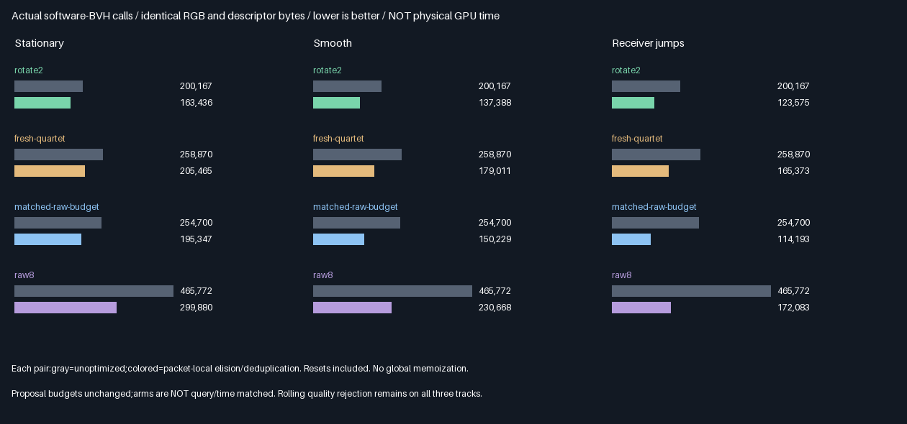

# Lossless packet-local query elision

Implemented exact-zero query elision and invocation-local duplicate reuse. RGB,descriptors,selection,proposals
and resets are unchanged. This phase tests cost preservation/reduction,not a new quality promotion.

## Measured outcome



| Track | Method | Before total | After suffix | After connection | After total | Reduction |
|-------|--------|-------------:|-------------:|-----------------:|------------:|----------:|
| Stationary | Rotate2 | 200,167 | 65,240 | 98,196 | 163,436 | 18.35% |
| Stationary | Fresh quartet | 258,870 | 107,290 | 98,175 | 205,465 | 20.63% |
| Stationary | Proposal-budget raw | 254,700 | 101,002 | 94,345 | 195,347 | 23.30% |
| Stationary | Raw8 | 465,772 | 154,935 | 144,945 | 299,880 | 35.62% |
| Smooth | Rotate2 | 200,167 | 65,087 | 72,301 | 137,388 | 31.36% |
| Smooth | Fresh quartet | 258,870 | 106,679 | 72,332 | 179,011 | 30.85% |
| Smooth | Proposal-budget raw | 254,700 | 83,707 | 66,522 | 150,229 | 41.02% |
| Smooth | Raw8 | 465,772 | 128,516 | 102,152 | 230,668 | 50.48% |
| Jumps | Rotate2 | 200,167 | 65,166 | 58,409 | 123,575 | 38.26% |
| Jumps | Fresh quartet | 258,870 | 106,998 | 58,375 | 165,373 | 36.12% |
| Jumps | Proposal-budget raw | 254,700 | 59,640 | 54,553 | 114,193 | 55.17% |
| Jumps | Raw8 | 465,772 | 89,822 | 82,261 | 172,083 | 63.05% |

All counts include cold starts,relight and blocker/BVH resets. Before is a fresh unoptimized replay,also exactly
matching the previous retained captures. After uses the same estimator and proposal budget with safe query
elision and packet-local duplicate reuse. It is not an exactly query-matched or time-matched comparison.

| Verification                     | Result                                                               |
|----------------------------------|----------------------------------------------------------------------|
| Release and host ASan/UBSan       | Both configurations;five CTests each plus both native execution arms   |
| Build parity                     | 1,156 semantic rows,244 runtime hashes/build,96 captures,four modules  |
| Non-query bytes                  | 113,246,208 identical bytes versus fresh and archived baselines         |
| Per-packet query counters        | 393,216 comparisons;no component exceeds baseline;CPU mask replay      |
| Descriptors                      | 786,432 comparisons per execution;178,176 exact retained-byte checks  |
| First moments                    | 1,152 RGB mean gates within6SE+2e-5                                   |
| Quality                          | Identical outputs/errors;previous promotion rejection remains3/3     |
| Production                       | No integration;348.046875MiB/defaults unchanged                         |

### Corrected cost interpretation

| Track | Rotate2 vs optimized proposal-budget raw | Rotate2 vs optimized raw8 |
|-------|----------------------------------------:|-------------------------:|
| Stationary | -16.34% | -45.50% |
| Smooth | -8.55% | -40.44% |
| Jumps | +8.22% | -28.19% |

Signed percentages compare total calls;negative means rotate2 uses fewer. The earlier21.41% advantage over
proposal-budget raw is no longer a universal result:in the jumping track rotate2 now uses8.22% MORE calls.
It also retains19.64% worse rolling RMSE there. Stationary/smooth rotate2 still trade fewer calls for worse
rolling error. Raw8 retains the lowest instant and rolling RMSE on every track at higher call counts.

### Decision table

More stars means better measured accuracy,not speed or production readiness. Trophy is accuracy only.

| Method              | Accuracy | Choice and reason                                                       |
|---------------------|----------|-------------------------------------------------------------------------|
| Raw8                | ⭐⭐⭐ 🏆 | Best instant/rolling reference;now substantially cheaper than old raw8  |
| Proposal-budget raw | ⭐⭐     | Lower rolling error than rotate2;also fewer calls on jumping track      |
| Fresh quartet       | ⭐⭐     | No-history reservoir reference;retains real reusable descriptor RGB     |
| Rotate2             | ⭐⭐     | Some query/error tradeoffs remain;all previous quality gates still fail |

Acceptance here is lossless call reduction for all12 track/arm combinations,not production promotion. Output
identity makes the preceding6.65–9.60% instant improvement and19.64–23.97% rolling penalty unchanged. See the
[full quality comparison](Results/QueryElision-comparison.md) and [prior frozen rejection](TracedQuartet.md).

## Mechanism and limits

- The optimized Slang wrapper enables shared traced-quartet code;the default unoptimized configuration remains
  available and is rerun in both builds. No separate estimator or replacement production ray implementation.
- Eight-point invocation-private suffix/connection tables deduplicate exact facet identities at fixed(.2,.3).
  They do not persist across pixels,dispatches,epochs or receiver changes. Connection reuse requires exact UV.
- Raw estimators reject zero current geometry before any ray,then reject all-zero traced RGB before connecting.
  Quartet evaluation applies the same zero-contribution rules. Selected descriptor birth still traces/caches
  real outgoing RGB even at zero birth geometry,because that descriptor may contribute at future receivers.
- No threshold approximations:only exact zeros are elided. RNG draws,selection,birth weights and accumulation
  order stay unchanged. Duplicate rays reuse their result,not their Monte Carlo sample weight or multiplicity.
- Independent CPU double all-triangle rays reconstruct geometry,source RGB and visibility. Integer proposal
  replay and per-packet masks predict actual suffix/connection wrapper calls;fixed2e-5 contracts are unchanged.
- Finite eight-point sampling makes duplicates frequent;do not extrapolate this benefit to continuous area
  sampling. Global eight-point memoization and other possible optimizations are absent. This is not a fully
  optimized renderer or a global optimal-cost claim. Added invocation-private tables may increase registers or
  spills;their physical cost is unmeasured. No production persistent buffer size changes.
- Software-BVH wrapper counts are not primitive visits,hardware RT invocations or physical speedup. Suffix and
  connection queries have different costs. Selection,geometry,table lookup and history overhead are untimed.
- Same direct Lambertian directional suffix and toy tracks as before;not multibounce GI,glossy transport,
  camera imagery,TAA,general-scene acceptance,or production mutation hooks.


Arrays are actual readbacks,linear exposure16/clipped. All underlying output floats—not just displayed pixels—
match the old capture bytes. [Unchanged error graph](Images/QueryElisionComparison.png).

## Progress and next bounded work

| Scope                         | Complete | Remaining | Meaning                                      |
|-------------------------------|----------|-----------|----------------------------------------------|
| Lossless elision experiment    | 100%     | 0%        | Implementation,tests,comparisons and evidence |
| Quality promotion             | 0/3      | Blocked   | Previous rolling rejection remains           |
| Overall ReSTIR/GI effort       | ~57%     | ~43%      | Planning estimates,not acceptance fractions   |

Done:descriptor/support,RGB selection/persistence,ray-tested suffix/visibility,integration and optimized
proposal-budget controls. Next:independently calibrated,held-out expected-query-budget fresh controls;do not
stop sampling adaptively based on the observed contribution/visibility,which can bias the estimator.
Remaining:correlation acceptance,continuous area proposals/PDFs,multibounce,dynamic/camera/TAA/general-scene
quality,physical GPU timings and production integration after acceptance. Packing/editor/vehicle/Jolt deferred.

## Reproduction and retained evidence

| Configuration | Tested condition                                                            |
|---------------|-----------------------------------------------------------------------------|
| Source        | Basef85ea4c7e91771d1d3d1cfa2380b2fd0f07e384d + logged source hashes           |
| Host          | Linux x86-64,GCC12.2,CMake3.31.6;local validation only                       |
| Shader        | Slang2026.14.1,SPIR-V1.3,-O0                                                 |
| Vulkan        | Pinned SwiftShader CPU Vulkan,production software BVH;not hardware RT        |
| Sanitizers    | Host ASan+UBSan only;driver/SPIR-V uninstrumented                             |
| Untested      | Windows/MSVC,physical GPUs,editor/production renderer and multibounce         |

Prerequisites:pinned tools in `Automation/ReplayToolDependencies.json`,Vulkan-Headers v1.4.321,Python/Pillow.
No application executable is delivered. Commands:

```bash
BUILD_JOBS=1 bash Exhibits/LightCompute/RunQueryElision.sh
SANITIZE=1 BUILD_JOBS=1 bash Exhibits/LightCompute/RunQueryElision.sh
_ClaudeScratch/venv/bin/python Exhibits/LightCompute/Code/QueryElisionEvidence.py
```

- [Release log](Results/QueryElision-release.txt),[host sanitizer log](Results/QueryElision-sanitized.txt).
- [Final audit](Results/QueryElision-parity.txt),[evidence hashes](Results/QueryElision-evidence-hashes.txt).
- [Measured cost table](Results/QueryElision-cost.md),[RGB mean gates](Results/QueryElision-means.md).
- [Slang wrapper](Code/QueryElisionGpu.slang),[shared estimator](Code/TracedQuartetGpu.slang),
  [CPU replay](Code/TracedQuartetValidation.h),[evidence generator](Code/QueryElisionEvidence.py).
- Retained optimized96 lossless readbacks,four compressed SPIR-V files,24 exact PNG arrays and three graphs.
  Unoptimized readbacks reuse the byte-identical preceding retained captures rather than duplicate archives.

No packing,PR or Actions. Commit/push backup authorized on the current session branch only.

## Protocol frozen before measurements — 2026-10-29

One bounded problem: remove provably redundant software-BVH calls without changing the estimator,proposal RNG,
selection,descriptor bytes,reset policy or RGB output. Preserve the preceding traced-quartet rejection.

| Concern       | Fixed requirement                                                                                   |
|---------------|-----------------------------------------------------------------------------------------------------|
| Inputs        | Previous three tracks,32 steps,1024 packets per arm,ten triangles,first8 points plus null |
| Arms          | Rotate2,fresh quartet,proposal-budget raw,raw8;same proposal budgets as TracedQuartet |
| Resets        | Steps0/16/24;all reset and suffix rebuild work included |
| Suffix reuse  | Deduplicate exact facet/.2/.3 suffix queries within one invocation only;no history/global memo table |
| Connections   | Skip exact zero geometry or all-zero RGB;deduplicate exact facet/receiver connections per invocation |
| Raw order     | Geometry first,then suffix,then connection only if RGB is nonzero |
| Descriptors   | Always construct real outgoing RGB for selected descriptors,even if birth geometry is zero           |
| Scope         | No cross-packet,dispatch or epoch memoization;no extra persistent production storage |
| CPU           | Independent double rays and mask replay;fixed2e-5 estimate/weight contract |
| Losslessness | Every non-query output byte equals both fresh unoptimized execution and prior retained captures      |
| Counters      | Every packet suffix/connection counter equals CPU replay and never exceeds its baseline |
| Acceptance    | Losslessness,CPU correctness,retained bytes,and fewer total calls on every track and arm |
| Quality       | Recompute instant/reset-aware four-step rolling RMSE and mean gates;no quality promotion by elision |
| Builds        | Release plus host ASan/UBSan,five CTests each;optimized/unoptimized execution and cross-build parity |
| Evidence      | Retain optimized captures/modules/logs,actual-array visual evidence and comparison graph/table |

This is an optimized proposal-budget control,not an exactly query-matched or time-matched experiment.
Connection costs and suffix costs differ;wrapper calls are not physical GPU timing. Quartet descriptor birth
requires reusable RGB even when current geometry is zero;raw estimators need only the current contribution.
No claim of a globally optimal implementation:finite-point global memoization is deliberately excluded.

Production348.046875MiB/defaults remain unchanged. No packing,PR or Actions. Overall progress before this phase:
~55% complete/~45% remaining,planning estimates. Physical GPU,Windows,area proposals,multibounce,camera/TAA and
production integration remain unvalidated.
