# Vulkan primary visibility, light history and reconstruction

## Held-out expected-query-budget control — 2026-10-29

[Separate-seed pilot allocation,held-out costs and rejected promotion](QueryCalibration.md):4096 CPU pilot
packets choose adjacent fresh raw counts1..32;1024 held-out GPU packets/arm use9/N normalization with no adaptive
stopping. Stationary/smooth costs match within0.30%/0.12%,but rotate2 rolling RMSE is8.09%/4.48% worse. Jumping
has8 infeasible zero-contribution steps and is not query-matched. Both eligible quality gates reject reuse.
Both builds/CPU reference and mean gates pass;default-policy regression preserves96 old buffers exactly.
Phase100%;overall~59%/~41% remaining,planning estimates. Next:continuous area proposals/PDF-correct fresh
reconnection. Production348.046875MiB/defaults unchanged;no physical timing,PR or Actions.


## Lossless packet-local query elision — 2026-10-29

[Optimized controls,unchanged RGB and corrected cost comparison](QueryElision.md):safe exact-zero elision and
invocation-local duplicate reuse preserve113,246,208 non-query bytes. Release/host ASan+UBSan compare both
optimized and unoptimized execution against prior captures. Every arm/track uses fewer calls than before.
On jumping receivers,optimized proposal-budget raw uses114,193 calls versus rotate2's123,575,and has lower
rolling error. Earlier quality rejection remains3/3. No physical speedup or exactly query/time-matched claim.
Bounded phase100%;overall~57%/~43% remaining,planning estimates;production348.046875MiB/defaults unchanged.
Next:independent calibration and held-out expected-query-budget controls before further promotion decisions.


## Traced RGB quartet integration — 2026-10-29

[Integrated selected suffixes,visibility,actual calls and rejected promotion](TracedQuartet.md):both builds pass
786,432 CPU descriptor comparisons/build,178,176 retained-byte checks and1,152 mean gates;96 captures match.
Rotate2 makes200,167 calls/track versus465,772 raw8 and254,700 proposal-budget raw,including resets. Instant
error improves6.65–9.60% versus the latter,but rolling error worsens19.64–23.97%;all3 quality gates fail.
Baselines deliberately query every non-null candidate and are not query/time matched or fully optimized.
No physical speedup/production promotion;348.046875MiB/defaults unchanged. Fair optimized controls are next.


## Ray-tested RGB suffix and visibility — 2026-10-29

[Complete direct-light suffix/reconnection gate and actual buffers](RgbTrace.md):production software-BVH shadow
and receiver-segment queries now control RGB. Cached/inline results match bitwise;40,960 independent CPU binary
reference rays agree. Both builds pass,five CTests each;six captures match. Omitting visibility leaks light on921
records. Cold cached/inline paths both use two calls/valid descriptor:no warm saving,quality or speed promotion.
Prior rolling-error rejection remains;production348.046875MiB/defaults unchanged. Multibounce GI is not established.


## Persistent RGB quartet reuse — 2026-10-29

[Complete persistence test,reset costs and rejected promotion](RgbReuse.md):two reservoirs retained/two refreshed;
786,432 descriptor comparisons/build and178,176 retained-byte checks pass. Both builds match96 captures and
all1,152 mean gates pass. Versus the matched raw budget,instant RGB RMSE improves8.08–12.33%,but four-step
rolling error worsens15.32–20.18%;all3 frozen promotion gates fail. Draws−45.3125% versus raw8 are not rays
or speed;including birth scores,logical geometry evaluations rise10.25%. Production348.046875MiB unchanged.


## Integrated RGB quartet selection — 2026-10-29

[Selector correctness,actual buffers and negative quality result](RgbQuartet.md):two Vulkan dispatches select,
write,read and evaluate four32B RGB facet descriptors. Both builds pass327,680 descriptor comparisons each;
20 captures match and96 correct/raw RGB mean gates pass. Fresh quartet RGB RMSE is9.06–67.82% HIGHER than
same-eight raw candidates;144B versus272B logical storage is not a fresh-quality or speed promotion.
Persistent reuse,traced RGB and visibility remain next work. Production348.046875MiB/defaults stay unchanged.


## RGB facet descriptor and positive support — 2026-10-29

[Complete descriptor/support gate and actual readbacks](FacetReservoir.md):shared32B descriptor,144B logical RGB
quartet,24,576 exact byte roundtrips per build and768 finite RGB checks pass. Release/host-sanitized captures
match exactly. Static typed-buffer SPIR-V stride32 is separately checked;runtime uses two float4 wire slots.
Zero birth-geometry scores fail future-visible support. This is not integrated RGB sampling or new GI quality.
Production348.046875MiB/defaults and prior scalar quartet evidence stay unchanged;packing remains deferred.


## Four weighted reservoirs — 2026-10-29

[Complete five-fixture comparison and new holdout](WeightedQuartet.md):80B logical scalar history versus144B raw
bank passes the fixed corrected-Fresh8 quality/query gate on all five strips,including new .45. Queries fall
17.51–24.00%,instant RMSE27.62–37.82%,temporal RMSE8.60–16.12%. Both builds and1,280 mean gates pass.
Raw Rotate4 remains more accurate;Fresh6 remains cheaper. No allocated-memory,physical-time or general RGB/GI
claim. Production348.046875MiB/Engine/layout/defaults stay unchanged;packing remains deferred.


## Two weighted reservoirs — 2026-10-29

[Complete lower-storage experiment,actual buffers and rejection](WeightedPair.md):positive geometry selection
retains correct birth weights in48B logical payload versus144B for eight raw candidates. Both builds and896
mean gates pass,but temporal quality worsens2.05%/1.19% on .12/.3 versus corrected fresh8. Query calls fall
19.52–26.86%;this is a budget tradeoff,not a quality-neutral replacement or physical timing/allocation result.
All previous12-arm controls remain unchanged. Production348.046875MiB/Engine/layout/defaults stay untouched.


## Confirmed visibility reuse and fair query baseline — 2026-10-29

[Numerical cause, corrected reuse, actual readbacks and full baseline comparison](VisibilityReuse.md).
Original/reconstructed direction.x differs by one ULP on three retained rays;the reconstructed visibility stays
authoritative. Confirmed-result reuse leaves all estimates/payloads unchanged. With both sides optimized,
rotate4 uses16.18–21.80% fewer queries and has14.07–16.65% lower temporal RMSE than fresh8. Fresh6 is cheaper
than rotate4;rotate2 still loses fresh8 temporal quality. These are restricted component/query results,not timings.
Eight-slot prototype memory remains unresolved;production348.046875MiB/layout/defaults stay unchanged.


## Fresh direct lighting + indirect-only replay — 2026-10-28

[Implemented split, actual colored-room captures, uncertainty and explicit work](ReplayIndirectSplit.md).
First-bounce lighting is sampled fresh and added outside reservoir weights; only deeper transport is reused.
Same-seed decomposition, exact direct-only isolation and matched fresh/whole controls pass. No general promotion:
plane RMSE is 1.03% worse; the room's observed 72.45% reduction is only a 0.99-SE paired MSE result.
Transport queries rise 42.83% / 17.36% versus whole Fresh8. Production defaults and output allocation are unchanged.
Stronger MIS baselines and removal of duplicated first-hop tracing remain next acceptance work.


## Full fresh-sample budget on history reset — 2026-10-28

[Implemented fallback, exact continuation checks, readbacks and measured cost](ReplayResetBudget.md).
The isolated reset branch executes Fresh8 instead of reduced spatial RIS: 68 reset images match Fresh8 exactly,
225 non-reset continuations are byte-identical, and source/bank normalization is unchanged. Observed reset red
RMSE improves 29.05% while current calls increase 128512→262144; this is not an equal-time temporal-quality win.
Production defaults and the 348.05 MiB output-only extrapolation stay unchanged. Direct/indirect separation is next.


## Independent emitter-enabled holdout — 2026-10-28

[Fixed specification, first-batch readbacks, reset-budget diagnosis and results](ReplayTemporalHoldout.md).
Four independently seeded 32-batch conditions cover stationary/camera/blocker motion and higher diffuse albedo.
All mean gates pass; no quality promotion gate passes. The blocker transition globally resets history, leaving
roughly four rather than eight current calls; newly exposed pixels remain in the measurement.
Keep production unchanged. Next implementation targets are fresh-budget reset fallback and indirect-only reuse,
not post-result tuning of whole-path temporal weights. No physical-GPU speed claim; 348.05 MiB output stays accepted.


## Bounded temporal + seed-bank prototype — 2026-10-28

[Weighting decision, cached current evaluations, actual readbacks and all-condition results](ReplayBoundedTemporal.md).
Count-matched temporal history replaces one spatial donor, with at most eight current calls in the measurement ROI.
Exact current-evaluation caching avoids duplicate tracing without dropping proposals or changing normalization.
Observed four-bounce RMSE is 13.06% lower without explicit emitter sampling, but worse with it; **no general
promotion or physical-GPU speed claim**. Production defaults and the accepted 348.05 MiB output-only allocation
extrapolation remain unchanged; packing remains deferred.


## Temporal measure and selected-source safety — 2026-10-28

[Mathematical contract, actual NaN repair and Vulkan evidence](ReplayTemporalContract.md):
120 exhaustive finite-model configurations and 18 GPU motion/source conditions pass. Repaired malformed
selected-history descriptors that could yield NaN; valid history output remains byte-identical to the old shader.
Release/host sanitizer, ten corruption cases, count-68 boundary and compact regression pass.
This is a correctness gate, not a new quality/speed win. Temporal + seed-bank RIS stays disabled;
**348.05 MiB output-only 1080p extrapolation** stays accepted for now, with packing deferred.


## Eight-current-path comparison — 2026-10-28

[Equal-current-path results, actual readbacks and separately counted warm-up](ReplayPathBudget.md):
eight fresh paths beat spatial seed RIS in three of four observed RMSE conditions; reuse is 12.55% lower
in the four-bounce case without explicit emitter sampling, but that benefit is not a clear 2-SE result.
All four mean/reference gates pass in Release and host ASan/UBSan. Reuse remains opt-in, not a general win.
The user accepts **348.05 MiB output-only at 1080p for now**, extrapolated rather than allocated/rendered;
further packing is deferred. No equal-time or physical-GPU performance claim.


## Compact seed-history storage — 2026-10-28

[Actual Vulkan allocations and byte-identical readbacks](ReplayCompactStorage.md): opt-in shared C++/Slang compact
layout reduces 64×64 output allocation from 2,868,240 to 720,896 bytes. Release/host sanitizer, 14 paired
motion/reset/corruption/miss frames, four paired capture frames and legacy reference regression pass.
Output-only extrapolation remains 348.05 MiB at 1080p; accepted for now, further packing deferred.
Production integration and device storage-range acceptance remain open.


## Retained-seed reservoirs and spatial replay — 2026-10-28

[Native C++/Slang continuation and actual readbacks](ReplaySeedReservoir.md): default-off seed-bank RIS now
combines with current-surface spatial replay. Final Release/host sanitizer, independent one/four-bounce
references and inactive-mode regression passed on SwiftShader CPU Vulkan. Four-bounce fixture RMSE is
0.152946 for four-path seed averaging versus 0.097017 for spatial RIS with up to eight current paths;
not equal work or a speedup. General ReSTIR, game-memory budget, viewport and physical GPU acceptance remain open.


**Actual Vulkan execution:** shared Slang now performs clustered analytic lighting, temporal/spatial reservoir
reuse, reprojection rejection, temporal moments and edge-aware reconstruction on the original ControlVehicle.
The tested device is **SwiftShader Device (Subzero), CPU type 4**, Vulkan 1.3.0, Slang 2026.14.1.
No physical GPU, hardware ray-query or Windows execution is claimed.

## Thin-pane emitter, volumetric fog shafts and multi-stratum mixtures — 2026-10-26

[Actual clerestory studio shafts and thin-pane acceptance](PaneTransmittance.md): `SegmentShadowTransmittance`
applies Fresnel + RGB Beer transmittance across up to seven thin panes (`CrossedPanes < 8` BSDF continuation) in
surface area-emitter quadrature (`2,016` probes, max `1.54e-8`), analytic volumetric fog (`922` probes, max `7.09e-7`)
and emissive volumetric fog (`541` probes, max `1.45e-6`), plus monotonic native quadrature convergence across four
reused multi-stratum presets (`racing-green`, `performance-rubber`, `pp-polypropylene`, `indigo-denim`). Pinned
`f5d99d4` negative control and all five static vehicle PNG byte streams verified. Software Vulkan only.

## Six-pose closed-glass vehicle motion — 2026-10-26

[Actual moving glazing animation and acceptance](GlazingMotion.md):6/6posed closed-glass vehicles and
body-mounted mirrors;3547glass/72mirror observations exactly fresh,17718static opaque reuse and23040black
source-off pixels. Faint absorbing paths use compensated survival without raising2048interaction limits.
240production-block numerical cases and the complete retained optical regression pass. Software Vulkan only;
geometry changes still conservatively reset indirect history, not continuous moving authored reuse.

## Derived closed vehicle glazing — 2026-10-26

[Actual vehicle glazing](VehicleGlazing.md): three nominal6mm closed components from the retained74 window
triangles, saved native IOR/RGB absorption, shared-edge and long-TIR corrections. Fresh software Vulkan vehicle
acceptance and the complete retained transport regression chain passed. No editor/physical-GPU completion claim.

## Saved closed-volume material coefficients — 2026-10-26

[Native saved-glass authoring](SavedDielectric.md) adds strict optional `[DielectricVolume]` IOR/RGB absorption
metadata, retains it through disk round trips and native material compilation, and uploads the compiled
coefficients into actual Vulkan slab validation. The studio surface approximation is unchanged: no glass
editor controls or full-renderer importer claim. The retained vehicle's 74 glass triangles have 68 unmatched
exact-position edges, so their thin-sheet assignment is preserved rather than blindly changed to solid glass.

## Smooth glass: camera, mirror, rough reflector, window and compact diffuse — 2026-10-25

[Primary glass](SolidDielectric.md), [mirror](MirrorDielectric.md), [rough reflector](RoughDielectric.md),
[window → glass](WindowDielectric.md) and [compact diffuse → glass](DiffuseDielectric.md) provide actual captures
and focused acceptance. All receiver classes now share one bounded volume-trace site; compact receivers keep
their uploaded cosine samples and diffuse response. This is not full material/PDF, rough/nested glass, complete
saved-material/editor integration, unified-scene or physical GPU/editor completion. [Done/remaining table](RendererProgress.md).

## Lower-cost working cloud preset — 2026-10-25

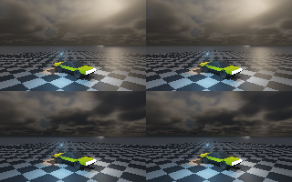

At the user's request, the working fog-scene preset now uses **32 cloud view/cube/surface-shadow steps and
32 cloud-shadow steps per fog sample**, rather than 64. Cloud self-shadowing stays at 6 samples and fog view
integration at 32. Geometry, cloud density, original ControlVehicle and both lighting types are unchanged.
This supersedes the earlier 64-shadow working preset; the historical quality-study results below remain valid.
Dedicated high-budget reference fixtures are intentionally retained, not silently weakened.

| Same-scene 32 vs finite 64 | Wind 0 s | Wind 120 s |
|--------------------------|----------|------------|
| Full-image linear RGB RMSE | 0.00207406 | 0.00187121 |
| Maximum channel difference | 0.0479916 | 0.0713069 |

These are actual 160×100 readbacks. Visual inspection found the lower budget suitable for iteration, not final
cloud quality. Local differences remain around cloud/horizon structure; 64 samples are not ground truth.
The outer cloud/shadow sample counts are halved, **not a measured 2× frame-time improvement**. No GPU timing,
FPS, physical-device or real-time claim. Device remains SwiftShader CPU Vulkan.

The comparison passed 468 native fog-ray and 236 native sky-cloud probes. A separate low-only execution
passed another 234 fog-ray and 118 sky-cloud probes. Maximum sky-cloud discrepancy was 1.78318e-5; fog
composite discrepancy 9.67208e-6. The changed default also passed the 654-camera/270-surface fog regression,
zero density, geometry occlusion, history isolation, toggles and bounds; native CTests passed 4/4.
These are fresh Release checks; no new sanitizer run is claimed for this preset-only continuation.

```bash
# Normal iteration: only lower-budget renders, two wind positions.
PREPARE=1 bash Exhibits/LightCompute/RunCloudPreview.sh
# Explicitly opt into the more expensive side-by-side reference study.
COMPARE=1 bash Exhibits/LightCompute/RunCloudPreview.sh
```

The CLI modes are `--cloud-preview` and `--cloud-budget`. Ordinary `--fog-rays`, `--fog-sky` and `--fog-checks`
now use 32 cloud and fog-shadow steps; `--fog-sampling` retains the original cloud64 fixture and explicitly
varies shadow budgets. Old images/manifests are historical, not relabelled as lower-budget captures.
Exact parameters, raw RGB hashes and logs: `Results/CloudBudget.json`, `CloudPreview.json`,
`CloudBudgetRegression.txt` and `CloudPreviewNative.txt`. Packagers verify CRCs and decoded RGB identity.

## Emissive surfaces illuminating fog — executed

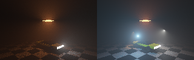

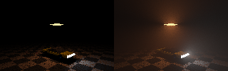

The shared Slang fog integrator now samples **emissive triangles inside the volume**, rather than only
attenuating their surface-lighting paths. It reuses the area/luminance CDF and uniform triangle samples,
converts area to solid angle, applies HG phase, triangle-BVH visibility and analytic emitter-to-volume fog
extinction, then integrates with the existing exact camera-segment weights. No surface BRDF or receiver
cosine is applied to a volume sample. Emission is two-sided, matching the existing surface convention.

| Verification | Result |
|--------------|--------|
| Actual Vulkan capture | Four 160×100 frames, 117 native probes each |
| ASan/UBSan numeric fixture | Four 64×40 cases, 112 native probes each |
| Maximum captured native/Vulkan RGB discrepancy | 1.59192e-5 |
| Independent rectangle solid-angle normalization | 131,072 native samples; 0.0446% relative error |
| Isolated volume contribution | Adds light; removing geometry occlusion increases radiance |
| Safety / isolation | Cold repeat, surface-radiance isolation, zero density, empty CDF and invalid inputs checked |

The calibration scene retains the **original 25,068-facet ControlVehicle** and ground (28,276 input facets),
plus an explicitly added two-triangle 2×2 m panel at z=6 m, radiance RGB=(35,9,2). Existing emissive facets
are retained. Original analytic lights are disabled only in the isolation cases and restored in the combined
capture. Ambient/sky and cloud scattering are disabled in this fixture to expose the area-light contribution.
Fog is extinction 0.07/m, scale height 12 m, albedo 0.9, HG g=0.25, maximum camera distance 70 m,
128 view midpoints and 16 emitter samples per midpoint. This is a disclosed calibration fixture, not the
previous daylight scene, a new vehicle model, an emissive-material boost or postprocessed beam imagery.

**Compatibility:** reserved fog scalar `Fog[15]` now selects 0–64 area samples per view midpoint.
The default remains **0**: existing analytic/surface-light presets and archived comparisons are unchanged.
The new path is explicitly enabled in this fixture, including with the original analytic lights. Analytic
source evaluation and emissive surface sampling are not removed or replaced. Emissive selection uses the
existing global importance CDF; spatial clustering is not necessary for correctness and is not claimed here.

`FogFacet0/1/2/3.png` correspond to in-scattering off / on / volume geometry occlusion off / both lighting types.
`Results/FogFacets.json` retains exact parameters, native comparisons and raw RGB hashes. The packager verifies
PNG CRCs and decoded RGB identity. Linux GCC 12.2 Release captures and RelWithDebInfo ASan/UBSan checks;
external-driver leak detection is disabled, not a global leak-free claim. Device: **SwiftShader CPU type 4**.
Thirteen compute entries, eight SSBOs and 128-byte pushes remain unchanged; no 64-bit shader feature added.

```bash
PREPARE=1 bash Exhibits/LightCompute/RunFogFacets.sh
```

Run serially. This compiles all entries, restores native inputs, builds the sanitizer executable, checks the
64×40 fixture and captures the 160×100 fixture. The focused CLI modes are `--fog-facet-checks` / `--fog-facets`.
Legacy fog sanitizer checks, exact/cluster/overflow, static/moving history, light-off/current-residual refresh
and all four native CTests passed; details are retained in `Results/FogFacetRegression.txt`. An initial legacy
history run used the primary-motion input (without uploaded raster receivers), correctly failed its coverage
assertion, and was rerun successfully using native raster/motion fixtures; the retained note explains this.

Finite area samples can be noisy; 128 regular view midpoints do not establish view convergence. Source
segments within 4 mm are omitted for numerical safety. Multiple scattering, fully coupled inter-bounce
transport, temporal fog, final cloud appearance, production viewport and physical GPU/Windows/real-time
acceptance remain open. Existing Sun/flare/stars are untouched; Moon remains planned.

## Fog shadow-sampling refinement — executed

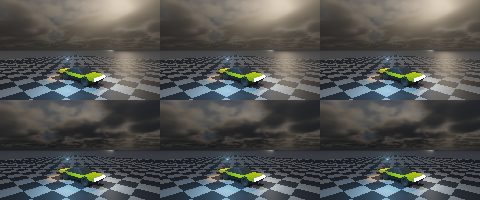

Only the cloud-shadow integration budget changes within each row. The original ControlVehicle, geometry,
Sun, procedural density, analytic lights and four-sample emissive/diffuse transport remain fixed.
These are **160×100 actual Vulkan renders**, not upscaled 320×200 images or a redesigned cloud field.

| Wind (s) | 16-step RGB RMSE | 32-step RGB RMSE | 64-step RGB RMSE | Reduction, 16→64 |
|----------|-----------------|-----------------|-----------------|-----------------|
| 0        | 0.00400171      | 0.000836603     | 0.000137084     | 96.57%          |
| 120      | 0.000453626     | 0.0000789365    | 0.000016385     | 96.39%          |

Errors use all 16,000 linear RGB pixels against **finite 128-step quadrature**, not converged ground truth.
64-step maximum absolute channel errors are 0.00275564 / 0.000350177, versus 0.0468006 / 0.00636348 at 16.
All eight budgets/wind combinations passed 117 independent native composite-ray probes each (936 total);
maximum native/Vulkan discrepancy was 1.0159e-5. The native reference uses double-precision integration and
native procedural cloud density, with the matching finite budget. This checks implementation agreement,
not physical correctness or convergence of 128 samples.

At this archived checkpoint the **exhibit preset** used 64 shadow samples and 32 camera midpoints;
the user-requested lower-cost working preset above now supersedes it. This is four times
as many shadow samples, not a measured speed improvement. The earlier 320×200 images below are retained
unchanged at their original 16-step budget. `Results/Fog.json` describes those historical captures;
`Results/FogSampling.json` describes this new study. Regular view stepping, temporal fog and final cloud
shape/sky appearance remain open. SwiftShader CPU only; no physical-GPU, Windows or real-time acceptance.

**Fresh verification:** the promoted preset passed 654 camera-ray and 270 surface-arrival probes,
analytic/zero-density checks, geometry occlusion, history isolation, enable/disable cold equality and bounds.
An additional 80×50 budget study passed 1,040 native comparisons under ASan/UBSan. Both sanitizer commands
exited 0; external-driver leak detection was disabled, not a global leak-free claim. The four native CTests
also passed. Logs: `FogSamplingPresetChecks.txt`, `FogSamplingSanitizers.txt`, `FogSamplingRegression.txt`.
The existing subset diagnostic now compares shadow64→128, not the vacuous shadow64→64: its largest red
change is 0.000818986 on the first twelve rays; view32→128 still changes red by up to 0.00202864.
These subset values are not full-image convergence bounds.

Sanitizer reproduction: configure a separate CMake build with `-DCMAKE_BUILD_TYPE=RelWithDebInfo`,
`-DCMAKE_CXX_FLAGS="-fsanitize=address,undefined -fno-omit-frame-pointer"` and
`-DCMAKE_EXE_LINKER_FLAGS="-fsanitize=address,undefined"`. Run that executable with the same driver/shaders/input,
`ASAN_OPTIONS=detect_leaks=0 UBSAN_OPTIONS=halt_on_error=1`, and `--fog-checks` then `--fog-sampling-checks`.

**Metadata correction:** a source audit found the original captures actually used base extinction
**0.0015/m and 450 m** scale height. Previous prose and `Fog.json` incorrectly said 0.0007/m and 650 m.
Only that description is corrected; no old image or numerical result was changed.

Reproduce serially with the existing pinned tool preparation:

```bash
PREPARE=1 bash Exhibits/LightCompute/RunFogSampling.sh
# Faster numerical-only study after building (80×50, no image overwrite):
export VK_ICD_FILENAMES="$PWD/ExternalPackages/VulkanCompute/SwiftShader/vk_swiftshader_icd.json"
_ClaudeScratch/build/light-compute/LightComputeValidation \
  "$PWD/ExternalPackages/VulkanCompute/SwiftShader/libvulkan.so.1" \
  _ClaudeScratch/build/light-compute _ClaudeScratch/primary-motion/VehicleMotion0.bin \
  _ClaudeScratch/light-compute --fog-sampling-checks
```

`BUILD_ONLY=1 bash Exhibits/LightCompute/RunFog.sh` restores the original native input, compiles all thirteen
Slang entries and builds the validation executable without overwriting the old fog evidence. The new packager
verifies PNG CRCs and exact decoded RGB identity for eight images and the six-panel comparison. Original
Sun/flare/star implementations are unchanged; Moon remains planned.

## Shadowed fog and light shafts — executed

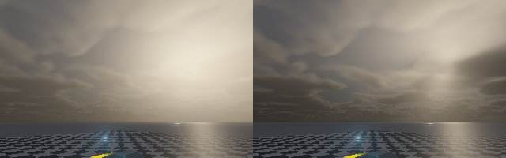

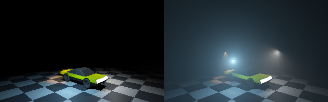

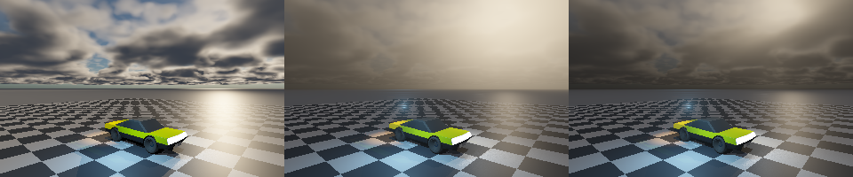

### What was reused, and what changed

The cloud density is the inherited native four-octave value-noise slab, ported to shared Slang—not a newly
invented cloud-shape model or downloaded cloud asset. Earlier work improved visible per-pixel integration,
ambient input and spatial surface/Sun shadows. It did **not** integrate cloud-shadowed light in the air between
camera and scene; the clear atmosphere cube alone cannot provide those shafts.

The inherited `FogTransmittance`/`ApplyFog` path is analytic extinction plus a constant-colour blend. That legacy
native reference-renderer mode remains available. This phase adds **new shadowed single scattering** through
that height-density profile: a native `IntegrateFogRadiance` reference and shared Slang `IntegrateFogScattering`.
The existing analytic column was also stabilized near horizontal rays with `expm1`; the shader uses a stable
small-argument polynomial. No radial screen blur, beam sprite or painted shaft image is used.

Each camera-ray segment gathers phase-weighted analytic illumination with:

- Exact analytic exponential optical depth along the camera and light segments.
- Cloud transmittance at the actual sample position, not one observer factor.
- Triangle-BVH geometry occlusion, including off-screen geometry.
- Existing point/IES/spot falloff and angular profiles, plus HG directional scattering.
- Surface-light and secondary-hit analytic arrival attenuation through fog; sampled emitter-to-surface
  extinction is included without removing visible emission or area sampling.
- Final volume integration stopping at the visible opaque surface, or a bounded local-medium distance.

A segment contributes `(T_before − T_after) × scattering_albedo × incident_radiance`; constant illumination
therefore matches the analytic uniform-medium integral. Surface lighting is reconstructed before camera fog is
resolved. Resolved fog does not feed surface-colour history. Cloud/fog selection changes invalidate surface
histories; switching fog on/off matches a cold reconstruction.

| Executed check | Result |
|---|---|
| Numeric camera-ray/native checks | 654 rays across five daylight cases and a point/IES/spot case |
| Native surface-light arrivals through fog | 270 receivers; maximum RGB discrepancy 5.21472e-5 |
| Daylight numeric ray integral | Maximum RGB discrepancy 1.14637e-5 |
| Local-light numeric ray integral | 109 rays; maximum RGB discrepancy 1.04968e-5 |
| Actual capture/native comparisons | 390 rays; maximum RGB discrepancy 5.48751e-5 |
| Zero fog density | Entire output bitwise equal to fog disabled |
| Uniform Beer and ambient scattering | Native closed forms passed; nonzero ambient input |
| Near-horizontal column | Stable against the horizontal limit |
| Geometry occlusion | Disabling it changes local-light scattering |
| Surface history and fog toggles | No resolved-fog feedback; on/off cold equality passed |
| Invalid march extent | Rejected before dispatch |
| Regressions | Cloud shadows/toggles, legacy Vulkan, indirect reconstruction and native CTest 4/4 passed |

The archived initial captures use 32 camera midpoints, 16 cloud-shadow samples, scattering albedo 0.9, HG g=0.65,
base extinction 0.0015/m and height scale 450 m. Camera integration is bounded at 2.5 km; light columns at 40 km.
Local-light captures use 64 camera steps, 0.07/m, a 10-m scale height and g=0.35. The IES profile is the retained
**synthetic relative-to-peak fixture**, not a newly calibrated measured lamp.

The sky comparison deliberately uses a thinner broken-cloud slab (800–1100 m, density scale 2.5, extinction
0.02/m) to expose shafts. It is a separate raised sky camera, not the vehicle view. Vehicle shots retain the
original authored vehicle and analytic/visible-emissive lighting plus four-sample emissive/diffuse transport.
The standard cloud slab remains 800–1800 m, density scale 1.5 in this fixture. A separate vehicle capture advances
wind to 120 seconds. Sun elevation is a fixed 20° fixture, not an observer/time ephemeris.

**These are actual 320×200 Vulkan readbacks**, not 640×400 renders or upscaled quality evidence. Timings do not
establish real-time performance. Source and output SHA256 coverage is retained in `Results/Manifest.json`.
The compiler is GCC 12.2; captures are Release and focused checks are RelWithDebInfo under ASan/UBSan with
external-driver leak detection disabled. Device remains **SwiftShader CPU type 4**. Windows script parity is
retained but Windows and physical RTX/GTX execution are not verified.

### Quality limits — not a finished participating-media renderer

- Single scattering only; ambient illumination remains approximate, not multiple scattering.
- Regular camera/shadow sampling can band or alias. On the first 12 numeric rays, increasing view steps
  from 32 to 128 changed red radiance by up to 0.00311955; increasing cloud-shadow steps from 16 to 64
  changed it by up to 0.0293056. These are subset sensitivities, not full-image convergence guarantees.
- Fog has no temporal reconstruction. The cloud slab and indirect cube retain their earlier appearance limits.
- Diffuse inter-bounce fog extinction/in-scattering is not fully coupled. Emissive-volume scattering is disabled
  in these archived captures; the opt-in implementation is documented above.
- Cloud/atmosphere/fog overlap is composited approximately, not solved as one coupled planetary medium.
- These are soft physical single-scattering shafts, not a claim of cinematic/final cloud appearance.
- Existing native Sun, flare and stars are preserved, not newly connected here. Moon remains planned.

Reproduction (run software-Vulkan jobs serially):

```bash
bash Exhibits/LightCompute/RunFog.sh
```

`--fog-checks` omits captures; `--fog-rays` captures the vehicle/day/local-light comparisons; `--fog-sky` captures
the separate broken-cloud comparison. The shader now has **13 compute entries**, still eight SSBOs, 128-byte
push constants and unchanged history/output allocation. The fog offset uses the previously unused bounding-box
`.w` word. Fog, primary, transport, receiver and reuse SPIR-V require only Shader capability and 32-bit integers.

## Spatial cloud shadows — surface and secondary rays

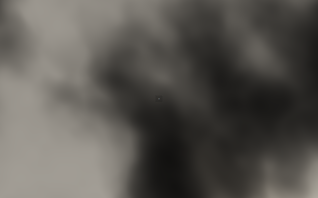

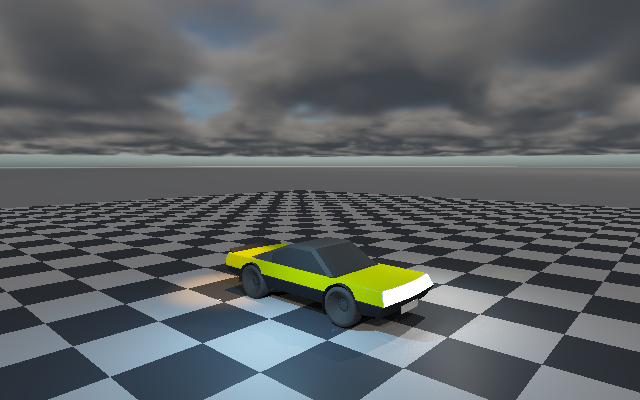

`CloudSunTransmittance` integrates extinction **at the actual shading position**, using the same bounded
64-midpoint density march as the cloud sky. Primary direct-light evaluation, temporal/spatial reservoir targets
and secondary-hit analytic arrivals use the local factor. The prior observer-wide factor is no longer used for
surface illumination. The observer-to-Sun cache record remains a diagnostic only.

The transmittance-only function skips phase and nested scattering work. Each evaluation computes it once per
receiver (or secondary hit), not once per light or reservoir candidate. Light proposal mass deliberately remains
unattenuated and retains support; targets and final contributions use current-position cloud extinction.
Point/IES/spot lights, unrelated directional sources and visible/area-sampled material emission are not scaled
by the Sun-only factor. No extra compute entry, descriptor, push constant or output slab was added.

| Check | Verified result |
|---|---|
| Native direct shading, five cases | 433 surface probes per case; maximum RGB discrepancy 8.87267e-6 |
| Procedural field at 35° Sun | Native T spans 0.00598468–0.988228 across the tested ground positions |
| Same field, wind at 120 seconds | Native T spans 0.00374286–0.992511; rendered surface lighting changes |
| Clear and uniform-medium fixtures | Clear output bitwise unchanged; uniform native shading agrees |
| Clustered/exhaustive evaluation | Bitwise equal in all five cases, including capacity-one selection |
| Single-Sun reservoir and spatial reuse | Maximum RGB discrepancy from exact evaluation 9.53674e-7 |
| Non-Solar analytic sources | Bitwise unchanged with the cloud feature enabled/disabled |
| Secondary-hit diffuse illumination | 117 independent native probes; maximum RGB discrepancy 7.40833e-8 |
| Weather-history revision | Wind update and cloud on/off equal cold direct/indirect restarts bitwise |

The four **640×400 actual Vulkan** vehicle and ground captures use wind times 0/60/120/180 seconds at a fixed
35° Sun. Vehicle captures retain 16-sample diffuse transport and analytic plus emissive lighting. The overhead
view uses exact direct plus visible emission only, isolating spatial shadows over the original scene's ground;
the vehicle occupies very few pixels at that scale. Both cameras remain below the cloud base. The vehicle and
camera are stationary within each sequence: wind is moving, not the geometry. Animation timing is illustrative.

Changing the cloud-enable selection also invalidates both histories. A new regression first reproduced stale
illumination when clouds were switched off without changing the parameter bytes; tracking that out-of-prefix
selection now makes both disable and re-enable match cold reconstruction bitwise.

### Ambient upload correction

The previous checkpoint added an ambient input, but `AppendCloudParameters` omitted its final four initializers,
so the upload silently zeroed that input. The uniform test then read the same zero back and did not detect it.
This phase fixes the upload and requires **nonzero RGB** before the closed-form ambient check. The cloud cube,
full-resolution camera and clear/cloud/low-Sun images are rerun with the corrected input, not relabelled old
captures. The moving-shadow fixture explicitly uses ambient RGB `[0.1, 0.12, 0.15]`; this remains an isotropic
approximation, not multiple scattering.

Focused reproduction (builds all shared entries and captures both views):

```bash
CLOUD_SHADOWS_ONLY=1 bash Exhibits/LightCompute/RunClouds.sh
```

`RunClouds.sh` without the environment switch runs both cloud-volume and spatial-shadow phases. The separate
`--cloud-shadow-checks` executable option omits full-resolution captures. The tested C++ configurations
are GCC 12.2 Release for captures and RelWithDebInfo with `-fsanitize=address,undefined -fno-omit-frame-pointer`
for focused checks. External-driver leak detection is disabled, and UBSan halts on error. Each of the five
single-Sun fixtures accepts 16,000 temporal and 63,438 spatial reservoir reuses on its second update.

Run large software-Vulkan captures serially: simultaneous validation runs exhausted allocation resources in this
sandbox. Earlier views were retained and the final wind view resumed successfully with `--cloud-shadow-captures 3`.
The resume option accepts first indices 1–3 and runs the remaining full views without repeating numeric checks.
Unneeded focused-mode buffer/pipeline preparation was also removed from `main`, and Vulkan allocation/pipeline
failures now name the operation. No memory-usage or speedup measurement is claimed.

Retained checks and scope are in
`Results/CloudShadows.txt` and `CloudShadows.json`; platform verification remains **SwiftShader CPU type 4**,
not physical RTX/GTX or Windows. These are point-Sun extinction shadows, not finite-disc penumbrae. Geometry seen through the cloud medium is not
validated; these cameras stay below its base. Flat-slab
horizon artifacts, approximate ambient and the observer-centred indirect environment cube remain limitations.

## Vulkan cloud volume and low-Sun lighting — executed

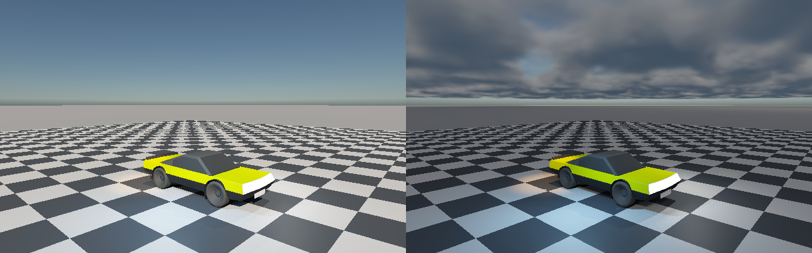

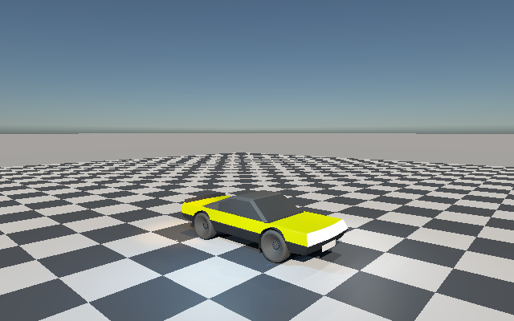

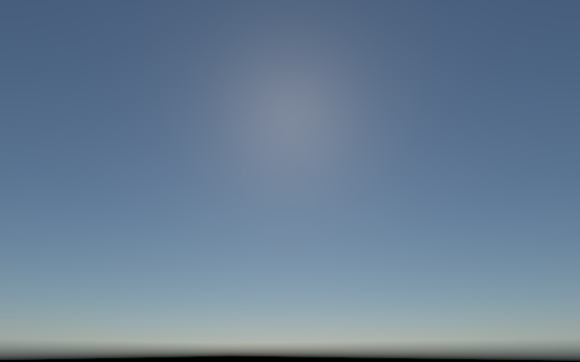

The shared Slang shader now evaluates the native cloud model on Vulkan: bounded slab intersections,
four-octave smooth value noise, wind advection, Beer-Lambert extinction, Henyey-Greenstein phase and six-step
sun self-shadowing. A **64-step per-pixel march** shades camera misses, rather than upscaling a coarse cloud
cube into the visible sky. A separate 48×48×6 GPU radiance cube supplies clouds to indirect rays. The underlying
Rayleigh/Mie/ozone atmosphere is still CPU-precomputed; this is not a GPU atmosphere port.

The native 64-bit lattice hash is reproduced with paired 32-bit multiply/add/shift operations. Inspected SPIR-V
for cloud, primary and transport entries has only `Shader` capability and no Int64 type/capability; optional
shaderInt64 support is not required. The ambient sky input is a solid-angle-weighted upper-hemisphere average.
An optional constant isotropic incident-radiance term was added to native `CloudParameters` and `MarchClouds`,
with a matching GPU term. **Its default is zero**, retaining the earlier sun-only result. The term integrates
uniform ambient illumination analytically per step; it is an approximation, not multiple scattering.

Sun irradiance in the scene is attenuated by native atmospheric transmittance to ground. The cloud Sun source
uses atmospheric transmittance at 1.3 km. Vulkan also computes cloud transmittance along the observer-to-Sun
ray for a diagnostic record. Matching directional sunlight at surfaces now uses the actual shading-position
transmittance described above. Camera, sky and indirect rays use the current cloud parameters.

| Verified check | Observed result |
|---|---|
| Cube-native comparisons | 446 directions × 5 cases = 2,230 double-reference probes |
| Maximum transmittance discrepancy | 1.186e-5; procedural cases at most 3.36908e-6 |
| Maximum composite cube RGB discrepancy | 8.32318e-6 |
| Full-resolution camera-native comparisons | 99 rays × 4 cases = 396; maximum RGB discrepancy 8.63495e-6 |
| Uniform-density Beer-Lambert comparison | Maximum absolute transmittance discrepancy 1.186e-5 |
| Uniform ambient integral | Native result matches the closed form within 1e-12 |
| Zero cloud density | Entire vehicle output bitwise equal to clear-atmosphere path |
| Wind, same Sun and field seed | 120-second advection changes the GPU cloud cube |
| Invalid march budget | Rejected before dispatch |
| ASan/UBSan | All five cases and camera/native checks passed; external-driver leak detection disabled |

The cases are clear 35° Sun, uniform-density numeric fixture, procedural clouds, the same field at wind time
120 s, and procedural clouds with a 3° Sun. The animation omits the uniform test, so it is an illustrative
weather/lighting sequence—not a continuous ephemeris, dynamics simulation or performance measurement. Sun
positions are explicit fixture angles. The same authored ControlVehicle and both analytic/emissive lighting
paths remain. The exhibit uses stronger daylight irradiance and a wider camera view to expose the sky; it does
not alter the native renderer's existing Sun, flare or stars, nor newly connect those presentation effects.

**Remaining appearance limits:** the flat cloud slab and regular 64-step march can show compressed/rippled
horizon structure; indirect cloud lighting still uses a low-resolution non-seamless cube. Cloud ambient is
isotropic and approximate; spatial shadows now move, but there is no finite-Sun penumbra model. This is a
verified environment path with smoother visible clouds, **not final cloud appearance**. Moon, night exposure,
licensed Milky Way/catalogue work, GPU atmosphere, physical RTX/GTX and Windows acceptance remain open.

The cloud checkpoint used **12 compute entries**, eight SSBOs and unchanged 128-byte push constants. The cloud cube plus
one Sun record adds 221,200 bytes after the 21 output/history slabs (86,237,200 total bytes at 640×400, excluding
receivers and scene/profile buffers). Camera cloud marching uses no CPU cloud pixels. Cloud parameters precede
the emissive CDF, so changing weather invalidates the existing exact environment/profile revision prefix.
All cloud parameters and march extents are bounded and checked before dispatch.

Focused reproduction:

```bash
bash Exhibits/LightCompute/RunClouds.sh
```

`Run.sh` includes this phase through the focused scripts; `Run.ps1` has command parity but was not executed on
Windows. `Results/Clouds.txt` contains the final sanitizer-executed checks; JSON and `CloudSanitizers.txt` retain
scope/device details. Native CTest 4/4, recovered checks, ASan/UBSan, original ControlVehicle clustered captures,
legacy Vulkan exact/cluster/reservoir/static-history and indirect reconstruction checks were rerun successfully.
The device remains **SwiftShader CPU type 4**, with no physical-GPU or real-time claim.

## Indirect temporal and spatial reconstruction — executed

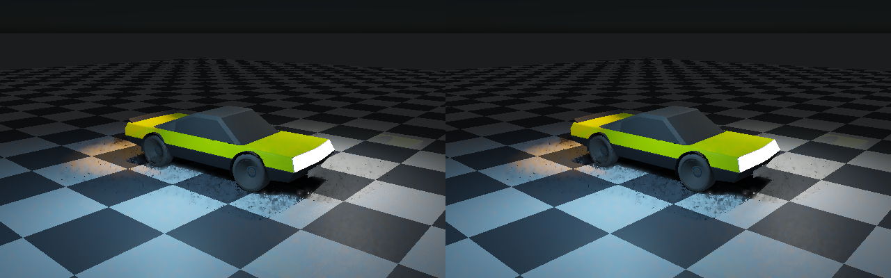

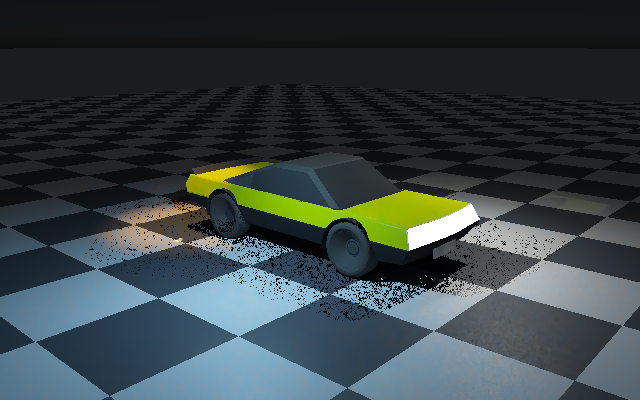

Three new shared shader entries run after secondary-ray transport and before direct-light evaluation:
`ReprojectSurfaceTransport`, `FilterSurfaceTransport`, `ResolveSurfaceTransport`. Raw indirect is kept separate
from visible material emission. Previous filtered indirect is accepted only through the existing four-pixel
world-position, stable-token, normal, material and optics reprojection checks. It is clamped to the current
compatible 3×3 raw RGB range and blended with a history length capped at 16. A 5×5 separable-binomial-weight
kernel then averages only compatible surfaces within the current world-space footprint.

Read and write slabs are distinct, and dispatch barriers separate all three stages. Previous indirect is not
overwritten until all temporal reads finish. Visible material emission and sky misses are not blurred. The
filtered indirect is added to current visible emission; the existing direct-light reconstruction runs unchanged.
The indirect checkpoint used **11 compute entries**, eight SSBOs, the same 128-byte push ABI, and 21 float4
output/history slabs: **86.016 MB at 640×400**, excluding receivers, geometry and profile buffers. This is a
reference allocation, not a measured VRAM budget or production performance claim.

| Verified check | Observed result |
|---|---|
| Isolated indirect-emission quality fixture | 160×100 original vehicle scene; analytic lights and environment disabled |
| Independent reference | 16 distinct seeds × 16 emitter-area draws per receiver; unchanged finite hemisphere quadrature |
| Eight reconstruction updates, disjoint seeds | Fresh RMSE 0.0103498 → filtered 0.0058573: **43.41% lower** |
| Static temporal / spatial routes | 14,080 accepted histories; 13,981 surface pixels with multiple spatial contributors |
| Independent native spatial-kernel probes | 210; maximum RGB discrepancy 4.8961e-8 |
| Emission-source revision | Rejected old indirect; bitwise equal to cold reconstruction |
| Camera cut | Rejected old indirect; bitwise equal to cold reconstruction |
| All sources disabled | Exactly black; no lingering indirect light |
| Six 640×400 moving poses | Temporal reuse exercised; analytic light change at pose 3 resets acceptance |
| Visible material emission | Preserved separately at every full-resolution surface pixel |
| Identical direct-light histories | Maximum extracted-direct discrepancy 3.8147e-6, from final float addition/subtraction |
| ASan/UBSan | Numeric, native spatial and reset checks passed; external-driver leak detection disabled |

The 43.41% result is **isolated-emission quality at 160×100**, not full-image moving quality at 640×400 or an
equal-cost speedup. Its independent-seed reference is finite, not a converged path-traced truth. Full-resolution
images use the same direct-light histories and seeds on both sides, one update per pose; only indirect
reconstruction differs. Remaining direct-light noise therefore appears on both sides of the comparison.

Emission revisions compare sorted distinct `(stable surface token, emitted RGB)` tuples, so triangle reordering
does not cause gratuitous resets. Analytic light/profile/environment revisions use the existing exact prefix
comparison. Disabling reconstruction invalidates its history, and re-enabling starts cold. Visible emission is
always current rather than accumulated with indirect lighting.

**Scope and limitations:** neighborhood clamping and spatial smoothing are biased and can soften illumination
boundaries. Surface reprojection prevents ordinary disocclusion reuse, but moving emitters and every possible
shadow/visibility change are not exhaustively revalidated. There is no claim of universally ghost-free motion,
statistical unbiasedness, glossy transport, GPU atmosphere/clouds, hardware ray queries or Windows acceptance.
The tested device remains **SwiftShader CPU type 4**. Existing Sun/flare/stars and the planned Moon are retained.

Focused reproduction, after restoring pinned tools (`PREPARE=1` if needed):

```bash
bash Exhibits/LightCompute/RunTransportReconstruction.sh
```

The full `Run.sh` and `RunEmissive.sh` include this phase. The quick numeric/reset path uses
`--transport-reconstruction-checks` with the same argument layout as the full `--transport-reconstruction`
command, skipping full-resolution captures; it is the path used for the sanitizer run.
`Results/TransportReconstruction.txt`, JSON, `TransportReconstructionRegression.txt` and
`TransportReconstructionSanitizers.txt` preserve the actual checks.

This sandbox was restored by fast-forwarding the session branch to saved GitHub checkpoint `0a4560c2`, then
restoring checksum-pinned ignored tools. Earlier public images/reports remain in Git. Missing private scratch
archives are not falsely described as freshly verified: the manifest labels their retained historical digests
separately from current bytes. Current shader binaries and regenerated inputs have fresh checksums.

## Emissive triangle importance sampling — executed


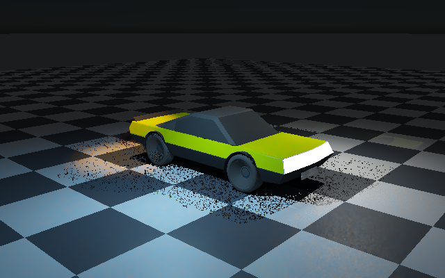

The secondary-emission part of the diffuse integral now has a dedicated estimator. A CPU geometry pass builds
a cumulative distribution over **1,130 positive-area emissive triangles**, weighted by world-space area times
RGB luminance. Vulkan selects a triangle, samples its area uniformly, traces a full-BVH visibility segment,
and evaluates the diffuse response with the triangle probability, area, inverse-square distance and receiver/
emitter cosine factors. Emission is two-sided to match the existing face-forward surface interpretation.
Primary visible emission remains separate and unchanged.

The hemisphere route still evaluates analytic point/IES/spot/directional lighting at secondary hits and the
atmosphere cube on misses. When explicit emitter sampling is enabled, secondary emission is omitted from the
hemisphere route, so it is not accumulated twice. This is a **partition of lighting contributions**, not MIS,
not a removal of analytic lights, and not resolution of authored analytic-proxy/emissive energy accounting.
A cumulative table is sufficient for this fixture; no new emissive spatial clustering is required or claimed.

| Verified check | Observed result |
|---|---|
| Samples | 16 hemisphere directions plus 16 area-emission draws per receiver |
| Independent native same-draw probes | 225 distributed surface receivers; mean RGB error 7.2128e-9; max 1.36771e-6 |
| Higher-sample native reference | Independent seed 8171, 8,192 area draws per probe |
| Old hemisphere emission RMSE versus that reference | 0.206886 |
| New area-emission RMSE versus that reference | 0.00906289: **95.62% lower** |
| Six moving poses | Current indirect/emission equals fresh evaluation bitwise at every pixel |
| Moving direct history | Valid acceptance survives CDF rebuilds; light change at pose 3 resets it |
| Empty emitter set | Bitwise equal to the hemisphere route with emission absent |
| Disabled environment | Exactly matches zero-environment evaluation; no cube metadata leaks into misses |
| Invalid zero probability | Rejected on CPU before Vulkan dispatch |
| ASan/UBSan | New estimator, native reference and safety checks passed; external-driver leak detection off |

This error reduction is **probe-only, one fixture and seed 71**, not a full-image quality statistic, universal
unbiasedness proof or equal-cost speedup. The higher-sample reference is itself a finite Monte Carlo estimate.
Explicit area samples add visibility work on top of the retained hemisphere routes. The comparison deliberately
isolates transported emission from analytic and environment lighting, and excludes primary visible emission.
Native area integration independently evaluates geometry, barycentric points, diffuse response and shadow BVH;
it shares the uploaded probability table and random integer sequence to check matching GPU draws.

The float CDF reserves one of 2²⁴ probability ticks for every positive-area emitter, then distributes the
remaining ticks by emitted power. Thus dim triangles retain nonzero probability rather than silently vanishing
through float rounding. Every entry's facet bounds, positive area/PDF, CDF monotonicity and normalization are
checked before dispatch. The profile buffer reserves enough span for moving CDFs. Direct-light revision checks
compare the exact light/profile/environment prefix, excluding the appended geometry-dependent emissive CDF;
per-pixel direct surface compatibility and current indirect evaluation remain active.

**Visual result:** the displaced bright illumination footprints are substantially removed; residual sampling
grain remains. This phase does **not** add indirect temporal accumulation or denoising, glossy transport,
GPU atmosphere/clouds or Moon rendering. Native Sun/flare/stars remain untouched. The executed device is still
**SwiftShader CPU type 4**, not physical RTX/GTX or Windows acceptance.

Focused reproduction (about a long software-rendering test run, not interactive frame timing):

```bash
# Set PREPARE=1 on a machine needing the pinned ignored Vulkan tools.
bash Exhibits/LightCompute/RunEmissive.sh
```

The full `Run.sh` now includes these checks after prior regressions. `Run.ps1` includes corresponding commands
but was not executed on Windows. `Results/EmissiveArea.txt` preserves the final sanitizer-executed numeric and
safety checks; `EmissiveRegression.txt` retains the rerun exact/cluster/reservoir/history regression, and
`EmissiveSanitizers.txt` identifies the sanitizer configuration. Original cosine transport and primary native
checks were also rerun. The ignored `EmissiveScene.bin`, including its CDF, is hashed in the manifest.

## One-bounce diffuse transport and atmosphere cube — executed

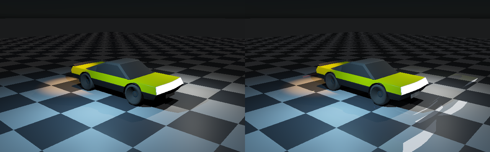


`TraceSurfaceTransport` now follows the camera-surface pass, before direct lighting and reconstruction. It traces
16 cosine-weighted hemisphere directions through the **full-scene triangle BVH**, including offscreen geometry.
A secondary hit contributes its authored material emission plus exact analytic point/IES/spot/directional light
arrival, native-equivalent GGX BRDF and shadow visibility. A miss samples the atmospheric radiance cube.
The primary vertex applies a Fresnel-weighted **diffuse** response; glossy indirect reflection is not included.
Direct GGX lighting is unchanged. Neither analytic lights nor emissive geometry was removed.

The environment cube has six 48×48 RGB float faces, baked by native `SingleScattering` and its transmittance LUT
at the fixture's 4 m observer altitude. Sun direction and irradiance come from the existing directional light.
Vulkan performs bilinear cube lookup for camera misses and unoccluded secondary rays. This is **CPU atmospheric
precomputation consumed by GPU transport**, not per-pixel CPU radiance or a GPU atmosphere/cloud implementation.
Existing Sun/flare/star rendering code remains untouched; the cube itself does not add those presentation effects.

| Verified check | Observed result |
|---|---|
| Secondary rays, 640×400 | 3,603,424: 263,475 triangle hits; 3,339,949 environment misses |
| Independent native transport probes | 901 distributed surface receivers × 16 directions |
| Probe mean / maximum RGB error | 2.08237e-8 / 4.6271e-6 |
| Analytic-only indirect RGB sum | 2053.27 |
| Emissive-only indirect RGB sum | 19571.8, excluding primary visible emission |
| Environment-only diffuse RGB sum | 612.624 |
| Sum of isolated routes versus combined transport | Maximum RGB discrepancy 8.44442e-6 |
| All light families and environment disabled | Exactly black |
| Six moving poses | Current indirect/emission equals fresh evaluation bitwise at every pixel |
| Light revision, moving pose 3 | Zero accepted direct-light histories |
| ASan/UBSan transport execution | Passed; external-driver leak detection disabled |

The probe oracle uses a rebuilt double BVH, independently computed hit barycentrics, native light arrival,
public IES profile import, native secondary BRDF/shadows and an independently evaluated diffuse primary response.
It checks the same finite quadrature, **not convergence to a high-sample path-traced reference**. The source-isolation
sum detects accidental duplicate accumulation in this integrator; it does not resolve whether an authored
analytic proxy duplicates the physical energy of an emissive fixture. Proxy/source accounting remains open.

Only direct-light reservoirs/colour history are reconstructed. Indirect and visible emission are freshly
computed each frame and added afterward, so old screen-space radiance cannot survive a source or pose change.
The moving checks use one history update per pose, without the earlier 16-update warmup. Their errors versus
exact direct lighting with the **same finite indirect quadrature** are retained in `Results/TransportMotion.txt`;
those are not measurements of total indirect-lighting accuracy.

**Visible limitation:** 16 fixed hemisphere directions produce coarse displaced illumination footprints around
bright emitters. They are quadrature artifacts, not validated glossy reflections. The new indirect contribution
is not temporally accumulated or spatially denoised. Multi-bounce transport, emissive importance sampling,
glossy transport, seamless/high-resolution atmosphere evaluation and sky/cloud appearance are still open.
This capture establishes the executed transport path, not final renderer quality or a performance win.

This earlier transport checkpoint used eight entries; the current shader has **13 compute entries**, eight
SSBOs and the unchanged 128-byte push ABI. The native
cube adds 165,888 bytes and hemisphere directions add 192 bytes to the profile/sample buffer; no per-pixel CPU
residual is uploaded. Private camera metadata stores their offsets. `TransportScene.bin` is retained only in
ignored scratch storage and hashed in the evidence manifest; it is not a new public scene format.

Reproduce all regressions and transport/motion checks with `bash Exhibits/LightCompute/Run.sh`.
The focused command after build/export is:

```bash
VK_ICD_FILENAMES="$PWD/ExternalPackages/VulkanCompute/SwiftShader/vk_swiftshader_icd.json" \
_ClaudeScratch/build/light-compute/LightComputeValidation \
  "$PWD/ExternalPackages/VulkanCompute/SwiftShader/libvulkan.so.1" \
  "$PWD/_ClaudeScratch/build/light-compute" \
  _ClaudeScratch/vehicle-primary/VehiclePrimary.bin _ClaudeScratch/light-compute --transport-only
```

Sanitizer reproduction uses the same command with `ASAN_OPTIONS=detect_leaks=0` and the executable configured
by CMake under `_ClaudeScratch/build/transport-sanitizers` with `-fsanitize=address,undefined` in compile/link
flags. `Results/TransportSanitizers.txt` preserves the executed checks. No physical GPU, RTX query, Windows
runtime or production viewport acceptance is claimed. Moon remains in `Documentation/EnvironmentTodo.md`.

## Moving Vulkan-primary reconstruction — executed


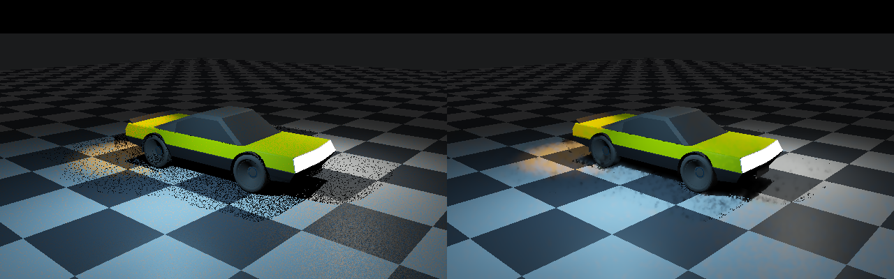

`VehicleCapture --primary-motion` exports six rigid/camera poses **without native rasterization**. Every exact,
fresh and history dispatch regenerates camera hits, surfaces, material emission and motion metadata on Vulkan,
after poisoning all receiver channels. The persistent history receives 16 static updates and then five moving
updates. Analytic light colour changes at pose 3 force a complete history reset. These captures use a black
environment and visible material emission—not indirect transport or emissive-source sampling.

| Pose | Fresh RGB RMSE | Reconstructed RGB RMSE | Accepted / rejected receivers |
|---|---|---|---|
| 0, after 16 updates | 0.134862 | 0.041186 | 225214 / 0 |
| 1 | 0.133991 | 0.0513191 | 152325 / 72955 |
| 2 | 0.131754 | 0.057873 | 152590 / 73330 |
| 3, light revision | 0.130677 | 0.0920956 | 0 / 225973 |
| 4 | 0.129381 | 0.0425442 | 153020 / 73540 |
| 5 | 0.126105 | 0.042405 | 153177 / 73558 |

Use `Results/PrimaryMotion.txt` for authoritative rounded measurements. Across moving poses, RMSE sums are
0.651907 fresh versus 0.286237 reconstructed: **56.09% lower**, a fixture-quality result, not an equal-cost speedup.
The lossless six-frame APNG has illustrative timing, not measured frame times. `PrimaryMotionReject1.png`
shows accepted colour in green, sampled visibility rejection in orange, rejected history in red, misses black.

Independent native first-hit/shading checks execute at every pose, on a separate Vulkan submission so they cannot
consume the history context's light-revision reset. A native rigid-transform/projector also checks every generated
surface's previous world position, normal, pixel and projection validity. Maximum observed reprojection error is
0.00012207 pixels, world error 4.76837e-7 m, normal-component error 1.19209e-7. The checks exposed inaccurate
shader sine/cosine evaluation on the software device; current/previous rotation coefficients are now computed
once per pose and uploaded, rather than recomputed approximately per pixel. Visibility remains shader-generated.

Camera-cut output matches a cold restart bitwise; disabling lights leaves no stale direct lighting; updating
facet emission matches exact current emission bitwise. All six poses have zero native/GPU hit/miss disagreement.
There are **11 triangle-identity differences** across the moving poses: six near triangle edges and five depth
orderings within `64 * float_epsilon * travel`. They remain counted, not described as identical geometry.
For matching facets, maximum relative depth error reaches 1.11028e-4 (bound 2e-4), and maximum RGB error is
6.93947e-5. Across **all** pixels, including edge/precision ambiguities, worst RGB error is 0.960438 and worst
relative depth error is 0.177935 at pose 2; per-frame mean RGB error remains at most 3.77025e-6.
These isolated visibility outliers are a robustness limitation, not hidden by the matched-facet statistics.
The oracle requires every interior identity mismatch to fit the stated float-depth tolerance; matched-facet
normals, full-image mean colour and all-pixel hit/miss checks remain independently gated.

Reproduce both retained regressions and moving-primary checks with `bash Exhibits/LightCompute/Run.sh`.
Windows command parity is in `Run.ps1`; Windows execution is **not** claimed. GPU indirect/environment transport,
RTX queries, physical-GPU performance and production viewport integration remain open. Existing environment
work and the planned Moon are retained, not replaced by this black-environment fixture.

## Primary camera rays — executed


`VehicleCapture --primary-input` skips both native renderer scene setup and rasterization. CPU work exports
mesh geometry, per-vertex normals, material records, lights and camera parameters only. Before dispatch, **all
36 floats of every receiver are poisoned with NaNs**. `TracePrimarySurfaces` generates pixel-centre camera rays,
traverses the full triangle BVH for the nearest clipped hit, interpolates normals/materials, and writes receivers.
Existing exact or clustered lighting then supplies direct illumination and BVH shadows. Material emission stays
independent of analytic point/IES/spot lights: neither lighting family was removed.

This controlled capture uses **a black environment, direct illumination and visible material emission**.
It does not upload a CPU per-pixel residual. It does not yet evaluate indirect transport or the native
sun/sky/cloud environment on Vulkan. The history images below retain their original CPU-primary environment path.

| Independent native ray check | Observed result |
|---|---|
| Camera coverage | 225,214 hits; 30,786 misses; zero hit/miss disagreement |
| First triangle | Zero identity disagreements on the vehicle scene |
| Maximum relative depth error | 5.00174e-6 |
| Maximum normal error, `abs(1-dot)` | 1.43991e-7, independently calculated barycentrics |
| Mean / maximum absolute RGB error | 2.03235e-6 / 6.93947e-5 |
| All-light versus clustered | Identical float32 output |
| Clipping fixture | Near/far rejection, nearest overlapping plane and all-miss case passed |
| Forced stack capacity one | 256 exhaustive fallbacks; same nearest depths and shaded output |

The oracle rebuilds a double-precision BVH from exported float vertices, independently computes camera rays and
barycentric weights, reconstructs Type-C profiles through the public IES importer, and evaluates the native BRDF,
light arrival and shadow queries. Forced traversal changes which triangle owns 16 exact shared-edge ties in the
16×16 fixture; these are individually classified as edge cases, not silently counted as identical facet IDs.
`Images/PrimaryNative.png` is the corresponding native ray result; `Results/Primary.txt` records all checks.

The private exhibit archive is now FLC3, with 144-byte shaded facets and camera metadata. Old scratch archives
must be regenerated. The shader still uses eight storage buffers; push constants are now **128 bytes** and
the original 16 float4 output/history slabs occupied **65.536 MB** at 640×400. Current indirect reconstruction
uses 21 slabs, **86.016 MB**, excluding receivers and scene geometry.
Primary generation writes rigid-motion metadata; its moving validation is documented above. The existing
six-pose CPU-primary history regression below was also rerun and passed.

## Retained history regression

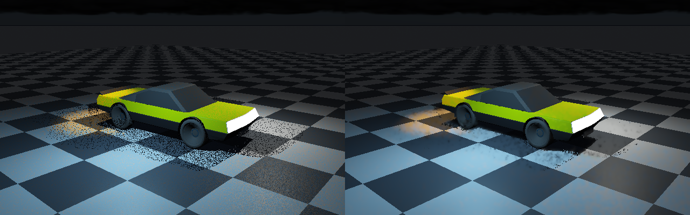

Left is fresh eight-candidate RIS; right uses reservoir history and reconstruction at the **same moving pose**.
The sequence begins with 16 static updates. The vehicle then rotates/translates through five further poses while
the camera pans. A point-light colour change at index 3 deliberately resets all old light histories.

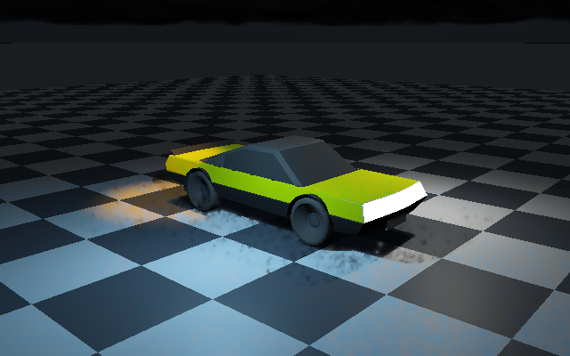

Animation timing is illustrative, **not measured rendering time or a dynamics simulation**. The six images are
actual Vulkan readbacks; no generated illustration or browser renderer is involved.

## Executed sequence

```text
Original ControlVehicle + authored materials
    → native primary visibility, stable surface tokens, rigid motion projection
    → current float32 surfaces + current full-scene BVH + current sky/indirect/emissive residual
    → AssignLightCells
    → EvaluateLightReceivers       fresh RIS + reprojected temporal reservoir + current visibility
    → ReuseLightNeighbours         compatible surface neighbours, target and visibility reevaluation
    → ReconstructLightHistory      temporal colour/moments, variance-based neighbourhood clipping
    → FilterLightNeighbours × 2    edge-aware à-trous filtering, steps 1 and 2
    → FinalizeLightHistory         current residual, persistent reservoirs/surface metadata
    → shader/host dependency + fence → actual readback → native display encoding → PNG/APNG
```

All 12 computation entries are shared in `Frontier/Engine/Rendering/Shaders/LightInfluence.slang`. The host
retains pipelines/descriptors and uses eight storage buffers with a 128-byte push constant. Inter-dispatch,
inter-submission and host/readback dependencies are explicit. Prior metadata is never overwritten until all
reprojection and reconstruction reads have completed. Twenty-one float4 slabs occupy 86.016 MB at 640×400,
excluding receiver inputs and geometry; this is an unoptimized reference allocation, not measured GPU VRAM.

The uploaded native direct-answer channel is deliberately poisoned with NaNs. Unpoisoned native answers remain
only in host memory for numerical checks. The shader recomputes direct illumination and BVH shadow visibility;
primary raster, sky and indirect transport remain CPU inputs in this retained history regression only.

## Verified results

| Check | Observed result |
|---|---|
| Original vehicle | 25,068 vehicle facets; 28,276 full-scene facets; 640×400 receivers |
| Exact Vulkan all-light/clustered/forced-capacity routes | Identical float32 output buffers |
| Exact Vulkan versus native RGB | Mean absolute error 2.02268e-6; maximum 6.44028e-5 |
| Native/Vulkan display comparison | 183 pixels differ; maximum one 8-bit code step |
| Candidate-list visits in exact comparison | 8,107,704 → 2,682,703; 66.91% fewer, **not a speedup measurement** |
| Fresh RIS, 97 lights, 256 seeds | Mean luminance 1480.95; exact 1480.88; standard error 0.0842466 |
| Reuse: 64 independent chains × 4 updates | Mean 1480.78; exact 1480.88; standard error 0.123867 |
| Sixteen static updates | RGB RMSE 0.133629 → 0.0413195; **69.08% lower** |
| Five moving updates | Mean per-image RMSE 0.1303814 → 0.057318; **56.04% lower** |
| Moving index 1 | 152,328 accepted; 72,952 rejected; 1,212 sampled-visibility colour rejections |
| Moving light change, index 3 | Zero accepted histories; current light table used immediately |
| Changed material | Exactly 256 affected receivers rejected; 256 unchanged receivers accepted |
| Normal, invalid motion/camera cut, position mismatch | All 512 receivers rejected in each case |
| Camera-cut fallback | Exactly matches a cold restart with identical random seed |
| All lights off | History output exactly matches current exact image; no stale direct contribution |
| Residual refresh | Current exact image matched; no old residual accumulation |
| Triangle stack capacity forced to one | 49,664 exhaustive fallbacks; matches ordinary BVH visibility |
| Offscreen caster | Ten caster facets shadow synthetic receivers, independent of primary-frustum culling |

Errors compare the same current surfaces/lights/geometry. Static reconstruction has sixteen updates versus one
fresh image; the moving comparison uses the stated warmup and lighting reset. These are fixture-specific image
quality measurements, **not equal-cost performance comparisons**. Filtering/clipping is deliberately biased;
the unfiltered energy check is separate and does not certify arbitrary ReSTIR reuse as unbiased.

`Results/Vulkan.txt` has each moving pose's rejection counts, errors and native RGB comparison. `Results/History.json`
has the quality summary. `Images/MotionReject1.png` shows green accepted colour history, orange sampled-visibility
rejection, red rejected history and black uncovered pixels. The PNG animation is lossless and its frame payloads,
chunk sequence and checksums are independently checked by `Code/HistoryImages.py`.

## Mechanisms and limits

- Fresh proposals use receiver-dependent incoming irradiance power: range, angular profile and surface cosine,
  with a positive support floor. A permuted 32-bit congruential stream replaces plain LCG output. Native exact
  comparison, independent seeds and the separate unfiltered-reuse energy test validate this configuration.
- Overflow or outside-grid queries enumerate all global light IDs. No assignment is silently lost. The host
  uses an 8×8×4 grid and cell capacity 1–16; the shader preserves conservative float32 sphere/box padding.
- Reprojection checks stable surface token, previous world position and normal, roughness, albedo, metallic,
  index of refraction and specular level. Four projected neighbours are considered. The validation computes
  rigid motion and camera projection on CPU; deforming surfaces need appropriate motion inputs from their caller.
- Temporal/spatial reservoirs retain global light IDs. Targets and selected-light visibility are reevaluated
  against current geometry. A sampled visibility change rejects colour history. This is **not** a complete
  all-light visibility-change detector; difficult shadow/specular regions remain noisy and can exhibit filtering bias.
- Light/profile input bytes are compared exactly, not merely hashed. Changes reset history before sampling.
  Arbitrary topology/surface-token reassignment requires an explicit caller reset or submission recreation.
- Current sky/indirect/emissive residual is added after direct-light reconstruction every update. The refresh
  check demonstrates this path, **not** a GPU exitance-cache or multibounce transport implementation.
- Temporal moments use up to sixteen updates and neighbourhood variance clipping; two à-trous iterations reject
  incompatible material, normal and geometric neighbours. This is a reference reconstruction, not quality sign-off.
- `TriangleVisibilitySpace::PackFloat32` retains every facet and expands converted bounds outward. Bounded shader
  stacks fall back to exhaustive triangle scanning rather than dropping occluders.
- LM-63 remains the supported Type-C/TILT=NONE relative-peak subset. The fixture is synthetic, not manufacturer
  measurement or absolute lumen calibration. Existing emissive geometry remains present.
- Native surface export is opt-in and rejects filtering, fog, multiple accumulation updates and non-exact direct
  lighting. The private scratch `.bin` ABI is version 2 with 144-byte receivers. It is diagnostic buffer exchange,
  not a new persistent engine-authored content/configuration format; runtime authoring remains TOML.

## Reproduce

Requires C++17, CMake 3.20+, Node and Python 3.9+. On Linux x86-64:

```bash
PREPARE=1 bash Exhibits/LightCompute/Run.sh
# Subsequent runs:
bash Exhibits/LightCompute/Run.sh
```

The script builds all six Slang entries, renders one exact input plus six moving native inputs, then executes
numerical, sampling, rejection, history, motion and refresh tests. It may take several minutes on the software
device. Pinned downloads, executables, SPIR-V and large surface snapshots stay in ignored storage. Source,
compiled-shader, snapshot and product hashes are recorded in `Results/Manifest.json`.

Direct SPIR-V at `-O0` avoids downstream optimizers absent from the pinned wheel; no tuned performance is claimed.
For another driver use `VULKAN_LIBRARY` and its ICD configuration; `SLANGC` can name a compatible compiler.
Device identity is printed at runtime. The host selects its first compute-capable device, reports ray-query
extension presence, but does not enable hardware acceleration structures/ray queries. Missing limits or numerical
mismatches fail the run. Khronos validation layers were not executed.

`Run.ps1` supplies the Windows entry using MSVC, Vulkan SDK headers, compatible Slang, Node, Python and CMake.
It is supplied **but not executed here**; no Windows binary or GTX/RTX hardware result is claimed.

## Integration boundary

This executes shared shader lighting/history through a native Vulkan validation submission, not the production
editor viewport or a complete GPU renderer. Primary raster and sky/indirect transport remain CPU. Native rigid
motion is tested; deforming scenes, broader history/bias regressions, physical GTX/RTX, hardware ray queries,
Windows and interactive viewport acceptance remain open. Environment/Moon appearance requirements stay deferred.

## Native vehicle material scene

[MaterialScene.md](MaterialScene.md) supplies actual green cellular-clearcoat vehicle, glass/rubber/cone/mirror
and shaderball/fabric captures. `bash Exhibits/LightCompute/RunMaterialScene.sh` selects this scene variant;
the old yellow-car regression fixtures remain intact. Shared authored scattering is reused, not replaced.
Glass is thin-sheet transport; plastic uses depth-screen tracing with BVH fallback. Full-library energy,
editor integration and physical-GPU acceptance remain incomplete.
