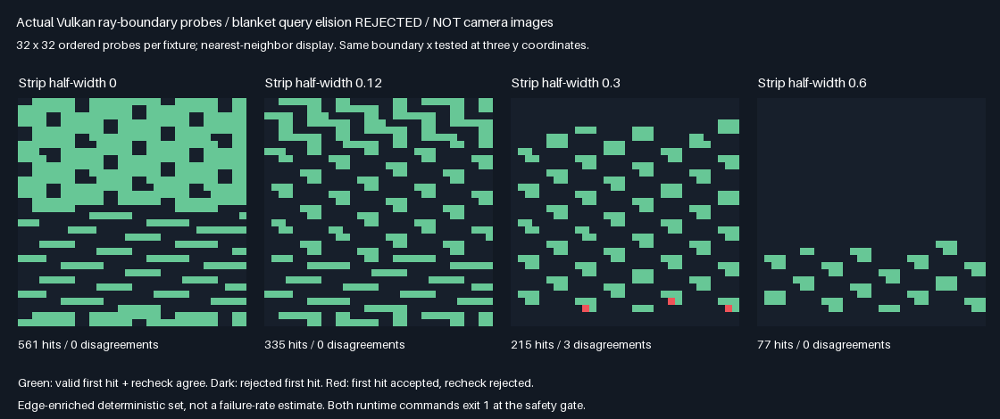

# Exact-sample nearest-facet query-budget audit

The unconditional query-elision prototype is **rejected by the frozen numerical-edge gate**. Both builds
reproduce three first-hit/recheck disagreements at one shadow-boundary configuration;the main twelve-arm
trajectory comparison is blocked,not passing. No query-saving or physical-GPU speed result is accepted.

## Reproduced outcome

| Strip half-width | Retained probes | Valid first hits | First-hit/recheck disagreements |
|-----------------:|----------------:|-----------------:|--------------------------------:|
| 0 | 1024 | 561 | 0 |
| .12 | 1024 | 335 | 0 |
| .3 | 1024 | 215 | 3 |
| .6 | 1024 | 77 | 0 |

| Decision | Outcome |
|----------|---------|
| Blanket removal of visibility rechecks | 🔴 Rejected;not numerically identical at tested boundaries |
| Existing checks/defaults | ✔️ Retained;no production change |
| Next investigation | Trace original/reconstructed rays before defining a consistent visibility contract |

The disagreements use receiver x=1,target x=−.399999887,and y=−.5/0/.5 (probe indices918/938/958). The requested
target lies at the right shadow cut plus1e-7. The original nearest-facet query accepts a secondary-square hit;
a new visibility ray through the reconstructed hit point rejects it. This isolates a non-equivalence between
the two query paths,but does **not** yet isolate the responsible arithmetic operation or prove a BVH defect.

These are three deterministic probe entries at one x configuration,not three independent failures or a
Monte Carlo failure-rate estimate. This does not invalidate earlier cohort-mean/quality results or establish
an observable game artifact. It does invalidate treating these rechecks as always redundant under the frozen
exact-sample contract. No epsilon,threshold or edge case was loosened after the failure.



Green=accepted first hit and successful recheck,dark=rejected first hit,red=accepted first hit but rejected
recheck. This is a diagnostic array,not a camera image. The prepared extent repeats the1024-case input set
across12 groups;only its first1024 entries per fixture are retained. The4,096 retained probes are not the total
number of dispatched rays,which includes identical repeats and extra recheck rays.

## Verification and blocked checks

| Check | Result |
|-------|--------|
| Compile/standard regression | Release and host ASan/UBSan build;five CTests pass each |
| Focused runtime gate | **Both commands exit1**,same numerical-edge rejection;not a successful runtime pass |
| Cross-build diagnostics | Eight identical semantic rows;39 source/tool/module hashes verified/build |
| Captures | Four raw flag arrays byte-identical;four PNG arrays exact;raw SHA256 retained in parity report |
| Shader derivation | Exact regeneration matches both compiled source inputs |
| Sanitizer findings | No host ASan/UBSan report;driver/shader instructions not sanitizer-instrumented |
| Twelve-arm trajectories | **Not run**,blocked before means,noise/candidate identity and work comparisons |
| Optimization/default acceptance | Rejected;no performance,storage or production promotion |

[Release](Results/RayBudget-release.txt), [host sanitizer](Results/RayBudget-sanitized.txt),
[rejection audit](Results/RayBudget-parity.txt). Earlier [setup](Results/RayBudget-setup.txt) and
[first boundary failure](Results/RayBudget-first-edge-failure.txt) are historical attempt logs,not live
source-hash audits or accepted measurements. The first physics attempt stopped at fixture2;the final version
collects all four fixture outcomes before applying the unchanged rejection gate.

```sh
bash Exhibits/LightCompute/RunRayBudget.sh
SANITIZE=1 BUILD_JOBS=1 bash Exhibits/LightCompute/RunRayBudget.sh
_ClaudeScratch/venv/bin/python Exhibits/LightCompute/Code/RayBudgetEvidence.py
```

The first two commands intentionally return1 while the recorded gate failure remains. The evidence script
returns0 only when it verifies this rejection and explicitly confirms no trajectory/result rows were produced.
Do not suppress the runtime exit code or reinterpret the evidence audit as optimization acceptance.

Tested Linux/GCC12.2 C++20,Slang2026.14.1/SPIR-V1.3,SwiftShader CPU Vulkan type4,Vulkan headers1.4.321,
CMake/CTest3.31.6,Python/Pillow. Both runs use base8c7e743 plus the subsequently checkpointed13d39f5 source;
logs pin the exact input hashes. Raw/build data live in ignored scratch;code,metrics,hashes and images are
retained. Earlier phase logs remain historical after the shared exhibit host adds another CLI/header.

## Next phase and limits

Instrument both query paths for the failing rays:original direction,computed hit point,reconstructed direction,
facet IDs,distances and float bit patterns. Verify neighboring representable inputs against the same geometry.
Then define and test which visibility result is authoritative before attempting query reuse again. Preserve
these exact three cases as regressions;do not hide them behind a post-hoc geometric margin.

The inherited fresh baseline is still not established as query-optimal,but simply deleting its rechecks has
not met the promised equivalence gate. Its previously measured quality gains remain separate from speed.
Physical-GPU/Windows/editor/TAA/general-scene GI acceptance remains unavailable or untested. No production
Engine/layout/default change,packing,PR or Actions run;production output stays348.046875MiB.

## Frozen protocol before measurement

Pair six inherited receiver-bank arms with six query-elided counterparts. No sampler, RNG advance, density,
normalization, candidate count, storage or refresh policy changes. This is query work, not physical-GPU timing.

| Concern | Fixed choice |
|---------|--------------|
| Arms | Legacy/fast inline area8,full bank8,rotate4/2,fresh cosine6/8;12 arms in one submission |
| Sampling | Same .75 receiver cosine/.25 known-square area mixture;fresh controls use cosine only |
| Trajectories | Same32 cohorts×1024 logical targets×16 poses×4 fixtures0/.12/.3/.6 |
| Events | Cold pose0;half-light9/restored13;same seed schedule and cyclic replacement |
| Elision1 | Cosine first-hit already proves source visibility;omit repeated source checks,including misses |
| Elision2 | Reuse source visibility already encoded by new q>.25,only for slots born at current pose |
| History | Always retrace receiver visibility for retained older candidates;never infer it from old q |
| Identity | Pointwise paired estimates<2e-6;stored candidate words equal;fast queries≤legacy per invocation |
| Fresh budget | Require exactly6/8 fewer nearest-facet calls per paired fresh6/8 invocation |
| Quality | 768 per-pose reference means within4 cohort nominal SE+.0001;all prior temporal/error metrics |
| Contrasts | Fast rotate4/2 vs fast fresh6/8,paired cohort MSE/nominal SE |
| Edges | 1024 explicit rays/fixture at square/shadow boundaries,y−.5/0/.5,16 receiver positions |
| Edge offsets | −1e-5,−1e-7,0,+1e-7,+1e-5;reconstruct actual hit point and compare first-hit/recheck |
| Safety | Any numerical edge disagreement blocks acceptance;no tolerance/holdout tuning after results |
| Captures | Cohort0 all64 output/payload submissions plus4 edge arrays;release/sanitizer parity required |
| Promotion | None automatic;production348.046875MiB/Engine/layout/defaults untouched |

q>.25 encodes birth visibility only in this fixed-normal,known-square mixture with a positive cosine density.
It is not a general-purpose visibility bit for arbitrary materials/surfaces. Slot birth is deterministic from
rotation and explicit revision rebuilds;no memory is added. Probe results do not prove every possible float ray.
Full bank and inline estimates/query counts must still match. All cost totals include cold/revision rebuilds.

Planned trajectory checks were blocked by the gate above. Reproduce: `bash Exhibits/LightCompute/RunRayBudget.sh`,
then the same command prefixed by
`SANITIZE=1 BUILD_JOBS=1`. Host sanitizers do not instrument SwiftShader/shaders;no Windows/editor/GPU timing
acceptance. Existing144B bank payload+16B telemetry remains a production storage blocker,not solved here.

A setup attempt stopped before any physics checks because the submission forbids changing receiver extent.
The corrected probe preserves the prepared extent, repeats the1024 probe set and captures/checks its first1024
results. Receiver defaults are restored before trajectories. No sampler, threshold or edge case changed.
The historical setup log is retained separately;it is not a passing runtime measurement.
