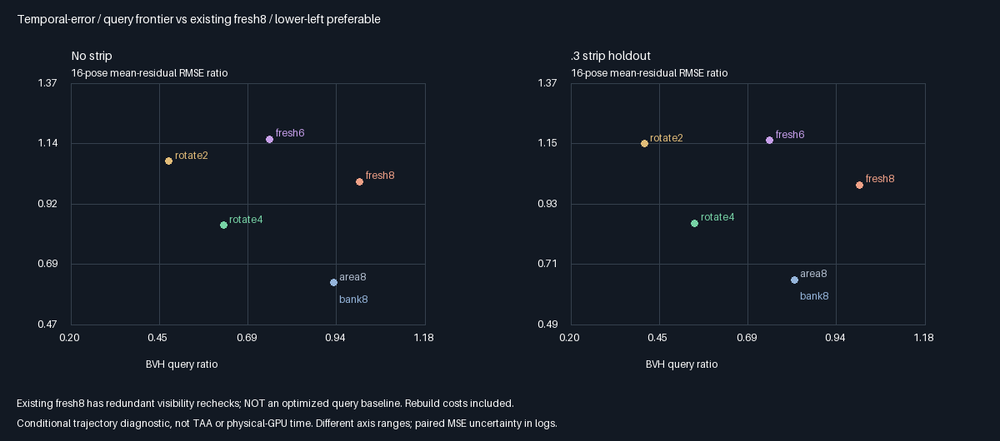
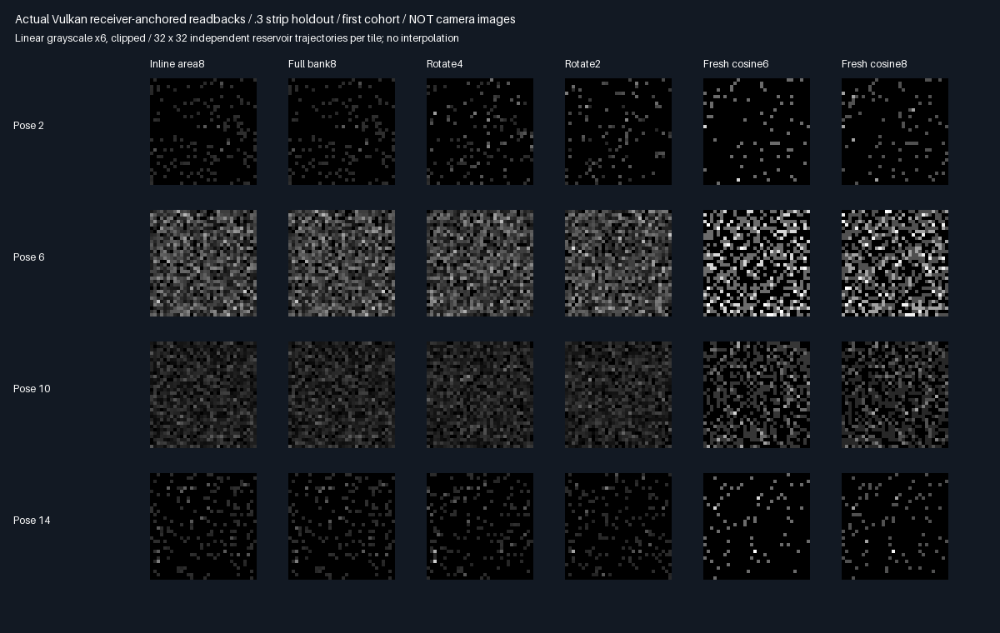

# Receiver-anchored proposals with historical candidate densities

Receiver-anchored rotate4 lowers temporal error against fresh8 on all four fixtures without adding bank storage.
A source audit also exposes redundant queries in the inherited controls, so optimized-speed acceptance is deferred.

## Verified outcome: fresh8 quality gap closed on these holdouts

| Arm | Measured quality result vs existing fresh8 | Decision |
|-----|-------------------------------------------|----------|
| Inline area8 | Lower instant/temporal RMSE in4/4;no candidate history | ⭐ Lower-storage follow-up |
| Rotate4 | Lower instant/temporal RMSE in4/4,including .3 holdout | ⭐ Retain quality result |
| Rotate2 | Higher temporal RMSE in4/4 despite lower instantaneous noise | 🔴 Not quality-neutral |
| Legacy fresh work | Contains one redundant visibility recheck per cosine draw | ⚠️ Optimized budget check next |

| Strip | Rotate4 instant RMSE reduction | Temporal RMSE reduction | Query reduction vs existing fresh8 |
|------:|------------------------------:|------------------------:|-----------------------------------:|
| 0 | 37.90% | 16.17% | 37.72% |
| .12 | 33.75% | 14.56% | 41.35% |
| .3 | 32.69% | 14.07% | 45.76% |
| .6 | 31.78% | 16.65% | 49.46% |

All four rotate4/fresh8 temporal-MSE contrasts favor rotate4 by at least24.41 nominal cohort SE, not guaranteed
confidence bounds. Versus component fresh6, temporal RMSE falls25.75–27.79% and instantaneous RMSE40.87–46.19%.
The new anchor does not universally improve the prior fixed-donor estimator: unoccluded rotate4 temporal RMSE
is slightly worse, but the previously failing .3 fresh8 gap changes from+12.70% to−14.07%. No period was tuned.

Rotate2 still increases temporal RMSE7.65%/9.49%/14.96%/3.89% versus fresh8. Its residual lag remains positive;
for the .3 fixture,rotate4/2 lag1=.3072/.4982 versus fresh8 .0005. Retention and fresh injection do not imply
independent samples. Inline area8 lowers temporal RMSE34.82–37.60% without persistent candidate history.

## Query fairness finding: do not promote these counts as optimized speed

`FreshComponent` still calls `SecondaryVisible` after every cosine proposal, including misses. Its proposal
already calls production nearest-facet traversal and rejects a first hit outside the secondary square. Thus
this explicit recheck is redundant in the intended geometry, subject to numerical-edge identity verification.
The source retains this inherited implementation to keep all136 fresh mean/result rows numerically comparable.

Query reductions above are actual counts **against that existing implementation**, not a matched, optimized
six/eight-path ray budget. The bank has repeated visibility checks too. No physical-GPU time was measured;
query count alone omits bank bandwidth/register cost. Next must compare exact-sample query-elided versions,
including misses, partial occlusion and numerical edges, before a practical speed claim or renderer promotion.
The lower RMSE is independently measured and does not rely on the redundant-query count.

## Evidence and limitations





These are logical reservoir arrays,not camera images. Display exposure6/clipping do not affect statistics.
[Full measurements](Results/ReceiverBank-comparison.md) retain every arm, error, correlation and query total.
Payload remains144B plus16B telemetry per test reservoir. The112B increment over the old single-winner payload
would cost221.484375MiB per1080p reservoir layer;it is not free space in production's348MiB layout.

## Verification

| Check | Verified outcome |
|-------|------------------|
| Builds | Release/host ASan+UBSan both exit0;five CTests each |
| Parity | 558 identical semantic rows;165 logged hashes verified/build |
| Means/identity | 384 pose means pass;full bank/inline estimates and query counts identical |
| Retention | 17,039,360 native retained-slot comparisons across32 cohorts |
| Readbacks | 128 raw captures byte-identical;24 representative PNG arrays exact |
| Independent payload audit | 1,572,864 candidates;532,480 retained slots byte-checked |
| Historical q / reconstruction | Max errors1.36e-7 /5.23e-8;196,608 bank estimates reconstructed |
| Negative controls | 30/64 CPU wrong-density means fail;27,426 cohort0 current-density disagreements |
| Null normalization | Nonnull divisor differs from correct fixed8 at128,392 cohort0 estimates |
| Controls/provenance | 136 fresh rows unchanged;derived shader source exact |

[Release](Results/ReceiverBank-release.txt), [sanitizer](Results/ReceiverBank-sanitized.txt),
[parity](Results/ReceiverBank-parity.txt). Wrong-current-density failures are10/10/8/2 by fixture. All cohort SE
and paired tests use32 independent cold cohorts;raw reconstruction uses cohort0. Histories are not independent
samples. Reused telemetry counts4/6 retained slots,0 at full rebuild;M remains8.

Tested GCC12.2 C++20, Slang2026.14.1/SPIR-V1.3, SwiftShader CPU Vulkan type4, Vulkan headers1.4.321,
CMake/CTest3.31.6, Python/Pillow. Release used baseb419528 plus prototype changes;sanitizer used671bd57 with
the same measured source hashes. Raw/build outputs are ignored scratch;metrics, images and generating code
are retained. Host sanitizers do not instrument the driver or shader instructions. Earlier source-hash logs
remain historical when the shared host gains a CLI/header;their captured results are not retroactively rerun.

```sh
bash Exhibits/LightCompute/RunReceiverBank.sh
SANITIZE=1 BUILD_JOBS=1 bash Exhibits/LightCompute/RunReceiverBank.sh
_ClaudeScratch/venv/bin/python Exhibits/LightCompute/Code/ReceiverBankEvidence.py
```

## Decision and next experiment

Retain the improved conditional-component quality result. Do not promote a production bank, declare optimized
query superiority, or infer physical-GPU speed. Known-area sampling, scalar diffuse response, stationary surfaces,
deterministic directional suffix, explicit revisions and the large payload remain restrictions. Windows/editor,
RGB/general surfaces, arbitrary multibounce GI and production TAA were not validated.

Next is an **exact-sample ray-budget audit**: remove unnecessary visibility rechecks from both fresh controls
and bank construction where first-hit information is sufficient. Verify estimate/mean/noise identity, actual
saved calls, misses, partial occlusion and numerical shadow edges before comparing work again. This does not
tune samples or change density/normalization;it tests whether the current measured query advantage survives
against a fairer implementation. Lower-storage weighted-reservoir injection remains subsequent work, not an
assumed solution. No packing, Engine/default/layout change, PR or Actions run;production stays348.046875MiB.

## Frozen premeasurement protocol

Change only the generation anchor: new draws use the current receiver position. Each retained candidate still
uses its own stored unconditional area density, including the visibility and geometry at its generation anchor.
The estimator remains sum(F_current/q_birth)/8, with canonical null draws included in M=8.

| Concern | Fixed choice |
|---------|--------------|
| Arms | Inline area8, full bank8, rotate4/2, current-receiver cosine6/8 restricted-component controls |
| Proposal | .75 cosine from generation receiver + .25 uniform over the known secondary square |
| Rotation/storage | Unchanged8 slots, replace4/2 per pose,144B payload+16B telemetry/test reservoir |
| Motion | Same16-pose x=.5−.5cos(2π pose/16), float upload, fixed normal+Z |
| Cohorts/fixtures | 32 cold cohorts×1024 trajectories;strip half-widths0/.12/.3/.6, all existing holdouts |
| Revisions | Full refresh at cold pose0, half-light9, restored-light13 |
| Seeds | MT19937-64 0x38d29a17 + fixture×0x1000193;same shared seeds/fresh controls as preceding phase |
| Correctness | 384 pose means:4 nominal cohort SE+.0001 versus independent converged clipped quadrature |
| Identity | Independent inline/full-bank pointwise difference<2e-6;query counts equal |
| Retention | All32 cohorts check unchanged retained payloads;first cohort captures all bank/output words |
| Audit | Independently infer each slot's birth pose and verify actual q_birth and current receiver estimate |
| Negative | CPU counterfactual rotate4 replaces q_birth with q_current;require at least1 failed pose mean overall |
| Metrics | Instant/16-pose mean-residual RMSE, residual-difference RMS, centered pooled lag1, actual BVH queries |
| Paired | Rotate4/2 vs fresh6/8 instantaneous/temporal MSE across32 cohorts with nominal SE |
| Promotion | None automatic;no cadence, mixture, threshold or holdout tuning after measurement |

The negative control uses actual GPU candidates but CPU analytic visibility/current density, not another GPU
arm. It isolates the denominator error;it does not independently verify a deliberately incorrect GPU program.
M stays8 despite temporal reuse. Each surviving draw's F/q term targets the same integral using its generation
density;substituting
another pose's density changes that sampling law. Slot age is inferred by deterministic rotation, without adding
anchor/age storage to the GPU payload. No balance heuristic over mixed birth proposals is introduced.

Reproduce with `bash Exhibits/LightCompute/RunReceiverBank.sh`, then `SANITIZE=1 BUILD_JOBS=1` for the host
sanitizer build. Verified results are retained above. This remains software Vulkan, not physical-GPU timing or
production TAA.
No production Engine/layout/default change;output stays348.046875MiB. The bank's existing large footprint is
not solved here;the uniform proposal still relies on one known diffuse square/deterministic directional suffix.

The subsequent [ray-budget safety audit](RayBudget.md) rejects unconditional elision at three deterministic
shadow-boundary probe entries. Its main work comparison is blocked,not passed;source-level redundancy does
not establish exact equivalence after float hit-point reconstruction. Original checks/defaults remain in place.
