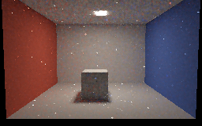
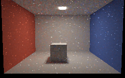
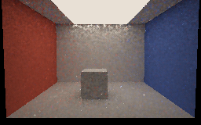
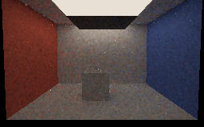
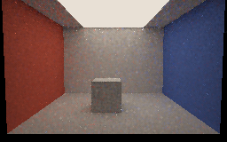

# Facet-only and balanced sampling captures

Six unfiltered 256×160 **SwiftShader CPU Vulkan** readbacks of the authored 24-triangle room. Each uses four
hits, temporal/spatial replay, and the last 12 of 24 frames averaged in linear RGB; exposure is 0.45 with
display gamma 2.2. They are not hardware-GPU or editor screenshots.

| Small source: facet-only | Small source: balanced |
|---|---|
|  [Filtered preview](Images/BalanceSmallFacetPreview.png) |  [Filtered preview](Images/BalanceSmallMixedPreview.png) |

| Large source: facet-only | Large source: balanced |
|---|---|
|  [Filtered preview](Images/BalanceLargeFacetPreview.png) |  [Filtered preview](Images/BalanceLargeMixedPreview.png) |

| Large source: blocker moved beneath it | Blocker moved away again |
|---|---|
|  [Filtered preview](Images/BalanceLargeBlockedPreview.png) |  [Filtered preview](Images/BalanceLargeReopenedPreview.png) |

Within each source-size pair, both modes use the same seed sequence and frame count; reservoir selections
can still differ. The small and large light dimensions are 0.25× and 1.8× the original room source, with
radiance scaled inversely to area. These pictures are **qualitative**, not a calibrated or equal-time benchmark.
The controlled single-receiver variance comparison, including a case where balancing worsens variance, is in
[ReplayBalance.md](ReplayBalance.md).

The moving-blocker transitions each retained 35,886 temporal guides without a global reset, capped previous
represented history at one, and used more than 147,000 spatial links. Fixed lower-image linear luminance was
0.4859 (large balanced open), 0.2234 (blocked) and 0.4851 (reopened). The previews use a display-only 9×9
geometry-guided blur that can smear shadows and spread bright outliers; validation uses unfiltered values.
These are settled frame averages, not evidence about transition-frame ghosting.

Reproduce with `bash Exhibits/LightCompute/RunReplayBalanceCapture.sh` after running
`python3 Exhibits/LightCompute/Code/Prepare.py`; Pillow is required for PNG conversion.
[Capture log and source hashes](Results/ReplayBalance-capture.txt).
