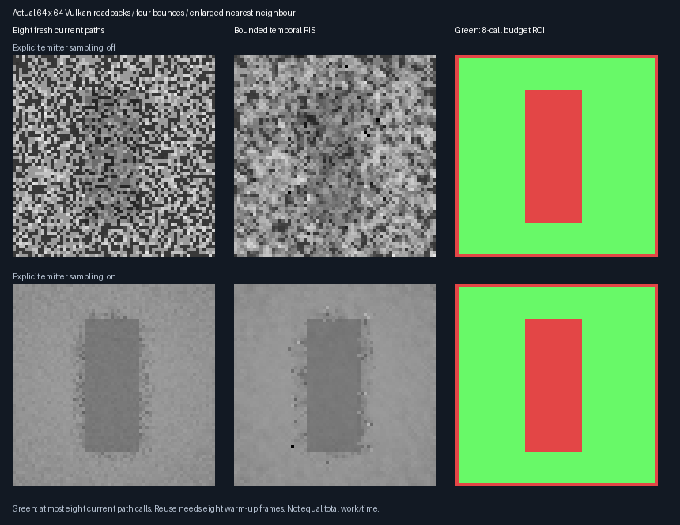
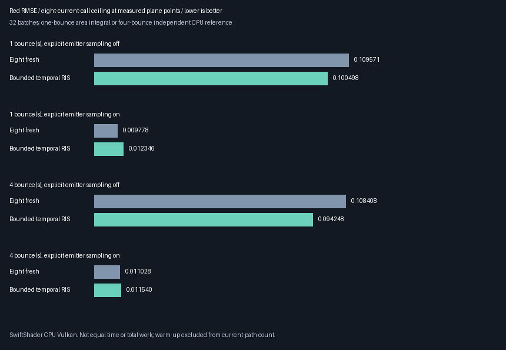

# Bounded temporal weighting and current-evaluation caching — 2026-10-28

**Implemented and tested an isolated temporal + seed-bank RIS prototype. Do not enable it generally yet.**
It improves observed four-bounce red RMSE by **13.06% without explicit emitter sampling**, but is worse with
explicit emitter sampling. Caching duplicate current evaluations preserves its numerical results and saves
real path evaluations; this is **not a measured physical-GPU speedup**. Production defaults remain unchanged.
The accepted **348.046875 MiB output-only 1080p extrapolation** remains unchanged; packing stays deferred.

## Chosen weighting

Use the selected source as a bounded proposal, not a colour blend or an independent-sample confidence estimate:

```text
n = number of current local candidates, 1..4
m = min(history represented count, n, existing domain cap)
a = sum of current local targets
b = m * history.W * target_now(history.seed)
M_new = n + m
select a local candidate or history in proportion to their target weights
W_new = (a+b) / (M_new * target_now(selected.seed))
```

History contributes at most half the **represented count**, not half the selection probability. Existing smaller
caps still apply: a camera-domain cap of one gives `M_new=5` at a four-local-candidate point. Stored `W` is not
clipped. Current radiance is evaluated at the current receiver; previous RGB is never the proposal value.
At eligible interior pixels, use **four local + one temporal + three spatial proposals**, replacing one spatial
donor rather than adding a ninth call. The omission rule is fixed before measuring quality.

The [source-measure contract](ReplayTemporalContract.md) remains required. Conditional selection expectation is
`[sum(f_now(local)) + m*history.W*f_now(history.seed)]/(n+m)`. Correlation does not invalidate this first-moment
identity when each proposal satisfies the conditional measure identity and coefficients follow eligible metadata.
It does invalidate an interpretation as independent samples. Neither the count cap nor these tests establish a
universal variance bound or a proof for the full 32-bit seed space.

### Duplicate evaluations: cache values, never delete weighted proposals

With three warm-up frames, all selected ancestral support is already in the local seed bank. An eight-frame
experiment was therefore added, before inspecting cold numerical quality results. Even then, selected history
matches one of the four local seeds in **47.6–52.5%** of measured cases. Eight proposals are not eight independent
or necessarily distinct paths. Do not reject matching seeds or change their weights.

The final derived shader caches the four local seeds and their **current receiver's just-computed radiances**.
For a matching temporal seed, use that identical value; otherwise execute the current path evaluator. Keep the
same target, selection random draw, source count and normalization. This is exact function-evaluation reuse,
not stale-history RGB reuse. It changes neither the estimator nor the pure-unselected-fresh bank.
It uses small per-invocation arrays; register pressure, spills and hardware occupancy remain unmeasured.

## Actual readbacks and all-condition quality



These are actual **64×64** readbacks enlarged with nearest-neighbour, not generated illustrations. Green marks
eligible plane points with an eight-current-call **ceiling**: an exact duplicate cache hit reduces execution to
seven calls. Outside this mask the candidate budget differs; do not infer whole-image equal-work quality.



The numerical experiment uses 32 paired seed batches per method and **702 fixed measured pixels** at 32×32.
The final cached results exactly match all reference/quality/paired/overlap rows of the retained uncached run.
The log's legacy `paths_at_measured_pixel=8` denotes the logical budget after caching, not eight executed calls.

| Bounces | Explicit emitter sampling | Fresh8 red RMSE | Temporal red RMSE | Observed change |
|---------|---------------------------|-----------------|-------------------|-----------------|
| 1 | Off | 0.109571180 | 0.100497665 | 8.28% lower |
| 1 | On | 0.009777516 | 0.012346260 | 26.27% higher |
| 4 | Off | 0.108407948 | 0.094248025 | **13.06% lower** |
| 4 | On | 0.011027660 | 0.011540377 | 4.65% higher |

All mean/reference gates pass; **those gates do not require a quality advantage**. The four-bounce/no-emitter
paired MSE change is `−0.002869593 ± 0.001356281` nominal batch SE, about 2.12 SE. The one-bounce/no-emitter
change is `−0.001906063 ± 0.002116960`, only 0.90 SE. With emitter sampling the changes are
`+0.0000568303 ± 0.0000151830` and `+0.0000115710 ± 0.0000091978`. These are exploratory four-condition
comparisons, not multiplicity-adjusted confidence guarantees; lower observed RMSE is not a universal win.

One-bounce reference: independent rectangle integration, refined 64→128 quadrature discrepancy RMSE
`0.000308311`, reference mean `0.106954529`. Four-bounce reference: **4096 CPU paths per measured pixel**,
2,875,392 total, reference mean `0.117948240`, nominal reference-mean SE `0.000180067`.
Reference noise and finite sample coverage remain limitations. Error is red-channel RMSE, not perceptual RGB.

## Work, startup and controls

`BOUNDED_WORK` records full-32×32-image current and warm-up calls, not just masked pixels. Each condition
uses 32 current submissions per method; reuse additionally uses **256 warm-up submissions**. Fresh executes
262,144 current path calls. Uncached temporal executes 252,672 current + 1,847,296 warm-up calls.
Cached full-image work, per condition:

| Bounces | Emitter sampling | Current calls | Warm-up calls | Saved current calls vs uncached |
|---------|------------------|---------------|---------------|---------------------------------|
| 1 | Off | 237,837 | 1,675,427 | 14,835 / 5.87% |
| 1 | On | 236,398 | 1,675,855 | 16,274 / 6.44% |
| 4 | Off | 237,463 | 1,675,242 | 15,209 / 6.02% |
| 4 | On | 236,380 | 1,675,811 | 16,292 / 6.45% |

The [final release log](Results/ReplayBoundedTemporal-release.txt) gives cached counts and indirect queries;
`BOUNDED_CACHE` reports exact current evaluations saved relative to uncached temporal. A path call is not a
fixed number of rays, and neither count is a frame-time measurement. Cached work is still much larger when
all benchmark warm-up is charged. Independent batches deliberately restart history; that cost is not a measured
steady-state game cost, nor should it be hidden as free history.

The retained **three-warm-frame startup control** produced Fresh8→uncached-temporal RMSE:
`0.108974477→0.112890422`, `0.009669253→0.012356974`, `0.107816053→0.103042245`,
`0.010959174→0.011632154`, in the same four-condition order. It also passed mean gates but did not establish a
general quality advantage. Its uncached work is 252,672 current + 549,376 warm-up calls per condition.
Cold and eight-warm cases consume different MT draws; their differences are **not paired causal age estimates**.
No seed/radiance rejection or post-result weight tuning was introduced.

## Validation, provenance and scope

- Exhaustive overlapping finite model: **24 configurations, 491,520 outcome visits**, maximum seed-basis error
  `9.78492460668e-18`. Shared ancestral seeds are included, not treated as independent.
- Cached versus uncached GPU control: **18 paired frames**, exact float output and nine reservoir/bank slabs,
  unchanged proposal admission/rejection counters, and **11,960 saved path calls** with exact accounting.
- Fresh8 rectangle control: 818 points, eight edge exclusions, zero maximum RGB discrepancy; poisoned old
  history cannot affect Fresh8 output. Four malformed-source cases exactly equal absent-history finite output.
- Both source-off captures verify scene-change reset, zero selected/bank history and **4096 black pixels** each.
  They are reset tests, not claims that arbitrary non-reset animated transport is solved.
- Release and **host-only ASan/UBSan** run the same experiment plus five CTests. The external driver and shaders
  are not sanitizer-instrumented. SwiftShader is CPU Vulkan, not physical RTX/GTX evidence.
- **40 logged digests per configuration and 66 bounded rows** match across the final release/sanitizer runs.
- [Parity audit](Results/ReplayBoundedTemporal-parity.txt) checks logged final file hashes, semantic rows, decoded
  captures, reproducible derived source, uncached shader identity and all five unchanged production shaders.
  The separate authoring/presenter/audit hashes are recorded post-run. Cold/uncached header hashes are historical
  snapshots, not assertions that earlier harness files equal today's harness.
- The production shader and production prohibition on selected-temporal + seed-bank RIS are unchanged. Only
  a fail-closed exhibit derivation enables this combination. No renderer/editor feature was silently enabled.

### Reproduce

From the repository root, with pinned dependencies prepared:

```bash
CAPTURE=1 bash Exhibits/LightCompute/RunReplayBoundedTemporal.sh
SANITIZE=1 CAPTURE=1 BUILD_JOBS=1 bash Exhibits/LightCompute/RunReplayBoundedTemporal.sh
_ClaudeScratch/venv/bin/python Exhibits/LightCompute/Code/ReplayBoundedTemporalImages.py \
  _ClaudeScratch/replay-bounded-temporal-capture-release/png \
  Exhibits/LightCompute/Results/ReplayBoundedTemporal-release.txt \
  Exhibits/LightCompute/Images
_ClaudeScratch/venv/bin/python Exhibits/LightCompute/Code/ReplayBoundedTemporalParity.py
```

Optional `BOUNDED_WARMUP=3` selects startup; use distinct `RESULTS`, `OUTPUT` and `IMAGES` paths to preserve
main evidence. The retained uncached shader is also compiled for cache parity. Exact historical uncached/cold
benchmarks used the pre-cache harness; their immutable numerical logs are retained separately.

## Decision and next acceptance boundary

**Keep bounded weighting and exact current-evaluation caching as validated prototype components; reject general
promotion for now.** Explicit emitter sampling is a strong practical baseline and still wins here. Do not remove
it to advertise the favorable no-emitter case. Next rendering work should test independently seeded, broader
motion/material/light fixtures with emitter sampling enabled and physical-GPU equal-time quality, including
warm-up amortization and cache register cost. Only then decide production integration. Windows/editor,
hardware ray queries, full-game GI and total 1080p VRAM acceptance remain open.


### Subsequent checkpoint

The [independent emitter-enabled holdout](ReplayTemporalHoldout.md) adds an exhibit CLI include to the main C++
source. This report's original source manifest identifies its completed checkpoint, not an assertion that the
current CLI file is unchanged forever. Its numerical logs and shader digests remain retained. Use the holdout
source audit for the newer executable; the shader algorithm and production defaults remain unchanged.
