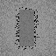
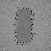

# Strict diffuse camera reprojection for replay GI

The Engine replay reconstruction has a **default-off**, narrow way to retain colour through a camera-only
transition. It applies only to the existing untextured Lambertian diffuse replay path with primary visibility,
a static opaque triangle scene and unchanged lighting and sampling. It is **not** general camera or object
motion reconstruction, a rough-reflection denoiser, hardware ray tracing, non-ray-traced GI, unified PBR or
an editor viewport. The renderer is still the bounded software triangle-BVH path exercised in an exhibit.

## Safety boundary and contract

- In `PathReplayDomainSpecification`, opt into `DiffuseCameraReprojection` and run
  `ValidatePathReplayDomain` on the exact scene that will be uploaded. This mode rejects non-primary,
  rough-opaque and textured requests, non-finite/skewed camera bases, invalid clipping/field of view and
  invalid optical guides. It additionally bounds geometry and the camera parameters. The validation host
  also requires reconstruction to be enabled. The Vulkan recorder rejects incompatible flag combinations
  before recording, but **cannot inspect GPU buffer contents**.
- `PathReplayHistoryDomain::Resolve()` snapshots receivers, facets, BVH enclosures/corners, material data,
  camera and the replay specification. `CameraOnly` means that the camera changed, all tracked non-camera
  inputs and sampling are unchanged, non-camera motion metadata is unchanged, and the supplied previous
  projection matches the preceding current projection byte-for-byte. Camera snapshots are byte-compared,
  including signed zero. A BVH change now invalidates the history decision even without camera movement.
  Snapshot copying is linear in scene data; no production scalability or performance claim is made.
- Only when the previous submission actually completed successfully, history allocations and reuse policy are
  unchanged, and that decision is true may the caller omit `PathReplayResetReconstruction` for a camera
  transition and set `PathReplayDiffuseCameraReprojection` for that transition. Otherwise reset colour. Reset
  on first use, resizing/reallocation, disabling or re-enabling reconstruction or this policy, a reservoir
  temporal/spatial-policy change, and any other relevant untracked revision. The domain object commits its
  snapshot during `Resolve`, not during GPU submission: if recording/submission fails, invalidate it and reset
  the GPU history before subsequent use. The domain and recorder do not own histories, synchronization,
  successful submission or all external scene state. The [recorder contract](PathReplayEngine.md) still applies.
- During a certified transition, the gather checks a positive matching token and **exact floating-point equality**
  of current, motion-reprojected and previous world position and normal. Material, optics, material address and
  emission must also match exactly; prior colour/history length must be valid. Only the view comparison is
  omitted. This is appropriate for this replay mode because its primary diffuse response is Lambertian and
  view-independent; it is not appropriate for the generic Fresnel-dependent diffuse helper, textured ray
  footprints or rough/specular response. Misses, disocclusions, mismatches and out-of-bounds coordinates start
  fresh. Float coordinates outside a safe integer conversion range, including non-finite coordinates, are
  rejected before gather or reservoir-history indexing.
- A camera-domain change still caps prior **reservoir** history at one unless the audit override is requested;
  that is separate from colour history. Multiple fresh candidates, retraced reservoirs and capped colour are
  not independent by construction. As in the existing stage, the first 16 compatible updates form a running
  average; later updates use weight `1/16` and are not a sliding window. It can lag rare bright paths.

Exact equality is deliberately restrictive. Floating-point projection differences make the acceptance pattern
patchy, and many ordinary movements accept nothing. A half-pixel shift in the fixture below accepted **zero**
colour histories. A caller that falsely certifies an untracked geometry, material, lighting or policy change can
still cause ghosting. Static input checks and a matching pixel do not establish temporal correctness under
animation, lens changes outside the snapshot, transparency, volumetrics, moving lights or disocclusions in
arbitrary scenes. No equal-time speedup, universal bias/variance guarantee or physical-GPU result is claimed.

## Controlled checks

In a `32 × 32` one-bounce scene, an opaque rectangle partly occludes a two-triangle area emitter above a
Lambertian plane. Two paired submissions use the same seeds: one retains colour from eight previous stationary
frames and the other reports the current raw output. The camera translates by `0.0625` world units, one
pixel on the plane. An independent C++ area integral intersects the blocker analytically instead of using
the GPU BVH; a `128 × 128` emitter grid and `64 × 64` grid differ by red-channel RMSE `0.000332` across
accepted plane points.

| Check | Result on SwiftShader CPU Vulkan |
|---|---|
| Single fresh candidate, reservoir reuse off | 290 exact colour matches; 734 rejected; 22 token/disocclusion mismatches; every rejected output bit-equal to raw |
| Area reference on the 290 accepted points | Raw red RMSE `0.0328993`; retained-colour RMSE `0.0105452`; ratio `0.321` |
| Four candidates plus temporal/spatial reservoir reuse | 290 colour matches; 970 reservoir accepts; 3,968 spatial links; host colour recurrence maximum error `0` |
| Nearly matching guide controls | Five individual `1e-6` position, normal, material, optics or emission changes rejected; 285 unaffected histories retained |
| Revision controls | Blocker, emission, material, previous projection, motion metadata and BVH-bound changes reset colour and match raw |
| Other guards | Half-pixel motion gives zero accepted; default-off and enabling-policy transitions reset; invalid mode/camera requests reject |

The RMSE comparison consumes eight previous frames in addition to the current frame; it is not equal work or
a general convergence guarantee. The area grid is a numerical reference for this small fixture, not observed
radiometric data. Four-candidate/reservoir figures check composition, not an independently verified random
stream or general unbiased adaptive reuse. Host ASan/UBSan and release numerical rows agree; the external driver
and shaders are not sanitizer-instrumented. Recorder mocks exercise invalid requests before recording, while
an invalid camera leaves the validation host's submission sequence unchanged. The bounded reconstruction and
candidate suites pass, including an extreme-coordinate reservoir/colour rejection. Twenty default-mode float
images match the older replay shader, 14 separate mixture-on moving-radiant PPMs match earlier captures, and
five CTests pass. The longer regressions preceded a portable, same-size camera-snapshot expression change;
final camera checks and CTests were rerun after it, as recorded in the regression log.

## Four-bounce reference and repeated camera transitions

A second scene uses the same plane, emitter and blocker with four diffuse bounces, a `0.025` uniform
three-channel environment, one fresh candidate and **no** temporal/spatial reservoir reuse or explicit facet
sampling. An independent double-precision CPU tracer uses brute-force triangle intersections, a different
orthonormal sampling frame and `mt19937_64` rather than the shader's PRNG/BVH. It models the same bounded
Lambertian transport and ray offsets, so it is an independent numerical implementation, not measured physical
truth. For each of the 290 exactly matched floor points it traces 4,096 CPU paths: 1,187,840 total. The RMS
of the corrected per-point CPU standard errors is `0.004736`.

Sixteen additional seed batches each contain eight stationary history updates and one translated frame. The
sample-corrected batch standard errors below are **nominal**: correlations in the finite GPU PRNG streams
remain an open concern. The same CPU point references are used for all 16 batches.

| Quantity, red channel | CPU reference | Current raw | Reprojected colour |
|---|---:|---:|---:|
| Mean over 290 points × 16 batches | `0.116197 ± 0.000278` nominal CPU mean SE | `0.112494 ± 0.004548` batch SE | `0.117898 ± 0.001816` batch SE |
| RMSE against per-point CPU means | — | `0.298553` | `0.101150` |

The filtered output uses eight extra frames, so the `0.339` RMSE ratio is not an equal-time speedup. A paired
one-bounce control confirms that 35 pixels in the first four-bounce raw frame receive additional indirect
contributions. Its retained-colour recurrence agrees with the host within `1.87e-9`. Moving the blocker while
moving the camera resets all four-bounce colour, and reopening resets it again; both match the corresponding
unfiltered replay output bit-for-bit. This is a conservative transition control, **not** dynamic colour reuse.
The finite reference and repeated batches do not prove general unbiasedness, independence or temporal safety.
A separate [dynamic camera/blocker study](ReplayDynamicCamera.md) checks four-bounce temporal and spatial
reservoir replay against CPU paths while colour remains reset.

## Diagnostic readbacks

These direct `64 × 64` readbacks use 12 stationary prior frames, one one-pixel camera translation, one fresh
path candidate and no reservoir reuse. Both colour images use the same current seed, exposure `3`, exponential
tone mapping and gamma `2.2`. Green in the mask means retained colour; red means raw colour. Only 1,484 of
4,096 pixels were accepted; 2,612 rejected pixels match raw bit-for-bit. The noisy/checkerboard pattern is an
honest consequence of exact matching, not a production-quality denoiser or proof of visual fidelity.

| Current raw | Strictly reprojected | Acceptance mask |
|---|---|---|
|  |  |  |

## Reproduce

Requires the prepared Slang/SwiftShader tools, Vulkan headers, CMake and a C++20 compiler; Pillow is needed
for captures. The external Vulkan driver and shaders are not sanitizer-instrumented.

```bash
RESULTS="$PWD/Exhibits/LightCompute/Results/ReplayCameraMultibounce-release.txt" \
  bash Exhibits/LightCompute/RunReplayCameraReprojection.sh
RESULTS="$PWD/Exhibits/LightCompute/Results/ReplayCameraMultibounce-sanitized.txt" \
  SANITIZE=1 BUILD_JOBS=1 bash Exhibits/LightCompute/RunReplayCameraReprojection.sh
# Optional: set CAPTURE=1 and IMAGES to a destination directory for the one-bounce diagnostic PNGs.
```

[Original camera release](Results/ReplayCameraReprojection-release.txt) ·
[Original camera host ASan/UBSan](Results/ReplayCameraReprojection-sanitized.txt) ·
[Four-bounce release](Results/ReplayCameraMultibounce-release.txt) ·
[Four-bounce host ASan/UBSan](Results/ReplayCameraMultibounce-sanitized.txt) ·
[Four-bounce regressions](Results/ReplayCameraMultibounce-regression.txt) ·
[Earlier reconstruction, candidate, image-parity and CTest regressions](Results/ReplayCameraReprojection-regression.txt) ·
[Existing bounded reconstruction](ReplayReconstruction.md) · [Candidate tests](ReplayCandidates.md).
