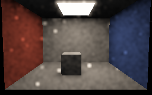
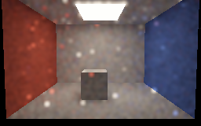
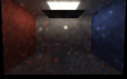
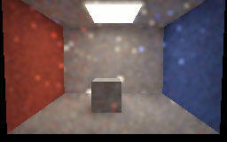

# Diffuse path-replay captures

These are four **actual Vulkan readbacks** of an authored 24-triangle scene rendered on SwiftShader CPU Vulkan,
not editor or hardware-GPU captures. Each pixel uses primary visibility plus fresh, temporal and spatial
random-sequence replay; paths are retraced against the current BVH. Each image averages the final 24 of 48
frames in linear RGB, then applies exposure 0.45 and display gamma 2.2.

The images shown below are **filtered previews**: a 9×9 geometry-guided Gaussian averages linear RGB only
across matching surface tokens and similar normals. It reduces noise but can blur shadows and spread
bright outliers; it is not used for validation. Follow the links under each image for the original noisy
readback. Bright speckles are real variance in this prototype, not calibrated detail.

| One hit (open) | Four hits (open) |
|---|---|
|  [Raw readback](Images/ReplayRoomOne.png) |  [Raw readback](Images/ReplayRoomOpen.png) |

| Four hits, blocker moved under lamp | Four hits, blocker moved away again |
|---|---|
|  [Raw readback](Images/ReplayRoomBlocked.png) |  [Raw readback](Images/ReplayRoomReopened.png) |

The moving-blocker sequences reused history without a global reset: 35,886 temporal records were accepted
on each transition, the represented-history cap was one on the transition frame, and more than 147,000
spatial links were considered. A fixed lower-image region in the **unfiltered linear data** had mean luminance
0.4534 for one hit, 0.5636 for four hits open, 0.0219 blocked, and 0.5379 reopened. This is a sanity check on
the authored scene, not an independent photometric reference or a claim of statistical independence between
pixels/frames. These images and averages are not the numerical validation fixtures in
[PathReplay.md](PathReplay.md).

Reproduce with `bash Exhibits/LightCompute/RunPathReplayCapture.sh` after preparing the pinned tools with
`python3 Exhibits/LightCompute/Code/Prepare.py`; Pillow is needed for PNG conversion. The script selects the
repository virtual environment when available. [Capture log and exact source hashes](Results/PathReplay-capture.txt).
